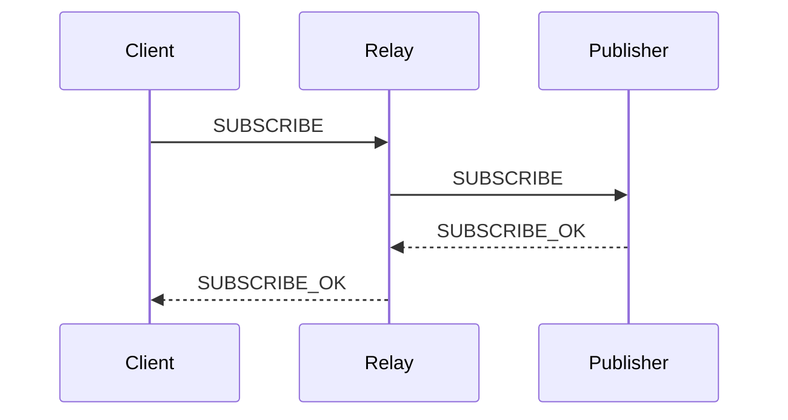

# Create Pull Request

## Steps

1. Inspect the branch: `git status`, `git diff origin/master...HEAD`, `git log origin/master..HEAD --oneline`. Split lower-layer or refactor changes into stacked PRs first (*Lower Layers* in `.agents/rules/coding-style.md`).
2. Run *Ponytail Review* and apply cuts until it replies `Lean already. Ship.`
3. Run *Comment Review* via subagent and apply its edits.
4. Delete resolved TODOs in `docs/todos/` and update stale docs (`todo-start` skill).
5. Run *Lint* for all touched areas and fix every failure.
6. Commit remaining work (English, Conventional Commits per `AGENTS.md`).
7. Push: `git push -u origin <branch>`.
8. Draft title and body, run *Review Before Posting* via subagent, and apply edits.
9. Open or update the PR against `master` (prefer environment PR tools such as `pull_request_create` / `pull_request_update`; fallback: `gh pr create --base master --title <title> --body <body>`). Update an existing PR rather than creating a duplicate.
10. Report the PR URL.

## Plugins

Two steps rely on third-party plugin skills declared in `.claude/settings.json` (which sets `PONYTAIL_DEFAULT_MODE=off` so only skills load):

| Plugin | Skill |
| --- | --- |
| [ponytail](https://github.com/DietrichGebert/ponytail) | `ponytail-review` |
| [i-have-adhd](https://github.com/ayghri/i-have-adhd) | `i-have-adhd` |

When Claude Code's Skill tool cannot load a skill (e.g. Codex, T3 Code, or `disable-model-invocation: true`), read the first existing file among:
1. `~/.agents/skills/<skill>/SKILL.md`
2. `<installPath>/skills/<skill>/SKILL.md` using the latest `installPath` of `<plugin>@<plugin>` in `~/.claude/plugins/installed_plugins.json`

If not found on disk, stop and ask the user to install the plugin—do not improvise.

## Ponytail Review

Run `ponytail-review` on `git diff origin/master...HEAD` on every PR request (including desktop "Create PR" and even if QA was waived).

- Invoke via Skill tool in Claude Code, or load from disk (*Plugins*) and follow it directly.
- Apply every cut except items the user explicitly requested by name (an API, option, or test).
- If a finding reveals a bug (e.g. diverged duplicate logic), fix it in a separate `fix` commit instead of folding it into the cut.

## Comment Review

Send every comment and doc comment added in the diff, with surrounding code, to a subagent running both checks in *Review Before Posting*. Ask for revised comments plus a one-line reason per edit.

For comments, *Redundancy* means restating surrounding names, types, control flow, or test names—delete such comments rather than shortening them.

## Lint

Run checks for every touched area regardless of how files were edited (the PostToolUse hook in `.claude/settings.json` only formats Edit/Write changes). Fix failures properly; never loosen checks.

- **Rust**: `Lint (Rust)` in `AGENTS.md`. If touching wasm-built crates (`sdk/js`, `crates/moqt`, `crates/broadcast`, `crates/telemetry`, `crates/telemetry-report`, `crates/mediapack`, `crates/msf`), also run `Lint (Rust, wasm32)`.
- **Browser SDK / examples** (`sdk/js/js/`, `examples/browser/`): run `npm ci` first (pins prettier), then `Lint (JavaScript)` in `AGENTS.md`. When touching code in `sdk/js/` or `examples/browser/`, also run `Wasm / JS SDK` in `AGENTS.md`, `npm run lint -w moq-wasm && npm run lint -w browser-examples`, `npm run lint:promises -w moq-wasm`, `npm run api:check -w moq-wasm`, and `npm run check:pack -w moq-wasm`.
- **Console web** (`services/console/web/`): `Console web` in `AGENTS.md`.
- **Python** (`sdk/python/`, `examples/python/`): `Test (Python)` in `AGENTS.md` for each affected directory.

## Title

- Japanese, prefixed with Conventional Commits type and scope matching the commits (`feat(relay): ...`).
- State what changed, not how.

## Body

- Start from `.github/pull_request_template.md`, replace HTML comments, and keep heading wording and order. Write in Japanese (except release notes).
- Always keep `## 概要` and `## やったこと`. Delete any other section that would only say `なし` or repeat another section.
- **Line limit**: aim for 1 line per section, max 3 lines (bullets count as lines; group related changes instead of listing files). Release note sections are exempt.

### Section Rules

| Section | Rule |
| --- | --- |
| `## 概要` | ≤3 lines: why, what, and anything reviewers must know first. Never pad to 3. |
| `## 関連タスク` | `#<IssueNumber>`. Public OSS repo: never paste internal tracker URLs. |
| `## やらないこと` | Work deliberately excluded. |
| `## 影響範囲` | Affected crates and whether breaking (`moqt` affects the whole workspace). For a `fix` affecting an SDK user, also state the first affected release (`git tag --contains <bug-commit> --list '<prefix>*' --sort=v:refname \| head -1`, prefix `js-sdk-v` / `python-sdk-v` / `rust-sdk-v`, or `未リリース`) and the MoQT draft version (`draft-14` / `draft-18`) if version-specific. |
| `## テスト` | Commands actually run and results; note any skipped checks. |
| `## リリースノート` / `## リリースノート（Python）` / `## リリースノート（Rust）` | Include only when visible to that SDK's users (API, behavior, or user-facing bug); add one per affected SDK tailored to its API. English bullets in the style of `sdk/js/js/CHANGELOG.md`, `sdk/python/CHANGELOG.md`, or `sdk/rust/CHANGELOG.md` (ready to copy verbatim); prefix breaking changes with `Breaking:` plus migration. Collected by `release-*` skills. Never edit those `CHANGELOG.md` files outside a release PR. |

### Do Not Write

Cut any sentence whose truth follows automatically from the change:
- Expected benefits or significance (`「〜できるようになります」「〜が改善されます」「〜の負担が減ります」`)
- Generic best-practice claims (`「規約が統一されていると保守しやすくなります」`)
- Unmeasured effects (give a number + condition, or omit)

Example cut from an `AGENTS.md` PR:
> エージェントと人間が、同じ規約を読み込んだ状態で作業を始められます。

## Review Before Posting

Never post the first draft. Pass the drafted title and body to a subagent for both checks below, asking for revised text plus a one-line reason per edit. It may cut, reorder, renumber, or delete whole sections, but must not add facts. Re-verify line limits after applying edits.

- **Redundancy**: cut anything restating the diff, a heading, or another section; repo background reviewers already know; filler/hedging; and automatic benefit claims (*Do Not Write*).
- **i-have-adhd**: `disable-model-invocation: true` prevents Skill tool loading—have the subagent read `i-have-adhd` from disk (*Plugins*). Apply its rules as a single response to the reviewer, skipping turn-to-turn state, time estimates, and closers.

## Mermaid Diagrams

Place under `## やったこと` only when prose is hard to follow (message flows, state transitions, new module dependencies). Skip for doc edits, dependency bumps, single-function fixes, or file-list restatements.

