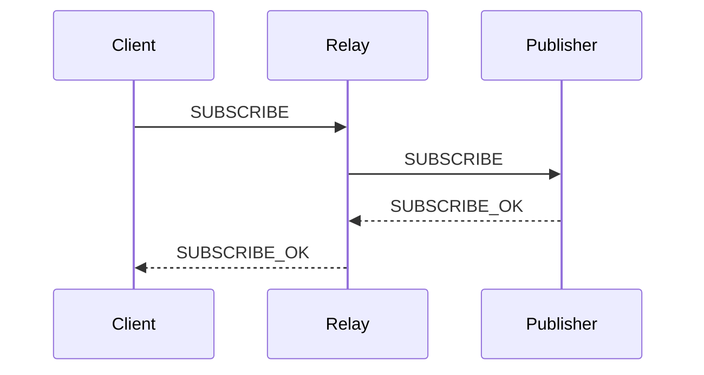

# Create Pull Request

## Steps

1. Review the change: `git status`, `git diff origin/master...HEAD`, and `git log origin/master..HEAD --oneline`. If it holds a lower-layer change or a refactor together with the change built on it, split it into stacked PRs first (*Lower Layers* in `.agents/rules/coding-style.md`).
2. Run the ponytail review on the diff and apply its cuts (see *Ponytail Review*). Repeat until it answers `Lean already. Ship.`
3. Have a subagent review the comments the diff adds (see *Comment Review*) and apply its edits.
4. Delete each TODO in `docs/todos/` that the diff resolves, and update the docs it makes stale (see the `todo-start` skill).
5. Run the lint CI runs and fix what it reports (see *Lint*).
6. Commit any uncommitted work. Commit messages are English and follow the Conventional Commits rules in `AGENTS.md`.
7. Push the branch: `git push -u origin <branch>`.
8. Draft the title and body, then have a subagent review them (see *Review Before Posting*) and apply its edits.
9. Create the PR (base `master`, with the drafted title and body). Use the environment's PR tools (e.g. `pull_request_create` / `pull_request_update`) when available; otherwise use `gh pr create --base master --title <title> --body <body>`.
   - If a PR already exists for the branch, push the new commits and update the existing PR instead of creating a duplicate.
10. Report the PR URL.

## Plugins

Two steps run skills from third-party plugins rather than rules written here:

| Plugin | Skill |
| --- | --- |
| [ponytail](https://github.com/DietrichGebert/ponytail) | `ponytail-review` |
| [i-have-adhd](https://github.com/ayghri/i-have-adhd) | `i-have-adhd` |

`.claude/settings.json` declares both, so Claude Code offers to install them when the repository is opened. It also sets `PONYTAIL_DEFAULT_MODE=off`, which keeps ponytail's always-on mode out of sessions here; only its skills load. In environments without Claude Code's Skill tool (such as Codex or T3 Code), read the installed `SKILL.md` directly from disk as described below. If a skill file cannot be found anywhere on disk, stop and ask the user to install the plugin; do not improvise the review.

## Ponytail Review

Run `ponytail-review` on `git diff origin/master...HEAD`. It lists cuts and does not apply them. Run it every time a PR is requested, including via the desktop "Create PR" command and when the user has waived QA.

- In Claude Code, invoke the `ponytail-review` skill.
- Otherwise, read the first existing file among `~/.agents/skills/ponytail-review/SKILL.md` and `skills/ponytail-review/SKILL.md` under the latest `installPath` of `ponytail@ponytail` in `~/.claude/plugins/installed_plugins.json`, and follow its instructions directly.

Apply every cut except those that remove something the user asked for by name (an API, an option, a test). A finding that exposes a bug, such as duplicated logic that has diverged, is fixed in its own `fix` commit rather than folded into the cut.

## Comment Review

Pass every comment and doc comment the diff adds, each with the code around it, to a subagent running the two checks in *Review Before Posting*. Ask for the revised comments plus a one-line reason per edit. For a comment, the Redundancy check reads "restates the diff" as "restates what the surrounding names, types, control flow, or test names already say"; delete such a comment instead of shortening it.

## Lint

Run the checks for what the diff touches, every time, whether the files were changed with Edit, Write or a shell command. The PostToolUse hook in `.claude/settings.json` formats only files written with Edit and Write.

- Rust: `Lint (Rust)` in `AGENTS.md`. When touching crates the wasm module builds from (`sdk/js`, `crates/moqt`, `crates/broadcast`, `crates/telemetry`, `crates/telemetry-report`, `crates/mediapack`, `crates/msf`), also run `Lint (Rust, wasm32)` in `AGENTS.md`.
- Browser SDK and examples (`sdk/js/js/` or `examples/browser/`): run `npm ci` first in this checkout so prettier is the version its lock file pins, then run `Lint (JavaScript)` in `AGENTS.md`. When touching `sdk/js/` or `examples/browser/` code, also run `Wasm / JS SDK` in `AGENTS.md`, `npm run lint -w moq-wasm && npm run lint -w browser-examples`, `npm run lint:promises -w moq-wasm`, `npm run api:check -w moq-wasm`, and `npm run check:pack -w moq-wasm`.
- Console web (`services/console/web/`): `Console web` in `AGENTS.md`.
- Python (`sdk/python/` or `examples/python/`): `Test (Python)` in `AGENTS.md` for each affected directory.

Fix a failure with the formatter or by hand, never by loosening the check.

## Title

- Write in Japanese.
- Prefix with the Conventional Commits type and scope, matching the commits: `feat(relay): ...`.
- State what changed, not how it was implemented.

## Body

Start from `.github/pull_request_template.md` and replace each HTML comment with the actual content. Keep the order and wording of the headings you keep.

Delete a section outright when it would only hold `なし`, or when its content restates another section. An empty heading makes the reader stop for nothing, so an omitted section is better than a filled-in one that says nothing. `## 概要` and `## やったこと` are always present.

Keep every section to one line where possible, and never more than three lines. Bullets count as lines: group related changes into a single bullet rather than listing every file. A section that will not fit in three lines usually means the PR is too large, or that the detail belongs in the diff rather than the description.

Section rules:

- `## 概要` — at most 3 lines: why the change was needed, what was done, and anything the reviewer must know before reading the diff. Stop at two lines when there is no third fact. Never pad to three.
- `## 関連タスク` — link issues as `#<IssueNumber>`. This repository is public OSS, so never paste internal tracker URLs.
- `## やらないこと` — state what was deliberately left out, so reviewers do not look for it.
- `## 影響範囲` — name the affected crates and whether the change is breaking for dependents. `moqt` is the central crate, so changes there affect the whole workspace.
  - For a `fix` PR that affects an SDK user, also state the first release that contains the bug (`git tag --contains <commit that introduced the bug> --list 'js-sdk-v*' --sort=v:refname | head -1`, with `'python-sdk-v*'` for the Python SDK and `'rust-sdk-v*'` for the Rust SDK, or `未リリース` when no tag contains it). State the MoQT draft version (`draft-14`, `draft-18`) when a bug occurs on only one of them.
- `## テスト` — the commands actually run and their results. If a check was skipped, say so.
- `## リリースノート` — present only when the change is visible to a user of the browser SDK (`moq-wasm`): its API, its behaviour, or a bug they could hit. One or more English bullets in the style of `sdk/js/js/CHANGELOG.md`, written to be copied there as they are; start a breaking change with `Breaking:` and show the migration. The `release-sdk` skill collects these sections when it releases. The rest of the body stays Japanese, and the three-line limit does not apply to this section.
- `## リリースノート（Python）` — the same for a user of the Python SDK (`moq-wasm` in `sdk/python`), in the style of `sdk/python/CHANGELOG.md`; the `release-python-sdk` skill collects these sections.
- `## リリースノート（Rust）` — the same for a user of the Rust SDK (`moq-wasm` in `sdk/rust`), in the style of `sdk/rust/CHANGELOG.md`; the `release-rust-sdk` skill collects these sections.

A change the users of several SDKs notice, such as one in `moqt`, gets a section for each, written for that SDK's API.

Do not edit `sdk/js/js/CHANGELOG.md`, `sdk/python/CHANGELOG.md` or `sdk/rust/CHANGELOG.md` in a PR other than a release PR: entries written there by parallel PRs conflict, so they live in the PR body until the release.

### Do Not Write

Cut any sentence whose truth follows automatically from the change itself. It reads as a conclusion but carries no information the reviewer did not already have.

- The expected benefit or significance of the change: 「〜できるようになります」「〜が改善されます」「〜の負担が減ります」
- General statements about why the practice is good: 「規約が統一されていると保守しやすくなります」
- Effects that were not measured. Write a number and the condition, or write nothing.

Concrete example. In a PR that adds conventions to `AGENTS.md`, this third line was cut:

> エージェントと人間が、同じ規約を読み込んだ状態で作業を始められます。

It only restates what "adding conventions" means, so the summary became two lines instead of three.

Write the whole body in Japanese.

## Review Before Posting

Never post the first draft. Pass the drafted title and body to a subagent with the two checks below. Ask for the revised text plus a one-line reason per edit, then apply the edits you agree with. The review may cut, reorder, and renumber; it must not add facts. Verify the result still satisfies the line limits.

### Redundancy

Cut anything that costs the reader attention without informing the review:

- Sentences that restate the diff, the section heading, or a point already made elsewhere in the body
- Background the reviewer of this repository already knows
- Hedging and filler that carries no information
- Claims of effect or benefit that follow automatically from the change (see *Do Not Write*)

Whole sections are in scope: the review may propose deleting one, not just shortening it.

### i-have-adhd

`i-have-adhd` sets `disable-model-invocation: true`, so the Skill tool cannot load it. Have the subagent read the first existing file among `~/.agents/skills/i-have-adhd/SKILL.md` and `skills/i-have-adhd/SKILL.md` under the latest `installPath` of `i-have-adhd@i-have-adhd` in `~/.claude/plugins/installed_plugins.json`.

Apply its rules to the body as if it were a single response to the reviewer. Rules about turn-to-turn state, time estimates, and closers have no PR equivalent; skip them.

## Mermaid Diagrams

Add a mermaid diagram only when prose alone is hard to follow — a changed message flow between client, relay, and server, a state transition, or a new module dependency. Place it under `## やったこと`.

Skip the diagram for changes that are already clear in text, such as documentation edits, dependency bumps, or single-function fixes. A diagram that just restates the file list is noise.

