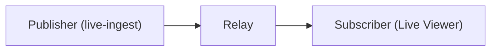

# moq-wasm

[](https://github.com/nttcom/moq-wasm/actions/workflows/lint.yml?query=branch%3Amaster)
[](https://codecov.io/gh/nttcom/moq-wasm)
[](LICENSE)

Publish and subscribe to live video, audio and data over Media over QUIC Transport
(MoQT). The Rust relay and client SDKs support [drafts 14 and 18](docs/spec/).

- [Try a video meeting](https://nttcom.github.io/moq-wasm/examples/meeting/) in your browser, or [browse all demos](https://nttcom.github.io/moq-wasm/).
- [JavaScript quickstart](https://nttcom.github.io/moq-wasm/docs/js/) — publish a camera from a browser.
- [Python quickstart](https://nttcom.github.io/moq-wasm/docs/python/moq_wasm.html) — send a message and read it back.

## Run the live-streaming demo locally



```shell
nix develop
npm ci
```

Run each command in its own terminal:

```shell
make relay          # relay on https://127.0.0.1:4433 and a local VTS
make live-ingest    # RTMP/SRT ingest publishing to the relay
make ffmpeg-srt     # test pattern over SRT into the ingest
make browser        # wasm build and the example hub on http://localhost:5173
make chrome         # Chrome trusting the relay's certificate (make chrome:linux on Linux)
```

In Live Viewer, select the local relay (`https://127.0.0.1:4433`), enter
`anon/live/test` and press **Watch**. You should see the ffmpeg test pattern.

## Development

- [Workspace crates](crates/README.md) and [component designs](docs/architecture/)
- [Relay setup](services/relay/README.md) and [signing tokens for namespaces outside `anon/**`](crates/auth-token/README.md)
- [Tests and local relay topology](tests/README.md)
