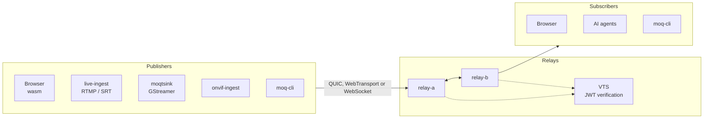

# moq-wasm

[](https://github.com/nttcom/moq-wasm/actions/workflows/lint.yml?query=branch%3Amaster)
[](https://codecov.io/gh/nttcom/moq-wasm)
[](LICENSE)

Media over QUIC Transport (MoQT) in Rust: one publish/subscribe API with
priority control and caching for browsers, native apps, cameras and AI
agents. Implements
[draft-ietf-moq-transport](https://datatracker.ietf.org/doc/draft-ietf-moq-transport/)
-14 and -18 (drafts in [`docs/spec/`](docs/spec/)).

## Demos

Hosted at **<https://nttcom.github.io/moq-wasm/>**; they connect to the cloud
relay, so nothing needs to be installed.

| Use case | Demo |
| --- | --- |
| Video meetings | [Meeting](https://nttcom.github.io/moq-wasm/examples/meeting/) |
| Live streaming and video on demand | [Live Viewer](https://nttcom.github.io/moq-wasm/examples/live-viewer/) |
| IP camera monitoring and PTZ control | [ONVIF](https://nttcom.github.io/moq-wasm/examples/onvif/) |
| USB camera monitoring | [Remote Monitoring](https://nttcom.github.io/moq-wasm/examples/remote-monitoring/) |
| Chat moderation by an AI agent | [MoQ Chat Moderation](https://nttcom.github.io/moq-wasm/examples/moq-chat-moderation/) |
| Video analysis by an AI agent | [MoQ Camera Detection](https://nttcom.github.io/moq-wasm/examples/moq-camera-detection/) |
| Camera control by an AI agent | [MoQ PTZ Tracking](https://nttcom.github.io/moq-wasm/examples/moq-ptz-tracking/) |

Every browser demo is described in [`examples/browser/README.md`](examples/browser/README.md).

## Getting Started

```shell
nix develop
npm ci
```

Run each command in its own terminal:

```shell
make relay          # relay and a local VTS on https://127.0.0.1:4433
make live-ingest    # RTMP/SRT ingest publishing to the relay
make ffmpeg-srt     # test pattern over SRT into the ingest
make browser        # wasm build and the example hub on http://localhost:5173
make chrome         # Chrome trusting the relay's certificate (make chrome:linux on Linux)
```

Open Live Viewer from the hub and watch `anon/live/test`. Chrome gets a fake
camera and microphone; `MOQT_FAKE_MEDIA=0 make chrome` uses the real ones.

`docker compose up -d` starts two relays (`:4433`, `:4434`) sharing a VTS and
a Redis route registry, the topology the E2E tests use.

```shell
make test                     # Rust unit tests
make browser-e2e-media        # browser publish/subscribe
./tests/auth-e2e/run.sh       # relay scenarios, see tests/README.md
```

## Architecture



Every client speaks MoQT to a relay. Relays cache objects for FETCH, forward
subscriptions to each other and authenticate sessions through the VTS.

| Path | Contents |
| --- | --- |
| [`crates/moqt/`](crates/moqt/README.md) | Protocol library every other component builds on |
| [`services/relay/`](services/relay/README.md) | Relay: cache, FETCH, cascading, JWT auth |
| [`crates/wasm/`](crates/wasm/README.md), [`crates/python/`](crates/python/README.md) | Browser (`moq-wasm` SDK) and Python bindings |
| [`services/live-ingest/`](services/live-ingest/README.md), [`onvif-ingest/`](services/onvif-ingest/README.md), [`crates/gst-plugin-moqt/`](crates/gst-plugin-moqt/README.md) | Publishers: RTMP/SRT/RTP, ONVIF cameras, GStreamer `moqtsink` |
| [`services/live-egress/`](services/live-egress/README.md), [`recorder/`](services/recorder/README.md) | Subscribers: plain RTP output, MP4 recording |
| [`crates/mediapack/`](crates/mediapack/README.md), [`msf/`](crates/msf/README.md), [`broadcast/`](crates/broadcast/README.md), [`transcode/`](crates/transcode/README.md) | Media: containers, MSF catalog, track layout, re-encoding |
| [`services/vts/`](services/vts/README.md), [`token-mint/`](services/token-mint/README.md), [`console/`](services/console/README.md), [`crates/auth-token/`](crates/auth-token/README.md) | Authentication: token verification, issuing and the JWT claims |
| [`crates/telemetry/`](crates/telemetry), [`services/observability/`](services/observability) | Shared `tracing` setup; relay stats collected into ClickHouse |
| [`examples/`](examples/browser/README.md) | Browser examples, `moq-cli`, pipecat bots |
| [`tests/`](tests/README.md) | Relay and browser E2E scenarios |

How the crates depend on each other: [`crates/README.md`](crates/README.md).
Design of each crate: [`docs/architecture/<package name>/`](docs/architecture).
Contributor rules: [`AGENTS.md`](AGENTS.md).

## Authentication

A session without a token is limited to `anon/**`, which every demo can use.
Other namespaces need an HS256 JWT, verified by the
[VTS](services/vts/README.md) and signed with the
[`auth-token` CLI](crates/auth-token/README.md).
