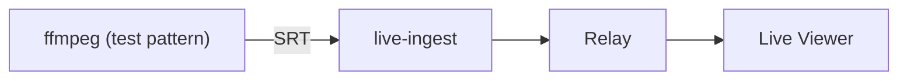

# moq-wasm

[](https://github.com/nttcom/moq-wasm/actions/workflows/lint.yml?query=branch%3Amaster)
[](https://codecov.io/gh/nttcom/moq-wasm)
[](LICENSE)

Publish and subscribe to live video, audio and data over Media over QUIC Transport
(MoQT). The Rust relay and client SDKs support [drafts 14 and 18](docs/spec/).

- [Try a video meeting](https://nttcom.github.io/moq-wasm/examples/meeting/) in your browser, or [browse all demos](https://nttcom.github.io/moq-wasm/).
- [JavaScript quickstart](https://nttcom.github.io/moq-wasm/docs/js/) — publish a camera from a browser.
- [Python quickstart](https://nttcom.github.io/moq-wasm/docs/python/moq_wasm.html) — send a message and read it back.

## Run the demos locally

Each demo builds and starts the browser examples on `http://localhost:5173`, a
relay on `https://127.0.0.1:4433` and the services the demo needs with Docker
Compose. You need Docker, Google Chrome, Node.js and OpenSSL.

`make chrome` opens the examples in a Chrome that trusts the relay's
self-signed certificate, which the relay writes to `services/relay/keys/` on
its first start. On Linux, run `make chrome:linux` and open
`http://localhost:5173/moq-wasm/`. Stop a demo with
`docker compose -f compose.demo.yml --profile <profile> down`.

### Meeting

```shell
docker compose -f compose.demo.yml up
make chrome
```

Open **Meeting**, select **Relay** › **Local** › **relay-a** and join. Join the
same room from another tab of that Chrome to meet yourself.

### Live streaming



```shell
docker compose -f compose.demo.yml --profile live up
make chrome
```

Open **Live Viewer**, enter `anon/live/test` and press **Watch**. You should
see the ffmpeg test pattern.

### AI voice agent

Get a Gemini API key from [Google AI Studio](https://aistudio.google.com/apikey).

```shell
GOOGLE_API_KEY=<API key> docker compose -f compose.demo.yml --profile voice-agent up
MOQT_FAKE_MEDIA=0 make chrome
```

Select **一時トークン** at the top right of the example list, open **AI Voice
Agent**, join and talk to the agent: only the page of a temporary app starts
the bot. `MOQT_FAKE_MEDIA=0` gives the page your microphone instead of Chrome's
test tone.

### Remote monitoring

```shell
docker compose -f compose.demo.yml --profile monitoring up
make chrome BROWSER_EXAMPLE_PATH='/moq-wasm/examples/remote-monitoring/index.html?location=demo'
```

Press **接続**. Three cameras, each an ffmpeg test pattern published with
`moq-cli`, appear under the location `demo`.

### Observability

Add `-f compose.observability.yml` to any demo, in `up` and in `down`:

```shell
docker compose -f compose.demo.yml -f compose.observability.yml --profile live up
```

Open **Observability** for the relay's sessions and tracks, and HyperDX on
`http://localhost:8080` for the logs and traces of the relay and the pages.

## Development

To change the code, run the services from source instead
(`nix develop`, then `npm ci`), each command in its own terminal:

```shell
make relay          # relay on https://127.0.0.1:4433 and a local VTS
make live-ingest    # RTMP/SRT ingest publishing to the relay
make ffmpeg-srt     # test pattern over SRT into the ingest
make browser        # wasm build and the example hub on http://localhost:5173
make chrome         # Chrome trusting the relay's certificate (make chrome:linux on Linux)
```

- [Workspace crates](crates/README.md) and [component designs](docs/architecture/)
- [Relay setup](services/relay/README.md) and [signing tokens for namespaces outside `anon/**`](crates/auth-token/README.md)
- [Tests and local relay topology](tests/README.md)
