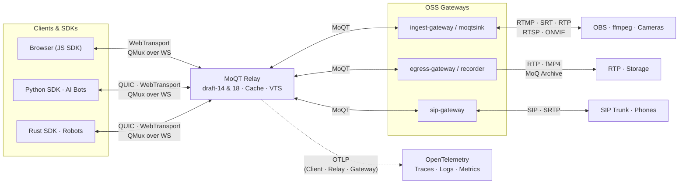

# moq-wasm

[](https://github.com/nttcom/moq-wasm/actions/workflows/lint.yml?query=branch%3Amaster)
[](https://codecov.io/gh/nttcom/moq-wasm)
[](LICENSE)

Self-hostable **Media over QUIC Transport (MoQT)** stack for low-latency video, audio, and data: JavaScript, Python, and Rust SDKs, a cascading relay, and media/telephony gateways, built in Rust on one protocol core.

- **Try in browser**: [MoQT Playground](https://nttcom.github.io/moq-wasm/) — meetings, live streaming, AI voice agents, camera monitoring, and more (no install)
- **Build**: [JavaScript SDK](sdk/js/js/README.md) · [Python SDK](sdk/python/README.md) · [Rust SDK](sdk/rust/README.md)
- **Self-host**: [Local demos](#try-it-locally) · [Relay setup](services/relay/README.md)

## Highlights

- **MoQT [draft-14 & draft-18](docs/spec/)**: Cross-version relaying between drafts.
- **Three transports, one port**: The relay accepts native QUIC (`moqt://`), WebTransport (`https://`), and QMux over WebSocket (`wss://`, `draft-lcurley-qmux-websocket-00`) on one port.
- **One media model across SDKs**: JavaScript, Python, and Rust SDKs share MSF catalogs, LOC/CMAF tracks, and event timelines, so any SDK can play what another publishes.
- **End-to-end OpenTelemetry**: Clients, relays, and gateways export OTLP traces, logs, and metrics (`OTEL_EXPORTER_OTLP_ENDPOINT`); `TRACE_CONTEXT` carries one trace across client–relay boundaries.



## Use cases

| Domain | Capabilities | Starting points |
| --- | --- | --- |
| **Messaging & collaboration** | Event timelines, `FETCH` catch-up | [Whiteboard](https://nttcom.github.io/moq-wasm/examples/whiteboard/), [Message](https://nttcom.github.io/moq-wasm/examples/message/) |
| **Web meetings & telephony** | Multi-party A/V, recording, SIP trunks | [Meeting](https://nttcom.github.io/moq-wasm/examples/meeting/), [`recorder`](services/recorder/README.md), [`sip-gateway`](docs/architecture/sip-gateway/architecture.md) |
| **Live streaming & production** | Cascading relays, RTMP/SRT/RTP ingest, ABR, relay-cache rewind | [Live Viewer](https://nttcom.github.io/moq-wasm/examples/live-viewer/), [`ingest-gateway`](services/ingest-gateway/README.md), [`egress-gateway`](services/egress-gateway/README.md), [`moqtsink`](sdk/gstreamer/README.md) |
| **Surveillance & monitoring** | ONVIF/RTSP pull, on-demand camera streams, PTZ | [Remote Monitoring](https://nttcom.github.io/moq-wasm/examples/remote-monitoring/), [`ingest-gateway pull`](services/ingest-gateway/README.md#pull) |
| **AI agents** | Pipecat voice transport, live translation, object-detection bots | [AI Voice Agent](https://nttcom.github.io/moq-wasm/examples/moq-ai-voice-agent/), [`sdk/python`](sdk/python/README.md), [`bot-dispatcher`](services/bot-dispatcher/README.md), [`live-translate`](docs/architecture/live-translate/architecture.md) |
| **Drones & robotics** | Camera feeds, action arbitration, dead-man hold | [`robotics`](docs/architecture/robotics/architecture.md), [`sdk/rust`](sdk/rust/README.md#a-robot), [`moq-robot-sim`](examples/rust/moq-robot-sim/README.md) |
| **Cloud gaming & real-time game data** | WebCodecs video, unreliable datagrams, prioritized streams | [Datagram](https://nttcom.github.io/moq-wasm/examples/datagram/), [`moqt`](crates/moqt/README.md) |

## SDKs

All three SDKs interoperate, follow `GOAWAY`, reconnect automatically, and support JWT auth.

| SDK | Guide | API | Highlights |
| --- | --- | --- | --- |
| **JavaScript (Browser)** | [`sdk/js/js`](sdk/js/js/README.md) | [TypeDoc](https://nttcom.github.io/moq-wasm/docs/js/) | WebTransport → WebSocket fallback, WebCodecs, `LivePlayer`, `<moq-player>` |
| **Python** | [`sdk/python`](sdk/python/README.md) | [pdoc](https://nttcom.github.io/moq-wasm/docs/python/moq_wasm.html) | Async QUIC/WebTransport client, PyAV codecs, Pipecat transport |
| **Rust** | [`sdk/rust`](sdk/rust/README.md) | [rustdoc](https://nttcom.github.io/moq-wasm/docs/rust/moq_wasm/index.html) | Async QUIC/WebTransport client, event timelines, robotics teleoperation |

**Hosted evaluation relay**: connect any SDK without deploying a relay to `https://relay.moqt.research.skyway.io:443`.

- `anon/**`: no token required (public — anyone who knows the namespace can subscribe).
- Private namespaces: self-host [`relay`](services/relay/README.md) with [`vts`](services/vts/README.md).

## Server & gateway stack

### Relay & platform

| Component | Role |
| --- | --- |
| [`services/relay`](services/relay/README.md) | MoQT relay (QUIC, WebTransport, WebSocket on one port), `FETCH` cache, cascading, draft-14/18 |
| [`services/vts`](services/vts/README.md) · [`services/console`](services/console/README.md) · [`services/temporary-apps`](services/temporary-apps/README.md) | JWT verification (VTS), app/token console, and temporary-app (`temp-*`) token mint / bot-launch proxy |
| [`services/bot-dispatcher`](services/bot-dispatcher/README.md) | On-demand room bot launcher |
| [`services/observability`](docs/architecture/observability/architecture.md) | Client telemetry collector and OTLP forwarder ([design](docs/architecture/telemetry/architecture.md)) |

### Media & telephony gateways

| Component | Role |
| --- | --- |
| [`services/ingest-gateway`](services/ingest-gateway/README.md) | RTMP, SRT, RTP, RTSP, and ONVIF (PTZ) ingest |
| [`services/egress-gateway`](services/egress-gateway/README.md) | MoQT to RTP + RTCP + SDP output |
| [`services/sip-gateway`](docs/architecture/sip-gateway/architecture.md) | Inbound/outbound SIP + SDES-SRTP room bridge |
| [`services/recorder`](services/recorder/README.md) | Multi-participant fMP4 recording and replayable MoQ archives |
| [`sdk/gstreamer`](sdk/gstreamer/README.md) | GStreamer `moqtsink` plugin (H.264/AAC) |

## Try it locally

Requires Docker, Google Chrome, Node.js, and OpenSSL. Each demo builds images on first run and starts the Playground (`http://localhost:5173`), a local relay (`https://127.0.0.1:4433`), and its supporting services.

- Run `docker compose ... up` in **terminal 1** (it stays in the foreground). Once ready, run `make chrome` in **terminal 2** to launch Chrome trusting the relay's self-signed certificate (`services/relay/keys/`).
- **Linux**: run `make chrome:linux` instead and open `http://localhost:5173/moq-wasm/`.

### Video meeting

```shell
docker compose -f compose.demo.yml up   # terminal 1
make chrome                              # terminal 2
```

1. Open **Meeting**.
2. Select **Relay** › **Local** › **relay-a** and join a room.
3. Open a second tab in the same Chrome window and join the same room.

### Live streaming (SRT → `ingest-gateway` → Relay → Live Viewer)

```shell
docker compose -f compose.demo.yml --profile live up   # terminal 1
make chrome                                            # terminal 2
```

1. Open **Live Viewer**.
2. Enter `anon/live/test` and press **Watch**.

### AI voice agent

Requires a Gemini API key from [Google AI Studio](https://aistudio.google.com/apikey):

```shell
GOOGLE_API_KEY=<key> docker compose -f compose.demo.yml --profile voice-agent up   # terminal 1
MOQT_FAKE_MEDIA=0 make chrome                                                      # terminal 2
```

1. Select **一時トークン** (Temporary token) in the top right.
2. Open **AI Voice Agent**.
3. Join and speak (`MOQT_FAKE_MEDIA=0` uses your real microphone).

### Remote camera monitoring

```shell
docker compose -f compose.demo.yml --profile monitoring up                                        # terminal 1
make chrome BROWSER_EXAMPLE_PATH='/moq-wasm/examples/remote-monitoring/index.html?location=demo'  # terminal 2
```

On Linux, open `http://localhost:5173/moq-wasm/examples/remote-monitoring/index.html?location=demo` in the Chrome window started by `make chrome:linux`.

Press **接続** (Connect) to view three test-pattern cameras at location `demo`.

### Observability & stopping demos

- **OpenTelemetry + HyperDX**: add `-f compose.observability.yml` to any demo, e.g.:
  ```shell
  docker compose -f compose.demo.yml -f compose.observability.yml --profile live up
  ```
  Open **Observability** in the Playground for live relay topology and tracks, or HyperDX (`http://localhost:8080`) for traces, logs, and metrics.
- **Stop**: run `docker compose -f compose.demo.yml down` for Meeting. For other demos, repeat the same `-f` and `--profile` flags with `down`.

## Development

From `nix develop` (after `npm ci`), start each service in its own terminal:

```shell
make relay            # https://127.0.0.1:4433 + VTS
make ingest-gateway   # RTMP/SRT ingest
make ffmpeg-srt       # test pattern over SRT
make browser          # wasm build + http://localhost:5173
make chrome           # Chrome with local relay cert (Linux: make chrome:linux)
```

## Further reading

- [Workspace crates](crates/README.md) · [Architecture docs](docs/architecture/)
- [Browser examples & Playground](examples/browser/README.md)
- [Relay configuration & clustering](services/relay/README.md)
- [Signing JWTs outside `anon/**`](crates/auth-token/README.md)
- [Tests & two-relay topology](tests/README.md)
