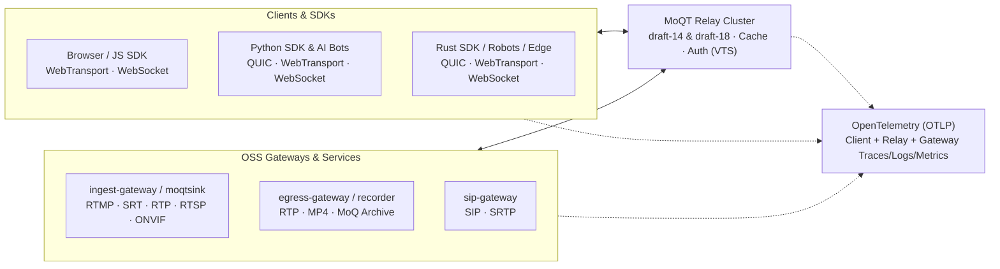

# moq-wasm

[](https://github.com/nttcom/moq-wasm/actions/workflows/lint.yml?query=branch%3Amaster)
[](https://codecov.io/gh/nttcom/moq-wasm)
[](LICENSE)

An open-source, self-hostable **Media over QUIC Transport (MoQT)** stack for low-latency live video, audio, and data. It includes **client SDKs** (JavaScript, Python, Rust), a **cascading MoQT relay**, and **media/telephony gateways** — all built in Rust on one core protocol implementation.

- **[Try MoQT Playground](https://nttcom.github.io/moq-wasm/)** — interactive browser demos (video meetings, live streaming, AI voice agents, remote camera monitoring, robot teleoperation, whiteboards, datagrams, and more).
- **Start building**: [JavaScript SDK](sdk/js/js/README.md) · [Python SDK](sdk/python/README.md) · [Rust SDK](sdk/rust/README.md)
- **Self-host**: [Run locally with Docker Compose](#try-it-locally) · [Relay setup](services/relay/README.md)

---

## Highlights

- **MoQT draft-14 & draft-18**: Both the relay and all SDKs support [draft-14 and draft-18](docs/spec/), including cross-version relaying between peers on different drafts.
- **QUIC, WebTransport & QMux over WebSocket**: Clients connect over native QUIC (`moqt://`), WebTransport (`https://`), or QMux over WebSocket (`draft-lcurley-qmux-websocket-00`, `wss://` fallback). The relay accepts all three on a single port.
- **Full-stack OSS & self-hostable**: Client SDKs, cascading relay, auth/token verifier, ingest/egress/SIP gateways, recorder, and observability collector are all open source and runnable on your own infrastructure.
- **JavaScript, Python & Rust SDKs**: Interoperable MSF broadcasts and raw MoQT tracks across browsers, servers, AI bots, and embedded/edge devices. Test against the hosted evaluation relay (`https://relay.moqt.research.skyway.io:443`) or your own relay.
- **End-to-end OpenTelemetry**: Traces (propagated across client–relay boundaries via `TRACE_CONTEXT`), structured logs, and metrics flow from browser/Python/Rust clients through relays and gateways via OTLP.
- **MoQT Playground**: Ready-to-run browser demos covering real-world scenarios without local setup.



---

## Use cases

Because MoQT unifies low-latency pub/sub streams, unreliable datagrams, and relay caching (`FETCH`) over one protocol, the same stack adapts cleanly across domains:

| Use case | How `moq-wasm` fits | Starting points |
| --- | --- | --- |
| **Messaging & real-time collaboration** | Ordered tracks, event timelines, and `FETCH` catch-up for late joiners | [Whiteboard](https://nttcom.github.io/moq-wasm/examples/whiteboard/), [Message](https://nttcom.github.io/moq-wasm/examples/message/) |
| **Web meetings & SIP telephony** | Multi-party video/audio/screen share, room recording & replay, and SIP trunk bridging | [Meeting](https://nttcom.github.io/moq-wasm/examples/meeting/), [`recorder`](services/recorder/README.md), [`sip-gateway`](docs/architecture/sip-gateway/architecture.md) |
| **Large-scale live streaming & remote production** | Cascading relays, RTMP/SRT/RTP/GStreamer ingest, ABR renditions, LOC & CMAF, relay-cache rewind | [Live Viewer](https://nttcom.github.io/moq-wasm/examples/live-viewer/), [`ingest-gateway`](services/ingest-gateway/README.md), [`egress-gateway`](services/egress-gateway/README.md), [`moqtsink`](crates/gst-plugin-moqt/README.md) |
| **Surveillance cameras & remote monitoring** | ONVIF/RTSP camera pull, lazy on-demand streaming, PTZ command tracks, multi-camera viewing | [Remote Monitoring](https://nttcom.github.io/moq-wasm/examples/remote-monitoring/), [`ingest-gateway pull`](services/ingest-gateway/README.md#pull) |
| **AI agents** | Pipecat transport for real-time voice agents, live translation/transcription, object detection, PTZ tracking, and chat moderation | [AI Voice Agent](https://nttcom.github.io/moq-wasm/examples/moq-ai-voice-agent/), [`sdk/python`](sdk/python/README.md), [`bot-dispatcher`](services/bot-dispatcher/README.md) |
| **Drones & robotics teleoperation** | Low-latency camera feeds + operator/policy action arbitration with dead-man hold and episode recording | [`crates/robotics`](docs/architecture/robotics/architecture.md), [`sdk/rust`](sdk/rust/README.md#a-robot), [`moq-robot-sim`](examples/rust/moq-robot-sim/README.md) |
| **Cloud gaming & real-time game data** | WebCodecs low-latency video plus unreliable MoQT datagrams and prioritized subgroup streams | [Datagram](https://nttcom.github.io/moq-wasm/examples/datagram/), [`moqt`](crates/moqt/README.md) |

---

## SDKs & hosted evaluation relay

All three SDKs interoperate using the same MSF catalog and LOC/CMAF media layout, handle `GOAWAY` handoffs and reconnection, and support JWT authentication:

| SDK | Guide | API Reference | Highlights |
| --- | --- | --- | --- |
| **JavaScript (Browser)** | [`sdk/js/js/README.md`](sdk/js/js/README.md) | [TypeDoc](https://nttcom.github.io/moq-wasm/docs/js/) | WebTransport + WebSocket fallback, WebCodecs publisher, `LivePlayer`, `<moq-player>`, recording replay |
| **Python** | [`sdk/python/README.md`](sdk/python/README.md) | [pdoc](https://nttcom.github.io/moq-wasm/docs/python/moq_wasm.html) | Async QUIC & WebTransport client, PyAV codecs, MSF broadcasts, Pipecat transport for AI bots |
| **Rust** | [`sdk/rust/README.md`](sdk/rust/README.md) | [rustdoc](https://nttcom.github.io/moq-wasm/docs/rust/moq_wasm/index.html) | Async QUIC & WebTransport client, MSF broadcasts, event timelines, robotics teleoperation |

### Hosted evaluation relay

To experiment without deploying a relay first, connect any SDK to the hosted evaluation relay:

```
https://relay.moqt.research.skyway.io:443
```

- Namespaces under `anon/**` require no token and are open for quick evaluation (anyone who knows the namespace can subscribe).
- For production or private namespaces, [self-host `services/relay`](services/relay/README.md) with JWT verification via [`services/vts`](services/vts/README.md).

---

## Self-hostable server & gateway stack

| Service / Plugin | Role |
| --- | --- |
| [`services/relay`](services/relay/README.md) | Multi-transport MoQT relay (QUIC, WebTransport, QMux over WebSocket), object cache (`FETCH`), cascading relays, cross-draft (14/18) |
| [`services/ingest-gateway`](services/ingest-gateway/README.md) | Ingests RTMP, SRT, RTP, RTSP, and ONVIF cameras (with PTZ control) into MoQT |
| [`services/egress-gateway`](services/egress-gateway/README.md) | Subscribes to MoQT broadcasts and outputs plain RTP + RTCP + SDP |
| [`services/sip-gateway`](docs/architecture/sip-gateway/architecture.md) | Bridges outbound/inbound SIP + SDES-SRTP phone calls into MoQT rooms |
| [`services/recorder`](services/recorder/README.md) | Records broadcasts to fMP4 (with multi-participant compositing) or replayable MoQ archives |
| [`services/vts`](services/vts/README.md) & [`services/console`](services/console/README.md) | JWT signature verification service (VTS) and app/token management console |
| [`services/bot-dispatcher`](services/bot-dispatcher/README.md) & [`services/live-translate`](docs/architecture/live-translate/architecture.md) | On-demand room bot launcher (recorder, AI bots) and live audio translation service |
| [`services/observability`](docs/architecture/observability/architecture.md) | Collects browser/SDK client telemetry and forwards unified OTLP traces, logs, and metrics ([design](docs/architecture/telemetry/architecture.md)) |
| [`crates/gst-plugin-moqt`](crates/gst-plugin-moqt/README.md) | GStreamer `moqtsink` plugin for publishing H.264/AAC pipelines directly to a relay |

---

## End-to-end observability (OpenTelemetry)

Every component exports OpenTelemetry (OTLP) traces, logs, and metrics (`OTEL_EXPORTER_OTLP_ENDPOINT`):

- **Distributed traces**: Clients attach W3C `TRACE_CONTEXT` to MoQT requests so a single trace follows a publish/subscribe/fetch from browser or SDK through cascading relays and gateways.
- **Client + server correlation**: Browser, Python, and Rust clients report logs, spans, and player stats to `services/observability`, which joins them with relay stats snapshots (`relay.stats.snapshot`) and service logs in your OTLP backend (e.g. HyperDX, Honeycomb, Grafana).

Run any local demo with `-f compose.observability.yml` to launch the full observability stack locally:

```shell
docker compose -f compose.demo.yml -f compose.observability.yml --profile live up
```

Then open **Observability** in the demo hub for live relay topology/tracks, or HyperDX at `http://localhost:8080` for traces, logs, and metrics.

---

## Try it locally

Explore the hosted [MoQT Playground](https://nttcom.github.io/moq-wasm/) right away, or run the demos locally with Docker Compose (requires Docker, Google Chrome, Node.js, and OpenSSL). Each demo starts MoQT Playground (`http://localhost:5173`), a local relay (`https://127.0.0.1:4433`), and its supporting services.

`make chrome` launches Chrome trusting the relay's self-signed certificate (`services/relay/keys/`). On Linux, run `make chrome:linux` and open `http://localhost:5173/moq-wasm/`. Stop any demo with `docker compose -f compose.demo.yml --profile <profile> down`.

### Video meeting

```shell
docker compose -f compose.demo.yml up
make chrome
```

Open **Meeting**, select **Relay** › **Local** › **relay-a**, and join. Open a second tab in the same Chrome window and join the same room.

### Live streaming (SRT → `ingest-gateway` → Relay → Live Viewer)

```shell
docker compose -f compose.demo.yml --profile live up
make chrome
```

Open **Live Viewer**, enter `anon/live/test`, and press **Watch**.

### AI voice agent

Get a Gemini API key from [Google AI Studio](https://aistudio.google.com/apikey):

```shell
GOOGLE_API_KEY=<API key> docker compose -f compose.demo.yml --profile voice-agent up
MOQT_FAKE_MEDIA=0 make chrome
```

Select **一時トークン** at the top right of the Playground, open **AI Voice Agent**, join, and speak (`MOQT_FAKE_MEDIA=0` uses your real microphone).

### Remote camera monitoring

```shell
docker compose -f compose.demo.yml --profile monitoring up
make chrome BROWSER_EXAMPLE_PATH='/moq-wasm/examples/remote-monitoring/index.html?location=demo'
```

Press **接続** to view three test-pattern cameras published via `moq-cli` under location `demo`.

---

## Development

To build and run services from source (`nix develop`, then `npm ci`), start each command in its own terminal:

```shell
make relay            # local relay on https://127.0.0.1:4433 + VTS
make ingest-gateway   # RTMP/SRT ingest publishing to the relay
make ffmpeg-srt       # test pattern over SRT into ingest-gateway
make browser          # wasm build + MoQT Playground on http://localhost:5173
make chrome           # Chrome trusting the local relay certificate (make chrome:linux on Linux)
```

### Further reading

- [Workspace crates (`crates/`)](crates/README.md) and [architecture documents (`docs/architecture/`)](docs/architecture/)
- [Browser examples & MoQT Playground](examples/browser/README.md)
- [Relay configuration & clustering](services/relay/README.md)
- [Signing JWTs for namespaces outside `anon/**`](crates/auth-token/README.md)
- [Tests & local two-relay topology](tests/README.md)
