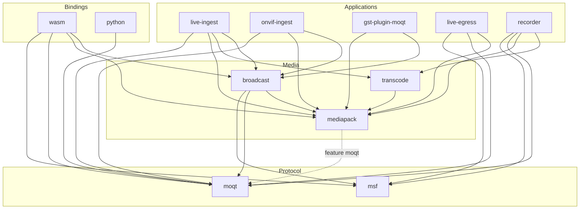
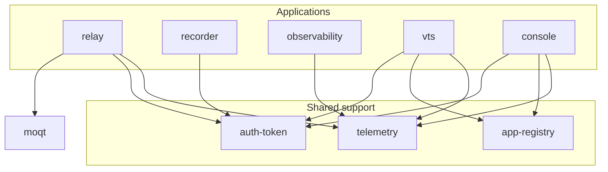

# Crates

How the workspace crates in `crates/` and `services/` depend on each other. What each crate does is listed in `AGENTS.md` §2.

An arrow `A --> B` means `A` depends on `B`. A crate depends only on crates in its own layer or the layers below it.

| Layer | Crates | Role |
| --- | --- | --- |
| Protocol | `moqt`, `msf` | MoQT and the MSF object format. Neither depends on another workspace crate. |
| Media | `mediapack`, `broadcast`, `transcode` | Containers and codecs, and turning media into an MSF broadcast. |
| Applications | `relay`, `live-ingest`, `live-egress`, `onvif-ingest`, `recorder`, `gst-plugin-moqt`, `observability`, `vts`, `console` | Binaries and plugins. Nothing in the workspace depends on them. |
| Bindings | `wasm`, `python` | `moqt` exposed to the browser and to Python. Nothing in the workspace depends on them. |
| Shared support | `telemetry`, `client-telemetry`, `auth-token`, `app-registry` | Small crates with no workspace dependencies, shared by the applications. |

## Media and protocol

- Publishers build their MSF broadcast through `broadcast`; the subscribers `live-egress` and `recorder` read the catalog with `msf` and the objects with `moqt` directly.
- `mediapack` depends on `moqt` only with its `moqt` feature (the dotted arrow), which maps LOC properties to MoQT extension headers.
- Arrows to `telemetry`, `client-telemetry` and `auth-token` are left out of this diagram.

## Relay and services

- Only `vts` and `console` read `app-registry`; `relay` and `recorder` reach it through `vts` over HTTP.
- `observability` takes the relays' stats over OTLP, so it does not depend on `moqt`.
