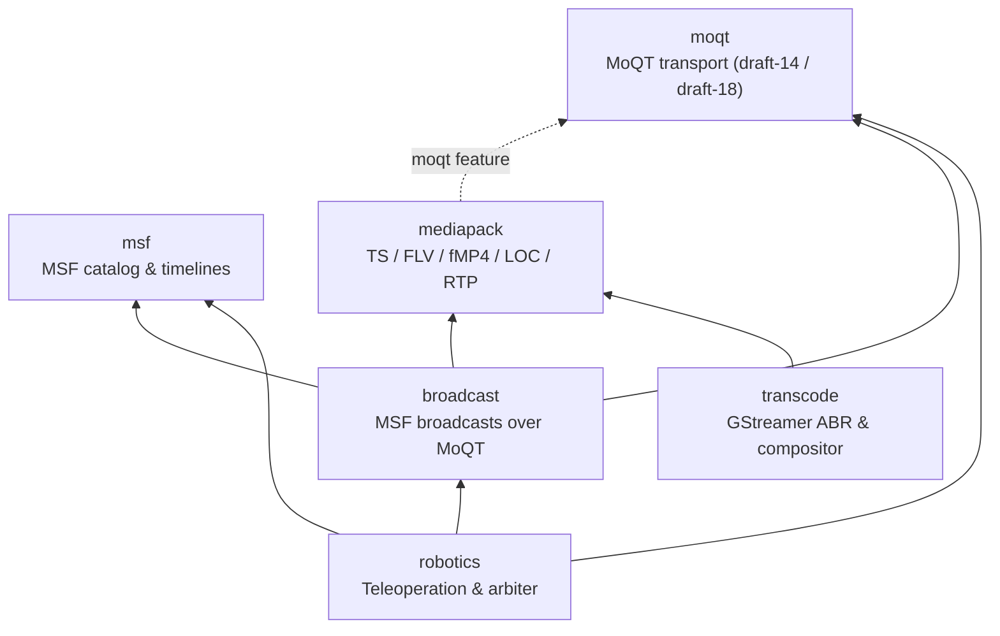

# Workspace crates

Reusable Rust libraries under `crates/`.

- **Building an app, bot, or robot?** Start with an SDK: [JavaScript](../sdk/js/js/README.md) · [Python](../sdk/python/README.md) · [Rust (`moq-wasm`)](../sdk/rust/README.md). `sdk/rust` wraps `moqt`, `broadcast`, and `robotics` with automatic reconnects and JWT refresh.
- **Publishing from GStreamer?** Use the [`gst-plugin-moqt`](../sdk/gstreamer/README.md) plugin.
- **Self-hosting a relay or gateway?** See [`services/`](../README.md#server--gateway-stack).
- **Embedding a crate directly or exploring the codebase?** Pick a crate below.

## Protocol & media dependencies

Arrows point to dependencies (`crates/` protocol and media layers only):

## Protocol & media

| Crate | Audience | Targets | Role |
| --- | --- | --- | --- |
| [`moqt`](moqt/README.md) | External / Via SDK | native, `wasm32` | Core MoQT transport over QUIC, WebTransport, and QMux over WebSocket (draft-18 & draft-14) |
| [`msf`](msf/README.md) | External | native, `wasm32` | Pure-Rust MSF catalog (`draft-ietf-moq-msf-02`) and CMSF (`draft-ietf-moq-cmsf-01`) types and validation |
| [`mediapack`](mediapack/README.md) | External | native, `wasm32` | Pure-Rust container demuxers/muxers (MPEG-TS, FLV, fMP4, LOC, RTP) and bitstream helpers |
| [`broadcast`](broadcast/README.md) | Via SDK / External | native, `wasm32` | Publishes and reads MSF broadcasts (`catalog`, LOC/CMAF tracks, timelines) over `moqt` |
| [`robotics`](robotics/README.md) | Via SDK / External | native | Robot teleoperation records, synchronous `Arbiter` with dead-man hold, `Robot`, and `Driver` |

## GStreamer & transcoding

| Crate | Audience | Targets | Role |
| --- | --- | --- | --- |
| [`transcode`](transcode/README.md) | External / Workspace | native (GStreamer) | In-process GStreamer H.264 ABR ladder transcoder and offline multi-participant MP4 compositor |

## Auth & service infrastructure

| Crate | Audience | Targets | Role |
| --- | --- | --- | --- |
| [`auth-token`](auth-token/README.md) | External (CLI) / Workspace | native | HS256 JWT claims, signing, verification, namespace authorization, VTS client, and token-minting CLI |
| [`app-registry`](app-registry/README.md) | Workspace-internal | native | JSON app registry backed by Cloud Storage or a local file with optimistic concurrency |
| [`google-cloud`](google-cloud/README.md) | Workspace-internal | native | Minimal GCP HTTP client: metadata tokens, conditional Cloud Storage, and IAP/ID token JWKS verification |
| [`http-server`](http-server/README.md) | Workspace-internal | native | Shared HTTP/1 accept loop, JSON body/response helpers, CORS, proxy IP extraction, and shutdown signal |
| [`job-launcher`](job-launcher/README.md) | Workspace-internal | native | Fire-and-forget job launcher over local child processes or Google Cloud Run Jobs |

## Telemetry

`telemetry` defines the JSON schemas, `telemetry-otlp` bootstraps servers, and `telemetry-report` collects client logs and spans without an OpenTelemetry SDK.

| Crate | Audience | Targets | Role |
| --- | --- | --- | --- |
| [`telemetry`](telemetry/README.md) | Workspace-internal | native, `wasm32` | Wire schemas for client telemetry reports (`/api/client-telemetry`) and 1 Hz relay stats snapshots |
| [`telemetry-otlp`](telemetry-otlp/README.md) | Workspace-internal | native | Tracing/OTLP bootstrap (stdout + OTLP traces, logs, metrics), `EventLogger`, and W3C trace context |
| [`telemetry-report`](telemetry-report/README.md) | Workspace-internal | native, `wasm32` | Lightweight `tracing` layer turning client logs and closed spans into `telemetry` reports |

Architecture docs: [`docs/architecture/`](../docs/architecture/) · Full component map: [`AGENTS.md`](../AGENTS.md#2-project-scope).
