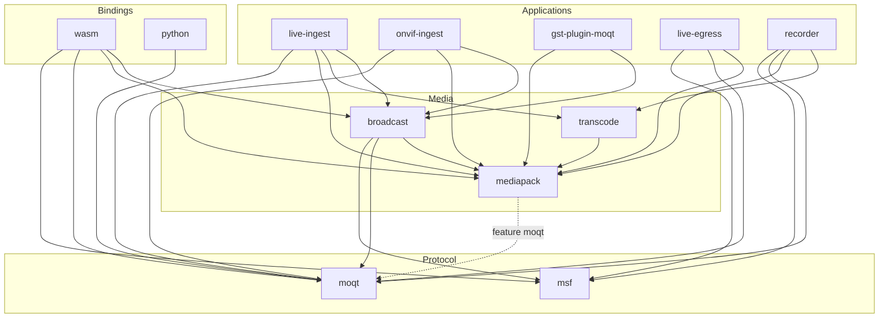
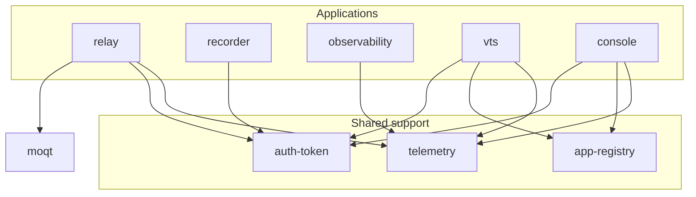

# Crates

Libraries, bindings and plugins live in `crates/<package name>/` and the servers and bridges built on them in `services/<package name>/`. This page shows how the crates in both directories depend on each other. What each crate does is listed in `AGENTS.md` §2, and its design in `docs/architecture/<package name>/architecture.md`.

An arrow `A --> B` means `A` depends on `B`, as declared in `A`'s `Cargo.toml`. Only dependencies between workspace crates are shown.

## Layers

The crates fall into five layers. A crate depends only on crates in its own layer or the layers below it.

| Layer | Crates | Role |
| --- | --- | --- |
| Protocol | `moqt`, `msf` | MoQT and the MSF object format. Neither depends on another workspace crate. |
| Media | `mediapack`, `broadcast`, `transcode` | Containers and codecs, and turning media into an MSF broadcast. |
| Applications | `relay`, `live-ingest`, `live-egress`, `onvif-ingest`, `recorder`, `gst-plugin-moqt`, `observability`, `vts`, `console` | Binaries and plugins. Nothing in the workspace depends on them. |
| Bindings | `wasm`, `python` | `moqt` exposed to the browser and to Python. Nothing in the workspace depends on them. |
| Shared support | `telemetry`, `auth-token`, `app-registry` | Small crates with no workspace dependencies, shared by the applications. |

## Media and protocol

- `broadcast` is the shared original publisher: `live-ingest`, `onvif-ingest`, `gst-plugin-moqt` and `wasm` build their MSF broadcast through it instead of writing the catalog and tracks themselves.
- `live-egress` and `recorder` are subscribers. They read the catalog with `msf` and the objects with `moqt` directly, without `broadcast`.
- `mediapack` depends on `moqt` only when its `moqt` feature is on (the dotted arrow). The feature maps LOC properties to MoQT extension headers. `broadcast`, `live-ingest`, `live-egress`, `recorder` and `wasm` turn it on; `transcode`, `onvif-ingest` and `gst-plugin-moqt` use `mediapack` without it.
- `live-ingest`, `onvif-ingest`, `live-egress` and `recorder` also depend on `telemetry`, and `recorder` on `auth-token`; those arrows are left out here to keep the diagram readable.

## Relay and services

- `auth-token` holds the JWT claims. `vts` and `console` sign and verify tokens with it; `relay` and the HTTP API of `recorder` read the claims `vts` returns.
- `app-registry` stores the apps whose secrets sign the tokens. Only `vts` and `console` read it; `relay` and `recorder` reach it through `vts` over HTTP, not as a crate dependency.
- `observability` takes the relays' stats snapshots over OTLP, not as a crate dependency, so it does not depend on `moqt`.
