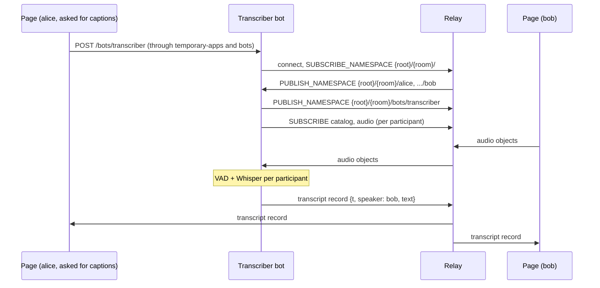

# Design: live transcription for the Meeting example

## Status
Accepted

## Date
2026-10-20

## Scope
A new pipecat bot `examples/python/moq-meeting-transcriber`, which the bot
service starts as the bot type `transcriber`
(see [the bot-dispatcher design](../bot-dispatcher/architecture.md)), and the Meeting page
(`examples/browser/examples/meeting`).
The bot reaches the relay through this repository's Python bindings
(`sdk/python`, see [its design](../python/architecture.md)).

## Context
A spike (2026-10-19/20) showed that a Python process can transcribe a meeting
participant with the pieces the other bots already use:

- moq-rs (`moq-rs` 0.4.7) subscribes to the participant's audio track and
  hands over each object payload, a bare Opus packet.
- PyAV decodes it to 16 kHz mono PCM.
- pipecat runs Silero VAD and `WhisperSTTService` (faster-whisper `small`,
  CPU, int8, Japanese) and emits one `TranscriptionFrame` per utterance,
  0.8–1.4 s after the speaker stops, on an Apple Silicon Mac.

moq-rs then fell short in a room of two: it has no joining FETCH, so a
catalog the relay already serves to the other participant never reached the
bot. The bot uses the Python SDK `moq-wasm` instead. pipecat's `MOQTransport`, which
is built on moq-rs, does not fit a meeting either:

- It follows one peer at a fixed path; a meeting has any number.
- It reads hang's `catalog.json`; the Meeting publishes an MSF catalog on
  `catalog`.
- Its audio input goes through moq-rs `subscribe_audio`, which reads the LOC
  payload as moq-rs's own property block and yields no frame for the
  Meeting's draft-ietf-moq-loc-04 objects, whose properties travel in the
  object header.

## Decision
A page asks the bot service to start the transcriber in its room. The bot subscribes to
the audio of every participant in the room, transcribes each one in its own
pipeline, and publishes the text on one event timeline track that the pages
in the room read.



### Rooms it serves
The page starts the transcriber through the temporary-apps service, the app
server of temporary apps (see "Temporary apps" in
[the bot-dispatcher design](../bot-dispatcher/architecture.md)), so the captions button shows only
in a temporary app's room. A registered app's server can start it in its own
rooms through `bot-dispatcher`.

### Starting and stopping
The Meeting page gains a captions button in the bottom bar. Choosing a model
from it sends `POST /bots/transcriber` with the room as `namespace_prefix` and
the model as the option `asr`; `bot-dispatcher` launches one bot per room, and answers
`409` while the room runs one. The bot joins the room with the token `bot-dispatcher`
signs for it and sends a heartbeat every 5 s. Until the bot's namespace
appears, the page asks `bot-dispatcher` for the room's latest transcriber every 5 s and
shows `transcriber failed to start` if it failed.

The bot ends by itself once the room has had no participant, nor the words of
one who left still to transcribe, for 30 s, counted from its start too, and at
the hour `bot-dispatcher` allows it. It follows the room's namespace until
then, so a participant who joins while the words of one who left are
transcribed is heard and starts the 30 s over. Stop transcription in the
button's menu asks for confirmation, then sends
`DELETE /bots/transcriber/{id}`, which the bot learns at its next heartbeat;
it then leaves the room for every page.

### What the bot subscribes to
- `SUBSCRIBE_NAMESPACE {root}/{room}/` finds the participants as they publish
  and withdraw their namespaces. A three-element namespace
  `{root}/{room}/{user}` is a participant, the same rule as
  `parseTrackNamespace`; anything else is ignored.
- For each participant it subscribes to `catalog` with a joining FETCH of the
  group the relay holds (`subscribe_current_group`): the relay already serves the
  catalog to the other participants, and a SUBSCRIBE alone would deliver
  nothing until the catalog changes. The subscription follows catalog updates.
- From the catalog it picks the audio track the Meeting's viewers pick, the
  one with the highest bitrate (`pickHighestBitrateTrack`). The publisher
  encodes a profile only while someone subscribes to it, so another choice
  would start an extra encoder in the participant's browser.
- When the audio track ends (mute), the bot subscribes again a second later.
  When the catalog switches to another track, the bot unsubscribes from the
  old one, so the participant's browser stops encoding it if no one else
  takes it. `PUBLISH_NAMESPACE_DONE` ends the participant once their audio is
  unsubscribed, so a rejoin under the same name is heard at once, while the
  room keeps their pipeline transcribing the utterances it already heard, so
  what they said before leaving reaches the transcript. Stopping the bot drops
  them instead, those of a participant who already left included, without
  waiting for the recognizer or handing it any more of them.

### Transcription
Each participant gets a pipeline of `VADProcessor(SileroVADAnalyzer())` and an
STT service. The language is fixed to Japanese, since language detection on a
short utterance guesses wrong more often than a demo of a Japanese meeting
gains from it. The Opus packets of the participant's audio objects are
decoded with PyAV and pushed as `UserAudioRawFrame`s whose `user_id` is the
participant's user name. The STT service is a `SegmentedSTTService` subclass
that dates each utterance (below) and hands the segment to one of five speech
recognizers:

| Name | Model | Where it runs |
| --- | --- | --- |
| `whisper` (default) | faster-whisper `small` (`--model`) | in the bot, on the CPU |
| `granite-speech-5-470m` | Granite Speech 5.0 470m | in the bot, on the CPU |
| `qwen3-asr` | Qwen3-ASR-1.7B | its own Cloud Run service with an L4 GPU, served by vLLM |
| `granite-speech-5-2b` | Granite Speech 5.0 2b | its own Cloud Run service with an L4 GPU, served by vLLM |
| `haas-ja` | Haas-ja-v1.0 | its own Cloud Run service with an L4 GPU, served by `haas-asr-server` |

- `whisper`: all pipelines share one faster-whisper model, so memory does not
  grow with the number of speakers, and transcribe one segment at a time.
  pipecat's `WhisperSTTService` loads a model per instance, so the bot holds
  the model itself. It loads only in a `whisper` room, while the bot joins it,
  and the room is `starting` until it has loaded.
- A call takes about as long for a short segment as for a long one, since
  Whisper's encoder always reads a 30 s window: on Cloud Run's 4 vCPU,
  `medium` took about 6 s per segment, and a speaker who paused more often
  than that fell further behind with every segment. A participant's segments
  that close while the recognizer is busy are therefore transcribed together
  in the next call, as one record dated from the first. The default is
  `small`, about 2.7 times faster than `medium`, so the delay after the last
  segment stays within about two calls.
- `granite-speech-5-470m`: a CTC model, so one pass of its encoder writes
  the whole segment, with no window to fill as Whisper's. It takes no
  language and writes what it hears. All pipelines share one model, as with
  `whisper`, but it loads, along with torch and transformers, when a room
  first picks it, so a bot whose rooms use only Whisper neither holds its
  3 GB in float32 nor spends the over 10 s that importing them takes before
  it listens. Float32 rather than
  its bfloat16 weights, since bfloat16 took about four times as long on the
  CPU. On a 4-thread laptop CPU it took 0.8 s for an 8 s utterance, against
  1.3 s for Whisper `small`. The image carries its weights, as it carries
  Whisper's.
- `qwen3-asr` and `granite-speech-5-2b`: the bot posts each segment as a
  WAV file to the service, with an identity token from the metadata server,
  as the other bots call the System One service. Qwen3-ASR takes it on the OpenAI-compatible
  `/v1/audio/transcriptions` with `language=ja`. vLLM's transcription API
  gives Granite Speech a fixed prompt that names no language and drops the
  request's, so the bot sends Granite Speech the WAV on `/v1/chat/completions`
  with the model card's prompt for Japanese speech. Each model has a service
  of its own, since Qwen3-ASR needs a vLLM nightly pinned for it and a
  service then runs the official vLLM image with arguments only. Neither is
  the System One service, which runs its own server (`system-one-server`)
  rather than vLLM.
- `haas-ja`: a Parakeet-TDT model (FastConformer encoder, TDT decoder) of
  616M parameters trained on Japanese, so it takes no language either. It
  runs on NeMo only, with Triton kernels that need an NVIDIA GPU, so vLLM
  cannot serve it: `examples/python/haas-asr-server` loads it with haas-asr
  and answers `/health` and `/v1/audio/transcriptions` as vLLM does, so the
  bot calls it with the same `HttpRecognizer` as `qwen3-asr`. The server
  runs the model on one thread, so concurrent segments wait for each other,
  and a segment longer than the 30 s it was trained on is split at its
  quietest points. Its 1.2 GB of weights go into the image rather than to
  Cloud Storage.
- None of the models transcribes while a participant speaks: each takes a
  whole utterance, so a caption follows the end of the utterance.

### Choosing the speech recognizer
The page sends its choice as the launch's option, `{"asr": "qwen3-asr"}`, which
`bot-dispatcher` hands to the bot in `--options`. The bot accepts its CPU recognizers and
the names the bot type's arguments name (`--asr qwen3-asr=<service URL>`, once
per GPU service), and fails on anything else, so a request cannot point the
bot at another server. A room runs with the choice of the launch that started
it.

The bot publishes a `status` track next to `transcript`: one object per group
holding `{"asr": <name>, "state": "starting" | "ready"}`. A GPU service that
scaled to zero takes minutes to answer, so the state stays `starting` until
its `/health` answers, and `whisper` stays `starting` until its model has
loaded, as does `granite-speech-5-470m`. Every page in the room shows the name and the state in
the `CC` badge. Until then the bot subscribes to no audio, so the service does
not receive the startup minutes' utterances all at once, and if the
recognizer has not answered within 2 s, the transcript gets a record from the
speaker `transcriber` saying it is starting and may take a while.

### The transcript track
The bot publishes under `{root}/{room}/bots/transcriber`. The namespace has
four elements, so the Meeting's member logic, which takes three-element
namespaces, does not show the bot as a participant, and no user name can
collide with it. The track is `transcript`, an MSF event timeline
(draft-ietf-moq-msf-02 §8) indexed by wallclock time:

```json
[
  { "T": 1792399956554, "data": { "speaker": "alice", "text": "今日は良い天気ですね" } }
]
```

- `T` is the bot's wall-clock time, in ms, at which the utterance began: the
  time the VAD closed the segment minus the segment's length.
- The track is published through the session's `Origin`, which keeps it for
  an hour, the longest a room runs, and answers the relay's SUBSCRIBE and
  FETCH. Its group ids start at the wall-clock time in µs, since the relay
  isolates a track whose publisher reuses a location.
- The track is one group: its first object is an empty record list, and
  each later object adds one record (§8.4).
- The bot publishes no MSF catalog: the page knows the fixed track name, as
  the MoQ Chat Moderation page does.

### The page
- While the bot's namespace is announced, every page in the room shows `CC`
  in the header, as it shows `REC` for a recording, since everyone's speech
  is being transcribed.
- Every page subscribes to `transcript` with the LargestObject
  filter and sends a joining FETCH for the current group: the FETCH ends at
  the largest object and the subscription starts after it, so together they
  carry the whole group. A group's first object replaces the records and
  later objects add to them, in whichever order the two deliver them.
- A speaker's live records from the last 5 s appear at the bottom of their
  tile, joined and cut to the last 60 characters, since a fast recognizer
  publishes fragments under a second apart. Records from the joining FETCH are history
  and are not shown there, however late a live record arrives. The sidebar gains a Transcript tab next
  to the chat that lists every record with speaker and time. The tab and the
  tile captions show on every page while the transcriber is in the room; the
  captions button hides or shows the tile captions on its own page only.

## Consequences

### Positive
- Transcription runs only while the room has participants, and any page in the
  room can stop it.
- Audio stays inside the deployment: the model runs in the bot.

### Negative
- Captions arrive after the speaker stops: about 0.7–1.4 s with
  `qwen3-asr`, and a few seconds with `whisper` on Cloud Run's CPUs. Every
  model transcribes whole utterances, so there are no partial results.
- CPU cost grows with the speech in the room.
- Each room starts its own bot, a Cloud Run Job execution, and a `whisper`
  room loads its own model, so captions start later than with a service whose
  model is already loaded.
- A participant cannot opt out of being transcribed; the header badge only
  tells them.

## Alternatives Considered

### pipecat `MOQTransport` per participant
It follows one fixed peer path, reads hang's catalog and decodes audio through
moq-rs `subscribe_audio`, none of which work against the Meeting (see
Context). One session per participant would also multiply relay sessions.

### A transcript track per participant
Each speaker's text would sit next to their audio, but the bot cannot publish
into a participant's namespace. One track with a `speaker` field gives the
page the same information with one subscription.

### Whisper large on the GPU as well
Whisper large-v3 is too slow on the CPU, so it would need a GPU service of
its own: vLLM serves one model per process, and Qwen3-ASR needs a nightly
vLLM that Whisper does not. One service running both behind a path router
saves an instance only when two rooms use different models at once, and ties
both to one vLLM build. Whisper `small` on the CPU covers the case of a
transcriber that needs no GPU.

### Qwen3-ASR and the decision model in one service
When this was decided the decision model was d3-flash, whose 17 GB of weights
would not fit one L4 together with Qwen3-ASR, so the service would have had to
swap models by request path. d1-2B takes about 4 GB, but one service would
still have to run both vLLM and `system-one-server`.

### MOSS-Transcribe-Diarize
vLLM checks the request's `language` against a list and leaves it out of the
model's prompt, and the model card names no other way to set the language,
so the model guessed the language of every utterance and wrote many in
languages no one spoke. Its diarization adds nothing either, since a
participant's track carries one speaker. Granite Speech 2b takes the
language in its prompt.

### Ming-3.0-asr-tiny
inclusionAI's ASR model of October 2026 lists Chinese, English and Chinese
dialects only, has 8.9B parameters (a mixture of experts with about 2B
active), and is served with SGLang.

### A hosted speech-to-text API
It needs no model in the bot, but sends meeting audio outside the deployment
and needs an API key in the service.
