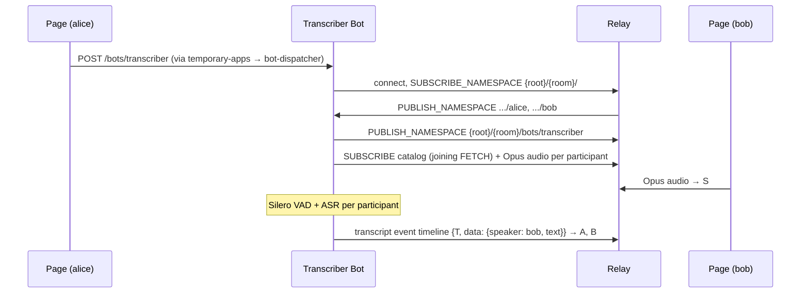

# Design: Live Transcription for the Meeting Example

## Status
Accepted (2026-10-20)

## Scope
Pipecat bot `examples/python/moq-meeting-transcriber` (launched via `bot-dispatcher` as type `transcriber`; see [`bot-dispatcher/architecture.md`](../bot-dispatcher/architecture.md)) and Meeting UI (`examples/browser/examples/meeting`). Connects via the Python SDK (`sdk/python`; [`python/architecture.md`](../python/architecture.md)).

## Context
A spike showed PyAV (Opus → 16 kHz mono PCM) + pipecat Silero VAD + faster-whisper `small` produces utterances 0.8–1.4 s after end-of-speech on Apple Silicon. However, `moq-rs` 0.4.7 and pipecat's `MOQTransport` failed in multi-party meetings:
- No joining FETCH (bot missed active participant catalogs).
- `MOQTransport` follows one fixed path, reads hang's `catalog.json` instead of MSF `catalog`, and misreads draft-ietf-moq-loc-04 extension headers.

Switching to the workspace Python SDK `moq-wasm` resolves all three.

## Decision



### Launch, Lifecycle & Discovery

**Start & Stop**
- **Who starts it**: Meeting UI shows the STT selector (bottom bar Activities menu) in temporary-app rooms (via `temporary-apps`); registered apps start it through their server via `bot-dispatcher`.
- **Start flow**: Choosing a model sends `POST /bots/transcriber` with `namespace_prefix` and `options: {"asr": "<name>"}` (`409` if already running). The bot joins with its bot token and heartbeats every 5 s; the page polls `bot-dispatcher` every 5 s until the bot's namespace appears (or shows `transcriber failed to start`).
- **Stop flow**: Exits after 30 s with no participants and no queued in-flight utterances (including from startup; new joiners reset the timer), at the 1 h cap, or on "Stop transcription" (`DELETE /bots/transcriber/{id}`, dropping in-flight utterances immediately).

**Participant Tracking (`SUBSCRIBE_NAMESPACE {root}/{room}/`)**
Matches 3-element `{root}/{room}/{user}` namespaces (`parseTrackNamespace`). Per participant:
- Subscribes to `catalog` via `subscribe_current_group` (joining FETCH) and tracks updates.
- Picks the lowest-bitrate Opus LOC audio track (`MoqWasmParticipantInput`).
- Re-subscribes 1 s after track end (mute); unsubscribes old track on catalog switch so browsers stop encoding unused tracks.
- On `PUBLISH_NAMESPACE_DONE`: unsubscribes immediately (allowing immediate rejoin under the same name) while letting already-captured utterances finish transcribing.

### Speech Recognizers
Each participant gets a `VADProcessor(SileroVADAnalyzer())` + `SegmentedSTTService` pipeline. Language is fixed to Japanese (short utterances mis-detect too often). All models transcribe complete utterances (captions follow end-of-speech).

| Name | Model | Runtime | Key behavior |
| --- | --- | --- | --- |
| `whisper` (default) | faster-whisper `small` (`--model`) | In-bot CPU | Single shared model across pipelines (serial queue per segment); ~2.7× faster than `medium` (30 s fixed encoder window). Loaded lazily on `whisper` room join. |
| `granite-speech-5-470m` | Granite Speech 5.0 470m | In-bot CPU | CTC (no fixed window, language-agnostic); shared float32 model (bfloat16 is ~4× slower on CPU; ~0.8 s vs 1.3 s Whisper for 8 s speech). Lazy-loads torch/transformers + 3 GB weights from image. |
| `qwen3-asr` | Qwen3-ASR-1.7B | Cloud Run L4 GPU (vLLM nightly) | Posts WAV + metadata ID token to `/v1/audio/transcriptions` (`language=ja`). |
| `granite-speech-5-2b` | Granite Speech 5.0 2b | Cloud Run L4 GPU (vLLM) | Posts WAV to `/v1/chat/completions` with Japanese model-card prompt (vLLM transcription API drops `language`). |
| `haas-ja` | Haas-ja-v1.0 (616M Parakeet-TDT) | Cloud Run L4 GPU (`haas-asr-server`) | NeMo/Triton server exposing `/health` and `/v1/audio/transcriptions` (same `HttpRecognizer`); single-threaded, splits segments > 30 s at quietest points, 1.2 GB weights baked into image. |

- **Allow-listed GPU URLs**: Only CPU recognizers and `--asr <name>=<url>` targets configured on the bot type are accepted, preventing SSRF.
- **`status` track**: Published alongside `transcript` as 1-object groups (`{"asr": "<name>", "state": "starting" | "ready"}`). Stays `starting` until GPU `/health` responds or local model loads; no audio is subscribed until `ready` (avoiding startup backlog). If startup exceeds 2 s, emits a `speaker: "transcriber"` notice into `transcript`.

### Transcript Track & Meeting UI
- **Namespace**: `{root}/{room}/bots/transcriber` (`botNamespace(room, 'transcriber')` in `moq-wasm/media`, 4 elements — ignored by participant logic, collision-free). No MSF catalog (fixed track names `transcript` and `status`).
- **`transcript` track**: Single-group MSF event timeline (draft-ietf-moq-msf-02 §8.4 incremental updates; first object empty list, each subsequent object appends one record) via `Origin` (1 h retention; initial Group ID = Unix µs so publisher restarts never reuse locations):

```json
[{ "T": 1792399956554, "data": { "speaker": "alice", "text": "今日は良い天気ですね" } }]
```
(`T` = utterance start in bot wall-clock ms = VAD close time − segment length.)

- **Meeting UI**:
  - Shows `CC` badge (with recognizer name/state) while bot namespace is announced (detected via `botTypeOf` or `watchBroadcasts`'s `onBotChange` in `moq-wasm/media`).
  - Reads `transcript` via `subscribeTranscript` (`moq-wasm/media`), which subscribes with `LargestObject` + joining FETCH of current group; first object replaces state, later objects append in any order, and malformed objects/records are skipped.
  - Speaker tiles display live records from the last 5 s (joined, truncated to last 60 chars); history from joining FETCH (`live: false`) goes only to the sidebar Transcript tab. The captions button toggles tile captions locally.

## Consequences & Alternatives

### Consequences
- **Positive**: Runs strictly on demand; audio stays inside deployment.
- **Negative**: Post-utterance latency (~0.7–1.4 s `qwen3-asr`, several seconds CPU `whisper`); CPU scales with speech; per-room Cloud Run Job + model load cold start; no per-participant opt-out (header badge notifies only).

### Alternatives Considered

| Alternative | Why rejected |
| --- | --- |
| pipecat `MOQTransport` per participant | Incompatible catalog/LOC and multiplies relay sessions |
| Per-participant transcript tracks | Bot cannot publish into participant namespaces; one track with `speaker` needs one subscription |
| Whisper `large-v3` on GPU | Needs its own vLLM build/service; CPU `small` covers the GPU-free case |
| Co-locate Qwen3-ASR with System One | Exceeded L4 VRAM with d3-flash and mixes vLLM + `system-one-server` |
| MOSS-Transcribe-Diarize | vLLM ignored `language`, causing wrong-language guesses; diarization is redundant on per-speaker tracks |
| Ming-3.0-asr-tiny | Chinese/English only (8.9B MoE / 2B active, SGLang) |
| Hosted STT API | Sends meeting audio outside the deployment and requires API keys |
