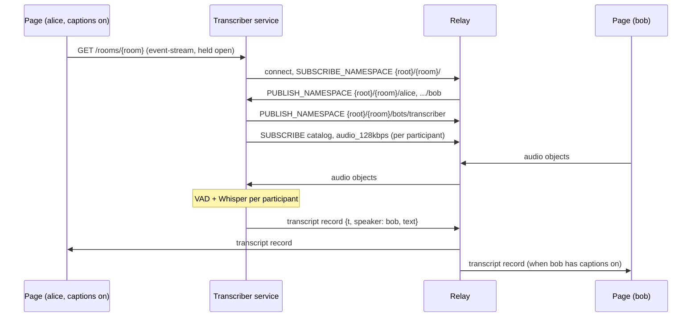

# Design: live transcription for the Meeting example

## Status
Accepted

## Date
2026-10-20

## Scope
A new pipecat bot `examples/python/moq-meeting-transcriber`, the Meeting page
(`examples/browser/examples/meeting`), and a small change to `moq-bot-rooms`.
The bot reaches the relay through this repository's Python bindings
(`crates/python`, see [its design](../python/architecture.md)).

## Context
A spike (2026-10-19/20) showed that a Python process can transcribe a meeting
participant with the pieces the other bots already use:

- moq-rs (`moq-rs` 0.4.7) subscribes to the participant's audio track and
  hands over each object payload, a bare Opus packet.
- PyAV decodes it to 16 kHz mono PCM.
- pipecat runs Silero VAD and `WhisperSTTService` (faster-whisper `small`,
  CPU, int8, Japanese) and emits one `TranscriptionFrame` per utterance,
  0.8–1.4 s after the speaker stops, on an Apple Silicon Mac.

moq-rs then fell short in a room of two: it has no joining FETCH, so a
catalog the relay already serves to the other participant never reached the
bot. The bot uses the module `moqt` instead. pipecat's `MOQTransport`, which
is built on moq-rs, does not fit a meeting either:

- It follows one peer at a fixed path; a meeting has any number.
- It reads hang's `catalog.json`; the Meeting publishes an MSF catalog on
  `catalog`.
- Its audio input goes through moq-rs `subscribe_audio`, which reads the LOC
  payload as moq-rs's own property block and yields no frame for the
  Meeting's draft-ietf-moq-loc-04 objects, whose properties travel in the
  object header.

## Decision
A page asks the transcriber to join its room over HTTP, as the other bots are
started (see [on-demand-rooms.md](on-demand-rooms.md)). The bot subscribes to
the audio of every participant in the room, transcribes each one in its own
pipeline, and publishes the text on one event timeline track that the pages
in the room read.



### Rooms it serves
The transcriber serves rooms of the anonymous app only, whose namespace root
is `anon`. A page that joined with `?jwt=` hides the captions button: a room
under another app's root would need a token for the bot, which the service
does not have.

### Starting and stopping
The Meeting page gains a captions button in the bottom bar. Turning it on
opens `GET {transcriberUrl}/rooms/{room}` as an `EventSource` and keeps it
open; turning it off, Leave, or closing the tab closes it. The bot runs while
at least one page in the room holds the request and stops 30 s after the last
one closes, with the limits of `moq-bot-rooms` (`--max-rooms`,
`--max-room-seconds`, `--open-hours`, `--allowed-origin`). A page shows the
`full`, `closed`, `expired` and `failed` events next to the button and turns
it off.

The page finds the service with `resolveServiceUrl`
(`examples/browser/utils/serviceUrl.ts`), as the other bot pages do: a local
relay means `http://127.0.0.1:8100`, any other relay the deployed service, and
`?transcriberUrl=` overrides both.

`moq-bot-rooms` accepts room IDs of `[a-z0-9-]{1,32}`, which a Meeting room
name need not match. `serve_rooms` takes the pattern as a parameter, and the
transcriber passes one that accepts any single namespace element of up to 64
characters without `/`.

### What the bot subscribes to
- `SUBSCRIBE_NAMESPACE {root}/{room}/` finds the participants as they publish
  and withdraw their namespaces. A three-element namespace
  `{root}/{room}/{user}` is a participant, the same rule as
  `parseTrackNamespace`; anything else is ignored.
- For each participant it subscribes to `catalog` with a joining FETCH of the
  group the relay holds (`current_group=True`): the relay already serves the
  catalog to the other participants, and a SUBSCRIBE alone would deliver
  nothing until the catalog changes. The subscription follows catalog updates.
- From the catalog it picks the audio track the Meeting's viewers pick, the
  one with the highest bitrate (`pickHighestBitrateTrack`). The publisher
  encodes a profile only while someone subscribes to it, so another choice
  would start an extra encoder in the participant's browser.
- When the audio track ends (mute), the bot subscribes again a second later.
  When the catalog switches to another track, the bot unsubscribes from the
  old one, so the participant's browser stops encoding it if no one else
  takes it. `PUBLISH_NAMESPACE_DONE` ends the participant.

### Transcription
Each participant gets a pipeline of `VADProcessor(SileroVADAnalyzer())` and an
STT service. The language is fixed to Japanese, since language detection on a
short utterance guesses wrong more often than a demo of a Japanese meeting
gains from it. The Opus packets of the participant's audio objects are
decoded with PyAV and pushed as `UserAudioRawFrame`s whose `user_id` is the
participant's user name. The STT service is a `SegmentedSTTService` subclass
that dates each utterance (below) and hands the segment to one of three speech
recognizers:

| Name | Model | Where it runs |
| --- | --- | --- |
| `whisper` (default) | faster-whisper `medium` (`--model`) | in the bot, on the CPU |
| `qwen3-asr` | Qwen3-ASR-1.7B | its own Cloud Run service with an L4 GPU, served by vLLM |
| `moss-transcribe-diarize` | MOSS-Transcribe-Diarize 0.9B | its own Cloud Run service with an L4 GPU, served by vLLM |

- `whisper`: all pipelines share one faster-whisper model, so memory does not
  grow with the number of speakers, and transcribe one segment at a time.
  pipecat's `WhisperSTTService` loads a model per instance, so the bot holds
  the model itself.
- `qwen3-asr` and `moss-transcribe-diarize`: the bot posts each segment as a
  WAV file to the service's OpenAI-compatible `/v1/audio/transcriptions`,
  with an identity token from the metadata server, as the other bots call
  d3-flash. Each model has a service of its own, since each needs a vLLM
  nightly pinned for it and a service then runs the official vLLM image with
  arguments only. Neither is d3-flash: d3-flash already fills most of an L4's
  24 GB with its own weights, and it runs its own server rather than vLLM.
- MOSS-Transcribe-Diarize writes each segment as `[start][S01]text[end]`. A
  participant's track carries one speaker, so the bot drops the times and
  speaker tags; the diarization helps only audio in which several people
  share a microphone, which the Meeting does not send.
- None of the models transcribes while a participant speaks: each takes a
  whole utterance, so a caption follows the end of the utterance.

### Choosing the speech recognizer
The page sends its choice with the room request,
`GET /rooms/{room}?asr=qwen3-asr`. `moq-bot-rooms` hands the query to the bot
of a new room; the bot accepts `whisper` and the names it was started with
(`--asr qwen3-asr=<service URL>`, once per GPU service), and refuses anything else, so a request
cannot point the bot at another server. A room runs with the choice of the
request that started it; later requests join the running room whatever they
ask for.

The bot publishes a `status` track next to `transcript`: one object per group
holding `{"asr": <name>, "state": "starting" | "ready"}`. A GPU service that
scaled to zero takes minutes to answer, so the state stays `starting` until
its `/health` answers. Every page in the room shows the name and the state in
the `CC` badge.

### The transcript track
The bot publishes under `{root}/{room}/bots/transcriber`. The namespace has
four elements, so the Meeting's member logic, which takes three-element
namespaces, does not show the bot as a participant, and no user name can
collide with it. The track is `transcript`, an MSF event timeline
(draft-ietf-moq-msf-01 §8) indexed by wallclock time:

```json
[
  { "t": 1792399956554, "data": { "speaker": "alice", "text": "今日は良い天気ですね" } }
]
```

- `t` is the bot's wall-clock time, in ms, at which the utterance began: the
  time the VAD closed the segment minus the segment's length.
- The track is published through the session's `Origin`, which keeps it for
  an hour, the longest a room runs, and answers the relay's SUBSCRIBE and
  FETCH. Its group ids start at the wall-clock time in µs, since the relay
  isolates a track whose publisher reuses a location.
- The track is one group: its first object is an empty record list, and
  each later object adds one record (§8.3).
- The bot publishes no MSF catalog. §8.2 requires an event timeline's catalog
  entry to list the tracks it applies to in `depends`, whose names MSF
  resolves in the event timeline's own namespace, and the audio it describes
  belongs to other broadcasts. The page knows the fixed track name, as the
  MoQ Chat Moderation page does.

### The page
- While the bot's namespace is announced, every page in the room shows `CC`
  in the header, as it shows `REC` for a recording, since everyone's speech
  is being transcribed.
- A page with captions on subscribes to `transcript` with the LargestObject
  filter and sends a joining FETCH for the current group: the FETCH ends at
  the largest object and the subscription starts after it, so together they
  carry the whole group. A group's first object replaces the records and
  later objects add to them, in whichever order the two deliver them.
- The newest record of a speaker appears at the bottom of that speaker's
  tile for 5 s after it arrives; records more than 15 s old, which a joining
  FETCH brings, are not shown there. The sidebar gains a Transcript tab next
  to the chat that lists every record with speaker and time.

## Consequences

### Positive
- Transcription runs only while someone in the room wants captions.
- Audio stays inside the deployment: the model runs in the bot.

### Negative
- Captions arrive about 1–2 s after the speaker stops. Whisper transcribes
  whole utterances, so there are no partial results.
- CPU cost grows with the speech in the room. The measured speed is from an
  Apple Silicon Mac; Cloud Run CPUs are not measured yet.
- A participant cannot opt out of being transcribed; the header badge only
  tells them.

## Alternatives Considered

### pipecat `MOQTransport` per participant
It follows one fixed peer path, reads hang's catalog and decodes audio through
moq-rs `subscribe_audio`, none of which work against the Meeting (see
Context). One session per participant would also multiply relay sessions.

### A transcript track per participant
Each speaker's text would sit next to their audio, but the bot cannot publish
into a participant's namespace. One track with a `speaker` field gives the
page the same information with one subscription.

### Whisper large on the GPU as well
Whisper large-v3 is too slow on the CPU, so it would need a GPU service of
its own: vLLM serves one model per process, and Qwen3-ASR needs a nightly
vLLM that Whisper does not. One service running both behind a path router
saves an instance only when two rooms use different models at once, and ties
both to one vLLM build. Whisper `medium` on the CPU covers the case of a
transcriber that needs no GPU.

### Qwen3-ASR and the d3-flash models in one service
The weights would not fit one L4 together, so the service would have to swap
models by request path, reloading d3-flash's 17 GB whenever chat moderation and
captions run at once.

### Ming-3.0-asr-tiny
inclusionAI's ASR model of October 2026 lists Chinese, English and Chinese
dialects only, has 8.9B parameters (a mixture of experts with about 2B
active), and is served with SGLang.

### A hosted speech-to-text API
It needs no model in the bot, but sends meeting audio outside the deployment
and needs an API key in the service.
