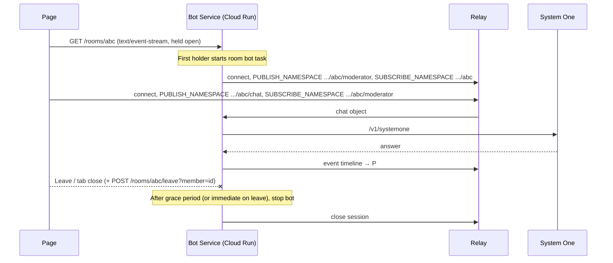

# Design: AI Demo Bots Started per Room, on Demand

## Status
Superseded by [`bot-dispatcher/architecture.md`](../bot-dispatcher/architecture.md) (which launches each bot as a job). Kept for historical context and the temporary-app token flow.

## Date
2026-10-19

## Scope
Covered the three pipecat demo bots under `examples/python/`, their browser pages under `examples/browser/examples/`, and their Cloud Run deployment:

| Bot | Page | Reads | Publishes |
| --- | --- | --- | --- |
| `moq-chat-moderation` | MoQ Chat Moderation | `anon/moq-chat-moderation/chat` | `anon/moq-chat-moderation/moderator` |
| `moq-camera-detection` | MoQ Camera Detection | `anon/moq-camera-detection/camera` | `anon/moq-camera-detection/detector` |
| `moq-ptz-tracking` | MoQ PTZ Tracking | `anon/moq-ptz-tracking/viewer`, `anon/onvif/client` | `anon/moq-ptz-tracking/tracker`, `anon/onvif/viewer` |

The System One Cloud Run model server (`/v1/systemone`, MoQ-unaware; see [system-one-on-cloud-run.md](../../../examples/python/system-one-on-cloud-run.md)) stayed unchanged.

## Context
Previously, all three bots ran continuously on one weekday-scheduled VM (9:00–17:30 Asia/Tokyo, with client-side notice in `examples/browser/utils/botHours.ts`):
1. **Idle cost**: Bots ran even with zero active users.
2. **Namespace collisions**: Fixed namespaces caused concurrent users to overwrite each other (e.g., `anon/moq-camera-detection/camera`).
3. **Silent failure**: A down bot was indistinguishable from a bot producing no detections.

## Decision
Each bot gained a `serve` HTTP mode on Cloud Run that runs one asyncio bot task per room while at least one page holds a request open.

### Rooms in the Namespace
Room IDs (`1–32` chars of `[a-z0-9-]`, taken from `?room=` or auto-generated into the URL) sit under the demo prefix (already covered by `anon/**`):
- `anon/moq-chat-moderation/<room>/{chat,moderator}`
- `anon/moq-camera-detection/<room>/{camera,detector}`
- PTZ tracking keeps its fixed ONVIF namespaces and accepts only `/rooms/onvif`.

### The Room Request (`GET /rooms/{room}`)

- **Stream lifecycle**: Opened via `fetch` on Join (reconnecting after 3 s on unexpected drop; `EventSource` is not used because it cannot send `Authorization: Bearer`). Non-SSE errors (`400`, `401`, `503`) abort retries.
- **Explicit leave**: Stream starts with a `member` event ID. On Leave/`pagehide`, the page sends `POST /rooms/{room}/leave?member={id}` (bodyless, headerless for no CORS preflight, `keepalive: true`), triggering immediate teardown while Cloud Run still allocates CPU.
- **Keepalive caveat**: Server writes a comment every 15 s, but Cloud Run's frontend buffers writes after browser disconnect until request timeout (measured 2026-10-22), so bots also detect empty rooms via MoQT namespaces.
- **Terminal SSE events** (stop page reconnects and display reason): `full` (`--max-rooms` exceeded), `closed` (outside `--open-hours`), `expired` (`--max-room-seconds` reached), `failed` (bot crashed).

### Room Lifetime & Cloud Run Settings
- **Per-room isolation**: First request starts an asyncio task with its own relay session; subsequent requests increment the holder count (shared bot). Dropping to 0 holds waits 30 s before cancelling so reloads do not restart the bot.
- **Namespace-driven exit**: If the room's page namespace stays unpublished for the grace period, the bot exits and closes held requests (freeing slots left open by disconnected tabs).
- **Caps & shutdown**: Rooms stop at `--max-room-seconds` (1 h; kept as an `expired` tombstone for one grace period so reconnecting tabs do not restart it), at `--open-hours` close (`closed`), and on `SIGTERM`.
- **Single instance**: In-memory room map requires `max-instances 1` with high `concurrency`.

| Cloud Run setting | Value | Reason |
| --- | --- | --- |
| Billing | Request-based (`--cpu-throttling`) | Avoids billing ~15 min idle tails and scanner wakeups; room holds request open while active. (Throttled teardown may miss relay close, falling back to relay idle timeout.) |
| Instances | `min 0`, `max 1` | Scale to zero when idle; single room map |
| Request timeout | `3600 s` | Covers `--max-room-seconds`; page reconnects within grace period if dropped |
| Ingress | All, unauthenticated | Direct browser access (bounded by Limits below) |
| Service account | `roles/run.invoker` on System One | Metadata identity token (`--metadata-auth`) |

### Temporary apps
Pages in temporary mode run under `temp-…` instead of `anon`, and bots do not hold the temporary-apps signing secret:

- **Token handoff**: `GET /rooms/{room}` sends `Authorization: Bearer <token>` (requiring CORS preflight on `OPTIONS`; query params are avoided because URLs land in Cloud Run/proxy access logs and temporary tokens can be refreshed indefinitely). `leave` uses the `member` ID as its capability.
- **Validation**: Service validates by refreshing the token at `POST /tokens/refresh` on `temporary-apps` (`401` on reject, `503` if unreachable) and uses the returned `appId` as namespace root (missing header defaults to `anon`). Registered `?jwt=` tokens are rejected and not sent by pages.
- **Room key & refresh**: Keyed by `(namespace_root, room_id)`. The bot refreshes via `moq_wasm.connect(refresh_token=AppToken.refresh)` 5 minutes before expiry using the relay's in-session refresh ([`relay/architecture.md`](../relay/architecture.md) "Token refresh"), retrying every 30 s on failure; expiry raises `TokenExpired` and ends the room with `failed`.
- **Issuer URL**: `--temporary-apps-url` → `TEMPORARY_APPS_URL` → `http://localhost:8083` (local relay) or `https://token-mint.moqt.research.skyway.io`. (PTZ's camera only publishes under `anon/onvif/client`, so temporary PTZ rooms have no camera.)

### Limits & Discovery
- **Abuse bounds**: `--max-rooms` (camera `1`, chat `10`), `--max-room-seconds` (`1 h`), `--open-hours` (weekdays 9:00–17:30 Asia/Tokyo), `--allowed-origin` check, server-pinned relay/System One URLs, and `max-instances 1`.
- **URL discovery**: Pages derive bot service URL from relay URL (like `resolveRecorderUrl`), overridable via `?botUrl=` only for localhost or `*.moqt.research.skyway.io` (`urlFromQuery`).
- **Removed**: Bot VM/schedule, `examples/browser/utils/botHours.ts`, and long-running CLI mode (local dev and E2E use `serve`).

## Consequences
- **Positive**: Cost tracks usage within open hours; forgotten tabs cap at 1 h; concurrent rooms no longer collide; logs flow to Cloud Logging.
- **Negative**: Adds `aiohttp.web` server per bot (already a dependency); cold starts add seconds on top of System One; anyone can hold a room open up to the limits.

## Rollout
1. Deploy `serve` services with per-room namespaces (VM keeps serving old fixed namespaces).
2. Ship updated browser pages.
3. Delete VM and schedule.

## Alternatives Considered
- **Cloud Run worker pools**: Keeps idle cost ($13–38/mo vs ~$7 VM), collisions, and silent failure.
- **Embed pipecat in System One GPU container**: Keeps ~$1.70/h GPU running for quiet rooms, slows prompt deploys (~5 min cold start), and VPC egress blocks public relay access.
- **Always-on relay dispatcher**: Still requires a 24/7 VM or worker pool.
- **Cloud Scheduler toggling ingress**: Causes config drift and opaque browser failures instead of `closed` notices.
- **Instance-based billing**: Bills idle tails and scanner hits (1 h real use billed 6.7 h on transcriber on 2026-10-21).
