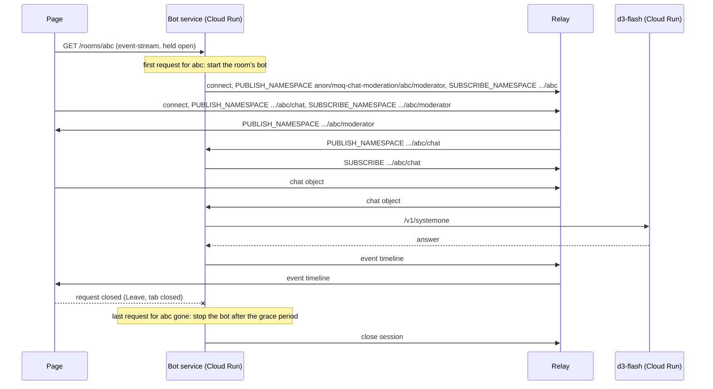

# Design: AI demo bots started per room, on demand

## Status
Proposed

## Date
2026-10-19

## Scope
The three pipecat bots under `examples/python/`, their browser pages under
`examples/browser/examples/`, and how they are deployed:

| Bot | Page | Reads | Publishes |
| --- | --- | --- | --- |
| `moq-chat-moderation` | MoQ Chat Moderation | `anon/moq-chat-moderation/chat` | `anon/moq-chat-moderation/moderator` |
| `moq-camera-detection` | MoQ Camera Detection | `anon/moq-camera-detection/camera` | `anon/moq-camera-detection/detector` |
| `moq-ptz-tracking` | MoQ PTZ Tracking | `anon/moq-ptz-tracking/viewer`, `anon/onvif/client` | `anon/moq-ptz-tracking/tracker`, `anon/onvif/viewer` |

d3-flash, the model server the bots call, stays as it is: a Cloud Run service
that answers `/v1/systemone` and knows nothing about MoQ
(see [d3-flash-on-cloud-run.md](../../../examples/python/d3-flash-on-cloud-run.md)).

## Context
Each bot is a process that connects to relay-1 when it starts and stays
connected until it is stopped. All three run on one VM, which an instance
schedule keeps up on weekdays 9:00–17:30 Asia/Tokyo only. The pages show a
notice outside those hours (`examples/browser/utils/botHours.ts`).

Three things go wrong with this shape:

1. The bot's lifetime has nothing to do with use. It runs when nobody has a
   page open, through every weekday, and the schedule is the only thing that
   bounds it.
2. There are no rooms. Every page and its bot use one fixed namespace, so two
   people who open the camera page at the same time both publish
   `anon/moq-camera-detection/camera`, and the second one collides with the
   first.
3. A bot that is down looks to the page like a bot that judged nothing.

Holding a MoQ session open is cheap and is not the problem. The problem is
that nothing starts or stops the bot.

## Decision
A page asks for a bot when it joins a room and keeps asking for as long as it
stays. Each bot package gains a `serve` mode: an HTTP server that runs one bot
per room while at least one page holds a request for that room. Each bot runs
as its own Cloud Run service.

### Rooms in the namespace
A room ID becomes the element after the demo name:

```text
anon/moq-chat-moderation/<room>/chat
anon/moq-chat-moderation/<room>/moderator
anon/moq-camera-detection/<room>/camera
anon/moq-camera-detection/<room>/detector
```

The page takes the room from the `room` query parameter. Without one, it
generates a random ID and writes it into the URL so the link can be shared. A
room ID is 1–32 characters of `[a-z0-9-]`, so it is always a single namespace
element. The relay's anonymous scope is `anon/**`, so the deeper namespace
needs no relay change.

PTZ tracking keeps its namespaces and has one fixed room, because there is one
ONVIF camera behind `anon/onvif/client`. It gets the same on-demand start as
the other two: its page always requests `/rooms/onvif`, and its server
accepts no other room.

### The room request
`GET /rooms/{room}` answers with `text/event-stream` and keeps the response
open. The page opens it with `EventSource` when the user presses Join, before
it connects to the relay, so the bot's start overlaps with the page's own
connect. The page closes it on Leave or `pagehide`.

The stream starts with a `member` event that names the hold. When the page
closes the stream, it also sends `POST /rooms/{room}/leave?member={id}`,
without a body or headers so that no CORS preflight is needed, and with
`keepalive` so that it outlives a closing tab. The server ends that hold at
once, and the room at once if no other page holds it, without the grace
period, and answers after the bot has left so that the teardown runs while
Cloud Run gives the instance CPU.

`POST /rooms/{room}/stop?member={id}`, sent the same way, ends the room for
every page that holds it: each stream gets
`stopped`. The server forgets the room once its bot has left, so the next
request starts a new bot.

The server sends a comment line every 15 s. A write to a page that is gone
fails, so a server the page reaches directly notices a closed tab within one
interval even when no TCP FIN arrives. Cloud Run does not pass that on: its
frontend keeps the request to the container open after the browser goes away,
and the writes keep succeeding until the request times out (measured
2026-10-22 on the deployed services). The bot therefore also tells the server
when the room is empty (below).

The page needs no new state for the bot itself. It already sends
SUBSCRIBE_NAMESPACE for the bot's namespace and starts the event timeline and
the d3-flash status on the PUBLISH_NAMESPACE that follows, whenever that
arrives (`setUpD3FlashBotPage` in `examples/browser/utils/d3FlashBot.ts`).
The stream carries the server's own events, each of which ends the response:

| Event | Sent when |
| --- | --- |
| `full` | a new room would exceed `--max-rooms` |
| `closed` | the request comes outside the opening hours, or the hours end while the room runs |
| `expired` | the room has run for `--max-room-seconds` |
| `failed` | the bot stopped with an exception |
| `stopped` | a page that holds the room stopped it |

The page closes the `EventSource` on any of them, since `EventSource` reopens
any stream the server ends, and shows why the bot left. `closed` shows the
off-hours notice the pages show today.



### Room lifetime in the server
The server keeps a map from room ID to a running bot and the number of open
requests for it.

- The first request for a room starts the bot as an asyncio task. The task
  does what `main()` does today, with the room's namespaces. Each room has its
  own relay session, so one room's failure or GOAWAY does not touch another.
- Further requests for the same room only raise the count, so every page in a
  room shares one bot. The pages of a room also share the namespace they
  publish under. The relay forwards the bot's SUBSCRIBE to one of them, so the
  bot reads one page's chat at a time, as with the fixed namespace. When that
  page leaves, the relay ends the track and the bot subscribes again, reaching
  a page that stayed. In practice the count covers a second tab and the
  reconnects of one page.
- When the count drops to zero, the server waits 30 s and then cancels the
  task. The task closes its relay session before it ends. A request that
  arrives within the 30 s keeps the bot running, so a page reload or an
  `EventSource` retry does not restart it.
- The bot follows the namespace its room's pages publish (`.../chat`,
  `.../camera`, the PTZ `viewer`, a Meeting participant's
  `{root}/{room}/{user}`). When it has gone unpublished for the grace period,
  from the start or since the last page withdrew it, the bot closes its relay
  session and returns. The server then ends the room at once and forgets it.
  Requests still held for it end without an event, so a page that is in fact
  still there reconnects and starts a new bot, and one that is gone frees the
  slot instead of holding it until `--max-room-seconds`.
- A room stops by itself `--max-room-seconds` (1 h) after its bot started,
  counted from the first request, so a tab left open does not keep a bot, and
  through it d3-flash, running for the rest of the day. Every open request gets `expired`.
  The expired room stays in the map, answering `expired` at once, until its
  last request has been gone for the grace period. An `EventSource` that
  reconnects in that window therefore does not start the room again. A page
  that joins the same room ID later starts a new bot.
- Outside the opening hours (`--open-hours`) a request for a new room gets
  `closed`. When the hours end, every running room stops the same way as an
  expired one, with `closed`. Without `--open-hours` the server is always
  open, which is what local development and the E2E tests use.
- SIGTERM, which Cloud Run sends before it stops an instance, cancels every
  room the same way.

The map lives in memory, so the service runs at most one instance
(`max-instances 1`). Two instances could each start a bot for the same room
and judge every message twice. One instance holds every room, and requests
are concurrent (`concurrency` well above the expected number of open pages).

### Cloud Run settings
| Setting | Value | Reason |
| --- | --- | --- |
| Billing | request-based (`--cpu-throttling`) | A room runs only while a page holds its request, so the room keeps the CPU. The 30 s grace period and the teardown after the last page leaves run throttled. |
| Instances | min 0, max 1 | Zero rooms means zero instances. The room map needs a single instance. |
| Request timeout | 3600 s (the maximum) | A request is held for the whole time a page stays in the room, which `--max-room-seconds` keeps within this. If a request still drops, `EventSource` opens a new one and the grace period covers the gap. |
| Ingress | all, unauthenticated | A browser opens the request directly. See "Limits" for abuse. |
| Service account | own, with `roles/run.invoker` on d3-flash | The bot keeps sending the identity token it gets from the metadata server (`--metadata-auth`), which Cloud Run provides as GCE does. |

Request-based billing does not bill an instance's idle tail, the up to
about 15 minutes it may stay up with no open request before Cloud Run stops
it. Scanners request the public URL many times a day, and each of their
requests starts an instance.

The throttled teardown may not reach the relay. The relay then ends the bot's session at its idle timeout, and the
bot's namespaces outlive the room until then.

### Limits
The endpoint has no authentication, so the server bounds what a request can
cause, as `recorder serve` does:

- `--max-rooms`. A request for a new room beyond it gets the `full` event and
  the response ends. The camera bot starts at 1: one camera room already
  sends d3-flash a picture every 0.1 s, and d3-flash answers one batch at a
  time. Chat starts at 10.
- `--max-room-seconds` (1 h) and `--open-hours` (weekdays 9:00–17:30
  Asia/Tokyo in the deployment), described above.
- A request whose `Origin` is not an `--allowed-origin` is refused.
- The relay URL and the d3-flash URL are server settings, so a request cannot
  point a bot at another relay or model server.

`max-instances 1` on both the bot service and d3-flash also bounds the cost.

### Where the page finds the service
The page derives the bot service URL from the relay URL, as the meeting page
does for the recorder (`resolveRecorderUrl`): a local relay means a local
`serve` on a fixed port, and any other relay means the deployed service. A
`botUrl` query parameter overrides it.

The bot always connects to the relay its server is configured with
(relay-1 in the deployment). A page that picked relay-2 or relay-3 reaches it
the way it does today.

### What goes away
- The bot VM and its instance schedule.
- `examples/browser/utils/botHours.ts`. The pages keep the off-hours notice
  but show it on `closed`, so the hours are defined only in the server.
- The long-running CLI mode of each bot. `serve` also runs locally, so local
  development and the E2E tests (`tests/browser-e2e/run-chat-moderation-e2e.mjs`,
  `run-camera-detection-e2e.mjs`) start `serve` and pass `botUrl`, and keep a
  single code path.

## Consequences

### Positive
- Within the opening hours, bots run exactly while someone uses a room, and
  the cost follows use. Outside them, nothing runs.
- A forgotten tab costs at most one hour of bot and d3-flash time.
- Several rooms can run at once, so two people trying the camera page no
  longer collide.
- Container stdout reaches Cloud Logging, which it does not on the VM.

### Negative
- Each bot package gets an HTTP server and a room map. `aiohttp` is already a
  dependency of all three, so `aiohttp.web` adds no new package.
- The first page in a room after a quiet period waits for a container start
  (seconds) on top of d3-flash's own cold start (minutes), as it does today.
- Anyone can keep a bot running by holding the request open. The limits
  above bound how much that costs.

## Rollout
The page and the bot must agree on the namespace, so the order matters:

1. Ship `serve` with the per-room namespaces and deploy the three services.
   The VM keeps serving the old pages on the old fixed namespaces meanwhile.
2. Ship the pages that open the room request and use the per-room namespaces.
3. Delete the VM and its schedule.

## Alternatives Considered

### Run the current bots unchanged on Cloud Run worker pools
This is the smallest move: a worker pool runs a process with no HTTP port, and
Cloud Scheduler can switch it between 0 and 1 instances on the current
schedule. It keeps all three problems above. It also costs more than the VM:
about $13–38 a month for the scheduled hours against about $7.

### Embed pipecat in the d3-flash container
This removes the JPEG and HTTP hop between the bot and the model, but the
model server runs one batch at a time, so throughput does not improve. In
exchange:
- The GPU instance (about $1.70/h) stays up for as long as a room is open,
  including a quiet chat room.
- Every change to a prompt or to bot logic rebuilds the CUDA image, and each
  deploy waits through a cold start of about five minutes.
- d3-flash sends all egress through a VPC subnet with no route to the
  internet, so it cannot reach the relay's public name.

### An always-on dispatcher that finds rooms through the relay
A small process sends SUBSCRIBE_NAMESPACE for `anon/moq-chat-moderation/` and
starts a room's bot when a chat broadcast appears, as LiveKit Agents
dispatches workers. The pages need no HTTP call. It still leaves one process
running all the time, so it still needs a VM or a worker pool and their
schedule, which is what this design removes.

### Stop the services outside the opening hours from Cloud Scheduler
A Cloud Run service cannot be stopped the way a VM can. Closing it at night
means switching its unauthenticated access or its ingress on a schedule, so
the deployed state differs from its declared configuration every evening, and
a page sees only a failed request. A check in the server needs no
infrastructure, and the page can tell the user why.

### Instance-based billing on the bot service
It bills each instance's idle tail, and every scanner request starts an
instance: one hour of real use on 2026-10-21 billed 6.7 hours on the
transcriber. It would keep the CPU for the grace period and the relay
teardown.
