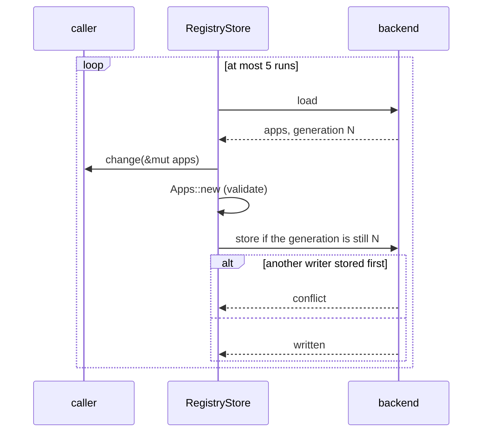

# `app-registry` Architecture

## Status
Living document. Update this file in the same change whenever the design intent,
module boundaries, runtime flow, or invariants described here change.

## Scope
`app-registry` keeps the registry of apps: each app's `appId`, `secret` and
`isRelay`, plus an optional `name`, the `sub` of the account that owns it,
`createdAt` and `rotatedAt` (when its secret was last replaced). One `sub` may
own several apps. The registry is one JSON document, an array of rows in the shape
of the VTS apps file, kept in Cloud Storage in production or in a local file
for development, tests and a single on-premises server.

The crate reads and writes the registry. It decides nothing about who may
create an app or how a secret is generated; those rules belong to its callers.

## Modules

| Module | Responsibility |
| --- | --- |
| `app.rs` | `App` (one row) and `Apps` (a validated list). `Apps::new` rejects an empty `appId` or `secret` and a duplicated `appId`. |
| `store.rs` | `RegistryStore`, the one entry point: `load` (apps and generation) and `update` (load, change, conditional store, retry). `Location` picks the backend. |
| `location.rs` | `Location`, the backend a store uses. `Location::from_env` reads it from environment variables whose names each caller passes, so the VTS and the console keep their own names. |
| `cloud_storage.rs` | The Cloud Storage backend over the JSON API. The generation is the object's; a store is an upload with `ifGenerationMatch`. `Endpoint` picks Cloud Storage or an emulator. |
| `file.rs` | The local file backend. The generation is a hash of the contents; a store compares it, writes a temporary file and renames it over the registry. |
| `credentials.rs` | The bearer token for Cloud Storage, taken from the metadata server and reused until 60 seconds before it expires. No token is sent to an emulator. |

## Update flow

## Invariants

- Every write is conditional on the generation that was read, so two writers
  never overwrite each other; the loser reloads and runs its change again. The
  file backend checks and renames without a lock, so it holds this only for
  one writing process; Cloud Storage holds it for any number of machines.
- A reader of the file backend never sees a half-written registry, because a
  store renames a complete temporary file over it.
- A change that leaves the registry invalid is never stored, and a change that
  leaves the apps as they were stores nothing.
- `update` may run the change more than once, so a change must not have side
  effects beyond the apps it is given.
- `load` fails when the registry does not exist. It is created once, out of
  band, with the relay's app in it.
- Unknown fields in a row are ignored on read, so rows written by an older
  writer stay readable.
