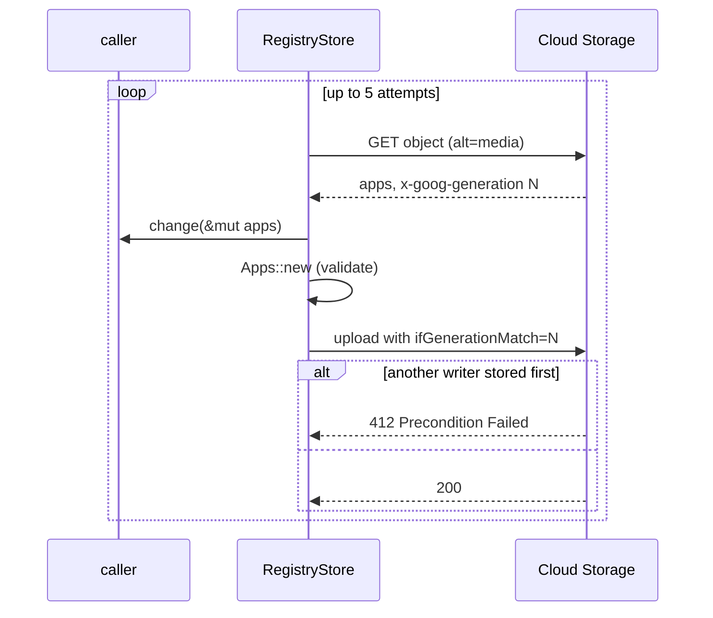

# `app-registry` Architecture

## Status
Living document. Update this file in the same change whenever the design intent,
module boundaries, runtime flow, or invariants described here change.

## Scope
`app-registry` keeps the registry of apps: each app's `appId`, `secret` and
`isRelay`, plus an optional `name`, the `sub` of the account that owns it and
`createdAt`. The registry is one JSON object in Cloud Storage, an array of
rows in the shape of the VTS apps file.

The crate reads and writes the registry. It decides nothing about who may
create an app or how a secret is generated; those rules belong to its callers.

## Modules

| Module | Responsibility |
| --- | --- |
| `app.rs` | `App` (one row) and `Apps` (a validated list). `Apps::new` rejects an empty `appId` or `secret`, a duplicated `appId`, and a `sub` that owns more than one app. |
| `store.rs` | `RegistryStore` over the Cloud Storage JSON API: `load` (apps and generation), `generation` (metadata only) and `update` (load, change, conditional upload, retry). `Endpoint` picks Cloud Storage or an emulator. |
| `credentials.rs` | The bearer token for Cloud Storage, taken from the metadata server and reused until 60 seconds before it expires. No token is sent to an emulator. |

## Update flow

## Invariants

- Every write is conditional on the generation that was read, so two writers
  never overwrite each other; the loser reloads and runs its change again.
- A change that leaves the registry invalid is never stored.
- `update` may run the change more than once, so a change must not have side
  effects beyond the apps it is given.
- `load` fails when the object does not exist. The registry is created once,
  out of band, with the relay's app in it.
- Unknown fields in a row are ignored on read, so rows written by an older
  writer stay readable.
