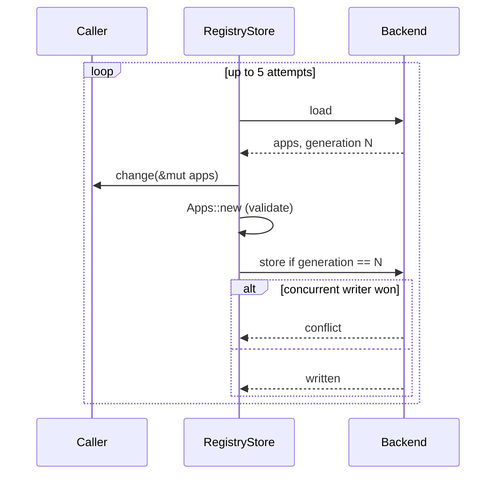

# `app-registry` Architecture

## Status
Living document. Update alongside any change to design intent, module boundaries, runtime flow, or invariants.

## Scope
`app-registry` reads and writes the shared app registry—a single JSON array matching the VTS apps file shape, stored in Cloud Storage (production) or a local file (development, tests, single on-premises server).

Each app row holds:
- **Core**: `appId`, `secret`, `isRelay`
- **Metadata** (optional): `name`, owner `sub` (one `sub` may own multiple apps), `createdAt`, `rotatedAt` (last secret rotation)
- **SIP gateway `phone` settings** ([`sip-gateway/architecture.md`](../sip-gateway/architecture.md)): E.164 inbound `numbers`, `callWebhook` queried for inbound calls, and `allowedDestinations` outbound prefixes

Access control (who may create an app) and secret generation belong to callers, not this crate.

## Modules

| Module | Key types | Responsibility |
| --- | --- | --- |
| `app.rs` | `App`, `Apps`, `Phone` | Row schema and validation. `Apps::new` enforces row invariants; `Phone::allows_destination` checks outbound prefixes. |
| `store.rs` | `RegistryStore` | Single entry point: `load` (returns apps + generation) and `update` (load, mutate, validate, conditional write, retry). |
| `location.rs` | `Location` | Backend selector. `Location::from_env` accepts caller-chosen env var names so VTS and console keep their own names. |
| `cloud_storage.rs` | — | Cloud Storage backend over `google-cloud`'s `CloudStorageBucket` (object generation + `ifGenerationMatch`). `Endpoint` picks Cloud Storage or an emulator. |
| `file.rs` | — | Local file backend. Uses a content hash as generation; checks it, writes a temp file, and atomically renames over the registry. |

### Validation Rules (`Apps::new`)
Rejects:
- Empty `appId` or `secret`, or duplicate `appId`
- Non-E.164 phone numbers or destination prefixes
- `numbers` set without `callWebhook`
- The same inbound phone number listed on two apps

## Update Flow

## Invariants

**Concurrency & atomicity**
- **Optimistic concurrency**: Every write checks the generation read at load; a losing writer reloads and retries. Cloud Storage enforces this across machines; the file backend serializes check-and-rename within one process only (no cross-process lock).
- **Atomic local reads**: Readers of the file backend never see partial writes because stores rename a complete temporary file into place.
- **Pure mutation callbacks**: `update` may invoke `change` multiple times on retry, so callbacks must have no external side effects.

**Data safety & rollout**
- **No invalid or no-op writes**: Invalid mutations are never written; unchanged apps skip the store entirely.
- **Pre-provisioned registry**: `load` fails if the registry does not exist; it is initialized out of band with the relay's app.
- **Schema rollout**: Unknown fields are ignored on read, so older writers still read newer rows—but drop unknown fields on write. Deploy all writers (`console`) before writing rows with new fields.
