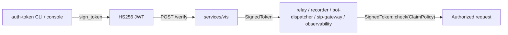

# `auth-token` Architecture

## Status
Living document. Update alongside any change to design intent, module boundaries, runtime flow, or invariants.

## Scope
`auth-token` defines the workspace's client JWT payload, HS256 signing/verification, post-VTS claim checks, a VTS verification client, and a signing CLI.

## Modules

| Module | Key types / items | Responsibility |
| --- | --- | --- |
| `lib.rs` | `Claims`, `Claims::issued`, `unix_now`, `TEMPORARY_APP_ID_PREFIX` | Claim schema, lifetime helper (`iat`/`exp` in Unix seconds), and temporary app `appId` prefix (see [`vts/architecture.md`](../vts/architecture.md)). |
| `temporary_app.rs` | `temporary_app_id`, `TemporaryAppTokenError` | Reads `appId` from an unexpired temporary app token without verifying its signature (`temporary-apps` verifies first; `live-translate` leaves verification to the relay). |
| `jwt.rs` | `sign_token`, `decode_unverified_payload`, `verify_signature`, `SignatureError` | Compact JWS over `aws-lc-rs` HMAC-SHA256. Header is fixed to `{"alg":"HS256"}`. |
| `signed_token.rs` | `SignedToken`, `ClaimPolicy`, `ClaimError`, `Access` | VTS `/verify` response (`appId`, `isRelay`, `claims`). `check` enforces `ClaimPolicy` (default: 24 h max client TTL, 60 s clock leeway), `iat`/`exp`, and namespace format; `covers` checks element-by-element namespace coverage. |
| `vts_client.rs` | `VtsClient`, `VtsVerifyError`, `AuthorizeError` | Optional (`vts-client` feature). `verify` calls VTS `POST /verify` with a 3 s timeout and W3C trace context; returns `SignedToken` or `Unauthorized` / `Unavailable`. `authorize` verifies a bearer token, then runs `SignedToken::check` and requires a non-relay token whose claim for an `Access` covers a namespace prefix; `AuthorizeError` separates missing token, VTS rejection, VTS unavailable, invalid claims, and forbidden so HTTP services map each to a status. |
| `bin/auth-token/` | `auth-token` CLI (`lifetime.rs`) | Optional (`cli` feature). Signs tokens using `AUTH_TOKEN_SECRET`. Flags: `--app-id`, `--publish`, `--subscribe`, `--bots`, `--calls`, `--ttl` (`15s`/`30m`/`12h`/`365d`), `--relay-id`. |

## Payload Claims

| Claim | Meaning |
| --- | --- |
| `appId` | Registered app whose secret signed the token; also the namespace root. |
| `publish` / `subscribe` | Relative namespace path allowed for publishing/subscribing (`""` = whole app root; absent = denied). |
| `bots` | Relative namespace path for starting/stopping/listing bots ([`bot-dispatcher`](../bot-dispatcher/architecture.md)); `""` = app root; absent on client tokens. |
| `calls` | Relative namespace path for phone calls ([`sip-gateway`](../sip-gateway/architecture.md)); `""` = app root; absent on client tokens. |
| `iat` / `exp` | Unix seconds. Checked by `SignedToken::check` under the caller's `ClaimPolicy`, never by VTS. |
| `relayId` | `RELAY_ID` of a relay peer (recorded as `peer_relay_id` by the accepting relay). Absent on client tokens. |

## Producers and Consumers

- **Signers**: `services/console` (`apps.rs`), `services/temporary-apps` (`issuer.rs`), `services/bot-dispatcher` (`signer.rs`), `services/sip-gateway` (`calls.rs`, `webhook.rs`), and the `auth-token` CLI build `Claims::issued` and sign via `sign_token`.
- **Signature verifier**: `services/vts` (`verify.rs`) calls `decode_unverified_payload` then `verify_signature`.
- **Token consumers**: `services/relay` (`modules/auth/vts_token_verifier.rs`), `services/recorder` (`api_auth.rs`), and `services/observability` (`app_verifier.rs`) call `VtsClient::verify` and run `SignedToken::check` with their own `ClaimPolicy` and authorization rules (`recorder` also checks `covers`); `services/bot-dispatcher` (`launch_auth.rs`, `bots`) and `services/sip-gateway` (`call_auth.rs`, `calls`) call `VtsClient::authorize` and map `AuthorizeError` to their HTTP responses. They hold no secret and never sign or verify locally.

## Invariants

**Security**
- **Signature before trust**: `decode_unverified_payload` does not verify the signature; authorization requires `verify_signature` with the app's secret.
- **HS256 only**: Any header `alg` other than `HS256` fails with `InvalidSignature`.
- **Secret isolation**: The crate stores no secrets; callers supply them. The CLI reads `AUTH_TOKEN_SECRET` from the environment only (never CLI args) and does not depend on `app-registry` or storage clients.

**Compatibility & packaging**
- **Feature-gated dependencies**: `clap` is behind `cli`; `reqwest`, `telemetry-otlp`, and `tracing` behind `vts-client`. Library-only consumers never build unused dependencies.
- **Forward-compatible claims**: Unknown claims are ignored on read and omitted on write, so VTS passes signed payloads through unchanged while readers inspect only known fields.
- **Consistent time/path checks**: Every VTS consumer validates timestamps and namespace paths through `SignedToken::check`.
