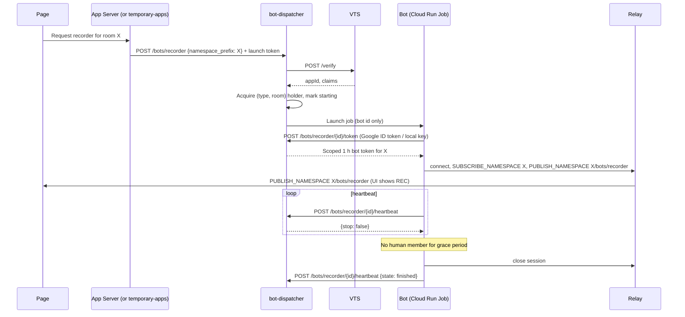

# Design: `bot-dispatcher` Service for Launching Room Bots

## Status
Accepted (2026-11-18)

## Scope
`services/bot-dispatcher` starts, stops, and tracks room bots, affecting:
- `services/recorder`: `recorder record` runs as a bot; `recorder serve` keeps read/replay APIs and drops start/stop.
- `examples/python/moq-*`: replaces `moq-bot-rooms`.
- `services/temporary-apps`: acts as app server for temporary apps.
- `crates/auth-token`: adds the `bots` launch claim.

## Context
Previously, `recorder serve` (`POST /recordings` with page JWT passed in `--token`) and `moq-bot-rooms` (`GET /rooms/{room}`) let pages start bots directly, causing four issues:
1. **End-user control**: Any page holding a room token could launch billable jobs.
2. **Credential leak**: Bots held the user's `publish`-capable token inside Cloud Run job overrides / process args.
3. **Token-bound lifetime**: Registered-app tokens could not be renewed by the bot, cutting off recordings at `exp`.
4. **No bot identity**: The relay saw identical tokens for users and bots.

## Decision

### Launch Flow & Roles
Bot launches are server-to-server: the app server decides and sends a short-lived **launch token**; `bot-dispatcher` launches the job and signs a scoped **bot token** when the bot calls back.



| Party | Holds | Responsibility |
| --- | --- | --- |
| App server | App secret | Authorizes bot launches; signs launch tokens |
| `temporary-apps` | Temporary app secret | Acts as app server for all temporary apps |
| `bot-dispatcher` | Registry read access + temp secret | Verifies launch tokens via VTS, launches jobs, signs bot tokens, tracks state |
| Bot | Bot ID + job identity | Joins room with bot token, sends heartbeats, exits on idle/stop |

Bots never see app secrets, launch tokens, or user tokens.

### Tokens & Bot Authentication
- **Launch token**: `auth_token::Claims` signed with app secret carrying `bots` (relative namespace prefix; `""` = app root; absent = denied). Carries no `publish`/`subscribe` (unusable on relay), lives ≤ 5 min, and cannot be a relay token (`isRelay`).
- **Bot token**: Signed by `bot-dispatcher` (`Claims::issued`) reading the app's current secret from `app-registry` on every sign (or temp secret) so rotations/deletions take effect at next renewal. Lives 1 hour; bots renew 5 min before expiry via relay in-session refresh (`TokenRefreshTask` / `moq_wasm.connect`). Refused once the bot is no longer running.
  - `recorder`: `subscribe: <room>`, `publish: <room>/bots/recorder`
  - AI bots: `subscribe: <room>`, `publish: <room>/bots/<type>`
- **Bot authentication**: Jobs start with only their bot ID (no secrets in args) and call `/token` and `/heartbeat` with a Google ID token (`aud` = `BOT_DISPATCHER_PUBLIC_URL`, RS256 against Google JWKS, `email` in `BOT_DISPATCHER_JOB_SERVICE_ACCOUNT`). Under `--launcher local`, a random per-bot key is passed via `BOT_DISPATCHER_BOT_KEY` env var instead. JWKS URL is configurable for unit tests.

### Bots in the Room
- **Presence namespace**: `<room>/bots/<type>` (4 elements under `<app>/<room>`), so 3-element participant logic ignores bots and usernames cannot collide. Pages detect bots directly from `PUBLISH_NAMESPACE` / `PUBLISH_NAMESPACE_DONE` instead of polling (`botNamespace`, `botTypeOf`, and `watchBroadcasts`'s `onBotChange` in `moq-wasm/media`).
- **Human member**: Any namespace under `<room>` not under reserved segments `bots` or `recordings`.
- **Auto-stop**: By default, bots exit after no human publisher is present for the grace period (including from startup), on `DELETE /bots/{type}/{id}` (next heartbeat returns `{stop: true}`), at longest run, or on `SIGTERM`. Listeners who do not publish do not keep a room alive. A registered app server may opt out per launch with `stay_when_empty: true` (default `false`; not stored or returned on the bot record), passing `max_seconds` as `--grace-seconds` (`services/temporary-apps` refuses `stay_when_empty: true` with `403 forbidden`).

| Type | Grace period | Longest run |
| --- | --- | --- |
| `recorder` | `300 s` | `2 h` |
| AI bots | `30 s` | `1 h` |

### Launchers, State & API
- **Launchers**: Uses shared `crates/job-launcher` (`CloudRun` job execution with overridden args, or `Local` child process; also used by `recorder composite`). Alternative faster launchers can be added per bot type without changing the API.
- **Stateless service**: All state lives in an object store (`gs://` or `file://`): one JSON record per bot plus one holder per `(type, room)` pointing to the latest bot. Holders use `PutMode::Create` / conditional replace only after the prior bot is inactive and are never deleted, guaranteeing at most one active bot per `(type, room)` across any number of instances.
- **Heartbeat & output**: States (`starting`, `running`, `stopping`, `finished`, `failed`) and an optional type-specific JSON object `output` are written only by `bot-dispatcher` from heartbeats (omitting `output` or sending `null` clears it, so bots include it on every heartbeat; non-objects return `400 invalid_request`; `recorder` reports `{"recording_id": "<id>"}`). A bot silent for **90 s** (or **5 min** before its first heartbeat, allowing ~2 min first-run image import) is marked `failed` and replaceable. `recorder` keeps its own recording/file metadata separately for `recorder serve`.

| Route | Caller | Response |
| --- | --- | --- |
| `POST /bots/{type}` `{namespace_prefix, options?, stay_when_empty?}` | App server | `201` bot; `400 invalid_options`; `409` already running in room; `503` at limit |
| `GET /bots?namespace_prefix=` | App server | `{"bots": […]}` latest bot per configured type in room (type-name order) |
| `GET /bots/{type}?namespace_prefix=` | App server | Room's latest bot of `{type}` |
| `GET /bots/{type}/{id}` | App server | Bot record |
| `DELETE /bots/{type}/{id}` | App server | `202` (stops on next heartbeat) |
| `POST /bots/{type}/{id}/token` | Bot | Fresh bot token |
| `POST /bots/{type}/{id}/heartbeat` `{state, error?, output?}` | Bot | `{stop}` |

Unknown types or type/ID mismatches return `404`. App comes from the launch token's `appId`; `SignedToken::covers` checks `bots` covers `namespace_prefix`. Relay URL, store, and limits are server-configured; no CORS headers are sent (server-to-server only).

### Temporary apps
`temporary-apps` holds the temporary app secret and serves as app server for all temporary apps:
- Exposes the app-server `/bots/{type}` routes to pages authenticated with their own `Authorization: Bearer` token.
- Verifies the page token (as in `POST /tokens/refresh`), mints a launch token (`bots` = page's `publish` claim), and forwards to `bot-dispatcher`.
- Enforces allowed types (`TEMPORARY_APPS_BOT_TYPES`), per-IP fixed-window rate limits, and refuses `stay_when_empty: true` with `403 forbidden`.

### Configuration & Modules
`BOT_DISPATCHER_TYPES` maps type names to JSON configs:
```json
{
  "recorder": {
    "launcher": { "kind": "cloud-run", "job": "projects/<p>/locations/<r>/jobs/<job>" },
    "args": ["bot"],
    "grace_seconds": 300,
    "max_seconds": 7200,
    "max_running": 5,
    "options": {
      "layout": ["combined", "per-track"],
      "composite": [true, false],
      "format": ["mp4", "moq"]
    }
  }
}
```
- **Local launcher**: Use `{"kind": "local", "program": "<path>"}` for local dev.
- **Option allow-list (`options`)**: Optional map from option key to non-empty array of allowed JSON scalars (malformed tables fail startup). `POST /bots/{type}` returns `400 invalid_options` before taking the room on non-objects, unknown keys, or unlisted values (cross-option checks like `composite: true` + `format: "moq"` stay in the bot; types without a table forward unchecked).
- **CLI args & spend bounds**: Bots receive `args` + `--bot-type`, `--bot-id`, `--bot-dispatcher-url`, `--namespace-prefix`, `--grace-seconds` (`max_seconds` when `stay_when_empty: true`), `--max-seconds`, and optional `--options <JSON>`. No per-app limits or opening hours: `max_running`, idle grace (unless `stay_when_empty: true`), `max_seconds`, and the deployment's daily cost cap bound spend.

| Env var | Purpose |
| --- | --- |
| `PORT` | Listen port (default `8098`) |
| `BOT_DISPATCHER_PUBLIC_URL` | Callback URL for bots and ID token `aud` |
| `BOT_DISPATCHER_VTS_URL` | VTS endpoint for launch tokens |
| `BOT_DISPATCHER_STORE_URL` | Bot state store (`gs://` or `file://`) |
| `BOT_DISPATCHER_REGISTRY_FILE` / `BOT_DISPATCHER_REGISTRY_BUCKET` + `BOT_DISPATCHER_REGISTRY_OBJECT` | App registry (validated once at startup; re-read per bot-token sign) |
| `BOT_DISPATCHER_TEMPORARY_APP_SECRET` | Secret for temporary app bot tokens |
| `BOT_DISPATCHER_JOB_SERVICE_ACCOUNT` | Comma-separated allowed Cloud Run Job service accounts |
| `BOT_DISPATCHER_GOOGLE_CERTS_URL` | JWKS URL for ID tokens (default Google) |
| `BOT_DISPATCHER_INSECURE_SKIP_AUTH` | `true` skips auth/registry and returns `null` bot token (local/E2E unauthenticated relay only) |

| Module | Key type | Responsibility |
| --- | --- | --- |
| `bot_types.rs` | `BotTypes` | Parses `BOT_DISPATCHER_TYPES`, launchers, limits, and optional `options` table |
| `launch_auth.rs` | `LaunchAuth` | Verifies launch tokens via `VtsClient` (≤ 5 min, non-relay, `bots` covers room) |
| `signer.rs` | `BotTokenSigner` | Signs bot tokens from registry or temp secret |
| `store.rs` | `BotStore` | Persists bot records, stop flags, room holders |
| `bots.rs` | `Bots` | Start/list (all types or one)/stop, bot token/heartbeat auth (`IdTokenVerifier` or local key) |
| `server.rs` | `BotDispatcherServer` | HTTP routes on `HttpServer` under `bot_dispatcher.request` span |

## Consequences, Alternatives & Open Questions

### Consequences
- **Positive**: Operators control launches; bots get scoped renewable tokens with zero secrets in args; bots are distinguishable by token and `bots/<type>` namespace; centralized limits.
- **Negative**: 24/7 operation relies on daily spend cap; registered apps need a server; `bot-dispatcher` becomes the third service holding app secrets (after VTS and console); adds RS256 JWKS verification; Cloud Run Job cold start (~12 s for recorder) is slower than warm services.

### Alternatives Considered
- **Forward page tokens**: Retains all four Context problems.
- **Join relay with launch token**: Prevents renewal without long-lived dual-purpose tokens.
- **Jobs read registry directly**: Exposes every app secret to every bot job and duplicates signing in Python.
- **Pass renewal key in args/store**: Leaks key in execution overrides or grants jobs store access.
- **Browser calls `bot-dispatcher` directly for temp apps**: Duplicates CORS and temp-token handling inside `bot-dispatcher`.

### Open Questions
- Opt-in page-token bot launches for serverless registered apps (deferred until requested).
