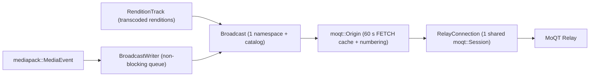

# `broadcast` Architecture

## Status
Living document. Update alongside any change to track layout, publishing flow, or invariants.

## Scope
`crates/broadcast` converts `mediapack::MediaEvent`s into an MSF broadcast (draft-ietf-moq-msf-02 §11.3, §11.4)—catalog, LOC and CMAF tracks, media timeline, and 60 s FETCH cache—and reads broadcasts back into `MediaEvent`s for `egress-gateway` and `sip-gateway`.

Used by `ingest-gateway`, `gst-plugin-moqt`, `moq-cli`, and `sdk/js` (Live Viewer MP4 publisher & browser SDK). Runs on native (`NATIVE`) and `wasm32` (`BROWSER`) by routing all tasks, timers, and clocks through `moqt::executor`. Track layout summary: [`crates/broadcast/README.md`](../../../crates/broadcast/README.md).

## Core Types & Pipeline

- **`RelayConnection`**: One relay session opened lazily and shared across all broadcasts on it (e.g., all RTMP stream keys; exposes transport stats and stream ledger for ingest-gateway).
- **`Broadcast`**: Binds a `RelayConnection` to one namespace, announces it, owns catalog metadata, and sends track objects.
- **`BroadcastWriter`**: Consumes `MediaEvent`s behind a bounded queue that never blocks the media source (returns `PushOutcome::Dropped` when the relay lags). Default tracks are `video` and `audio`; `ingest-gateway pull` runs one writer per profile via `SourceTracks` (`video/profile_N`, `audio/profile_N`).
- **`RenditionTrack`**: Publishes one transcoded rendition aligned to its writer's source video groups.
- **Event timelines & chat**: `Broadcast::offer_event_timeline` registers arbitrary MSF §8 timelines (e.g., robotics) with custom Publisher Priority (re-offering replaces by name in `CatalogMetadata`), written via `Broadcast::send_object`. Chat is an offered timeline at media/catalog priority; default broadcasts list chat (and the pre-AAC `audio` placeholder) only while a default track exists unless `Broadcast::offer_chat` is called explicitly.

## Publishing, Removal & Teardown

- **Eager `PUBLISH` vs. on-demand CMAF**: Every cataloged track **except** CMAF is published via `PUBLISH` (draft-14 §9.13) before the catalog naming it is sent, so the relay caches it from object 0. CMAF tracks transmit only while subscribed so uplinks do not carry duplicate packagings when nobody watches CMAF.
- **Lazy startup (`PUBLISH_NAMESPACE`)**: Sent so relays can route cascaded `SUBSCRIBE`s and accept catalog `SUBSCRIBE`s immediately. `Broadcast::wait_for_subscriber` resolves on the first accepted `SUBSCRIBE` (e.g., lazy ONVIF camera pull); `Broadcast::declare_tracks` allows pre-catalog direct `SUBSCRIBE`s (e.g., tracking bots). Removed/known-absent tracks answer `TRACK_DOES_NOT_EXIST`.
- **Track removal (`remove_track`)**: Sends the updated catalog *first*, then ends removed tracks (including CMAF siblings, orphaned timelines, and—on the last default track—audio placeholder and unoffered chat) with `PUBLISH_DONE` via `Origin::end_track`. `Origin` retains group numbering so re-added tracks never reuse locations. `BroadcastWriter::remove_track` queues after prior media so pending configs cannot resurrect the track.
- **Broadcast teardown (§11.4)**: Ends sources first (`MediaSource::end` removes video, renditions, audio in queue order and stops rendition tasks so further pushes return `Stopped`; stopped tasks remove directly from `Broadcast`), then `Broadcast::end_catalog` clears the catalog from `CatalogRefreshTask` and ends the catalog track with `PUBLISH_DONE`. (`isComplete` catalog update is not sent.)

## Track Formats (LOC & CMAF)

### LOC Tracks (draft-ietf-moq-loc-04)
- **Payloads**: Raw codec bitstreams—H.264/H.265 (Annex-B, in-band parameter sets), VP8/VP9 frames, AV1 temporal units, raw AAC, G.711 A-law, Opus, MP3.
- **Extension headers**: Capture timestamp in `0x10` (Unix µs, no Timescale), anchored at wall clock on first `BroadcastWriter::push` + PTS delta (so connect latency never shifts timestamps forward). Audio level (if measured) in `0x0C` (§2.3.3.2).

**Catalog metadata (`msf-02` §5.1.7, §5.2.4.1, §5.2.14)**
- **Init data**: Base64-encoded in `initDataList` keyed by track name (`initRef`) for AAC `AudioSpecificConfig`; A-law/Opus/MP3 need only codec, sample rate, and channels.
- **Video codec**: WebCodecs string from bitstream (VP9 infers lowest fitting level, matching `vpcC`).
- **Estimates**: Missing `bitrate`/`framerate` are estimated (video scales known switching-set bitrate by pixel count or codec/size/fps, default 30 fps; audio from codec/channels; audio placeholder = AAC-LC 48 kHz stereo).

### CMAF Siblings (draft-ietf-moq-cmsf-01)
Disabled when `SourceTracks::cmaf` is off. Otherwise every media track except A-law, Opus, and MP3 gets a `_cmaf` sibling (`packaging: cmaf`):
- Init segment in `initDataList` (§3.1); each object is one `moof` + `mdat` single-sample fragment (§3.3).
- Decode/presentation times offset by the writer's capture origin (within 1 tick of LOC Unix µs), allowing mixed LOC video + CMAF audio in the same `renderGroup`.
- Group boundaries mirror the LOC track directly (not looked up by muxer-adjusted PTS).
- **Grouping**: Each `SourceTracks::switching_set` with >1 track gets an odd `altGroup` (LOC) and next even `altGroup` (CMAF). Video, CMAF siblings, and audio of one `SourceTracks` share one `renderGroup` (msf-02 §5.2.12); numbers are grouping-only (players identify sources by video track name).

## FETCH Cache & Session Sharing

### FETCH Cache (`moqt::Origin`)
- All produced objects are numbered and retained for **60 s** regardless of subscribers, answering standalone `FETCH` (draft-14 §9.16) so viewers can rewind CMAF before the relay's first subscriber. Tracks joining mid-group start live delivery at the next group so live and cached IDs match.
- `Origin::handle` serves `FETCH`, `FETCH_CANCEL`, and `TRACK_STATUS`; `broadcast` handles `SUBSCRIBE`/`UNSUBSCRIBE` itself to drive subscriber signals and the stream ledger.
- **Catalog exception**: Newest catalog object stays cached for publisher lifetime and is refreshed by `CatalogRefreshTask` at least every **30 s** (half default relay cache TTL, msf-02 §5), even when no media flows.

### Sharing a Session
- **`RelayConnection::new`**: Owns its session, reads events, rejects unknown `SUBSCRIBE`s with `TRACK_DOES_NOT_EXIST`, and closes session on `close`.
- **`RelayConnection::with_session`**: Publishes onto a caller-owned session and `Origin` (e.g., browser sharing publish + play). Caller forwards events to `RelayConnection::handle`, which handles broadcast tracks and returns unhandled events (`Disconnected` after stopping sends; foreign `SUBSCRIBE`s/unknown `UNSUBSCRIBE`s). `close` leaves the session open.
- **`RelayConnection::with_client_session`**: Implements `moqt::client::EventHandler` so callers register it via `Session::add_handler` ahead of `Origin` and remove it via `HandlerId` when broadcasts end.

## Media Sources of the SDKs
`MediaSource` wraps `BroadcastWriter` (`configure_video`, `push_video`, `configure_audio`, `push_audio`, renditions, `remove_track`) for the browser, Python, and Rust SDKs:
- Runs frames through `loc::Demuxer` so H.264/H.265 keyframes auto-configure parameter sets; returns `PushOutcome::NoPicture` for non-picture access units.
- Each `MediaRendition` runs its own task behind a **300-command** bounded channel (~10 s @ 30 fps), reserving **4 slots** for configs (never dropped; if even reserved slots fill, latest config replaces pending and queues before the next accepted keyframe).
- Excess frames return `PushOutcome::Dropped` and drop until a keyframe fits, triggering `keyframe_requests` at drop start and on each dropped keyframe.
- `MediaSourceError` separates invalid caller media (`InvalidMedia`) from a stopped source.

## Relay Switchover, Group Alignment & Media Timeline

### Relay Switchover
`RelayConnection` enables `ClientConfig::follow_go_away` (draft-14 §3.5 / §8.4.2, draft-22 §7.6.1): announces/publishes on the new relay while fanning objects out to both relays (new relay starts at next group; old relay continues until `UNSUBSCRIBE` or close), preserving `Origin` numbering and cache. Re-sends the catalog immediately on `Session::moved_past`. If the target relay is unreachable within 10 s, keeps publishing on the old session until closed.

### Group Alignment
- **Switching-set alignment (cmsf-01 §3.2)**: `BroadcastWriter::push` assigns a source keyframe's group ID *before* queueing (so callers push source before transcoding, ensuring renditions find the ID). Missed source keyframes keep writing to the current group and emit Prior Group ID Gap on catch-up. Browser simultaneous encoding uses `RenditionKeyframes::SameFrames` (whichever rendition arrives first assigns the PTS's group ID).
- **Monotonicity (`StartedGroups`)**: Duplicate-PTS keyframes stay in their existing group so IDs never regress. Group IDs are **seeded from the wall clock** so restarted publishers never collide with cached relay locations.
- **Dynamic keyframes (`SourceTracks::keyframe_requests`)**: Registered via `Broadcast::prepare_encoded_video` before catalog update (shared across source, renditions, and CMAF siblings). Sets `DYNAMIC_GROUPS` (draft-18 §12.6) and triggers on `NEW_GROUP_REQUEST` (§10.2.13) once the open group is ≥ 2 s old or ≥ 60 objects, plus on queue drops. Enabled by browser (`onKeyframeRequest`); unset by `ingest-gateway`/`gst-plugin-moqt`.
- **On-demand encoding (`SourceTracks::demand_sender`)**: Registered via `Broadcast::publish_on_demand` so tracks publish in Forward State 0 (draft-18 §10.10) and notify when subscribed (including CMAF siblings). Catalog, media timeline, chat, and offered timelines stay Forward State 1. `MediaSource` coalesces transitions into `DemandChanges` (at most 1 unread state per track).
- **Audio alignment**: Follows the latest video keyframe's group ID (dropping pre-first-keyframe audio). Without video, audio opens a 1 s group using the same ID sequence. If a browser rendition numbers a keyframe before video config arrives, audio drops earlier samples until entering that group so IDs never run backwards.

### Media Timeline (draft-ietf-moq-msf-02 §7)
Every writer publishes `<video>_timeline` (default `video_timeline`), even without video, covering its cataloged video/renditions/audio and CMAF siblings (`depends` = `renderGroup` if exclusive per §7.2, else track names).
- At each group start (driven by video when active, else audio), appends `[pts, [group_id, 0], encode_wallclock]` (both times = capture timestamp) and publishes the accumulated list in a new timeline group.
- Evicts entries older than relay cache retention; a restarted writer starts an empty timeline.

## Reading a Broadcast

`BroadcastReader` (used by `egress-gateway`, `sip-gateway`) subscribes to a broadcast and yields `mediapack::MediaEvent`s on one channel via per-track `TrackReceiveTask`s (aborted on drop):

- **Selection**: Uses `selection::select_tracks` (shared with `recorder`, see [`recorder/architecture.md`](../recorder/architecture.md) "Sources"). Default: main source's tallest video + highest-bitrate audio (`VideoChoice::Off`/`AudioChoice::Off` disable). Ignores CMAF and timelines; skips unsupported codecs; waits for next catalog if AAC lacks `initRef` yet.
- **A/V sync & timing**: Audio arriving before (or captured before) the first video object is dropped (untimed audio passes once video starts). Each `loc::Demuxer` measures PTS relative to a shared capture origin (first video object's LOC timestamp, or first audio object if audio-only).

**Joining subscriptions**
- **Catalog**: `Subscriber::subscribe_current_group` (joining FETCH, MSF §5).
- **Video**: `NextGroupStart` (starts on keyframe, 2 s `DELIVERY TIMEOUT`).
- **Audio**: `LargestObject` (draft-14 §9.7, 2 s `DELIVERY TIMEOUT`) because audio decodes standalone and meeting audio may use one endless group. No FETCH for media (avoids burst output on RTP).
