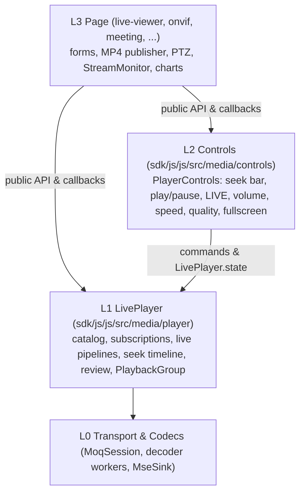
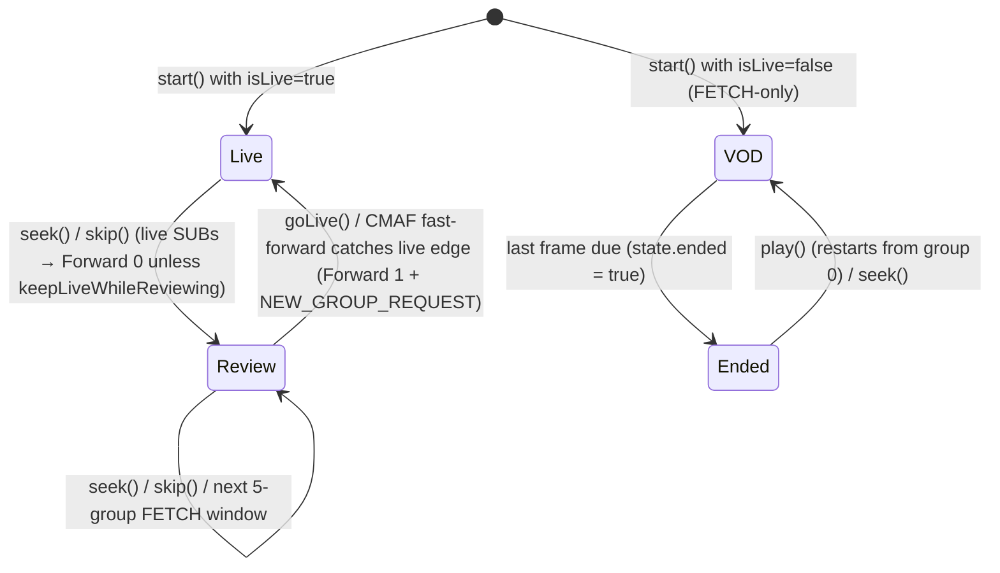

# Live Player Architecture

## Status
Implemented. Update alongside any change to layering, module boundaries, public API, or invariants.

## Scope
`LivePlayer` is the MoQT browser player (`sdk/js/js/src/media/player`, used by `examples/browser`). It follows an MSF catalog, plays live video/audio (LOC or CMAF), rewinds into the relay's FETCH cache (DVR review), and plays non-live broadcasts (`isLive: false`, e.g., recorder replays) as VOD via FETCH alone.

**Jump to:** [Layering](#layering) · [Public API](#public-api-l1) · [Modules](#modules-l1) · [Conventions & Invariants](#stream-conventions--invariants) · [Playback](#playback-behaviour) · [Consumers](#consumers--test-ids)

## Layering



### Layer Rules
- **DOM boundary (L1)**: Creates only hidden/pooled picture elements at the front of `container` (styled by `livePlayer.css`), leaving page overlays on top; never reads forms or writes status text.
- **Session ownership**: L1 never connects or closes sessions; `start` accepts a connected `MoqSession` so pages share one session across players/publishers. GOAWAY and reconnect stay in `moqt::Session` ([`moqt/session-migration.md`](../moqt/session-migration.md)).
- **MoQT handles**: Uses `MoqSubscription` (`groups()` for media, object-by-object for text), `MoqFetch` (review windows), `trackStatus` (live edge), and `subscribeCurrentGroup` (catalog). Keys `DeliveryObserver` with player-local IDs (hiding wire aliases/request IDs).
- **Stateless controls (L2)**: `PlayerControls` renders `LivePlayer.state` on `onStateChange`, keeping only transient UI gesture state (drag, pointer idle). Appends `playerControls.css` after pictures/overlays; global arrow keys assume one `PlayerControls` per page.
- **Dependency direction**: SDK imports nothing from `examples/`; diagnostics (`StreamMonitor`) stay in L3 via `DeliveryObserver`.

## Public API (L1)

### `LivePlayer` & `LocLive`
```ts
type LivePlayerOptions = {
  container: HTMLElement
  callbacks: LivePlayerCallbacks // onStateChange, onLiveFrame, onLog, onAudioLevel?
  deliveryObserver?: DeliveryObserver
  livePicture?: LivePictureKind
  keepLiveWhileReviewing?: boolean
  deliveryTimeoutMs?: number | null   // default 2000; null disables
  groupOrder?: 'ascending' | 'descending'
  source?: LiveSource
  audioContext?: AudioContext
  latencyTolerance?: LatencyTolerance
}

class LivePlayer {
  start(session: MoqSession, namespace: string[], tracks?: LiveTracks | BroadcastCatalog): Promise<void>
  stop(): Promise<void>
  dispose(): Promise<void>
  selectVideoTrack(name: string): Promise<void>
  selectAudioTrack(name: string): Promise<void>
  setAdaptiveVideo(enabled: boolean): void
  setLatencyTolerance(tolerance: LatencyTolerance): void
  addAudioTrack(name: string, listener?: AddedAudioTrackListener): Promise<AddedAudioTrack>
  addTextTrack(name: string, listener: AddedTextTrackListener): Promise<AddedTextTrack>
  setVideoEnabled(enabled: boolean): Promise<void>
  setVideoPriority(priority: number): void
  setPackaging(packaging: Packaging): Promise<void>
  seek(captureMicros: number): void
  skip(seconds: number): void
  goLive(): void
  setPaused(paused: boolean): void
  setVolume(volume: number, timeConstantSeconds?: number): void
  setPlaybackRate(rate: number): void
  setBufferPolicy(policy: BufferPolicy): void
  setCatchUp(catchUp: CatchUp): void
  setLateSamples(lateSamples: LateSamples): void
  setAudioVideoSync(audioVideoSync: AudioVideoSync): void
  readonly state: LivePlayerState
  stats(): LivePlayerStats
  elapsedMsAt(captureMicros: number): number | undefined
}
```

**`start(..., tracks)` forms:** omitted (creates/closes own catalog subscription); `LiveTracks` `{ video?, audio? }` (skips catalog); `BroadcastCatalog` (shared across players on the same session per draft-14 §9.7, left open on `stop`).

- **Lifecycle**: `start`/`stop` preserve user settings (packaging, volume, buffer policy, catch-up). Call `dispose` when discarding a per-broadcast player to close decoder workers, `AudioContext`s, and picture elements.
- **`LocLive`**: Standalone live LOC pipeline (`configureTrack`, `push`, `joinAudio`, `setBufferPolicy`, `reset`, `dispose`, `stats`, exposing `playout` and `picture`) for pages managing their own subscriptions.
- **`PlaybackGroup`**: Coordinates multiple players on one capture-time position (`add`, `remove`, `play`, `pause`, `seek`, `skip`, `goLive`, `state: { mode, positionMicros, paused, ended }`).
- **State & stats**: `LivePlayerState` exposes tracks, selection, `mode` (`live`/`review`), `isLive`, `ended`, `inRange`, `paused`, `stalled`, playback rate, statuses, seek range, and observer aliases. `LivePlayerStats` = `LiveStats` (frame size, viewer delay, buffer/target, output latency, arrival spread, bitrates, A/V offset, audio breaks, video drops/late, shed) + object count.

## Modules (L1)

Each player creates 2 decoder workers.

### Core, Catalog & Subscriptions
| Module | Responsibility |
| --- | --- |
| `livePlayer` | Facade: owns modules/state, dispatches commands, branches by packaging |
| `trackContext`, `deliveryObserver` | Request context and delivery telemetry hook |
| `broadcastCatalog`, `textTrack` | Shared catalog (SUBSCRIBE + FETCH, newest group wins, 2 s retry on absent publisher) and whole-object text tracks |
| `trackSubscriptions`, `trackPriority` | Per-kind subscriptions, ordered Forward updates, retire hand-over; Subscriber Priorities: catalog `0`, text `16`, audio `32`, video `128` |
| `playableVideoTracks` | Filters browser-decodable video tracks; picks lowest bitrate per resolution within an `altGroup` |

### Live Playback & Adaptive Switching
| Module | Responsibility |
| --- | --- |
| `locLive`, `cmafLive` | Live LOC (workers + `LivePlayout` + picture sink + pre-decode hold) and live CMAF (`MseSink`, waits for group start on reopen) |
| `adaptiveBitrate`, `renditionSplice`, `videoSwitcher` | ABR ladder over `altGroup` and gapless live LOC rendition switching |
| `addedTrack`, `addedAudioTrack`, `audioLane`, `addedTextTrack` | Secondary audio/text tracks synced to `LivePlayout` clock (e.g., live translation & captions) |
| `pictureStage`, `pictureElements`, `stallWatch` | Single visible picture, first-frame handover, MSE element pool, auto-resume after DOM move, 500 ms stall spinner |

### Timeline, Review (DVR) & Multi-Player Sync
| Module | Responsibility |
| --- | --- |
| `seekTimeline`, `rewind`, `audioGroups`, `arrivalLag`, `streamConventions` | Combines `GroupTimeline`, `MediaTimeline`, and `AudioGroups` across 60 s cache TTL |
| `reviewSession`, `reviewFetch`, `reviewGroupStore` | Per-seek bounded FETCH windows, closed-group waits, TRACK_STATUS live edge, eviction recovery, shared single-group cache |
| `locReview`, `cmafReview`, `reviewClock` | Review playback via `ReviewPlayout` or review `MseSink` on a capture-time clock |
| `playbackGroup`, `groupMember` | Multi-player position alignment, range gating, and shared commands |

## Stream Conventions & Invariants

### Publisher Conventions
| Convention | `ingest-gateway` / MP4 publisher | ONVIF bridge |
| --- | --- | --- |
| Shared wall-clock LOC capture timestamps | Yes | Yes |
| CMAF sibling `<track>_cmaf` | `ingest-gateway` only | No |
| MSF media timeline track per source | Yes | Yes (per camera profile) |
| Audio groups aligned to video keyframe IDs | Yes | **No** (rotates every 2 s with own IDs) |
| Codec present in initial catalog | Yes | Added once stream starts |
| Relay cache TTL 60 s; join group may lack keyframe | Yes | Yes |

When audio groups are unaligned (not covered by the media timeline and starts diverge > 500 ms from video group IDs), `AudioGroups` fetches closed audio groups covering the window's capture span (deduplicating overlap across 2 s groups).

### Invariants

**Subscriptions & review**
- **Single active review**: Only one review runs at a time; a new seek, `goLive`, live video track change, or `stop` cancels the prior review (single-group FETCHes populating `reviewGroupStore` may finish).
- **VOD is FETCH-only**: Non-live broadcasts open no media `SUBSCRIBE` and send no `TRACK_STATUS`.
- **Closed-group review boundary**: A review FETCH never reaches into the open live-edge group, since such a FETCH does not end until the publisher closes that group.
- **Ordered Forward updates**: `SUBSCRIBE_UPDATE` Forward toggles apply strictly in issue order.
- **Immediate `PUBLISH_DONE` drop**: Drops ended subscriptions immediately rather than reading late objects during `moqt`'s draft-14 §9.12 grace period.

**Recovery, rendering & sync**
- **Publisher return detection**: Catalog end (or video end for `LiveTracks`) clears tracks and retries `SUBSCRIBE` every 2 s (relays answer `TRACK_DOES_NOT_EXIST` when no live publisher exists).
- **No blank frames**: A replacement picture is shown only after presenting its first frame.
- **`PlaybackGroup` authority**: Members review strictly on the group clock and delegate `seek`/`skip`/`goLive`/`setPaused` to the group.
- **Worker/main split**: Pre-decode hold and superseded-group drops stay in the video worker; playout budgeting stays on the main thread.

## Playback Behaviour

### Live vs. Review (DVR) & VOD Flow



### Review (Rewind) & Eviction

**Fetching & live edge**
- **Windowing**: First window fetches only the target closed keyframe group (reused from `reviewGroupStore` if cached), decoding pre-target frames unpaced; subsequent windows fetch up to 5 groups ahead. While paused, prefetches 2 adjacent groups in the step direction into `reviewGroupStore`.
- **Live-edge tracking**: Sets live video/audio `SUBSCRIBE` to Forward `0` (unless `keepLiveWhileReviewing` is enabled or relay lacks `TRACK_STATUS`) and polls `TRACK_STATUS` every 500 ms to advance the live edge. `goLive()` restores Forward `1` and sends `NEW_GROUP_REQUEST` (starts new group if open group ≥ 2 s or ≥ 60 objects; otherwise waits up to 1 GOP).
- **Eviction recovery**: FETCH failing with `INTERNAL_ERROR`, `TIMEOUT`, `INVALID_RANGE`, `NO_OBJECTS`, `UNKNOWN_STATUS_IN_RANGE`, reset `INTERNAL_ERROR`, empty response, or missing first object drops groups up to the failed group from the timeline and resumes from the oldest remaining group (or returns to live). Other errors display and hold position.

**Audio, pausing & speed**
- **Review audio**: Waits until the audio track advances past the group (audio trails video slightly in interleaved streams) to avoid MSE holes. LOC decodes slightly ahead on `ReviewClock`; CMAF appends by `tfdt`.
- **Seeking while paused**: Shows and holds the frame at the new position with audio suspended (enables 1 s monitoring scrubs; frame-by-frame stepping not implemented).
- **Playback speed**: `0.5x`–`2x` (with `preservesPitch`) enabled in CMAF review only; > 1x auto-returns to live upon reaching the live edge and resets to `1x`.

### VOD (`isLive: false`)
- Reads media timeline via `SUBSCRIBE` + joining FETCH (all groups closed, including newest); plays from group 0 via review FETCH windows without `TRACK_STATUS` or media `SUBSCRIBE`.
- Seek bar spans timeline start to `trackDuration` (§5.2.36); `goLive` is a no-op and `LIVE` button is hidden; finishing sets `state.ended` (resuming restarts from group 0).

### Playback Group (`PlaybackGroup`)
- Aligns players **only during review/VOD** using one shared `ReviewClock` + `AudioContext` (drifted by the first scheduled sound; late chunks on other players drop). Live players run independently at their own live edges.
- Checks every 250 ms whether the group position falls inside each player's replayable/VOD range: out-of-range players hold (`state.inRange = false`, Forward `0`, no FETCH) until reached. CMAF players align at seek time but pace on their own media element clock.
- `add`/`remove` work dynamically; adding a VOD player (or receiving its first timeline) starts the group at the earliest known start. All VOD players finishing pauses the group and sets `state.ended`.

### Catalog, Packaging, Rendition Switch & ABR
- **Catalog**: Subscribed + joining FETCH of `SUBSCRIBE_OK`'s largest group (skipped if no content exists). Newest group wins regardless of arrival order; redefining a track reconfigures its decoder. Invalid/missing `initRef` logs a warning. Tracks specifying `namespace` (§5.2.2) subscribe under that namespace (e.g., `live-translate`).
- **Packaging**: Gear menu switches `LOC` (WebCodecs → `MediaStream`/canvas) ↔ `CMAF` (`_cmaf` → pooled `<video>` `MseSink`, seek axis from media timeline).
- **Gapless LOC rendition switch (`videoSwitcher`, `renditionSplice`)**: Subscribes incoming `altGroup` track (`NextGroupStart`), splices at the group after outgoing's newest started group (keeping timeline intact), and sends `SUBSCRIBE_UPDATE` (`endBeforeGroup`) to outgoing (waiting for `PUBLISH_DONE`; falls back to `UNSUBSCRIBE` on send error or overrun). Unaligned group IDs (> 1 apart), non-`altGroup`, CMAF, or review switches hard-resubscribe.

**Automatic quality (`AdaptiveBitrate`, live LOC only)**
- Runs over `altGroup` tracks with bitrates, capped at the smallest rendition ≥ container height in device pixels (waits for non-zero container height under `Auto`).
- Steps down when 1 s min capture-to-arrival lag exceeds baseline min lag by > `latencyTolerance` (400 ms default, 2 s `'high'`; ignores idle gaps and 3 s post-switch settling) to highest rendition ≤ 80% of 2 s throughput.
- Trials step-up after 10 s calm; failing within 20 s doubles cooldown up to 120 s (halved per calm minute).

### Audio / Video Synchronisation (LOC)
- **Adaptive jitter buffer**: Target = audio capture-to-arrival jitter over last 10 s (peak-to-peak, or 95th percentile via `arrivalQuantile` in meeting) + `AudioContext` output latency + 20 ms concealment margin, clamped to `[Min buffer, Max buffer]`. While audio plays, a `Max buffer` too small for it gives way to the least the output plays without running out: how far the fastest audio arrives behind the fastest sample + output latency + 20 ms + one audio chunk (a lower target makes every chunk miss its time, so the sound is concealed and shed in turns).
- **Warm-up & master clock**: Holds samples until `AudioContext` reports output latency (up to 400 ms without audio), then anchors on the newest sample. Audio is clock master (chunks append contiguously at a write head; write-head drift steers the clock; secondary `addAudioTrack` lanes follow without steering). Video holds frames until due.
- **Video ahead (`setAudioVideoSync('video-ahead')`, default `'synced'`)**: For games and remote control. A frame's time is the clock's minus what the audio is scheduled ahead of being heard (output latency + 20 ms), so the picture waits for the arrival spread only and the sound follows it by that lead. The lead holds while no audio plays, and waiting frames move with it when it changes (setting, or the output reporting its latency as audio joins).
- **Decoder worker ordering**: Both workers tag outputs with input chunk capture timestamps (surviving gaps/loops). Audio worker reorders interleaved groups (releasing 50 ms before due, or 100 ms unanchored); video worker immediately jumps to any newer group's keyframe and drops older partial groups.

**Concealment & catch-up** (within 20 ms of underrun: NetEq expand repeating last pitch period, fading out over 300 ms; after 10 s settle, shrinks excess buffer):
- **`Skip (trim + crossfade)`** (default): Drops excess chunks and crossfades at best waveform match within 10 ms.
- **`Speed up (WSOLA)`**: 10% pitch-preserving speedup when > 20 ms over (falls back to skip > 400 ms over).
- **`Off`**: Never shrinks; `lateSamples: 'drop'` discards late samples for fixed-delay use cases.

### Controls, Seek Bar & MP4 Publisher
- **Controls**: Auto-hide overlay (and cursor in fullscreen); 500 ms stall spinner; play/pause (pausing review freezes; resuming live re-anchors/jumps to edge); volume slider; `LIVE` status/return button; fullscreen.
- **Seek bar & elapsed time**: Spans replayable 60 s window (`Home` oldest, `End` live/VOD end). Thumb stays at seek anchor while fill/readouts step 1 s at a time to avoid burst jitter. Live broadcasts have no elapsed-from-start (`elapsedMsAt` = `undefined`); VOD shows `position / broadcast` from MSF media timeline.
- **MP4 publisher (`Mp4Broadcast`)**: Streams local H.264 + AAC/MP3 files via `mediapack::mp4::Mp4Index` (`moov` only + `File.slice`) on its own session, pacing in decode order + reorder delay, with WebCodecs local preview (`viewer delay`), `Publish Streams` ledger, and 60 s FETCH cache.

## Consumers & Test IDs
Test IDs: `live-viewer-*` (page), `live-player-*` (player & controls).

| Consumer | Integration |
| --- | --- |
| `examples/live-viewer` | `LivePlayer`, `PlayerControls`, diagnostics (`StreamMonitor`, delivery grid, `PlaybackCharts`), `Mp4Broadcast` |
| `examples/onvif` | `<moq-player controls>` (`moq-wasm/element`) sharing session with PTZ commands |
| `examples/meeting` | Per-member camera + screen-share `LivePlayer`s sharing `BroadcastCatalog`; video enabled only on stage; disposed on leave |
| `examples/media/subscriber` | `<moq-player>` with explicit `LiveTracks` |
| `examples/remote-monitoring` | `watchBroadcasts` + `RemoteBroadcast` with `keepLiveWhileReviewing`, stage/strip reparenting, pause-and-step review |
| `examples/live-translate/viewer` | Fixed-delay (`catchUp: 'off'`, `lateSamples: 'drop'`), `addAudioTrack` crossfade on `onFirstScheduled`, `addTextTrack` captions |
