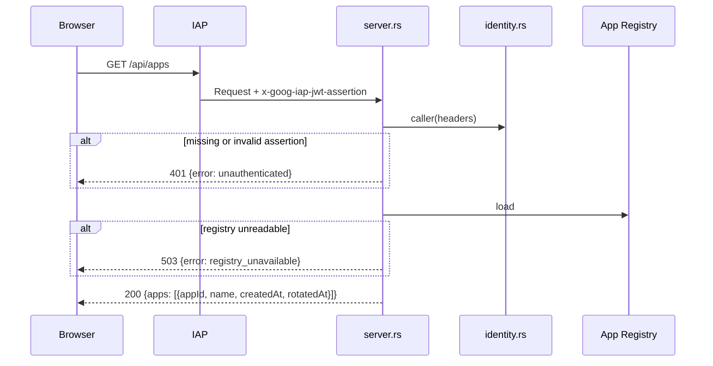

# `console` Architecture

## Status
Living document. Update alongside any change to design intent, module boundaries, runtime flow, or invariants.

## Scope
Backend for the internal web console. Runs on Cloud Run behind IAP, identifies employees via IAP assertions (`sub`), and manages their apps in the shared app registry (`crates/app-registry`). It never verifies client JWTs (VTS owns verification).

An employee's account is solely their IAP `sub`; the console stores no user profile table. Each registry row's `sub` links the app to its owner.

## Modules

| Module | Key types | Responsibility |
| --- | --- | --- |
| `identity.rs` | `Identity` (`Iap`, `Development`) | Extracts caller `sub`. `Iap` verifies `x-goog-iap-jwt-assertion` via `google_cloud::IapVerifier` (ES256, issuer `https://cloud.google.com/iap`, configured `aud`, 30 s skew, 60 s JWKS cache). `Development` returns a fixed `sub` locally; `Identity::new` rejects `Development` on Cloud Run and rejects both or neither. |
| `server.rs` | `ConsoleServer` | HTTP/1 server via `http_server::HttpServer`; enforces CSRF checks on writes, identifies caller, and routes API requests. |
| `input.rs` | — | Validates request bodies (rejects unknown fields). |
| `apps.rs` | — | Runs owner-scoped CRUD via `RegistryStore::update` (create, token issue, secret rotate, delete); returns `None` for apps not owned by caller. |
| `usage.rs` | `ObservabilityClient` | Proxies `GET /api/usage` (`from`, `to`, `points` only) to `services/observability` ([`observability/architecture.md`](../observability/architecture.md)). |
| `recordings.rs` | `RecorderClient` | Calls `recorder`'s `GET /apps/{appId}/recordings` and `GET /recordings/{id}/file` ([`recorder/architecture.md`](../recorder/architecture.md)). |
| `static_files.rs` | `StaticFiles` | Serves built web assets from `CONSOLE_STATIC_DIR` with strict path sanitization and extension allow-list. |
| `main.rs` | — | Loads config, performs an initial registry read to fail fast, binds `0.0.0.0:$PORT`. |
| `web/` | React + Tailwind + Vite | Frontend SPA (`App.tsx`, `Sidebar.tsx`, `pages.tsx`, `usage.tsx`, `recordings.tsx`, `modals.tsx`). Sends `X-Console-Request` on every API call; renders names as React text (never raw HTML). |

### Input & Resource Rules

**API input & limits**
- **App name** (`input.rs`): 1–64 chars after trimming, no control characters.
- **Namespace paths**: `""` or `/`-separated non-empty elements, max 255 chars.
- **Tokens**: 1 s to 24 h TTL; must specify `publish`, `subscribe`, or both.
- **App creation** (`apps.rs`): UUIDv4 `appId`, 32 random bytes (base64) `secret`, max **20 apps per owner** (VTS reads the whole registry on each verify).

**Static assets & UI**
- **Static files** (`static_files.rs`): Every path segment must be a plain filename (non-empty, no leading dot, `[A-Za-z0-9._-]`); `/` maps to `index.html`. Allowed types: HTML, JS, CSS, SVG, PNG, ICO, WOFF2, WASM. `assets/` files carry content hashes (`immutable`, 1 year); other static files are `no-cache`.
- **UI modals** (`web/modals.tsx`): Secrets and tokens are shown once; a secret modal stays open until the employee confirms saving it.

## Request Flow

## API

| Route | Response & errors |
| --- | --- |
| `GET /api/me` | `200 {email, relayUrl}` |
| `GET /api/apps` | `200 {apps: [{appId, name, createdAt, rotatedAt}]}` (caller's apps only) |
| `POST /api/apps` `{name}` | `201 {app, secret}`; `400 too_many_apps` at 20 apps |
| `POST /api/apps/{appId}/tokens` `{publish?, subscribe?, ttlSeconds}` | `200 {token, expiresAt}`; `404 no_app` |
| `POST /api/apps/{appId}/secret` | `200 {app, secret}` (records `rotatedAt`); `404 no_app` |
| `DELETE /api/apps/{appId}` | `204`; `404 no_app` |
| `GET /api/apps/{appId}/recordings` | `200` MP4 list; `404 no_app`; `503 recorder_unavailable` |
| `GET /api/apps/{appId}/recordings/{id}/file?name=` | `302` to 15-min signed GCS URL; `400 no_name`; `404 no_app`/`no_file`; `503 recorder_unavailable` |
| `GET /api/apps/{appId}/usage?from=&to=[&points=]` | `200` usage data; `400 invalid_range`; `404 no_app`; `503 observability_unavailable` |

**Common errors**: `401 unauthenticated` (no verified `sub`), `400` (body validation failure), `503 registry_unavailable` (registry read/write failure). Non-`GET` routes return `403 forbidden` unless `X-Console-Request` is present and any `Origin` header's host matches `Host`.

## Downstream Service Access (Usage & Recordings)
- **Usage**: Console signs a 60 s token (`subscribe: ""`) with the app's secret and sends it to `observability`, which verifies via VTS and scopes the answer to that app. Console holds no privileged observability credential; operators view cross-app and relay metrics in HyperDX.
- **Recordings**: Same per-app token flow against `recorder`. Video bytes bypass the console: `/file` fetches a signed Cloud Storage URL and responds with `302`, so `<video>` streams via range requests straight from GCS. The UI requests signed URLs lazily on play/open because `recorder` signs each via IAM.

## Configuration

| Variable | Purpose |
| --- | --- |
| `CONSOLE_IAP_AUDIENCE` | Expected IAP `aud` (`/projects/<num>/locations/<region>/services/<service>`) |
| `CONSOLE_DEV_SUB` | Local fixed `sub` (refused when `K_SERVICE` is set) |
| `CONSOLE_REGISTRY_FILE` | Local registry file path |
| `CONSOLE_REGISTRY_BUCKET` / `CONSOLE_REGISTRY_OBJECT` | Cloud Storage registry (object defaults to `registry.json`) |
| `CONSOLE_STATIC_DIR` | Built frontend directory (`web/dist`); API-only if unset |
| `CONSOLE_RECORDER_URL` | Recorder base URL (recordings routes return `503` if unset) |
| `CONSOLE_OBSERVABILITY_URL` | Observability base URL (usage route returns `503` if unset) |
| `CONSOLE_RELAY_URL` | Relay URL shown in UI (`relayUrl` is `null` if unset) |
| `PORT` | Listen port (default `8080`) |

## Container Image
`services/console/Dockerfile` builds `web/` with Node and the Rust binary with `cargo-chef`, packaging both onto `distroless/cc` (`nonroot`, `CONSOLE_STATIC_DIR=/srv/console`, listening on `PORT`).

## Invariants

**Access & secrets**
- **Secret exposure**: Only `POST /api/apps` and `POST /api/apps/{appId}/secret` return `secret`. No other response or log line carries secrets or tokens; internally signed tokens go only to `observability` or `recorder`.
- **Strict ownership**: Apps are accessible only when `row.sub == caller.sub`; other owners' apps return `404 no_app`, and the relay app (no `sub`) is unreachable.
- **Identity source**: `sub` comes only from a verified IAP assertion or (off Cloud Run) `CONSOLE_DEV_SUB`. Only `sub` is persisted; `email` is returned by `/api/me` and never stored; all other IAP claims are discarded.

**HTTP & asset safety**
- **CSRF defense**: Cross-site pages cannot send `X-Console-Request` without a CORS preflight that the console never grants.
- **Security & cache headers**: Every response sets a same-origin CSP (allowing media from `storage.googleapis.com` for signed recordings, disallowing framing) and `X-Content-Type-Options: nosniff`. Non-static responses set `Cache-Control: no-store`.
- **Static containment**: Path validation prevents escaping `CONSOLE_STATIC_DIR` or serving non-asset files (e.g., a local registry file).
