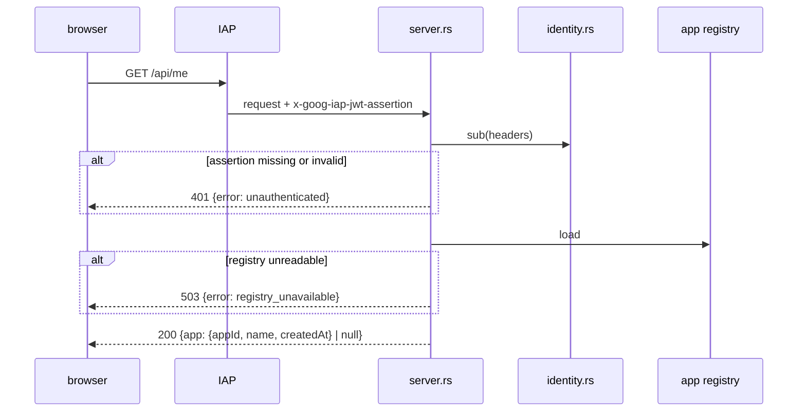

# `console` Architecture

## Status
Living document. Update this file in the same change whenever the design intent,
module boundaries, runtime flow, or invariants described here change.

## Scope
`console` is the backend of an internal web console. It runs on Cloud Run with
IAP enabled on the service, learns who an employee is from the IAP assertion,
and serves that employee's app from the app registry (`crates/app-registry`).
It never verifies client JWTs; that stays in the VTS.

An employee's account is their IAP `sub`. The console stores nothing else
about them: the `sub` of an app's row in the registry links the app to its
account.

## Modules

| Module | Responsibility |
| --- | --- |
| `iap.rs` | `IapVerifier`: checks an IAP assertion and returns its `sub`. The assertion must be ES256-signed by a key IAP publishes, name `https://cloud.google.com/iap` as issuer and the configured audience, and lie inside its `iat` / `exp` window give or take 30 seconds. The key set is fetched from Google, cached, and fetched again for an unknown `kid` at most once a minute. |
| `identity.rs` | `Identity`: how a request names its `sub`. `Iap` reads the `x-goog-iap-jwt-assertion` header and verifies it; `Development` returns a fixed `sub` for local runs. `Identity::new` refuses `Development` on Cloud Run and refuses both or neither. |
| `server.rs` | `ConsoleServer`: owns the accept-loop `JoinHandle` and serves `GET /api/me`, which answers the caller's app (`appId`, `name`, `createdAt`) or `null`. |
| `main.rs` | Reads the configuration, loads the registry once to fail fast, binds `0.0.0.0:$PORT` and serves. |

## Request flow

## Configuration

| Variable | Meaning |
| --- | --- |
| `CONSOLE_IAP_AUDIENCE` | Expected `aud`: `/projects/<project number>/locations/<region>/services/<service>` for IAP on Cloud Run |
| `CONSOLE_DEV_SUB` | Fixed `sub` for local runs instead of IAP; refused when `K_SERVICE` is set |
| `CONSOLE_REGISTRY_FILE` | Registry in a local file |
| `CONSOLE_REGISTRY_BUCKET` / `CONSOLE_REGISTRY_OBJECT` | Registry in Cloud Storage (object defaults to `registry.json`) |
| `PORT` | Listen port, default `8080` (Cloud Run sets it) |

## Invariants

- No response carries an app's `secret`.
- The `sub` comes only from a verified assertion or, outside Cloud Run, from
  `CONSOLE_DEV_SUB`. A request never names its own `sub` or `appId`.
- The development identity cannot start on Cloud Run, where `K_SERVICE` is
  always set.
- Of the IAP claims the console keeps only `sub`; `email` and the rest are
  read and discarded.
