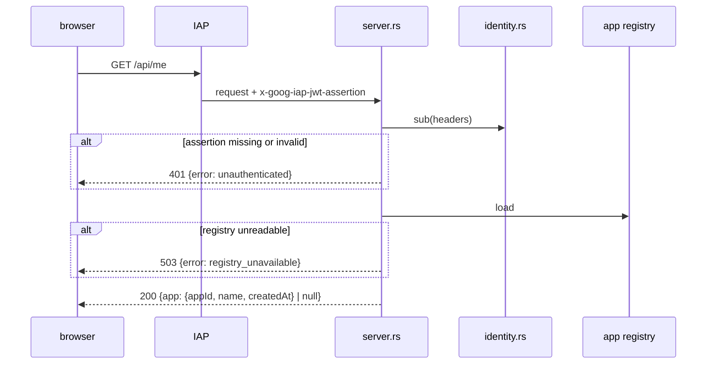

# `console` Architecture

## Status
Living document. Update this file in the same change whenever the design intent,
module boundaries, runtime flow, or invariants described here change.

## Scope
`console` is the backend of an internal web console. It runs on Cloud Run with
IAP enabled on the service, learns who an employee is from the IAP assertion,
and serves that employee's app from the app registry (`crates/app-registry`).
It never verifies client JWTs; that stays in the VTS.

An employee's account is their IAP `sub`. The console stores nothing else
about them: the `sub` of an app's row in the registry links the app to its
account.

## Modules

| Module | Responsibility |
| --- | --- |
| `iap.rs` | `IapVerifier`: checks an IAP assertion and returns its `sub`. The assertion must be ES256-signed by a key IAP publishes, name `https://cloud.google.com/iap` as issuer and the configured audience, and lie inside its `iat` / `exp` window give or take 30 seconds. The key set is fetched from Google, cached, and fetched again for an unknown `kid` at most once a minute. |
| `identity.rs` | `Identity`: how a request names its `sub`. `Iap` reads the `x-goog-iap-jwt-assertion` header and verifies it; `Development` returns a fixed `sub` for local runs. `Identity::new` refuses `Development` on Cloud Run and refuses both or neither. |
| `server.rs` | `ConsoleServer`: owns the accept-loop `JoinHandle`, refuses a write that fails the CSRF check, identifies the caller and routes the API. |
| `input.rs` | The request bodies and their rules: an app name is 1 to 64 characters after trimming, without control characters; a publish or subscribe path is `""` or `/`-separated non-empty elements, up to 255 characters; a token lives 1 second to 24 hours and names publish, subscribe or both. Unknown fields are refused. |
| `apps.rs` | The operations on the caller's app over `RegistryStore::update`: create (a random version 4 UUID as `appId`, 32 random bytes in base64 as `secret`), issue a token signed with the app's secret, rotate the secret, delete. Each answers `Done`, `NoApp` or `AlreadyHasApp`. |
| `static_files.rs` | `StaticFiles`: the built pages under `CONSOLE_STATIC_DIR`. `/` is `index.html`; every other path element must be plain ASCII (letters, digits, `.`, `_`, `-`) that does not start with a dot, and only html, js, css, svg, png, ico and woff2 are served. |
| `main.rs` | Reads the configuration, loads the registry once to fail fast, binds `0.0.0.0:$PORT` and serves. |
| `web/` | The pages: React and Tailwind built by Vite. Each request carries `X-Console-Request`; names are rendered as text by React, never as HTML. |

## Request flow

## API

| Route | Answer |
| --- | --- |
| `GET /api/me` | `200 {app: {appId, name, createdAt} \| null}` |
| `POST /api/app` `{name}` | `201 {app}`; `409 app_exists` when the caller has one |
| `POST /api/tokens` `{publish?, subscribe?, ttlSeconds}` | `200 {token, expiresAt}`; `404 no_app` |
| `POST /api/app/secret` | `200 {app}`; `404 no_app` |
| `DELETE /api/app` | `204`; `404 no_app` |

Every route answers `401 unauthenticated` without a verified `sub`, `400` with
the rule a body breaks, and `503 registry_unavailable` when the registry
cannot be read or written. A route other than `GET` answers `403 forbidden`
unless the request carries `X-Console-Request` and, when it carries `Origin`,
that origin's host matches `Host`.

## Configuration

| Variable | Meaning |
| --- | --- |
| `CONSOLE_IAP_AUDIENCE` | Expected `aud`: `/projects/<project number>/locations/<region>/services/<service>` for IAP on Cloud Run |
| `CONSOLE_DEV_SUB` | Fixed `sub` for local runs instead of IAP; refused when `K_SERVICE` is set |
| `CONSOLE_REGISTRY_FILE` | Registry in a local file |
| `CONSOLE_REGISTRY_BUCKET` / `CONSOLE_REGISTRY_OBJECT` | Registry in Cloud Storage (object defaults to `registry.json`) |
| `CONSOLE_STATIC_DIR` | Directory of the built pages (`web/dist`); without it only the API is served |
| `PORT` | Listen port, default `8080` (Cloud Run sets it) |

## Invariants

- No response carries an app's `secret`, and no log line carries a token.
- The caller's app is always found from the verified `sub`; no request names
  an `appId`, and the relay's app, which has no `sub`, is never touched.
- A cross-site page cannot make a signed-in browser change an app: it cannot
  add `X-Console-Request` without a CORS preflight the console never grants.
- The `sub` comes only from a verified assertion or, outside Cloud Run, from
  `CONSOLE_DEV_SUB`. A request never names its own `sub` or `appId`.
- The development identity cannot start on Cloud Run, where `K_SERVICE` is
  always set.
- Of the IAP claims the console keeps only `sub`; `email` and the rest are
  read and discarded.
- Every response carries a Content-Security-Policy that allows only
  same-origin resources and no framing, and `X-Content-Type-Options: nosniff`.
  API answers are `no-store`; `index.html` is `no-cache`; files under
  `assets/`, whose names carry a content hash, are cached for a year.
- A static path can name nothing outside `CONSOLE_STATIC_DIR` and nothing that
  is not a page asset, so a stray file such as a registry is never served.
