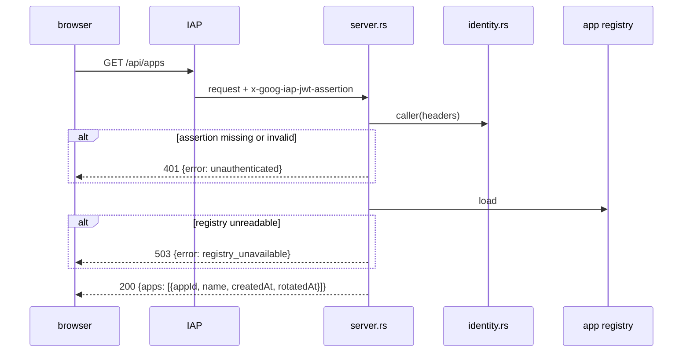

# `console` Architecture

## Status
Living document. Update this file in the same change whenever the design intent,
module boundaries, runtime flow, or invariants described here change.

## Scope
`console` is the backend of an internal web console. It runs on Cloud Run with
IAP enabled on the service, learns who an employee is from the IAP assertion,
and serves that employee's app from the app registry (`crates/app-registry`).
It never verifies client JWTs; that stays in the VTS.

An employee's account is their IAP `sub`. The console stores nothing else
about them: the `sub` of an app's row in the registry links the app to its
account.

## Modules

| Module | Responsibility |
| --- | --- |
| `iap.rs` | `IapVerifier`: checks an IAP assertion and returns its `sub`. The assertion must be ES256-signed by a key IAP publishes, name `https://cloud.google.com/iap` as issuer and the configured audience, and lie inside its `iat` / `exp` window give or take 30 seconds. The key set is fetched from Google, cached, and fetched again for an unknown `kid` at most once a minute. |
| `identity.rs` | `Identity`: how a request names its `sub`. `Iap` reads the `x-goog-iap-jwt-assertion` header and verifies it; `Development` returns a fixed `sub` for local runs. `Identity::new` refuses `Development` on Cloud Run and refuses both or neither. |
| `server.rs` | `ConsoleServer`: serves HTTP/1 through `http_server::HttpServer`, refuses a write that fails the CSRF check, identifies the caller and routes the API. |
| `input.rs` | The request bodies and their rules: an app name is 1 to 64 characters after trimming, without control characters; a publish or subscribe path is `""` or `/`-separated non-empty elements, up to 255 characters; a token lives 1 second to 24 hours and names publish, subscribe or both. Unknown fields are refused. |
| `apps.rs` | The operations on the caller's apps over `RegistryStore::update`: create (a random version 4 UUID as `appId`, 32 random bytes in base64 as `secret`; at most 20 apps per owner, because the VTS reads the whole registry on every verification), issue a token signed with the app's secret, rotate the secret (recording `rotatedAt`), delete. An operation on an `appId` the caller does not own answers `None`. |
| `usage.rs` | `ObservabilityClient`: reads an app's traffic from the observability server's `GET /api/usage` (see `docs/architecture/observability/architecture.md`). It passes on `from`, `to` and `points` from the query and nothing else. |
| `recordings.rs` | `RecorderClient`: reads an app's MP4 recordings from the recorder's `GET /apps/{appId}/recordings` and the signed URL of one file from `GET /recordings/{id}/file` (see `docs/architecture/recorder/architecture.md`). |
| (`static-files` crate) | `StaticFiles`: the built pages under `CONSOLE_STATIC_DIR`; see `docs/architecture/static-files/architecture.md`. |
| `main.rs` | Reads the configuration, loads the registry once to fail fast, binds `0.0.0.0:$PORT` and serves. |
| `web/` | The pages: React and Tailwind built by Vite. `App.tsx` holds the apps, the chosen app, the page and the open dialog; `Sidebar.tsx` switches apps and pages; `pages.tsx` renders the pages of an app, the list of apps and the pages still to come; `usage.tsx` the app's traffic (Observability): totals, the up- and downlink rate over time, totals per relay, the distribution of sessions by bytes and the busiest Track Namespaces; `recordings.tsx` the app's recordings with their files, each played in a `<video>` or opened from its signed URL; `modals.tsx` shows a secret or a token once, a secret only until the employee confirms saving it. Each request carries `X-Console-Request`; names are rendered as text by React, never as HTML. |

## Request flow

## API

| Route | Answer |
| --- | --- |
| `GET /api/me` | `200 {email, relayUrl}` |
| `GET /api/apps` | `200 {apps: [{appId, name, createdAt, rotatedAt}]}`, the caller's apps |
| `POST /api/apps` `{name}` | `201 {app, secret}`; `400 too_many_apps` when the caller already owns 20 apps |
| `POST /api/apps/{appId}/tokens` `{publish?, subscribe?, ttlSeconds}` | `200 {token, expiresAt}`; `404 no_app` |
| `POST /api/apps/{appId}/secret` | `200 {app, secret}`; `404 no_app` |
| `DELETE /api/apps/{appId}` | `204`; `404 no_app` |
| `GET /api/apps/{appId}/recordings` | `200` the recorder's list of the app's MP4 recordings; `404 no_app`; `503 recorder_unavailable` without `CONSOLE_RECORDER_URL` or when the recorder fails |
| `GET /api/apps/{appId}/recordings/{id}/file?name=` | `302` to the signed Cloud Storage URL of the file, valid for 15 minutes; `400 no_name`; `404 no_app`, or `no_file` when the app has no such recording or file; `503 recorder_unavailable` |
| `GET /api/apps/{appId}/usage?from=&to=[&points=]` | `200` the observability server's `/api/usage` for the app; `400 invalid_range` when the server refuses the range, `from` or `to` missing included; `404 no_app`; `503 observability_unavailable` without `CONSOLE_OBSERVABILITY_URL` or when the server fails |

Every route answers `401 unauthenticated` without a verified `sub`, `400` with
the rule a body breaks, and `503 registry_unavailable` when the registry
cannot be read or written. A route other than `GET` answers `403 forbidden`
unless the request carries `X-Console-Request` and, when it carries `Origin`,
that origin's host matches `Host`.

## Configuration

| Variable | Meaning |
| --- | --- |
| `CONSOLE_IAP_AUDIENCE` | Expected `aud`: `/projects/<project number>/locations/<region>/services/<service>` for IAP on Cloud Run |
| `CONSOLE_DEV_SUB` | Fixed `sub` for local runs instead of IAP; refused when `K_SERVICE` is set |
| `CONSOLE_REGISTRY_FILE` | Registry in a local file |
| `CONSOLE_REGISTRY_BUCKET` / `CONSOLE_REGISTRY_OBJECT` | Registry in Cloud Storage (object defaults to `registry.json`) |
| `CONSOLE_STATIC_DIR` | Directory of the built pages (`web/dist`); without it only the API is served |
| `CONSOLE_RECORDER_URL` | Base URL of the recorder an app's recordings are read from; without it the recordings routes answer 503 |
| `CONSOLE_OBSERVABILITY_URL` | Base URL of the observability server an app's usage is read from; without it the usage route answers 503 |
| `CONSOLE_RELAY_URL` | Relay URL the pages show for connecting; `relayUrl` is `null` without it |
| `PORT` | Listen port, default `8080` (Cloud Run sets it) |

## Image

`services/console/Dockerfile` builds `web/` with Node, the binary with
`cargo-chef` as the VTS does, and puts both on `distroless/cc` with
`CONSOLE_STATIC_DIR=/srv/console`. It runs as `nonroot` and listens on `PORT`.

## Usage

The console reads an app's usage as its owner would: it signs a token for the
app with the app's secret, `subscribe: ""` and a 60 second lifetime, and sends
it to the observability server, which answers only the app that token names
after the VTS verifies it. The console therefore needs no credential of its
own there, and an employee can read only the apps they own. Operators read
every app, and the relays' own figures, in HyperDX instead.

## Recordings

An app's recordings are read the same way, with a token signed for the whole
app sent to the recorder. A file does not pass through the console: its route
asks the recorder for a URL that Cloud Storage signed for that one object and
redirects the browser there, so a `<video>` plays it with range requests
straight from the bucket. The page asks for the URL only when a file is played
or opened, because the recorder signs each one with a call to IAM.

## Invariants

- Only the answers to creating an app and rotating its secret carry the `secret`, so its owner can sign tokens on their own server; no other response, and no log line, carries a secret or a token. The token signed to read an app's usage or recordings goes only to the observability server or the recorder.
- A request names an `appId`, but an app is read or changed only when its
  `sub` is the verified caller's, so another employee's app answers
  `404 no_app`; the relay's app, which has no `sub`, is never touched.
- A cross-site page cannot make a signed-in browser change an app: it cannot
  add `X-Console-Request` without a CORS preflight the console never grants.
- The `sub` comes only from a verified assertion or, outside Cloud Run, from
  `CONSOLE_DEV_SUB`. A request never names its own `sub`.
- The development identity cannot start on Cloud Run, where `K_SERVICE` is
  always set.
- Of the IAP claims the console stores only `sub`. `email` is returned to the
  caller by `/api/me` and never stored; the rest are discarded.
- Every response carries a Content-Security-Policy that allows only
  same-origin resources, besides media from `storage.googleapis.com` for a
  recording's signed URL, and no framing, and `X-Content-Type-Options: nosniff`.
  API answers are `no-store`; `index.html` is `no-cache`; files under
  `assets/`, whose names carry a content hash, are cached for a year.
- A static path can name nothing outside `CONSOLE_STATIC_DIR` and nothing that
  is not a page asset, so a stray file such as a registry is never served.
