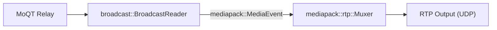

# `egress-gateway` Architecture

## Status
Living document. Update alongside any change to the reading flow, outputs, or invariants.

## Scope
`services/egress-gateway` is the reverse of `ingest-gateway`: it subscribes to an MSF broadcast on a relay (layout defined in [`broadcast/architecture.md`](../broadcast/architecture.md)) and emits its media to an external protocol. Plain RTP is currently the sole output.

## Layers

- **`broadcast::BroadcastReader`**: Owns MoQT and MSF—reads the catalog, selects tracks, and emits `MediaEvent`s on one channel (details in [`broadcast/architecture.md`](../broadcast/architecture.md) under "Reading a broadcast").
- **Output (`rtp`)**: Protocol-only consumer of `MediaEvent`s; knows nothing of MoQT.
- **Packetization in `mediapack`**: Socket-free muxers (`rtp::Muxer`, and future fMP4/WebRTC outputs) live in `mediapack` for reuse.

## RTP Timing & Lip-Sync

`BroadcastReader` aligns every track to one shared capture origin. The RTP output propagates this alignment via RTCP Sender Reports (SR):
- Each stream keeps an independent RTP timestamp offset (per RTP).
- Every SR pairs wall-clock send time with the stream's extrapolated RTP timestamp (RFC 3550 §6.4.1), where wall-clock time is `shared_capture_origin + presentation_time`.
- Both streams share one CNAME so SR-aware receivers synchronize them; receivers ignoring SRs fall back to arrival times.
- SRs are sent with each stream's first packet, then every 5 seconds (RFC 3550 §6.2 minimum interval).

## RTP Output Details

- **Unconnected UDP socket**: Packets go out on one unconnected socket. A connected socket surfaces ICMP errors when a receiver is not listening yet and would abort output; RTP stays fire-and-forget.
- **SDP generation**: Written once the muxer has configuration for every announced stream, including parameter sets (so receivers decode from the first keyframe), each stream's SSRC, and the shared CNAME.
- **Static overrides**: Payload types and SSRCs can be pinned via CLI flags for pre-configured receivers without SDP negotiation (e.g., mediasoup `PlainTransport`). Payload types are restricted to the dynamic range, avoiding values reserved by RTCP multiplexing (RFC 5761 §4).
- **RTCP port**: Sent to `rtp_port + 1` (RFC 3550 §11), or multiplexed onto the RTP port with `--rtcp-mux`.
- **No keyframe requests**: RTCP PLI/FIR are ignored because the encoder sits behind the relay; late receivers wait for the publisher's next group.

## End of Stream
Output runs until all tracks end or the relay session closes. If a publisher disconnects and resets an in-flight group stream, the reader skips that stream while keeping subscriptions open.
