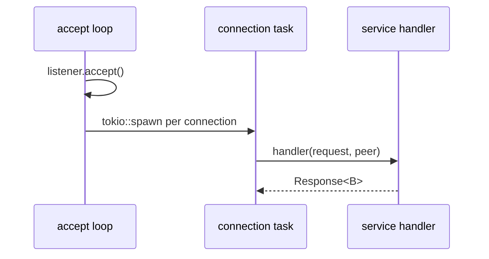

# `http-server` Architecture

## Status

Living document. Update this file in the same change whenever the design intent,
module boundaries, runtime flow, or invariants described here change.

## Scope

`http-server` is the HTTP/1 server part every HTTP service shares: `console`,
`vts`, `temporary-apps`, `observability`, `live-translate` and `recorder`. Each
service keeps its own routing and state; this crate accepts connections,
reads JSON bodies, bearer tokens and query strings, and builds responses.

| Item | Responsibility |
| --- | --- |
| `HttpServer::run(listener, handler)` | Spawns the accept loop and owns its `JoinHandle`. Each connection runs hyper HTTP/1 on its own task and calls `handler(request, peer)` for every request. |
| `json_response(status, body)` | `body` serialized as JSON with `Content-Type: application/json`. |
| `error_response(status, error)` | `{"error": error}` through `json_response`. |
| `empty_response(status)` | `status` with an empty body and no headers. |
| `allow_any_origin(response, methods, headers)` | `response` with `Access-Control-Allow-Origin: *` and the given allowed methods and request headers, for the services whose pages are served from any origin (`temporary-apps`, `live-translate`, `observability`). |
| `bearer_token(headers)` | The token of `Authorization: Bearer <token>`, or `None` without one or with an empty token. |
| `read_json(body)` | The body parsed as JSON, or `None` when it is longer than `MAX_JSON_BODY_BYTES` (16 KiB), fails to read or does not parse. The service picks its own error response. |

## Runtime flow

## Invariants

- A failed `accept` is logged at WARN (`accept failed`) and the loop goes on;
  a connection that ends with an error is logged at DEBUG with the peer.
- The handler cannot fail: it returns a response for every request, so the
  service decides the status of each failure.
- The response body type is the service's: `Full<Bytes>` for JSON, a boxed
  body for server-sent events (`live-translate`), `Either` for a streamed
  replay (`recorder`). The JSON helpers return `Full<Bytes>`; a service with
  another body type maps it.
- Dropping `HttpServer` aborts the accept loop. Open connections are not
  tracked and run to their end.
- Headers that only some services send (`Cache-Control: no-store` in
  `console`, the allowed-origin CORS of `recorder`, `Access-Control-Max-Age`
  in `observability`) are added by the service, not here.

## Dependencies

`hyper`, `hyper-util` and `http-body-util`: see [hyper.md](hyper.md).
