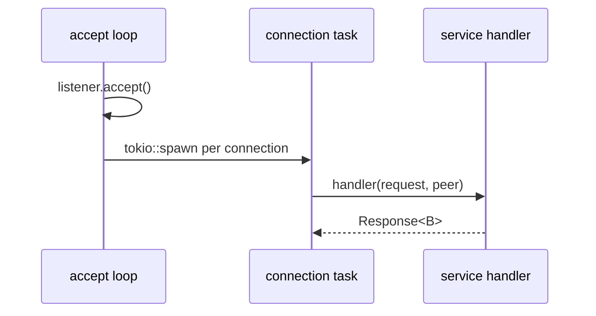

# `http-server` Architecture

## Status

Living document. Update this file in the same change whenever the design intent,
module boundaries, runtime flow, or invariants described here change.

## Scope

`http-server` is the HTTP/1 server part every HTTP service shares: `console`,
`vts`, `token-mint`, `observability`, `live-translate` and `recorder`. Each
service keeps its own routing, state and response headers; this crate only
accepts connections and builds JSON bodies.

| Item | Responsibility |
| --- | --- |
| `HttpServer::run(listener, handler)` | Spawns the accept loop and owns its `JoinHandle`. Each connection runs hyper HTTP/1 on its own task and calls `handler(request, peer)` for every request. |
| `json_response(status, body)` | `body` serialized as JSON with `Content-Type: application/json`. |
| `error_response(status, error)` | `{"error": error}` through `json_response`. |

## Runtime flow

## Invariants

- A failed `accept` is logged at WARN (`accept failed`) and the loop goes on;
  a connection that ends with an error is logged at DEBUG with the peer.
- The handler cannot fail: it returns a response for every request, so the
  service decides the status of each failure.
- The response body type is the service's: `Full<Bytes>` for JSON, a boxed
  body for server-sent events (`live-translate`), `Either` for a streamed
  replay (`recorder`). The JSON helpers return `Full<Bytes>`; a service with
  another body type maps it.
- Dropping `HttpServer` aborts the accept loop. Open connections are not
  tracked and run to their end.
- Headers that only some services send (`Cache-Control: no-store` in
  `console`, CORS in `observability`, `token-mint` and `recorder`) are added by
  the service, not here.

## Dependencies

`hyper`, `hyper-util` and `http-body-util`: see [hyper.md](hyper.md).
