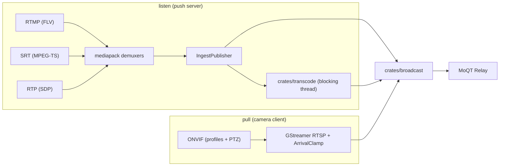

# `ingest-gateway` Architecture

## Status
Living document. Update alongside any change to ingest flow or packet-loss handling.

## Scope
`services/ingest-gateway` ingests external media protocols and publishes them to a MoQT relay via `crates/broadcast` (track layout in [`broadcast/architecture.md`](../broadcast/architecture.md)).

Subcommands split by connection direction (not protocol), matching deployment placement:

| Subcommand | Module | Role & deployment |
| --- | --- | --- |
| `listen` | `listen` | Server: accepts pushed RTMP, SRT, and RTP streams; opens one `Broadcast` per stream. Deployed where publishers can reach its ports. |
| `pull` | `pull` | Client: pulls one RTSP stream or ONVIF camera's profiles into one `Broadcast`. Deployed next to the camera. |

`main` initializes telemetry under service name `ingest-gateway` and flattens shared `RelayArgs` (`--moqt-url`, `--auth-token`, `--insecure-skip-tls-verify`) into both subcommands.

## `listen`

Each input (`rtmp`, `srt`, `rtp`) runs only when its CLI flag (`--rtmp-addr`, `--srt-addr`, `--rtp-sdp`) is provided. Each owns its transport and feeds `mediapack::MediaEvent`s into `IngestPublisher` (supporting RTMP/FLV, SRT/MPEG-TS, and plain RTP for H.264, AAC, Opus, and G.711 A-law via SDP).

- **Non-blocking startup**: Nothing on the input task may block before the first sample push because `broadcast` anchors the capture origin at that push. Blocking delays the origin and stamps queued backlog into the future.
- **Transcoding**: Built on a blocking thread with a bounded input queue that drops excess video samples. `IngestPublisher` writes each source sample before handing it to the transcoder, ensuring the source keyframe's group ID exists when renditions look it up (see "Group alignment" in [`broadcast/architecture.md`](../broadcast/architecture.md)).

### SRT & MPEG-TS Loss Handling
- **4 MiB UDP receive buffer**: Keyframes arrive as multi-hundred-kilobyte bursts within milliseconds; `srt-tokio`'s 64 KiB default overflows whenever scheduling stalls.
- **Keyframe recovery**: The MPEG-TS demuxer tracks continuity counters. On loss, it drops the damaged frame and all dependent frames until the next keyframe rather than publishing corrupt frames. Each loss logs a `WARN`; SRT stats log at stream end.

### RTP Sessions
- **Sockets & demuxer**: One UDP socket per SDP `m=` section (joining multicast if `c=` is multicast), each with a 4 MiB receive buffer ([socket2.md](socket2.md)), all feeding one `rtp::Demuxer` keyed by payload type. Out-of-band SDP parameter sets seed the demuxer so the first keyframe decodes immediately.
- **Stream lifecycle**: Starts on the first datagram and ends after 5 s of silence or when a datagram arrives with a new SSRC (a restarted sender picks new sequence numbers and timestamps). Either condition closes the current `Broadcast` and opens a fresh one under the same namespace.
- **Reordering & loss**: Reorders packets per stream and declares a gap after 200 ms of newer packets. Damaged frames drop until the next keyframe (logged at `WARN`).

### Namespaces
All defaults stay under `anon/**` because relays admit tokenless publishers only there:

| Protocol | Namespace source | Default |
| --- | --- | --- |
| SRT | Stream ID `r=` resource (`#!::r=anon/live/test,m=publish`) or plain path | `anon/srt/live` |
| RTMP | URL app name + all `/`-separated stream key segments except the last | — |
| RTP | `--rtp-namespace` | `anon/rtp/live` |

## `pull`

One process serves one source: `--rtsp-url`, `--onvif-ip`, or both (RTSP overrides camera profiles while ONVIF handles PTZ only). `onvif` encapsulates `GetProfiles`, `GetStreamUri`, and PTZ; the rest of `pull` knows only RTSP URLs.

- **Lazy pull**: Declares a video and audio track per profile in one `Broadcast`, but opens GStreamer RTSP sessions ([gstreamer.md](gstreamer.md)) only on the first `SUBSCRIBE` to the catalog or any profile track.
- **Reconnects**: Ended RTSP sessions reconnect with 1–30 s backoff, creating a fresh `BroadcastWriter` so restarted timestamps get a new capture origin.
- **Timestamp clamping**: `ArrivalClamp` shifts camera-origin RTSP timestamps so no capture time lies in the future relative to sample arrival ([proptest.md](proptest.md)).
- **ONVIF PTZ**: `CommandSubscriber` subscribes to `--command-namespace` on the same relay session and forwards commands serially to a PTZ worker thread.
- **Exit**: Process exits when the relay ends all profile tracks or the command subscription closes.
