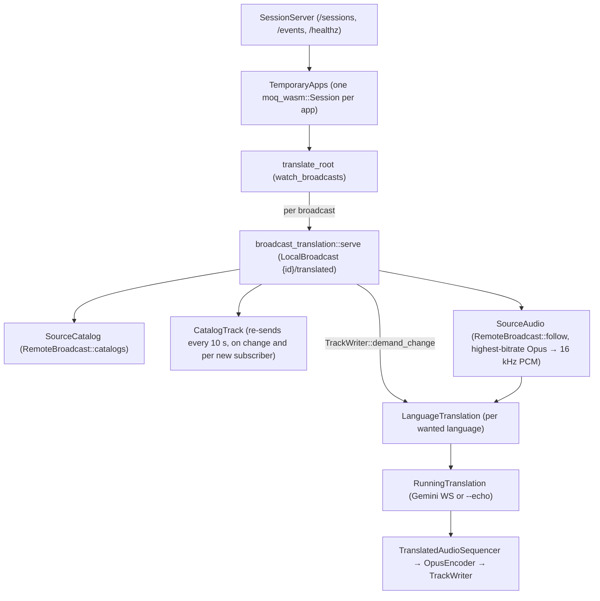

# `live-translate` Architecture

## Status
Living document. Update alongside any change to design intent, module boundaries, runtime flow, or invariants.

## Scope
`live-translate` (`examples/rust/live-translate`) is an example built on the public Rust SDK (`moq-wasm`, `sdk/rust`) only: it watches a root namespace on a relay and, for each broadcast `{root}/{id}`, publishes `{root}/{id}/translated` with:
- **MSF catalog**: References the source video/audio plus translated audio and transcript tracks.
- **Translated audio**: One Opus track per target language (`audio_en`, `audio_es`, `audio_de`, `audio_ko`, `audio_zh-Hans`).
- **Transcripts**: `text_<lang>` (Gemini output, stamped like translated audio) and `text_ja` (source speech heard by Gemini, stamped with newest source audio time; written by one active language and ended when none runs), each as JSON `{"text", "final"}`.

### Translation Backends & Limits
- **Gemini Live Translate** (`gemini/platform.rs`): Connects to Gemini Enterprise Agent Platform (`global` Live API over WebSocket with `Authorization: Bearer`) using the metadata server's access token (`gemini/metadata_token.rs`) on Cloud Run, or `gcloud` impersonation (`LIVE_TRANSLATE_GCLOUD_IMPERSONATE`) locally.
- **`--echo` mode**: Returns source audio after each language's fixed delay without Google Cloud. Startup fails unless `--echo` or `LIVE_TRANSLATE_GCP_PROJECT` is set.
- **On-demand vs. `--always-on`** (`TranslationPolicy` in `root_translation.rs`): Languages translate only while subscribed, except `--always-on` languages which run for the whole broadcast (~1 s tune-in instead of waiting for Gemini's first response) and ignore viewer count and time limits.
- **Time & failure caps**: Non-always-on languages stop after `--language-time-limit-minutes` (checked every minute, ending its tracks with `PUBLISH_DONE` so viewers fall back to original audio). A language also ends with `translation unavailable` if Gemini closes with a policy violation or rapid failures back off to 30 s.

### HTTP Server & Temporary Apps (`session_server.rs`, `temporary_apps.rs`)
When `PORT` is set, the HTTP server binds before dialing the relay (all responses allow any CORS origin):

| Route | Purpose |
| --- | --- |
| `POST /sessions` (`Authorization: Bearer <token>`) | Registers a temporary app (`services/temporary-apps`) and opens a relay session watching `{appId}/live-translate`. Re-posting for an active app restarts it with the new token. Max `--max-apps` (5) apps at once; an app idle for 1 minute (or with no broadcast) is evicted. |
| `GET /events` | SSE keepalive (comment every 15 s) held by streamer pages so Cloud Run stays alive while broadcasting and scales to zero when idle. |
| `GET /healthz` | Health check. |

With `--public-root` (local dev and E2E), the service also watches `anon/live-translate` without a token. With `LIVE_TRANSLATE_TELEMETRY_URL`, logs and spans also go to that observability server's client telemetry through `moq_wasm::telemetry`, filed under each temporary app's token (stdout only otherwise). Tokens are never refreshed; the relay closes the session at expiry (≤ 1 hour), ending translation. Callers are unauthenticated; cost is bounded by session/time limits and project Gemini billing caps.

## Runtime Flow

- **Catalog & source audio**: `SourceCatalog` follows `{id}/catalog` dynamically as browser encoders come online (retrying a refused SUBSCRIBE 5 times). `SourceAudio` follows the highest-bitrate Opus track (`DELIVERY TIMEOUT` 5 s; the SDK resubscribes 1 s after close/error), decodes to 16 kHz PCM, and broadcasts `(latest_input_ts, PCM)` to active languages.
- **On-demand tracks**: Every `audio_<lang>`, `text_<lang>` and `text_ja` is registered with `PublishTrackOptions::on_demand` before `PUBLISH_NAMESPACE`. A language starts when `demand_change` reports its audio or transcript wanted and idles once neither is. The relay forwards `SUBSCRIBE` only for the first downstream viewer and `UNSUBSCRIBE` when the last leaves, so demand follows the viewers; `PUBLISH` is not used, as it would send the tracks unasked.
- **Ending a track**: A refused start (capacity, start failure), the time limit, an engine giving up, or an idle language with `text_ja` still wanted ends the wanted tracks with `TrackWriter::end` (`PUBLISH_DONE`) and registers them again, so a viewer may subscribe anew. The demand reports of an ended track's writer are told apart by a generation number.
- **Output framing**: `OpusEncoder → TrackWriter` emits 20 ms objects with LOC capture timestamps, starting a group every 2 s of media time.

## Timestamps
LOC capture timestamps record "when this was said" on the broadcaster's clock (the translator never reads its own wall clock). Gemini outputs 250 ms real-time chunks continuously (including silence):
- **Input cursor**: Capture timestamp of the newest source audio object pushed to the decoder.
- **Connection anchor**: On initial connect and every reconnect, the first translated frame is stamped `input_cursor - fixed_gemini_delay` (per-language estimate in `target_language.rs`, since Gemini does not identify which input chunk produced an output).
- **Monotonic stepping**: Every subsequent frame advances by +20 ms even across delivery stalls.

## Invariants

**Session & auth**
- **Public SDK only**: The example depends on `moq-wasm` (`sdk/rust`) and external crates, not on workspace-internal crates.
- **No local token verification**: Temporary app tokens are passed straight to the relay (which rejects invalid ones) and never logged. No relay secrets are stored.

**Resource & timing caps**
- **Idle grace & `text_ja` isolation**: A language keeps Gemini open for 5 s after neither of its tracks is wanted. `text_ja` demand does not count toward any language, so transcript-only viewers never keep a language alive; it ends with its writer language.
- **Global concurrency cap**: At most `--max-sessions` (5) languages run across all broadcasts and roots; a track wanted beyond that is ended at once rather than queuing against project quota.
- **Monotonic timestamps**: Translated timestamps and group IDs never decrease.

## Testing Conventions
- Timestamp, framing, catalog, and Gemini message logic are unit-tested without I/O; Opus pipelines test against local GStreamer.
- `tests/live-translate-e2e/run.sh` runs a fake broadcaster and viewer against a relay in `--echo` mode and verifies translated timestamps align with source time.
