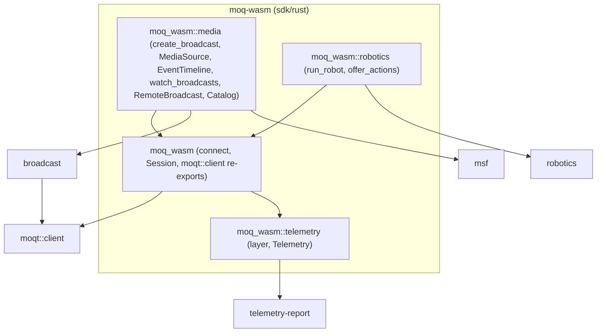

# Design: the Rust SDK `moq-wasm`

## Status
Accepted (2026-11-20)

## Scope
Single-dependency Rust SDK (`sdk/rust`, package `moq-wasm`, imported as `moq_wasm`) for external Rust applications (starting with remote-operated robots), released like the Python SDK ([`python/sdk.md`](../python/sdk.md)). Workspace services continue using `moqt` and `broadcast` directly.

Revises two decisions from [`moqt/sdk.md`](../moqt/sdk.md): the Rust entry point is `moq-wasm` (not `moqt`), and its release tag is `rust-sdk-v*` (not `rust-v*`).

## Context
[`moqt/sdk.md`](../moqt/sdk.md) exposed `moqt::client` as the core client, leaving media to `broadcast`. External Rust apps had to reimplement helpers already built into the Python SDK:

| Pattern | Python SDK | Rust without `moq-wasm` |
| --- | --- | --- |
| Token refresh | `connect(refresh_token=)` | Per-service or missing |
| End classification | `ConnectionLost`, `TokenExpired`, `SessionClosed` | `TransportClose` only |
| Namespace lifecycle | `watch_broadcasts` | Custom loops in `ingest-gateway` / `live-translate` |
| Catalog & track follow | `RemoteBroadcast.catalogs`, `Catalog.select`, `follow` | `CatalogReader` / `CommandSubscriber` per service |
| Media & event publishing | `add_media_source`, `EventTimeline` | Manual `BroadcastWriter` + `mediapack` events |

This media layer depends on `moqt`, `broadcast`, and `msf`, so it cannot live inside `moqt` (`broadcast` depends on `moqt`).

## Decision

### Crate Design & Layers
- **Package & naming**: `sdk/rust` is package `moq-wasm` (imported as `moq_wasm`), matching the repo and the browser/Python SDKs (no `-client`/`-rust` suffix; does not use WebAssembly). Native targets on Tokio only.
- **Single dependency**: Re-exports `moqt::client` plus the `moqt` types named in its signatures (`CertificateVerification`, `Version`, `FilterType`, `GroupOrder`, `Location`, `ExtensionHeaders`, `TransportClose`, `RequestErrorCode`, …) and nothing else from `moqt`, preventing version mismatches. `sdk/python` keeps `[lib] name = "moq_wasm"` with `doc = false` so workspace `cargo doc` produces one `moq_wasm`.

```toml
[dependencies]
moq-wasm = { git = "https://github.com/nttcom/moq-wasm", tag = "rust-sdk-v0.1.0" }
tokio = { version = "1", features = ["macros", "rt-multi-thread"] }
```



Naming mirrors the Python SDK (`snake_case`).

### Core: `moq_wasm`

```rust
use moq_wasm::{ConnectOptions, RefreshToken, SessionEnd};

let session = moq_wasm::connect(
    "https://relay.example:4433",
    ConnectOptions {
        token: Some(jwt),
        refresh_token: Some(RefreshToken::new(|current| async move {
            my_app_server.later_token(&current).await
        })),
        ..Default::default()
    },
).await?;

let status = session.publish_track(&["anon", "robot-1"], "status", Default::default()).await?;
tokio::select! {
    result = work(&session, status) => result?,
    end = session.closed() => match end {
        SessionEnd::ConnectionLost(close) => tracing::warn!(?close, "relay lost"),
        SessionEnd::TokenExpired => tracing::warn!("token expired"),
        SessionEnd::Closed => {}
    },
}
```

**Connection & session**
- **`connect(url, ConnectOptions)`**: Accepts `token`, `refresh_token`, `certificate_verification`, and `versions` (default: draft-18, then draft-14).
- **`Session`**: Owns `moqt::client::Session` (via `Deref`, keeping all request methods without copying signatures) plus the token-refresh task. Provides its own `closed()` and `close()`. Refused requests return `RequestError` / `FetchError`; other failures return `anyhow::Error`.
- **Raw tracks**: `publish_track` returns `TrackWriter`. With `PublishTrackOptions::on_demand`, `demand_change()` reports whether a subscription is in Forward State 1 (draft-18 §10.10; latest value, changes coalesced) so the app produces only while wanted; `end()` sends `PUBLISH_DONE` to every subscriber and a later `publish_track` of the same name makes the track subscribable again.
- **Reconnection & GOAWAY**: Handled by `moqt` up to 60 s ([`moqt/session-migration.md`](../moqt/session-migration.md)); SDK does not re-dial afterward.

**Lifecycle & logging**
- **Token refresh**: Reads `app_id`/`exp`, calls `RefreshToken` (`Fn(String) -> Future<Output = anyhow::Result<String>>`) 5 min before expiry, retries every 30 s until `exp`, and sends in-session `TRACK_STATUS` refresh ([`relay/architecture.md`](../relay/architecture.md) "Token refresh"). New connections use the latest token.
- **`closed()`**: Resolves once with `ConnectionLost(TransportClose)`, `TokenExpired`, or `Closed`. Callers race their work against `closed()` with `tokio::select!`.
- **Logs**: Emits `tracing` events using `AGENTS.md` fields without installing a subscriber (no `init`/`on_log`/`on_span`); `moq_wasm::telemetry` forwards them to client telemetry (below).

### Client Telemetry: `moq_wasm::telemetry`

```rust
use tracing_subscriber::{Layer, filter::LevelFilter, layer::SubscriberExt, util::SubscriberInitExt};

let (telemetry_layer, telemetry) = moq_wasm::telemetry::layer(moq_wasm::telemetry::TelemetryOptions {
    url: "https://observability.example".to_string(),
    page: "my-robot".to_string(),
});
tracing_subscriber::registry()
    .with(tracing_subscriber::fmt::layer())
    .with(telemetry_layer.with_filter(LevelFilter::INFO))
    .init();
let session = moq_wasm::connect(url, options).await?;
session.scoped(work(&session)).await?;
telemetry.flush().await;
```

The Rust counterpart of the Python SDK's `init(telemetry=)` ([`python/sdk.md`](../python/sdk.md) "Logs and Spans"), posting to `observability`'s `/api/client-telemetry` ([`observability/architecture.md`](../observability/architecture.md) "Client Telemetry") with `service: "rust"`.
- **A layer, not `init`**: Rust apps install their own subscriber, so `layer(options)` returns a `tracing_subscriber::Layer` (events → logs at the levels the app filters it to; closed `INFO`+ spans via `telemetry-report`'s `SpanRecordLayer`) and a `Telemetry` owning the flush task. It also sets `moqt`'s spawn wrapper and trace-context provider/joiner (process-wide, first call wins), so requests carry `TRACE_CONTEXT`.
- **Session scopes**: Each `Session` binds a `telemetry_report` scope to its current token (followed across refreshes); `connect` runs in it, so the session's `moqt` tasks carry it, and `Session::scoped(future)` puts app work (and the `moqt` tasks it spawns) under it. Requests called directly on `Session` outside `scoped` and records outside any session go untokenized, e.g. an HTTP server's logs in a service holding one session per app token.
- **Reports**: Newest 100 logs + 100 spans per token (max 64 tokens, the oldest evicted and counted), posted every 10 s and on `Telemetry::flush` (5 s timeout, failures dropped). Remembers up to 64 `401`-rejected tokens by SHA-256 digest and sends their later records untokenized. Dropping `Telemetry` stops the task without a final report (a spawned report would not outlive the runtime), so apps await `flush()` before exit. No `redact` or custom stats.
- **Dependencies**: `telemetry-report` and `telemetry` (shared with the other SDKs), `tracing-subscriber`, `reqwest` (rustls), and `aws-lc-rs` (SHA-256), all already workspace dependencies.

### Media: `moq_wasm::media`

```rust
use moq_wasm::{Retention, media::{self, MediaSourceOptions, TrackQuery, WatchOptions}};

let builder = media::create_broadcast(&session, &["anon", "robot-1"]);
let status = builder.publish_track("status", Default::default()).await?;
let events = builder.event_timeline("events", Retention::For(Duration::from_secs(3600))).await?;
let broadcast = builder.announce().await?;
let camera = broadcast.add_media_source(MediaSourceOptions::new("camera"));

camera.configure_video("avc1.42e01f")?;
camera.push_video(annexb_access_unit, timestamp_micros)?;

media::watch_broadcasts(&session, &["anon", "operators"], WatchOptions::default(), |remote| async move {
    let mut catalogs = remote.catalogs().await?;
    while let Some(catalog) = catalogs.next().await? {
        let _track = catalog.select(&TrackQuery { role: Some("audio"), ..Default::default() });
    }
    Ok(())
}).await?;
broadcast.close().await?;
```

| Type / Function | Behavior |
| --- | --- |
| `create_broadcast` → `BroadcastBuilder` | Registers tracks (`publish_track`, `event_timeline`; rejects `publish: true`) **before** `announce()` returns `LocalBroadcast`, guaranteeing immediate `SUBSCRIBE`s find them. |
| `LocalBroadcast` | Adds later tracks and `MediaSource`s (`add_media_source`). `close()` (or `Drop` via spawned task) withdraws namespace (`PUBLISH_NAMESPACE_DONE`) and stops sources/renditions. |
| `EventTimeline` | Single-group MSF §8 incremental timeline backed by `Retention` (1-record-per-group robot tracks live in `robotics`). |
| `MediaSource` | Shared `broadcast::MediaSource` wrapper (H.264/H.265/VP8/VP9/AV1, AAC/Opus, µs capture timestamps, renditions, `keyframe_request()`, `demand_change()`, `on_demand`, required `label` via `MediaSourceOptions::new`). |
| `watch_broadcasts` | Spawns a Tokio task per matching broadcast under `prefix`, aborts on withdraw, restarts on re-announce, logs `Err`, optional `empty_timeout`. Skips self-published namespaces via `moqt::Session::publishes_namespace`. |
| `RemoteBroadcast` | `catalogs()` (joining FETCH, skips/logs unparseable), `follow(name, FollowOptions)` (plain `SUBSCRIBE` from largest object to avoid `SUBSCRIBE_NAMESPACE` overlap draft-14 §9.28; 2 s default `delivery_timeout`, 1 s resubscribe), `event_timeline(name, EventTimelineOptions)` (joining FETCH, no default timeout, deduplicates on resubscribe). Dropping unsubscribes. |
| `loc_timestamp_micros` / `loc_timestamp_headers` | Read and write the LOC Timestamp property (draft-ietf-moq-loc-04 §2.3.1.1) as wall-clock µs since the Unix epoch, in the `ExtensionHeaders` of `follow` objects and `TrackWriter::write`; thin wrappers over `mediapack::loc`. A Timestamp in media time (with Timescale, §2.3.1.2) reads as `None`. |
| `Catalog` | `msf` catalog parsed with `parse` or built with `new(tracks)` (no `generatedAt`) and written with `to_bytes()` (e.g. a catalog listing another broadcast's tracks by `namespace`, MSF §5.2.2); `select(&TrackQuery)` (`role`, `packaging`, `codec` prefix, `BitratePreference::{Lowest, Highest}`); tracks re-exported as `CatalogTrack`. |

Deferred until requested: `BroadcastReader`, CMAF copies, server API, and codecs.

### Robotics & No-Codec Policy
- **No codec**: Packs encoded frames into LOC without encoding/decoding to avoid H.264 patent/license obligations ([`python/sdk.md`](../python/sdk.md) "No codec in the wheel"). Robots encode via hardware/GStreamer/FFmpeg (`gst-plugin-moqt` for GStreamer).
- **`moq_wasm::robotics`** (always compiled, not feature-gated): Wraps `crates/robotics` ([`robotics/architecture.md`](../robotics/architecture.md)):
  - Robot: `run_robot(session, broadcast, config)` on `<room>/robot` + re-exported `Robot`, `Command`, `HoldReason`, `ArbiterConfig`.
  - Policy driver: `offer_actions(broadcast)` + `Driver`, `State`, `decode_object`.
  - Uses core `PublishTrackOptions::priority` and `EventTimeline` / `RemoteBroadcast::event_timeline`.

### Release
No build artifacts; users depend directly on the git tag:
1. PRs add user-visible entries under `## リリースノート（Rust）` (never editing `sdk/rust/CHANGELOG.md` directly). A release PR collects them and bumps `sdk/rust/Cargo.toml` (`.agents/skills/release-rust-sdk/SKILL.md`).
2. Push tag `rust-sdk-v<version>` on the merge commit.
3. `.github/workflows/rust-sdk-release.yml` validates tag vs. version/changelog, runs `cargo update && cargo test -p moq-wasm` (uncommitted, simulating external git dependency resolution) on Linux x86_64, Linux aarch64, and macOS arm64.
4. Creates GitHub Release with the changelog section (not marked Latest).

Versions are `0.x` independent of other SDKs; minor versions may break API. See [`moqt/sdk.md`](../moqt/sdk.md) for why crates.io is deferred.

### Platforms, Docs & Consequences
- **Platforms & toolchain**: Linux x86_64, Linux aarch64 (Jetson / Raspberry Pi 64-bit), macOS arm64. Requires Rust ≥ 1.85 (edition 2024) and a C compiler/cross-toolchain for `aws-lc-sys` ([`moqt/aws-lc-rs.md`](../moqt/aws-lc-rs.md)).
- **Docs & example**: `sdk/rust/README.md` is `#![doc = include_str!(...)]`; `examples/browser` `npm run docs` publishes `cargo doc -p moq-wasm --no-deps` to `examples/browser/public/docs/rust`; `examples/rust/moq-broadcast` demonstrates `publish`/`watch` using only this crate.
- **Consequences**: One dependency with full core/media/robotics helpers; trade-offs are maintaining `moqt::client` parity across Rust/Python, two `moq_wasm` targets in the workspace (`sdk/rust` lib vs `sdk/python` cdylib), and C toolchain requirement for `aws-lc-sys`.

### Alternatives Considered

| Alternative | Why rejected |
| --- | --- |
| `moqt` directly | Cannot depend on `broadcast`/`msf`; forces multi-crate tags and mismatched naming |
| Media layer inside `broadcast` | Still requires two crates and mixes session helpers into an original-publisher library |
| Wrap every `moqt::client` type | Duplicates an already SDK-shaped `0.x` surface |
| Role name (`client`) / suffix (`moq-wasm-rust`) | Forces dependency renaming or repeats Cargo context |
| `crates.io` | Locks name/versions pre-1.0 and forces publishing `moqt`, `broadcast`, `msf`, `mediapack` |
