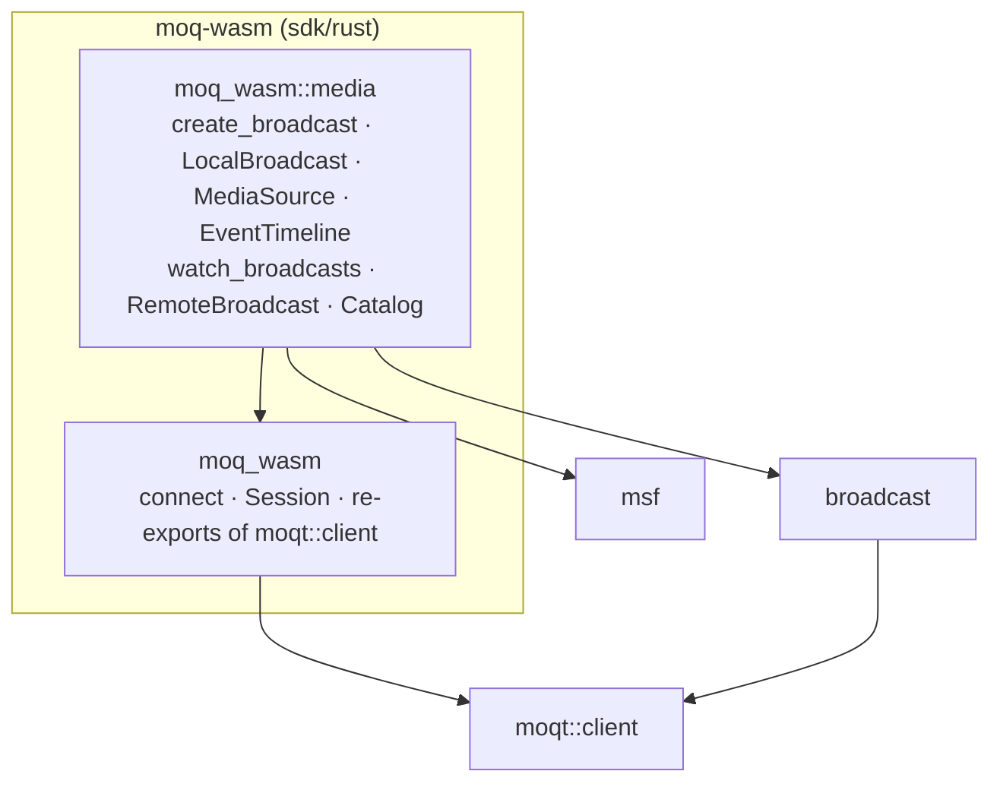

# Design: the Rust SDK `moq-wasm`

## Status
Proposed

## Date
2026-11-20

## Scope
A Rust SDK for applications outside this repository, robots under remote
operation first, released like the Python SDK
([python/sdk.md](../python/sdk.md)): a new crate `sdk/rust` that a
Rust application adds as its only dependency on this repository. This
document fixes the crate, its API and its release. Robot-specific features
(command expiry, dead-man stop, observation alignment, the track layout of a
robot) are designed separately; "Robotics" below says how they reach this
crate.

It revises two decisions of [moqt/sdk.md](../moqt/sdk.md): the Rust entry
point is no longer `moqt` itself, and its tag is `rust-sdk-v*`, not `rust-v*`.

## Context
[moqt/sdk.md](../moqt/sdk.md) made `moqt::client` the language-independent
client: `Session` with `subscribe`, `subscribe_current_group`,
`subscribe_group_start`, `fetch`, `track_status`, `watch_namespaces`,
`announce` and `publish_track` (with `datagram`), shaped after the browser
SDK's `MoqSession`. The browser and Python SDKs bind it. It chose `moqt`
as the Rust SDK and left media to `broadcast`, and its release steps for
Rust (README, changelog, `rust-v*` workflow) were not started.

A Rust application today therefore writes what the Python SDK gives a bot:

| Pattern | Python SDK | Rust today |
| --- | --- | --- |
| Refresh the token before it expires | `connect(refresh_token=)` | each service, or nothing |
| Tell a lost connection from an expired token or `close` | `ConnectionLost`, `TokenExpired`, `SessionClosed` | `TransportClose` only |
| Run a task per broadcast under a prefix, cancelled when it is withdrawn | `watch_broadcasts` | `services/onvif-ingest/src/command_subscriber.rs` and `services/live-translate`, each its own loop |
| Read the catalog with a joining FETCH and pick a track | `RemoteBroadcast.catalogs`, `Catalog.select` | `services/recorder/src/catalog_reader.rs`, `services/live-translate/src/source_catalog.rs` |
| Subscribe again after a track ends | `RemoteBroadcast.follow` | `CommandSubscriber`, per service |
| Publish encoded H.264/Opus as an MSF broadcast | `LocalBroadcast.add_media_source` over `_native.MediaBroadcast` | `broadcast::Broadcast` and `BroadcastWriter` with `mediapack` events built by hand |
| Write an MSF event timeline | `EventTimeline` | by hand |

The media source is already written twice: `sdk/js/src/media_broadcast.rs`
and `sdk/python/src/media_broadcast.rs` wrap `broadcast::Broadcast` with the
same `configure_video`, `push_video`, `configure_audio`, `push_audio`,
`add_rendition`, `remove_track`, keyframe request and demand change, about
400 lines each.

The layer that closes these gaps depends on `moqt`, `broadcast` and `msf`.
`moqt` cannot hold it, since `broadcast` depends on `moqt`.

## Decision

### The crate
- **Package `moq-wasm`, in `sdk/rust` beside `sdk/js` and `sdk/python`,
  imported as `moq_wasm`.** A
  git dependency is named by its package, so the package carries the name
  users install, the one the browser and Python SDKs are installed under. It
  does not use WebAssembly; the name follows the repository, as the Python
  package's does. A role name (`client`) would make users write
  `client = { git = … }` or rename it with `package =`.
- **No suffix.** `moq-wasm-client` or `moq-wasm-rust` says nothing Cargo
  does not: the browser and Python SDKs are clients too, and the tags tell
  the three apart.
- **One dependency.** The crate re-exports `moqt::client` and the `moqt`
  types its signatures name (`ClientConfig`, `CertificateVerification`,
  `FilterType`, `GroupOrder`, `Location`, `ExtensionHeaders`,
  `TransportClose`, `RequestErrorCode`, …), and nothing else of `moqt`, so
  an application never adds `moqt`, `broadcast` or `msf` itself and cannot
  mix versions of them. `moqt::client` is already the client API shaped
  after `MoqSession`; wrapping each of its types again would copy it. A
  change to `moqt::client` is a change to this SDK and is written in its
  changelog.
- **`sdk/python` keeps `[lib] name = "moq_wasm"`** for its extension
  module and gains `doc = false`, so `cargo doc --workspace` writes one
  `moq_wasm`.
- Native targets only, on tokio. The browser uses the browser SDK.

```toml
[dependencies]
moq-wasm = { git = "https://github.com/nttcom/moq-wasm", tag = "rust-sdk-v0.1.0" }
tokio = { version = "1", features = ["macros", "rt-multi-thread"] }
```

### Layers



The same split as the browser SDK's `moq-wasm` and `moq-wasm/media` and the
Python SDK's `moq_wasm` and `moq_wasm.media`. Names follow the Python SDK,
which is already snake_case.

### Core: `moq_wasm`

```rust
use moq_wasm::{ConnectOptions, RefreshToken, SessionEnd};

let session = moq_wasm::connect(
    "https://relay.example:4433",
    ConnectOptions {
        token: Some(jwt),
        refresh_token: Some(RefreshToken::new(|current| async move {
            my_app_server.later_token(&current).await
        })),
        ..Default::default()
    },
)
.await?;

let status = session
    .publish_track(&["anon", "robot-1"], "status", Default::default())
    .await?;
tokio::select! {
    result = work(&session, status) => result?,
    end = session.closed() => match end {
        SessionEnd::ConnectionLost(close) => tracing::warn!(?close, "relay lost"),
        SessionEnd::TokenExpired => tracing::warn!("token expired"),
        SessionEnd::Closed => {}
    },
}
```

- **`connect(url, ConnectOptions)`** builds the endpoint and returns a
  `Session`. `ConnectOptions` holds `token`, `refresh_token`,
  `certificate_verification` and the `ClientConfig` fields an application
  sets. A failure to connect is the `Err`.
- **`Session`** owns a `moqt::client::Session` and the token refresh task,
  and dereferences to the `moqt::client::Session`, so its request methods
  keep their names and arguments without a copy of each: `subscribe`,
  `subscribe_current_group`, `subscribe_group_start`, `fetch`,
  `track_status`, `watch_namespaces`, `announce`, `publish_track`,
  `transferred_bytes`. `closed` and `close` are its own. What they return are `moqt::client`'s
  `Subscription`, `Group`, `Fetch`, `NamespaceWatch`, `Announcement` and
  `TrackWriter`, re-exported. A refused request is `moqt::client`'s
  `RequestError` or `FetchError`; any other failure is `anyhow::Error`.
- **Reconnection is the native session's**, as in the Python SDK: `moqt`
  follows GOAWAY and replaces a lost connection for at most 60 s
  ([moqt/session-migration.md](../moqt/session-migration.md)), sending the
  namespaces and subscriptions again. The SDK does not dial again after
  that.
- **Token refresh** is the Python SDK's: the session reads `app_id` and
  `exp` from the token, calls `refresh_token` with the current token five
  minutes before `exp`, retries every 30 s until the token expires, and
  sends each new token to the relay (the TRACK_STATUS refresh of
  [relay/architecture.md](../relay/architecture.md) "Token refresh"). A
  connection the native session opens presents the newest token. Getting a
  token stays the application's job. `RefreshToken` wraps an
  `Fn(String) -> impl Future<Output = anyhow::Result<String>>`.
- **`closed()`** resolves once with how the session ended: `ConnectionLost`
  with the last connection's `TransportClose`, `TokenExpired` when the token
  expired while `refresh_token` kept failing, or `Closed` after `close()`.
  Rust has no task group to cancel the work, so the application races its
  work against `closed()`; the README shows it.

### Logs
The crate logs through `tracing`, with the field vocabulary of AGENTS.md
"Logging", and installs no subscriber: a Rust application already chooses
its own (`tracing-subscriber`, OpenTelemetry). The browser and Python SDKs'
`init`, `on_log`, `on_span` and the client telemetry posted to the
observability server are left out; they exist because those runtimes cannot
read `tracing` directly.

### Media: `moq_wasm::media`

```rust
use moq_wasm::{Retention, media::{self, MediaSourceOptions, TrackQuery, WatchOptions}};

let builder = media::create_broadcast(&session, &["anon", "robot-1"]);
let status = builder.publish_track("status", Default::default()).await?;
let events = builder.event_timeline("events", Retention::For(Duration::from_secs(3600))).await?;
let broadcast = builder.announce().await?;
let camera = broadcast.add_media_source(MediaSourceOptions::new("camera"));

camera.configure_video("avc1.42e01f")?;
camera.push_video(annexb_access_unit, timestamp_micros)?; // a keyframe opens a group

media::watch_broadcasts(&session, &["anon", "operators"], WatchOptions::default(), |remote| async move {
    let mut catalogs = remote.catalogs().await?;
    while let Some(catalog) = catalogs.next().await? {
        let track = catalog.select(&TrackQuery { role: Some("audio"), ..Default::default() });
        // …
    }
    Ok(())
})
.await?;

broadcast.close().await?;
```

- **`create_broadcast(session, namespace)`** returns a `BroadcastBuilder`.
  Its `publish_track` and `event_timeline` register tracks, and
  `announce()` publishes the namespace and returns the `LocalBroadcast`.
  The Python SDK asks for tracks to be declared before the first `await` so
  that a SUBSCRIBE the relay forwards at once finds them; here the builder
  makes it a type: no track of the batch can be added after the announce.
  The builder refuses a track with `publish`, since a PUBLISH follows the
  namespace. `LocalBroadcast` adds later tracks with the same methods, and
  media sources with `add_media_source`: a subscriber finds a media
  source's tracks in the catalog, which lists them only once they are
  published, so they need no place in the batch. `close()` withdraws the
  namespace (PUBLISH_NAMESPACE_DONE) and stops the media sources and their
  renditions: their pushes fail from then on, so no frame reaches the
  subscriptions the namespace had, and their waits end. Dropping a
  `LocalBroadcast` without `close()` does the same, withdrawing on a spawned
  task.
- **`EventTimeline`** writes a draft-ietf-moq-msf-02 §8 event timeline as
  the Python SDK's does: one group, each record one more object, so a late
  joiner's joining FETCH brings the records the track still keeps for its
  `Retention`. The
  one-record-per-group tracks of a robot are written by `robotics`.
- **`MediaSource`** is the Python SDK's media source in Rust: it takes
  encoded video (H.264, H.265, VP8, VP9, AV1) or audio (AAC, Opus) with capture timestamps in
  microseconds and publishes them through `broadcast` as LOC tracks with the
  MSF catalog and media timeline: `configure_video`, `push_video`,
  `configure_audio`, `push_audio`, `add_rendition`, `remove_track`,
  `keyframe_request().await` (a NEW_GROUP_REQUEST), `demand_change().await`
  and the `on_demand` option. `MediaSourceOptions::new(label)` takes the
  catalog label, which has no default, as the Python SDK's `label` has
  none. Its implementation is the wrapper
  `sdk/js` and `sdk/python` share after "Migration" step 2, so the
  three SDKs publish the same catalog.
- **`watch_broadcasts(session, prefix, WatchOptions, handler)`** runs
  `handler` on a tokio task for each broadcast published under `prefix` that
  `WatchOptions::filter` accepts, aborts it when the broadcast is withdrawn
  and runs it again when it is published anew. A handler's `Err` is logged.
  With `WatchOptions::empty_timeout`, it returns once no broadcast has been
  published for that long. It skips the broadcasts this session publishes,
  which a relay echoes to its SUBSCRIBE_NAMESPACE (draft-14 §6.1), through
  `moqt::Session::publishes_namespace`: a namespace is published through
  `announce` or through `broadcast`'s `RelayConnection`, so only the moqt
  session sees both.
- **`RemoteBroadcast`** is one published namespace. `catalogs().await`
  subscribes, and its `Catalogs` yields a `Catalog` each time the publisher
  changes it, starting from the one the
  relay holds (a joining FETCH), and skips one that does not parse, logging
  it. `follow(name, FollowOptions)` yields the track's objects from the
  largest object on, and subscribes again a second after the track ends or
  its SUBSCRIBE fails. It sends a plain SUBSCRIBE, not
  `moqt::client::Session::follow_track`: that sends a SUBSCRIBE_NAMESPACE of
  its own, which overlaps the one `watch_broadcasts` holds and is refused
  (draft-14 §9.28).
  `event_timeline(name, EventTimelineOptions)` yields the records of an
  event timeline track, starting with those the relay still keeps (a
  joining FETCH), and subscribes again as `follow` does. Both options set
  the SUBSCRIBE's `priority` and `delivery_timeout`, which a robot's tracks
  set per track ([robotics/architecture.md](../robotics/architecture.md)
  "Priority and delivery"). Their defaults differ, as the Python SDK's do:
  `follow` drops what would arrive more than 2 s late, as a player does,
  while `event_timeline` has no timeout, since a chat or an episode track
  needs every record. Each is its own type so that its `Default` is its
  default. All three are read with `next().await`, as
  `moqt::client::Subscription` is; `follow`'s `FollowedTrack` and
  `event_timeline`'s `RemoteEventTimeline` never end by themselves, and an
  event timeline subscribed again skips the objects it already read.
  Dropping any of them unsubscribes.
- **`Catalog`** is `msf`'s parsed catalog with `select(&TrackQuery)`, which
  picks a track by `role`, `packaging`, `codec` (`"avc1"` matches
  `avc1.42e01f`) and a `BitratePreference` (`Lowest`, `Highest`). Its
  tracks are `msf::Track`, re-exported as `CatalogTrack`.

Left out until an application asks: reading a broadcast back into media
events (`broadcast::BroadcastReader`, what `live-egress` uses), the CMAF
copies of a media source's tracks (`cmaf`), the server side, and any codec.

### No codec
The crate packs encoded frames into LOC objects and never encodes or
decodes, for the reason [python/sdk.md](../python/sdk.md) "No codec in the
wheel" gives: H.264 encoders and decoders carry patent and license terms that
this repository does not take on for its users. A robot encodes with what it
has (a hardware encoder, GStreamer, FFmpeg) and pushes the access units; a
GStreamer pipeline can use `gst-plugin-moqt` instead.

### Robotics
Robot teleoperation and cloud VLA are the first users. Their features are
designed in [robotics/architecture.md](../robotics/architecture.md): the
room layout, the record types on event timeline tracks, the arbitration
between operator and policy with its dead-man hold, observation alignment,
recording and the LeRobot export. That logic lives once in the crate
`robotics`, and each SDK wraps it.

This crate gains `moq_wasm::robotics` with the shape of the Python SDK's
`moq_wasm.robotics` (the robot side, `Robot`, first), in the same plan step
as the Python module. It is not behind a Cargo feature: `robotics` adds
record types and logic, not a heavy dependency, and a feature would split
the tested builds. Until then the crate stays domain-free. The robotics
design needs two things of the general API, both above:
- `priority` in `PublishTrackOptions`, the Publisher Priority per track that
  `moqt` gains in that design's step 1; this crate exposes it through the
  re-export without code of its own.
- Event timelines in both directions: `EventTimeline` to write, and
  `RemoteBroadcast::event_timeline` to read.

### Release
As the Python SDK's, without build artifacts: the tag is what users depend
on.

1. PRs do not edit `sdk/rust/CHANGELOG.md`; a change a user of the
   crate would notice carries its entry in the PR body's
   `## リリースノート（Rust）` section. The release PR collects them into the
   version's section and sets `version` in `sdk/rust/Cargo.toml`
   (`.agents/skills/release-rust-sdk/SKILL.md`).
2. `rust-sdk-v<version>` is pushed on its merge commit.
3. `.github/workflows/rust-sdk-release.yml` stops unless the tag names the
   version and the changelog has its section. On Linux x86_64, Linux
   aarch64 and macOS arm64 runners it runs `cargo update` and then
   `cargo test -p moq-wasm`: a git dependency does not read this
   repository's `Cargo.lock`, so CI resolves dependencies as a user's build
   does (the reason [moqt/sdk.md](../moqt/sdk.md) "Rust" gives). The
   `cargo update` is not committed.
4. The GitHub Release is created with the changelog section as its body,
   not marked Latest.

Versions are `0.x` and independent of the other SDKs; a minor version may
break the API, as theirs may. crates.io stays out for the reasons
[moqt/sdk.md](../moqt/sdk.md) "レジストリに公開しない理由" gives.

### Platforms and toolchain
- Supported: the three platforms the release workflow tests. Linux aarch64
  covers Jetson and Raspberry Pi 64-bit.
- The crate builds `aws-lc-sys` (via `aws-lc-rs`, see
  [moqt/aws-lc-rs.md](../moqt/aws-lc-rs.md)), so a build needs a C compiler,
  and a cross build a C cross toolchain for the target. The README lists
  this.
- The workspace is edition 2024, so Rust 1.85 or later. No older MSRV is
  promised; the README names the version CI uses.

### Documentation
- `sdk/rust/README.md` is the crate's documentation root
  (`#![doc = include_str!("../README.md")]`): install, connect, publish a
  broadcast, follow one, and the platform notes.
- `npm run docs` in `examples/browser`, which already writes the Python
  reference, runs `cargo doc -p moq-wasm --no-deps` into
  `examples/browser/public/docs/rust`, so GitHub Pages serves it next to the
  browser and Python references.
- `crates/moqt/README.md` points applications to this crate and keeps its
  own example for code that needs `moqt`'s lower layers.
- An example under `examples/rust/` publishes an H.264 file as a broadcast
  with a status track and follows a command track an operator page
  publishes, the shape of `onvif-ingest`'s `CommandSubscriber`.

## Migration
One step per PR, each stacked on the one before.

1. **docs: this design.** [moqt/sdk.md](../moqt/sdk.md) marks decisions 2 and
   3 and its Rust release steps 9 and 10 as replaced by this document.
2. **refactor(broadcast): one media source.** Move the wrapper
   `sdk/js/src/media_broadcast.rs` and
   `sdk/python/src/media_broadcast.rs` share into `broadcast`, and make
   both bindings call it. The browser unit tests, pytest and the media E2E
   guard it; neither SDK's API changes.
3. **feat(moq-wasm): core.** The crate, `connect`, `Session`, token refresh,
   `SessionEnd`, the re-exports, the README; AGENTS.md gains the crate in its
   component table; `sdk/python` gains `doc = false`.
4. **feat(moq-wasm): publish a broadcast.** `create_broadcast`,
   `LocalBroadcast`, `EventTimeline`, `MediaSource`.
5. **feat(moq-wasm): follow broadcasts.** `watch_broadcasts`,
   `RemoteBroadcast` (with `event_timeline`), `Catalog`.
6. **docs(examples): a robot-shaped Rust example.**
7. **ci: release.** `rust-sdk-release.yml`, the `release-rust-sdk` skill,
   `CHANGELOG.md`, the Rust reference on GitHub Pages. Then
   `rust-sdk-v0.1.0`.

The services in this repository keep `moqt` and `broadcast`. Moving one onto
the SDK is a change of its own, for when it would delete code.

## Consequences

### Positive
- A Rust application adds one dependency, named as the other two SDKs, and
  writes no event loop, token refresh, catalog reading or LOC packing.
- The three SDKs publish media through one wrapper over `broadcast`.
- Robot software in Rust gets `moq_wasm::robotics` from the same crate when
  the robotics design adds it.

### Negative
- `moqt::client` is now a public surface twice over: through the bindings
  and as re-exports. Its changes need a changelog entry.
- Token refresh, `watch_broadcasts`, `follow` and `Catalog.select` exist in
  Python and in Rust; the two must keep the same behaviour.
- `moq_wasm` names two library targets in the workspace, told apart only by
  crate type.
- A build needs a C toolchain for `aws-lc-sys`, which matters most when
  cross-compiling for a robot.

## Alternatives Considered

### `moqt` as the Rust SDK ([moqt/sdk.md](../moqt/sdk.md) decision 2)
Adds nothing new, but the layer above the core needs `broadcast` and `msf`,
which `moqt` cannot depend on. Users would add `moqt`, `broadcast` and `msf`
at the same tag, and the Rust name would differ from the other two SDKs.

### Put the media layer in `broadcast`
Users would still add two crates, and `broadcast` serves the services as an
original-publisher library; session-level helpers (`watch_broadcasts`, token
refresh) do not belong there.

### Wrap every `moqt::client` type
Would decouple the SDK from `moqt`'s changes, but copies a type for each
type `moqt::client` already shaped after the browser SDK, for a crate at
`0.x` that may break anyway.

### A role name (`client`) or a suffix (`moq-wasm-client`)
A role name makes users rename the dependency; a suffix repeats what Cargo
says.

### crates.io
Gives `cargo add moq-wasm` and semver ranges, but freezes names and versions
before the API settles, and needs every path dependency (`moqt`,
`broadcast`, `msf`, `mediapack`) published too.
