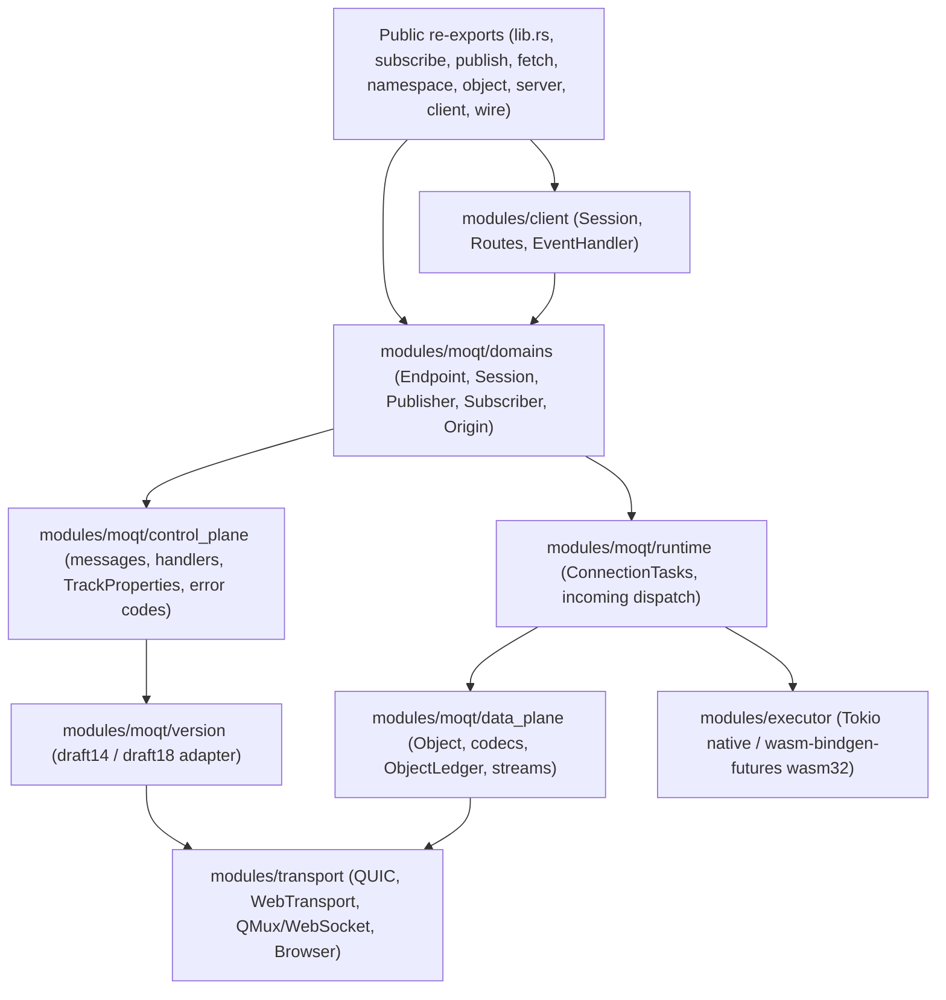
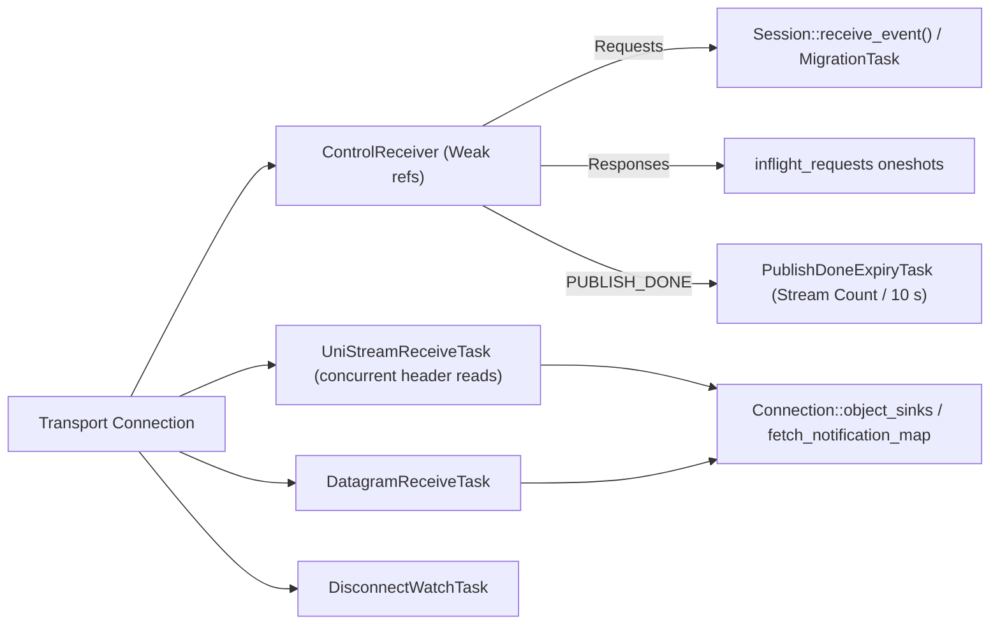

# `moqt` Architecture

## Status
Living document. Update alongside any change to design intent, module boundaries, runtime flow, or invariants.

## Scope
Core Media over QUIC Transport implementation (`draft-ietf-moq-transport-14`, plus `draft-ietf-moq-transport-18` in `modules/moqt/version/draft18`). Every workspace crate depends on `moqt`: `relay` builds a server on it, `sdk/js` runs its client on `wasm32`, and bridges/examples/SDKs use its client API natively.

**Jump to:** [Layering](#layering--public-modules) · [Transport](#transport-layer-modulestransport) · [Version Adapter](#version-adapter-modulesmoqtversion) · [Domains](#session-establishment--runtime-modulesmoqtdomains) · [Control Plane](#control-plane-modulesmoqtcontrol_plane) · [Data Plane](#data-plane--dispatch-modulesmoqtdata_plane-runtimedispatch) · [Invariants](#key-invariants--performance-invariants) · [Testing](#testing-conventions)

## Layering & Public Modules

| Public module | Exports |
| --- | --- |
| `moqt::` | `Endpoint`, `Session`, `SessionEvent`, `Publisher`, `Subscriber`, `Subscription`, `TrackWriter`, `TrackReader`, transport markers, GOAWAY/session handlers, general errors |
| `moqt::subscribe` | `SUBSCRIBE`, `SUBSCRIBE_UPDATE`, `UNSUBSCRIBE`, `TRACK_STATUS` options, `FilterType`, handlers |
| `moqt::publish` | `PUBLISH`, `PUBLISH_DONE` (`PublishOption`, handlers) |
| `moqt::fetch` | `FETCH`, `FETCH_CANCEL` (`FetchParams`, options, handlers, fetch stream sender/receiver) |
| `moqt::namespace` | `PUBLISH_NAMESPACE*`, `SUBSCRIBE_NAMESPACE` (draft-18 `SUBSCRIBE_TRACKS`), `UNSUBSCRIBE_NAMESPACE`, `PendingPublishNamespace`, `NamespaceInterest`, handlers |
| `moqt::object` | Draft-independent `Object`, `ForwardingPreference`, `SubgroupStart`, `Location`, `GroupOrder`, `ExtensionHeaders`, `ObjectStatus`, subgroup/datagram senders & receivers |
| `moqt::server` | `Accepting`, `Handshake`, `ServerConfig`, `TransportAddresses`; `self-signed-cert` feature: `CertificateFiles`, `write_self_signed_cert` |
| `moqt::executor` | `spawn`/`JoinHandle` (`abort_on_drop()` → `AbortOnDrop`), `sleep`, monotonic `now`, wall `system_time` (for wasm32-compatible callers) |
| `moqt::client` | High-level client `Session`, `Subscription`, `Group`, `Fetch`, `NamespaceWatch`, `Announcement`, `TrackWriter`, `EventHandler`, `RequestError` |
| `moqt::wire` | Draft-14 numeric request error codes (`RequestKind`, `request_error_code_to_wire`) for the SDK bindings, plus `TrackStatusOk`/`SubscribeOk`. Control framing is crate-private. |

Implementation files under `modules/` are organized by layer; top-level modules only re-export. Everything builds on `wasm32` (`QUIC`/`NATIVE` are `#[cfg(not(target_arch = "wasm32"))]`; `BROWSER` is wasm32-only).

## Transport Layer (`modules/transport`)

`TransportProtocol` defines one associated `TransportConnectionCreator`, which produces type-erased `Box<dyn TransportConnection>` (`BoxedSendStream`, `BoxedReceiveStream`). Only `Endpoint<T>` and `SessionCreator<T>` are generic over `T`; all session/stream types are concrete so one process can mix transports in a single collection.

### Transport Markers
| Marker | Stack | Notes |
| --- | --- | --- |
| `QUIC` | `quinn` (MoQT ALPNs) | Raw QUIC only; inter-relay links and native clients. Rejects non-`moqt://` URLs. No WebSocket fallback. |
| `NATIVE` | `quinn` (ALPN dispatch) + TCP listener | Server accepts `h3` (WebTransport) + MoQT ALPNs on one UDP port, plus QMux over `wss://` on the same TCP port. Client selects transport by URL scheme (`moqt://` 4433, `https://` 443, `wss://` 443; prefers IPv4 matching its IPv4 socket). |
| `BROWSER` | `web-sys` `WebTransport` (`--cfg web_sys_unstable_apis`) + `WebSocket` QMux | `wasm32` client only (`https://`, `wss://`, `NativeRoots` only; `accept`/`server` fail; `stats()` zeros). Maps priority → `sendOrder`, resets/stops → `WebTransportError.streamErrorCode`. `close()` fires `writer.close()` without awaiting peer FIN ACK. Losing raced WebTransports are closed explicitly. WebSocket backpressures at `bufferedAmount > 1 MiB`; uses `QX_PING` keepalive. |

- **Stream primitives**: `TransportReceiveStream::stop` sends `STOP_SENDING`; `TransportSendStream::poll_stopped` stores its wait inside the stream so `StreamSender::stopped` waits without holding the stream; `try_open_bi` opens only if peer stream credit is immediately available (QUIC polls once; WebTransport retains a pending open across calls; `BROWSER` falls back to `open_bi`).
- **Happy Eyeballs WebSocket fallback (`SessionCreator::open_transport`)**: Races `moqt://` or `https://` against `wss://` on the same host/port (`moqt://` uses path `/`). Resolves DNS once up front; primary gets a head start (`NATIVE`: 200 ms, `BROWSER`: 500 ms; immediate fallback on early failure). Winner is not cached; WebSocket win logs `WARN` (`url`, `fallback_url`). `BROWSER` also hedges a second `WebTransport` dial at 500 ms against initial packet loss. Only transport open falls back (failed `SETUP` returns as-is).
- **TLS & dual-stack bind**: `client_crypto.rs` builds rustls config once per `Endpoint` (reused across GOAWAY/reconnect). Native servers bind `[::]:port` via `dual_stack_bind.rs` (on Apple/XNU, holds `0.0.0.0:port` during bind and retries ephemeral port 0 up to `EPHEMERAL_PORT_ATTEMPTS`).
- **Protocol negotiation (`application_protocol.rs`)**: Creators are draft-agnostic and negotiate `ApplicationProtocols` (QUIC ALPN, WebTransport `WT-Available-Protocols`/`WT-Protocol` via `js_sys::Reflect` in browser, WebSocket `Sec-WebSocket-Protocol` `qmux-02.<alpn>` then `qmux-02`, returning 400 on mismatch).

### QMux over WebSocket (`modules/transport/qmux`, `modules/transport/websocket`)
Implements QMux (`draft-ietf-quic-qmux-02`) over WebSocket (`draft-lcurley-qmux-websocket-00`, one binary message = one record without `Size` prefix) for UDP-blocked networks and browsers without WebTransport:
- **Codecs (`frame.rs`, `transport_parameters.rs`)**: First frame must be `QX_TRANSPORT_PARAMETERS` (max record size 16,382 B, never raised). Invalid/duplicate/prohibited frames or params fail with draft QUIC error codes.
- **Limits (`qmux_connection.rs`)**: Matches quinn defaults—1 MiB per-stream window, 1,000 uni / 100 bi streams, 16 MiB connection window, 30 s idle timeout, 1 MiB drop-oldest datagram queue.
- **Tasks**: `qmux_send_task.rs` packs records in order: control frames → datagrams → streams by `set_priority` (round-robin ties) with a 64 KiB per-stream `SendQuota` (high-priority streams never block behind low-priority) and single-pass `SessionState::wake`; sends `QX_PING` every 5 s for keepalive and RTT. `qmux_receive_task.rs` never blocks on the app (buffers within advertised window, raises `MAX_STREAM_DATA`/`MAX_DATA` at 50% consumed, returns `MAX_STREAMS` only after app drops handle and peer data ends).
- **Close & lifecycle**: `close` sends `CONNECTION_CLOSE 0x1d` + WebSocket Close; dropping unfinished send/recv streams sends reset 0 / `STOP_SENDING 0`. `websocket_listener.rs` enforces a 10 s TLS/upgrade timeout, answers `503` while refusing connections, and tracks active tasks (`TransportEnded`) for clean `wait_idle`. `websocket_client.rs` enforces a 30 s total dial timeout (matching quinn). `Session::url_scheme` returns `wss` so GOAWAY preserves WebSocket.

## Version adapter (`modules/moqt/version`)

Everything above `version` operates on draft-independent intents; `version/<draft>` maps them to wire framing. `ClientConfig::versions` / `ServerConfig::versions` default to `DEFAULT_VERSIONS` (`draft-18`, then `draft-14`). Adding a draft touches only `version/<draft>` and wire codecs (never adds draft-specific runtime tasks).

`ControlChannel` is a closed enum (exhaustive matching, no `Send`/object-safety issues on `wasm32`) exposing `reserve_request_id`, `send_request`, `send_subscribe_update`, `respond`, and `notify`, using draft-14 control structs as the shared internal model. Data plane uses `SubgroupEncoder`/`FetchEncoder`, `Version::accept_uni_stream`, `SubgroupReader`/`FetchReader`, and `Version::encode_datagram`/`decode_datagram`.

- **Negotiation**: Server order wins (`moq-00` or WebTransport without subprotocol = draft-14; `moqt-18` = draft-18). `server_application_protocols` omits subprotocols after draft-14. Unlisted drafts fail the session.
- **Varint range**: Draft-14 caps at `< 2^62` (draft-18 uses `vi64`); exceeding it fails with `UnencodableObject` naming the field so callers know whether to skip an object (extension header) or abort a group (Group/Object ID).
- **Draft-specific app rules & optional fields**: Exposed via handlers/options (`FetchHandler::check_joining`: draft-14 LargestObject-only session close vs. draft-18 Forward=1 `INVALID_RANGE`; `SubscribeUpdateHandler::may_widen`: draft-14 forbidden vs. draft-18 allowed; `FetchOption::fill_timeout`: draft-18 §10.2.5 `FILL_TIMEOUT`, `None` on draft-14).

### Draft-14 vs. Draft-18 Mapping

| Aspect | `draft14` | `draft18` (`draft-ietf-moq-transport-18.txt`) |
| --- | --- | --- |
| Control streams | Single bi stream; Request IDs `0,2,…` (client) / `1,3,…` (server); `inflight_requests` + `LateResponseAction` withdrawals + 10 s timeout; a message that holds the stream is written by its own task, so a dropped caller never leaves it partial or skips its Request ID | One uni control stream per side (`SETUP`, `GOAWAY`) + one bi stream per request (no ID pairing or late responses). Drop/cancel resets stream and stops peer half with `STOP_SENDING CANCELLED` (§5.2); cancelling a peer's answered request (UNSUBSCRIBE of a PUBLISH, PUBLISH_NAMESPACE_CANCEL) ends this half with FIN instead, so the response is not discarded (§3.3.2). |
| `FETCH` lifetime | Ends with response stream | Request stream stays open until both `FETCH_OK` and response FIN/reset (`attach_fetch_response`); peer reset or `STOP_SENDING` resets both and raises `FetchCancel`; a `REQUEST_ERROR` resets a response stream still open. |
| `TrackProperties` | Mapped to/from draft-14 parameters & Group Order | Preserves raw received wire bytes (including non-minimal varints and Immutable Properties §12.7) unless overwritten via setters; rejects malformed Immutable Properties (`MALFORMED_TRACK`) and Mandatory Properties (`UNSUPPORTED_EXTENSION`, §2.5.1). |
| `PUBLISH_NAMESPACE` / `SUBSCRIBE_TRACKS` | Single `SUBSCRIBE_NAMESPACE` for any `NamespaceInterest` | Splits into parallel `SUBSCRIBE_NAMESPACE` (`Namespaces`, yielding `NAMESPACE`/`NAMESPACE_DONE` with synthetic countdown IDs from `u64::MAX`) and `SUBSCRIBE_TRACKS` (`Tracks`, with `try_open_bi` + `PUBLISH_BLOCKED` tracking across prefix updates per §6.1 / §10.9.2). |
| `REQUEST_UPDATE` | `SUBSCRIBE_UPDATE` has no response (§9.10) | Delta-applied (§10.9); answers sent strictly in arrival order (10 s timeout → `REQUEST_ERROR TIMEOUT`, returning `UpdateAnswer::Failed` so app sends `PUBLISH_DONE UPDATE_FAILED`). Outbound `update_forward`/`update_priority`/`end_before_group` await `REQUEST_OK` (`send_forward_update` and `NEW_GROUP_REQUEST` do not wait); a started outbound write is finished by its own task even if the caller drops, so answer waiters stay in wire order. Once a subscription ended on a connection (`PUBLISH_DONE` received or `UNSUBSCRIBE` sent), updates, `NEW_GROUP_REQUEST` and `UNSUBSCRIBE` send nothing for it there and return `Ok`. Prefix updates raise `SubscribeNamespaceUpdate` under `namespace_writes` lock (§10.9.2). |
| Data plane | Separate `SubgroupHeader` / `ObjectDatagram` / `FetchObject` | Delta-encoded FETCH objects; omitted subgroup/datagram priority inherits `DEFAULT PUBLISHER PRIORITY` (§12.4, default 128). |

## Session Establishment & Runtime (`modules/moqt/domains`)

- **Client**: `Endpoint::connect(url)` → `Connecting` → `version::connect` (30 s `SERVER_SETUP_TIMEOUT`, or 10 s `MIGRATION_TIMEOUT` on GOAWAY) → `Session`. `ClientConfig.authorization_token` (`AuthorizationTokenSource`: fixed, async provider called before every `CLIENT_SETUP`, or `shared` `Mutex<String>`) sends `USE_VALUE` token type `0`.
- **Server**: `Endpoint::accept()` returns non-blocking `Accepting` (`AcceptError::EndpointClosing` when closed; `refuse_new_connections()` fails new dials at transport level without touching existing sessions). `Accepting` runs transport handshake (10 s `TRANSPORT_HANDSHAKE_TIMEOUT`) + `version::accept` (10 s `CLIENT_SETUP_TIMEOUT`) → `Handshake` (exposes `authorization_tokens()`, `trace_context()`, `accept(session_span)`, `reject(code, reason)`).

### `Session` Background Tasks (`ConnectionTasks`)

All 5 tasks abort when `ConnectionTasks` drops (`ControlReceiver` and `PublishDoneExpiryTask` hold `Weak` refs so they never leak the session). `Session` exposes lightweight `Publisher`/`Subscriber` facades, `Session::closed() -> TransportClose`, `Session::url_scheme()`, `Publisher::begin_publish_namespace` (non-blocking ordered write + `PendingPublishNamespace`), and `Publisher::begin_publish_subscribed_namespace` (announces strictly on a covering `SUBSCRIBE_NAMESPACE` stream, failing with `RequestFailure::NoNamespaceSubscription` on draft-18 when none covers the namespace). A second `GOAWAY` or server-received `GOAWAY` with URI closes with `PROTOCOL_VIOLATION` (§9.4). Client sessions with `follow_go_away: true` route through `MigrationTask` ([`session-migration.md`](session-migration.md)).

### `TrackWriter` / `TrackReader`
- **`TrackWriter`**: Wraps `StreamDataSenderFactory` (1 payload/object, 1 subgroup/group, `SubgroupId::None`, default priority 128). `start_group()` sends `EndOfGroup` + FIN; `start_group_at(id)` aligns switching sets and emits Prior Group ID Gap for the ids it skips. An Origin outlet's writer instead carries the gap its `Placement` got from the numbering (a `GroupBoundary::At` past the next id), so groups it passed in Forward State 0 or failed to open are never announced as nonexistent.
- **`TrackReader`**: Wraps `DataReceiver`, reading subgroup streams concurrently into a 64-object bounded channel (applying QUIC backpressure; ordering guaranteed per subgroup only). Skips status objects; per-stream resets end only that stream (`DEBUG`); only `MalformedTrackError` returns `Err`.

**Late-join helpers**
- `subscribe_current_group`: Pipelines `SUBSCRIBE(LargestObject)` + Relative Joining `FETCH(offset=0)` in 1 RTT; drains fetched objects before live streams (refused FETCH falls back to live).
- `subscribe_group_start(ns, name, new_group_after)` (draft-18 §5.1.3.1): Joins via FETCH if non-dynamic or `Largest Object ID < new_group_after`; otherwise sends `request_new_group` and waits up to 1 s (`NEW_GROUP_WAIT`) before falling back to Joining FETCH.
- `request_new_group(&sub, largest_group)`: Sends `REQUEST_UPDATE(NEW_GROUP_REQUEST)` on dynamic draft-18 tracks (`false` otherwise).

### `Origin` (`domains/origin.rs`)
Opt-in original-publisher state (`Arc<tokio::sync::Mutex<_>>`, not used by relays).

**Track state & writes**
- **Per track (`ensure_track`)**: `ObjectNumbering` (fails at `u64::MAX`, never wraps), `ObjectCache` (`Retention::For(duration)` expired asynchronously by `CacheExpiryTask`, or `Retention::NewestOnly`), and per-subscription `OutletSendTask`s (keyed by `(SessionContext, logical_request_id)`).
- **Writes (`write`, `write_group`)**: Numbers and caches first, queues onto all outlets in numbering order while holding state lock, awaits replies after unlocking. `set_delivery(datagrams)` locks subgroup vs. datagram once an object exists (`PublishTrackError::OtherDelivery`).
- **Dynamic groups (`accept_new_group_requests`)**: Announces `DYNAMIC_GROUPS` and throttles `NEW_GROUP_REQUEST` notifications via `NewGroupDelayTask` to `MIN_GROUP_DURATION` (2 s) / `MIN_GROUP_OBJECTS` (60) (§10.2.13).

**Publishing, demand & lifecycle**
- **Publishing & subscriptions**: `publish` serializes via an outer `publishing` lock (taken before state lock; `release` and `end_track` wait on it to handle immediate `UNSUBSCRIBE`). `accept_subscribe` sets `JoinPoint` for Joining FETCH (rejected with `INVALID_JOINING_REQUEST_ID` / `INVALID_RANGE` / `PROTOCOL_VIOLATION`); `release` cancels the outlet's `CancellationToken` and resets its open group with `CANCELLED` (§10.4.3).
- **Forward State & demand**: Tracks Forward State per outlet (skipping Forward 0; resets abandoned group and reopens stream on resume, §11.4.3). `publish_on_demand` starts in Forward 0 and notifies `TrackDemand` changes (§10.10).
- **`end_track`**: Finishes open groups with `EndOfGroup`, sends `PUBLISH_DONE(TRACK_ENDED)` with exact `Stream Count`, keeps cache/numbering for FETCH and future re-publish (rejecting new `SUBSCRIBE` until re-ensured).
- **`handle(event)`**: Auto-handles registered-track `SUBSCRIBE`, `UNSUBSCRIBE`, `FETCH` (`FetchServeTask`), `FETCH_CANCEL`, `TRACK_STATUS`, and `NEW_GROUP_REQUEST`, returning unhandled events to the app. Range math lives in `domains/fetch_range.rs` (`resolve_fetch_range`, `resolve_joining_fetch`).

### `NamespaceWatchers` & `client`

#### `NamespaceWatchers` (`domains/namespace_watchers.rs`)
Crate-internal watcher registry: `watch(prefix)` returns a `NamespaceEvent` channel; `handle(event)` answers `PUBLISH_NAMESPACE` with `ok`, fans out announce/done to matching prefixes, and ends watchers on `Disconnected`.

#### `client` — the client session
Language-independent client entry point (`modules/client/`, API mapping in [`sdk.md`](sdk.md)). Wraps `moqt::Session` and runs `EventLoopTask` over `Routes`:

| File | Role |
| --- | --- |
| `session.rs` | `Session::new` / `Session::connect` + all client operations (namespaces passed as `&[&str]`, joined with `/`) |
| `routes.rs`, `event_loop_task.rs`, `event_handler.rs` | `Routes`, `EventLoopTask`, `EventHandler` (`handle(event) -> Option<event>`) + `HandlerId` |
| `subscription.rs`, `fetch.rs`, `namespace_watch.rs`, `announcement.rs`, `track_writer.rs` | Request handles |
| `track_follower.rs` | `TrackFollower` (`follow_track`): follows sequential publishers of one track, emitting `FollowEvent::PublisherLeft` |
| `track_watch.rs` | `TrackWatch` (`watch_tracks`): single `SUBSCRIBE_NAMESPACE` streaming ordered namespaces + `PublishRequest`s (`accept_current_group`) |
| `request_error.rs` | `RequestError` (`RequestKind`, `RequestFailure`, wire code), `FetchError` |

**Event dispatch order**: custom `EventHandler`s (in `add_handler` order, e.g., `broadcast::RelayConnection`) → `Origin` (also notifies `TrackWriter::next_subscriber`) → `NamespaceWatchers` → `Routes::answer` (acks `SUBSCRIBE_NAMESPACE`, rejects unknown `SUBSCRIBE` with `TRACK_DOES_NOT_EXIST` and `PUBLISH` with `UNINTERESTED` under `moqt.client.*` root spans joining peer trace).

**Invariants**: `Send + Sync` natively (`MaybeSend`/`MaybeSync` on `wasm32`; `std::sync::Mutex` tables never held across `.await`); session end terminates all watches/`done`/`next_subscriber`/`demand_change`; `Subscription` locks into `next` or `next_group` on first call; GOAWAY/reconnect stay in `moqt::Session`.

### `SessionContext` & `Connection` State
- **`Connection`** (per transport): `transport`, `ControlChannel`, `track_alias: AtomicU64`, server/GOAWAY flags, `generation` (logical ID = `generation << 56 | wire_id`), `ObjectSinks` (keyed by wire alias, stamping logical alias), `fetch_notification_map` (single-stream; unknown IDs stopped with `CANCELLED`).
- **`SessionContext`** (cross-connection): current + previous `Connection`, `event_sender`, `receiver_map` / `fetch_receiver_map` (`PendingFetch` drop-guard), `ledgers` (`Weak<ObjectLedger>` per track, surviving migration), `carried` (read-locked by outbound requests, write-locked during migration), `published_namespaces` (`Session::publishes_namespace` skips relay self-echoes per draft-14 §6.1), and `publish_subscriptions` (`SendTargets::Publish` fan-out vs. `SendTargets::Connection`).

### Request spans
Each outbound request runs in an `INFO` span (`moqt.subscriber.{subscribe,subscribe_namespace,fetch}`, `moqt.publisher.{publish,publish_namespace}`, `moqt.session.connect`, plus `DEBUG` `moqt.subscriber.track_status`) recording `request_id` (wire ID of last attempt), `duration_ms` on response/timeout, and `outcome` (`ok` | `rejected` | `timeout` | `failed`). `moqt.session.connect` opens transport outside the span and closes before session tasks start so neither holds the trace open.

**`TRACE_CONTEXT` extension (`0x1fff`)**: Negotiated via Setup Option `0x1fff` in `CLIENT_SETUP` (carrying `moqt.session.connect`'s `traceparent`) and `SERVER_SETUP` (empty). Sent on requests only when peer advertised the option (avoiding draft-18 §10.2 `PROTOCOL_VIOLATION`). `moqt` has no OTel dependency—apps register `set_trace_context_provider` and `set_trace_context_joiner`, and handlers expose `trace_context()`.

## Control Plane (`modules/moqt/control_plane`)

**Messages, properties & error codes**
- **`control_messages/` & `wire.rs`**: Draft-14 structs + framing (varint type + 16-bit fixed length).
- **`TrackProperties`**: Single source of truth for `max_cache_duration`, `delivery_timeout`, `group_order`, and `default_publisher_priority` (checked in mutable list then Immutable Properties §12.7). Tracks with Mandatory Properties are never sent to draft-14 peers (`UNSUPPORTED_EXTENSION` / `NOT_SUPPORTED` / `RequestFailure::TrackNotUnderstood`, §2.5.1).
- **`error_codes.rs` & `constants.rs`**: Typed `RequestErrorCode`, `PublishDoneCode`, `DataStreamResetCode`, `TerminationErrorCode`; unknown/unmappable codes fall back to `INTERNAL_ERROR`.

**Handlers & receive task**
- **`handler/` & `ResponseGuard`**: Inbound facades pinned to their arriving `Connection`; expose authoritative `track_namespace_tuple` and `/`-joined `track_namespace`. `ResponseGuard` sends `*_OK`, `*_ERROR`, or drop-time `NOT_SUPPORTED` and logs `*_OK sent` / `*_ERROR sent`; the first answer wins, and a later `ok`/`error` sends nothing and returns `Ok`.
- **Draft-14 `ControlMessageReceiveTask`**: Routes (1) requests & passthrough notifications (`GOAWAY`, `SUBSCRIBE_UPDATE`, `PUBLISH_DONE`, `FETCH_CANCEL`, `PUBLISH_NAMESPACE_CANCEL`) → `SessionEvent`, (2) responses → `inflight_requests` (`PendingResponse` / `ReceivedResponse` drop-guards guarantee cancel-safety via `LateResponseAction` withdrawals; after a `SUBSCRIBE_OK` the next message waits until its `ReceivedResponse` is accepted or dropped, so a `PUBLISH_DONE` behind it sees the registered receiver — draft-18's request stream task does the same), (3) malformed/unexpected messages → session close.
- **`TRACK_STATUS`** (§9.20–9.21): Uses SUBSCRIBE shape with Track Alias 0; late `TRACK_STATUS_OK` is discarded; unhandled `TrackStatusHandler` replies `NOT_SUPPORTED`.

## Data Plane & Dispatch (`modules/moqt/data_plane`, `runtime/dispatch`)

**Models & validation (`object/`)**
- **Canonical & wire types**: `Object` and `SubgroupStart`; wire `SubgroupHeader` (`0x10..=0x1D`), `SubgroupObject`, `ObjectDatagram`, `FetchObject`, `ExtensionHeaders` (ordered `KeyValuePair` list forwarded unmodified per draft-14 §10.2.1.2), `ObjectStatus`.
- **`immutable_properties.rs`**: Rejects nested Immutable Properties or malformed KVPs (`MalformedTrackError::MalformedImmutableProperties`, draft-14 §11.2 / draft-18 §12.7) before ledger check.
- **`object_ledger.rs`**: Enforces duplicate consistency per track (draft-14 §8.1 / draft-18 §9.1; ~38 B/entry, ~260 MB/day at 80 obj/s; `std::sync::Mutex` never held across `.await`). Conflicts in preference, subgroup, priority, payload (52-bit hash), or (draft-14 only) Normal/EndOfGroup/EndOfTrack status fail with `MalformedTrackError::ConflictingDuplicate` (extension headers and `DoesNotExist` ignored). Identical duplicates pass through.

**Streams & datagrams (`stream/`)**
- **`StreamDataSender`**: Compile-time typestate (`Uninitialized` → `start()` → `HeaderSent`), rejects non-increasing Object IDs, supports streaming partial payloads (`begin_object` / `send_payload`).
- **`StreamDataReceiver`**: `receive()` returns resolved `Subgroup::{Header, Object}`; `into_parts()` streams `SubgroupPart::{ObjectStart, Payload}` (zero-copy pieces hashed incrementally by ledger; whole objects copied for safe caching).
- **`DatagramSender` / `TrackData::Datagram`**: Oversized datagrams drop silently returning `DatagramDelivery::TooLarge` (§10.3 / §11.3). `Publisher::mixes_forwarding_preferences()` reflects draft-14 (one preference per track) vs. draft-18 (mixed allowed).
- **`FetchDataSender` / `FetchDataReceiver`**: Yields `Fetch::{Object, UnknownRange { last }, End}` (draft-18 §11.4.4.2; `report_unknown_range` marks or resets with `UNKNOWN_OBJECT_STATUS` / `INTERNAL_ERROR`; `FetchHandler::marks_unknown_ranges()`).
- **`stream_priority.rs`**: Packs §7.2 scheduling (subscriber priority, publisher priority, group position ≤ 4095, subgroup ID ≤ 7) into negative `i32` so control streams (priority `0`) always outrank data.

**Dispatch (`runtime/dispatch`)**: `subscription_notifier::notify` routes `IncomingObject::{Subgroup, Datagram}` into `Connection::object_sinks`; `fetch_notifier::notify` routes FETCH streams directly to `fetch_notification_map`.

## Key Invariants & Performance Invariants

### Protocol & Wire Invariants

**Framing & request IDs**
- **Dropped send stream resets (code 0), never FINs** (draft-14 §10.4.3): Prevents partial subgroups looking complete (`QUICSendStream`/`WtSendStream` reset in `Drop`, `BrowserSendStream` aborts).
- **Strict Request IDs & `MAX_REQUEST_ID`** (§9.1, §9.5): `RequestIdReservation` serializes writes without gaps; peer gaps close with `INVALID_REQUEST_ID`. Outbound IDs block at peer limit (emitting `REQUESTS_BLOCKED`); inbound window replenishes by 1,000 IDs at 50% usage; violations close with `TOO_MANY_REQUESTS` / `PROTOCOL_VIOLATION`.
- **Declared length cap**: Object payload or extension/properties length > 16 MiB (`MAX_WIRE_DECLARED_LENGTH`) fails stream decode (§12.1 / §13.5).

**Session & cutover safety**
- **Duplicate alias & unknown IDs**: Duplicate live `SUBSCRIBE_OK` alias closes with `DuplicateTrackAlias` (§9.8); unknown response ID or future `SUBSCRIBE_UPDATE` ID closes with `ProtocolViolation`; future `PUBLISH_DONE` ID closes with `InvalidRequestId`.
- **Control timeout**: 10 s per request (`RequestFailure::Timeout`, keeping session open); > 100 abandoned draft-14 entries close with `CONTROL_MESSAGE_TIMEOUT`.
- **Withdrawn request**: A draft-18 request this side withdraws before its response (e.g. `PUBLISH_NAMESPACE_DONE` on a pending `PUBLISH_NAMESPACE`) fails with `RequestFailure::Withdrawn`, not `SessionClosed`, so it never waits for a migration (draft-18 §3.3.2).
- **Group cutover**: Carried subscriptions cut over cleanly at a group boundary via `GroupCutover` (zero duplicates when previous connection closes).

### Buffering, Backpressure & Lifecycle Invariants

**Queues & expiry**
- **Buffer-before-subscribe**: `object_sinks` buffers up to 256 objects/alias (`MAX_PENDING_OBJECTS_PER_TRACK_ALIAS`) and 1,024 total across unknown aliases (`MAX_PENDING_OBJECTS`), expiring after 10 s (`UNKNOWN_TRACK_ALIAS_PERIOD`, also checked on install), drained atomically on `register_data_receiver`.
- **Bounded queues**: Unread datagrams cap at 1,024/subscription (`MAX_QUEUED_DATAGRAMS`, drop-newest); unread `SessionEvent`s cap at 1,024 (`MAX_UNREAD_EVENTS`, backpressuring transport).
- **Cancelled & `PUBLISH_DONE` subscriptions**: Unsubscribe/rejected `PUBLISH` installs a 10 s `Cancelled` sink marker discarding late objects. `PublishDoneExpiryTask` cancels the sinks of subscriptions once `Stream Count` streams arrive or after 10 s (always 10 s for `Stream Count == 0` / datagrams); an unclaimed `receiver_map` entry stays, readable to its end, until claimed or the session is dropped.
- **Subscription end**: A subscription this side receives (`subscribe*` or an accepted `PUBLISH`) holds a `SubscriptionEnd`, registered on the session's `SessionEventSender` before its `SUBSCRIBE_OK` / `PUBLISH_OK` is accepted or written. The session's `PublishDone` event (a received `PUBLISH_DONE` under its logical ID, or the `GOING_AWAY` a refused re-send reports) resolves it when sent, read or not; `UNSUBSCRIBE` and the session's `Disconnected` end it without one. `client::Subscription::done` reads it.

**Scheduling, teardown & runtime**
- **Priority before data**: Stream transport priority is set before writing the header.
- **Clean teardown (`Session::close`)**: Waits up to 2 s for peer ACKs on FIN'd data/FETCH streams (`UnacknowledgedStreams`, RFC 9000 §10.2), then closes with `NO_ERROR` and awaits `Endpoint::wait_idle()` (unclosed streams terminate with the connection, never FIN).
- **Runtime abstraction (`modules/executor`)**: Session stack never calls Tokio I/O or `std::time::Instant` directly; uses `executor` (`set_spawn_wrapper` propagates telemetry scopes on native and `wasm32`).

### Performance Invariants (Must Hold for Every Draft)
1. **Concurrent uni-stream header reads** (`UniStreamReceiveTask`): A stalled header never blocks later streams (guarded by draft-14 and draft-18 regression tests).
2. **Non-blocking stream close** (`TransportSendStream::close`): `finish()` / `writer.close()` returns without awaiting peer FIN ACK; only `Session::close` awaits ACKs in batch.

## Testing Conventions
Colocated `#[cfg(test)] mod tests` (Arrange/Act/Assert), `proptest` codec properties in sibling `properties` modules using `test_support/*_strategies.rs` ([proptest.md](proptest.md)), and cross-crate E2E suites under `tests/`.
