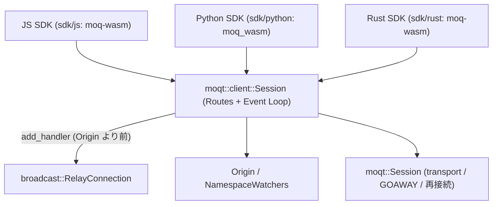

# Python SDK と Rust SDK の設計

## ステータス
実装済み。`moqt::client` の公開 API、Python モジュールの公開 API、配布手順を変える変更ではこのファイルも更新する。

- **Rust SDK**: `moqt::client` を re-export する crate `moq-wasm`（`sdk/rust`）。詳細は [`moq-wasm/sdk.md`](../moq-wasm/sdk.md)。
- **Python SDK**: core の上の再接続・media・pipecat transport。詳細は [`python/sdk.md`](../python/sdk.md)。

## 目標
ブラウザ SDK（[`wasm/browser-sdk.md`](../wasm/browser-sdk.md)）と同じ操作（relay 接続、track の購読・配信、namespace 監視）を Python と Rust でも同じ形で書けるようにする。JS の `MoqSession`（`sdk/js/js/src/core/session.ts`）を基準に、3言語でメソッド名と引数の意味をそろえる。対象は **core API** のみ。



## 3言語の API の対応

### 接続・終了・ブロードキャスト

| JS (`MoqSession`) | Python (`moq_wasm.Session`) | Rust (`moqt::client::Session`) |
| --- | --- | --- |
| `MoqSession.connect(url, { token, versions })` | `moq_wasm.connect(url, token=, refresh_token=, verify_certificate=, versions=)` | `Session::connect(url, &ClientConfig)` |
| `closed` → `CloseInfo` | `closed()`（失敗時は例外） | `closed` → `TransportClose` |
| `close()` | `close()` | `close`（`NO_ERROR` で閉じ `Endpoint::wait_idle` まで待機） |
| `broadcast(ns)` → `MediaBroadcast` | `moq_wasm.media.create_broadcast` | `moq_wasm::media::create_broadcast` |

### 購読・FETCH・状態確認

| JS (`MoqSession`) | Python (`moq_wasm.Session`) | Rust (`moqt::client::Session`) |
| --- | --- | --- |
| `subscribe(ns, track, { filter, forward, priority, deliveryTimeoutMs, groupOrder })` | `subscribe(ns, name, filter=, forward=, priority=, delivery_timeout=, group_order=)` | `subscribe(ns, name, SubscribeOptions)` |
| `subscribeCurrentGroup(ns, track, options?)` | `subscribe_current_group(ns, name, …)` | `subscribe_current_group` |
| `subscribeGroupStart(ns, track, newGroupAfter, options?)` / `requestNewGroup(largestGroup)` | `subscribe_group_start(ns, name, new_group_after, …)` / `request_new_group` | `subscribe_group_start` / `Subscription::request_new_group` |
| `fetch(ns, track, start, end)` → `MoqFetch` | `fetch(ns, name, start, end)` → `Fetch` | `fetch` → `Fetch` |
| `trackStatus(ns, track)` → `MoqLocation \| undefined` | `track_status(ns, name)` → `Location \| None` | `track_status` |
| `MoqSubscription` async iteration / `groups()` → `MoqGroup` | `Subscription` async iteration / `groups()` → `Group` | `Subscription::next` / `next_group` → `Group` |
| `largest` / `done` (`PUBLISH_DONE`) / `close()` (`UNSUBSCRIBE`) | `largest` / `done()` / `close()` | `largest` / `done` / `close` |
| `setForward` / `setPriority` / `endBeforeGroup` | `set_forward` / `set_priority` / `end_before_group` | `set_forward` / `set_priority` / `end_before_group` |

### 配信・namespace・型

| JS (`MoqSession`) | Python (`moq_wasm.Session`) | Rust (`moqt::client::Session`) |
| --- | --- | --- |
| `watchNamespaces(prefix)` → `MoqNamespaceWatch` | `watch_namespaces(prefix)` → `NamespaceWatch` | `watch_namespaces` → `NamespaceWatch` |
| `announce(ns)` → `Announcement.close()` | `announce(ns)` → `Announcement.close()` | `announce` → `Announcement::close` |
| `publishTrack(ns, track, { retentionMs, publish, datagram, priority })` → `TrackWriter` | `publish_track(ns, name, retention_seconds=, publish=, datagram=, priority=)` → `TrackWriter` | `publish_track(ns, name, PublishTrackOptions)` → `TrackWriter` |
| `write(payload, newGroup, locHeader)` / `writeGroup(payload)` / `nextSubscriber()` | `write(payload, new_group=)` / `write_group(payload)` / `next_subscriber()` | `write(payload, new_group, ExtensionHeaders)` / `write_group` / `next_subscriber` / `demand_change` / `end` |
| `ReceivedObject` (`groupId`, `subgroupId`, `objectId`, `objectStatus`, `objectPayload`, `locHeader`) | `Object` (`group_id`, `subgroup_id`, `object_id`, `status`, `payload`, `extension_headers`, `timestamp_micros`) | `ReceivedObject` |
| `RequestError`（draft のエラーコード） | `RequestError` (`message_type`, `code`, `reason`) | `RequestError` |

## `moqt::client`: Rust の入口

`moqt::client` がイベント振り分け（`modules/client/routes.rs` の `Routes`）を持ち、wasm と Python はその上の薄い binding にする。

```rust
use bytes::Bytes;
use moqt::client::{PublishTrackOptions, Session, SubscribeOptions};
use moqt::ClientConfig;

let session = Session::connect("moqt://relay.example.com:4433", &ClientConfig::default()).await?;

let chat = session
    .publish_track(&["room-1", "alice"], "chat", PublishTrackOptions::default())
    .await?;
chat.write_group(Bytes::from_static(b"hello")).await?;

let mut subscription = session
    .subscribe(&["room-1", "bob"], "chat", SubscribeOptions::default())
    .await?;
while let Some(object) = subscription.next().await? {
    println!("{} {:?}", object.group_id, object.payload);
}

let mut watch = session.watch_namespaces(&["room-1"]).await?;
while let Some(event) = watch.next().await {
    println!("{:?} {}", event.namespace, event.active);
}

session.close().await;
```

### 型と JS との対応

| `moqt::client` | JS | 役割 |
| --- | --- | --- |
| `Session` | `MoqSession` | `Arc<moqt::Session>`・`Origin`・`NamespaceWatchers`・イベントループの `JoinHandle` を保持。`close` でループ停止と `moqt::Session::close` |
| `Subscription` | `MoqSubscription` | `next` / `next_group` / `largest` / `done` / `set_forward` / `set_priority` / `request_new_group` / `end_before_group` / `close` |
| `Group` | `MoqGroup` | 1本の subgroup stream |
| `Fetch` | `MoqFetch` | 1つの `FETCH` 応答 |
| `NamespaceWatch` | `MoqNamespaceWatch` | `next` と `close`（`UNSUBSCRIBE_NAMESPACE`） |
| `TrackFollower` | なし | `follow_track` の戻り値。publisher が入れ替わる1本のトラック（視聴者の操作トラック等）を追い、`FollowEvent` を返す。ネイティブブリッジ専用 |
| `Announcement` | `Announcement` | `close`（`PUBLISH_NAMESPACE_DONE`） |
| `TrackWriter` | `TrackWriter` | `Origin` への `write`（`ExtensionHeaders` 対応）・`write_group`・`next_subscriber`・`demand_change`（`PublishTrackOptions::on_demand` のトラックで Forward State 1 の購読があるか）・`end`（`PUBLISH_DONE` で終了、再度の `publish_track` で購読可能に戻る） |
| `EventHandler` | なし | `broadcast` 等のイベントフック（下記） |
| `RequestError` | `RequestError` | `kind` (`RequestKind`)、`failure` (`RequestFailure`)、`code()`、`reason()` |
| `PublishTrackError` | なし（`Error` 文字列） | `publish_track` の `anyhow::Error` 内包型。`OtherDelivery`: 異なる `datagram` 方式で再登録 |

### 設計ルール
- **2つの生成口**: `Session::new(moqt::Session)` は既存セッションを引き取る（wasm/Python が独自 endpoint・トークン・span で接続後に使用）。`Session::connect(url, &ClientConfig)` は自前 endpoint で接続（native: `NATIVE`、wasm32: `BROWSER`）。
- **命名と区別**: メソッド名は JS に合わせる。低層の `moqt::TrackWriter` / `moqt::Subscription` とは `client::` で区別する。namespace は `&[&str]` で受け取り、内部で `/` 結合する。
- **スレッド安全性**: native では `Send + Sync`（Python binding が別 Tokio thread から利用）。wasm32 でも同一型を使い、内部テーブルは `std::sync::Mutex`（`.await` を跨いで保持しない）、タスク起動は `executor::spawn`。
- **未処理リクエスト**: 未知の `SUBSCRIBE` には `TRACK_DOES_NOT_EXIST`、`PUBLISH` には `UNINTERESTED` を返す。
- **再接続と GOAWAY**: `moqt::Session` に委譲し、`client` 層では追加しない。

### `broadcast` への振り分け
`broadcast` は `moqt` に依存するため、`moqt::client` から直接参照できない。代わりに `client::EventHandler` trait（`async fn handle(&self, SessionEvent) -> Option<SessionEvent>`）を用意し、`Session::add_handler` で `Origin` より前に登録・`remove_handler(HandlerId)` で解除する。`broadcast::RelayConnection` がこれを実装し、`with_client_session` で接続する。

### `moqt` 内に置く理由

| 案 | 長所 | 短所 |
| --- | --- | --- |
| A. `moqt` をそのまま SDK にする | 追加なし | 利用者がイベントループを自前で書く必要があり、wasm と Python で重複する |
| B. 新規入口 crate を作る | `moqt` の公開 API が増えない | 利用者が別 crate を追加する必要があり、汎用すぎない名前決めも必要 |
| **C. `moqt::client` module（採用）** | 依存は `moqt` のみ、3言語で命名統一・重複解消 | `moqt` の公開 API が増え、draft-18 移行で守る面が広がる |

`EventHandler` により B の利点（`broadcast` 振り分け）も C で満たせ、3言語の差分は binding 層の型変換のみに収まる。

## Python の API
`sdk/python/python/moq_wasm/_native.pyi`（PyO3 binding）と `_session.py`（`Session`）が定義する。JS `MoqSession` に合わせた命名で asyncio awaitable を返す。詳細は [`python/sdk.md`](../python/sdk.md) の「Core」を参照。

## 配布
3言語とも 1.0 までは API 破壊を許容し、レジストリ公開せず GitHub Release + tag で配布する。

| 言語 | tag | Release 添付物 | 詳細 |
| --- | --- | --- | --- |
| JS | `js-sdk-v<version>` | `npm pack` tarball | [`wasm/browser-sdk.md`](../wasm/browser-sdk.md)「配布」 |
| Python | `python-sdk-v<version>` | abi3 wheel (Py3.11+: Linux x86_64/aarch64, macOS arm64) | [`python/sdk.md`](../python/sdk.md)「Package」 |
| Rust | `rust-sdk-v<version>` | なし（tag 指定の git 依存） | [`moq-wasm/sdk.md`](../moq-wasm/sdk.md)「Release」 |

### レジストリ（crates.io / PyPI / npm）に公開しない理由
- **API 未確定**: 1.0 未満は minor でも破壊的変更するため、範囲指定更新や Dependabot の利点が活きない。
- **公開版の不可逆性**: crates.io は yank のみ、PyPI は同版差し替え不可で、名前も事実上固定される。
- **crates.io の名前競合**: 2026-10-30 時点で他プロジェクトが `moqt` 0.0.1 を公開済み（PyPI/npm は空き）。
- **Rust 依存の連鎖公開**: crates.io では git/path 依存不可のため、`broadcast` を出すには `msf`・`mediapack` も同時公開が必要。

公開可否は core API 1.0 到達時に3言語まとめて判断する。

## 名前と版
- **統一名称 `moq-wasm`**: 技術ではなくリポジトリ名に揃え、npm・Python（配布名 `moq-wasm` / import `moq_wasm`）・Rust crate（`sdk/rust`）すべて `moq-wasm` とする。レジストリ公開前なら変更可能（GitHub はリポジトリ改名後も旧 URL を転送）。
- **言語ごとの独立バージョニング**: 3言語は relay 越しの通信のみが接点のため版を揃えない。対応 draft バージョンは各 changelog に記載し、semver に従い 1.0 未満は minor で破壊的変更可。

## 決定事項
1. **Python wheel 対象**: Linux x86_64、Linux aarch64、macOS arm64（他環境は git ソースビルド、動作保証なし）。
2. **Rust の入口**: `moqt::client` module とし、`sdk/rust` の `moq-wasm` が re-export する。
3. **統一名称**: 3言語とも `moq-wasm`。

## 範囲外
- **レジストリ公開**: 1.0 時点で再検討（「配布」「名前と版」参照）。
- **メディア API**: Python は [`python/sdk.md`](../python/sdk.md)、Rust は [`moq-wasm/sdk.md`](../moq-wasm/sdk.md) で扱う。
- **Windows wheel**: 必要時に matrix 追加（事前に CI で pytest 実行環境を整備）。
