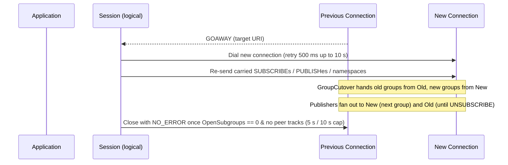

# Session Migration Inside `Session`

## Status
Accepted (2026-10-16)

## What
A client `Session` follows server `GOAWAY` transparently (draft-14 §3.5). Callers keep their `Session`, `Subscription`s, receivers, senders, handlers, logical request IDs, and track aliases across connections. Replaced `moqt::MigratingSession` and the browser's TypeScript switchover (both deleted).

## Context
`MigratingSession` hid request IDs behind handles and only delivered objects. The browser's message-level API exposes request IDs and track aliases to JS, so it had to reimplement migration in TypeScript. Moving the ID map into `Session` gives Rust and browser callers one implementation.

## Design

### Migration Sequence

### Layering
`Session` is the logical session; per-connection state lives in `Connection` (transport, `ControlChannel` + wire ID allocator, local track aliases, GOAWAY state, wire-alias object sinks, FETCH stream notifications) with reader tasks in `ConnectionTasks`.

`Session` holds:
- Current `Connection` (plus previous `Connection` during migration)
- Logical request table and one shared event channel
- Handle to the `Endpoint`'s connection creator (reuses socket/transport, including `BROWSER`)
- `MigrationTask` (handles `GOAWAY`; retries new connection every 500 ms for 10 s)

Requests sent during migration wait for carried requests to re-send so none are missed. `Publisher`, `Subscriber`, and outbound handlers resolve the active connection at send time; incoming request handlers pin the connection the request arrived on so answers go back there.

### Turning It Off
Controlled by `ClientConfig::follow_go_away` (default `true`). When `false`, `GOAWAY` is delivered as a `SessionEvent` with no migration. Server-side sessions never migrate.

| Client | `follow_go_away` | Reason |
| --- | --- | --- |
| `relay → relay` (`inter_relay_connection_manager`) | `false` | Relays handle peer `GOAWAY` by subscribing alternate publishers ("GOAWAY sequence"). |
| `broadcast`, `recorder`, `egress-gateway`, `ingest-gateway` (pull commands), `moq-cli`, `wasm` | `true` | Transparent switchover. |

### Request IDs and Track Aliases
Each connection allocates its own wire IDs (draft-14 §9.1), mapped to stable logical IDs:
- **Outbound requests** (`SUBSCRIBE`, `SUBSCRIBE_NAMESPACE`, `PUBLISH`, `PUBLISH_NAMESPACE`, `FETCH`, `TRACK_STATUS`): Logical ID = wire ID on the initial connection. Each connection maps `logical → wire` for follow-ups (`UNSUBSCRIBE`, `SUBSCRIBE_UPDATE`, `FETCH_CANCEL`, `PUBLISH_DONE`, responses).
- **Inbound requests**: First connection uses wire ID directly; later connections assign fresh logical IDs from a session-wide counter to avoid collisions across relays.
- **Track aliases**: Logical alias = first connection's alias. Later connections translate wire ↔ logical aliases at object ingress (`subscription_notifier::notify`) and stream/datagram open.

### Subscribing Side

**Re-send & filters**
- **Filter**: Carried subscriptions re-send with current Forward state and `NextGroupStart` (or `AbsoluteRange` starting after the newest handed-out group, keeping `End Group`).
- **`SUBSCRIBE_UPDATE` state**: Updates replace carried Forward state and priority; setting `End Group` converts the carried filter into an `AbsoluteRange`.
- **Refused re-sends**: A subscription the new server does not accept stays on the previous connection and ends with it: its receiver ends and the application gets a `PublishDone` event (`GOING_AWAY`), as for a `PUBLISH_DONE`.
- **Skipped re-sends**: Not re-sent if `PUBLISH_DONE` already ended it, or if an `AbsoluteRange`'s `End Group` already started on the previous connection (kept open up to 10 s until its streams finish). A `PUBLISH_DONE` from the previous connection for a carried subscription only signals drain and is suppressed.

**Deduplication & FETCH**
- **`GroupCutover`**: Both connections feed the same `DataReceiver`. Because a `SUBSCRIBE` only delivers objects after `SUBSCRIBE_OK`'s Largest Object (draft-14 §9.7), `GroupCutover` leaves mid-way groups to the previous connection, taking groups before cutover from the previous connection and the rest from the new one (per subgroup stream or datagram), dropping duplicates before the app sees them. The cutover is the group after the newest the previous connection handed out, and not before the new subscription's first whole group, whichever of its groups arrives first; the newest is kept after the previous connection closes, so a lagging relay's groups are not delivered twice. This relies on publishers never reusing a location: a publisher that numbers groups on the new connection lower delivers nothing there until its Group IDs pass that newest group.
- **Cross-draft & `ObjectLedger`**: Streams/datagrams validate against their arriving connection's draft (a draft-14 → draft-18 move may mix subgroup streams and datagrams). `ObjectLedger` lives on the logical session so cross-migration and FETCH copies are still checked for conflicts.
- **In-flight & Joining `FETCH`**: In-flight `FETCH` keeps reading on the previous connection and resumes on the new connection from after the last received location through `FETCH_OK`'s End Location if cut off (descending `FETCH`es are not retried). `fetch_relative_joining` uses a Joining `FETCH` only on the subscription's original connection (draft-14 §9.16.2 requires `LargestObject`); after migration, it sends a Standalone `FETCH` for the same range.

### Publishing Side
`PUBLISH_NAMESPACE` and `PUBLISH` re-send on the new connection. `StreamDataSenderFactory` and `DatagramSender` fan out streams/datagrams to every connection whose peer still takes the track—the new one from the next group, and the previous one until `UNSUBSCRIBE` (draft-22 §7.6.1). Covers both `PUBLISH`- and `SUBSCRIBE`-initiated tracks, transparently below `Origin`. A track ending with `publish_done` keeps its connections from closing until its `PUBLISH_DONE` is written there.

### Events
- `receive_event` delivers events from all connections translated to logical IDs.
- `GOAWAY` is consumed when `follow_go_away` is enabled.
- `Disconnected` fires once when the current connection closes without replacement; previous connection `Disconnected` and `ProtocolViolation` events are dropped.
- Re-announced `PUBLISH_NAMESPACE` from the new relay is delivered as-is so the app can re-acknowledge it.

### Reconnecting after a lost connection
When `follow_go_away` is `true`, `Session` also replaces an unexpectedly lost connection via migration to its current URL:

- **Triggers**: Connection closed without a termination code (network drop / relay restart), or `EXPIRED_AUTH_TOKEN` when `ClientConfig::authorization_token` is a provider that returns a *different* token than the rejected one (repeating the same token ends the session). Local closes and all other termination codes end the session.
- **Backoff & cap**: Retries starting at 0.5 s, doubling up to 10 s, for at most 60 s (~relay cache TTL). A `SETUP` token rejection (`UNAUTHORIZED`, `EXPIRED_AUTH_TOKEN`) allows only one retry. `Session::closed` stays pending and no `Disconnected` fires during retries.
- **Cut-off requests**: `SUBSCRIBE_NAMESPACE`, `PUBLISH_NAMESPACE`, `PUBLISH`, or `SUBSCRIBE` interrupted before a response release the `carried` lock and retry on the new connection (failing only if the session ends). Namespace requests enter `carried` on send (rejection/timeout, or dropping an unanswered `PendingPublishNamespace`, removes only that record; `UNSUBSCRIBE_NAMESPACE`/`PUBLISH_NAMESPACE_DONE` and an incoming `PUBLISH_NAMESPACE_CANCEL` clear all records for the namespace). A `PUBLISH_NAMESPACE` refused or cancelled after a migration re-announced it is withdrawn with `PUBLISH_NAMESPACE_DONE` on the other live connections that announced it. Other requests and timeouts still fail normally.
- **No gap fill**: Once the new connection takes over, the lost connection retires immediately; subscriptions resume from the next group start without filling missed objects.
- **Closed during a GOAWAY move**: A move that completes after the current connection closed retires that connection at once, like a reconnect; when `Session::close` closed it, the move closes the new connection and the session ends.

### Closing the Previous Connection
Closes with `NO_ERROR` once the peer takes no published tracks there and all carried subscriptions have zero open subgroup streams (`OpenSubgroups`), when the server closes it, or when the session ends:
- A `SUBSCRIBE` the peer sent counts as taken from its receipt until its `UNSUBSCRIBE`, its `PUBLISH_DONE` is written, or the application refuses it or drops its handler unanswered.
- A subscription with no open streams at move time cuts over immediately after its newest handed-out group.
- Long-lived groups are capped by a **5 s** grace after all subscriptions cut over (**10 s** if a track receives nothing on the new connection).
- Un-unsubscribed `SUBSCRIBE`s from the previous server, and `PUBLISH`es rejected by the new server, then emit an `Unsubscribe` event.

## Alternatives
- **Keep `MigratingSession` + add ID map in wasm**: Duplicates ID mapping in both wasm and `moqt` once Rust callers need stable IDs.
- **Keep TypeScript switchover**: Forces maintaining migration logic in two languages.
