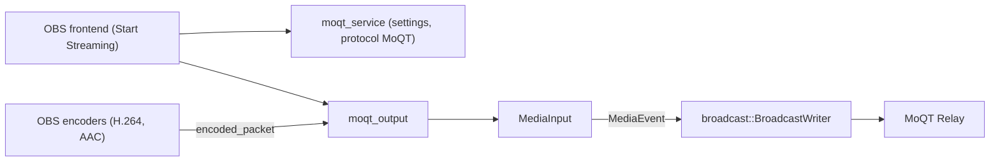

# `obs-moqt` Architecture

## Status
Living document. Update alongside any change to the libobs boundary, the stream lifecycle, or the service settings.

## Scope
`crates/obs-moqt` is an OBS Studio plugin (`cdylib`) that hands the packets of OBS's own H.264 and AAC encoders to `crates/broadcast` (track layout in [`broadcast/architecture.md`](../broadcast/architecture.md)). OBS keeps the capture, encoding, **Start Streaming** button, status bar, and reconnect policy; the plugin adds only a destination.

## Modules

| Module | Role |
| --- | --- |
| `libobs` | Hand-written declarations of the libobs C ABI in use (structs, constants, functions) |
| `service` | Registers `moqt_service`: stateless, names the `MoQT` protocol, defaults the keyframe interval |
| `output` | Registers `moqt_output`: stream lifecycle, relay session, statistics |
| `media_input` | Encoder packets → `mediapack::MediaEvent` (parameter sets, one clock) |
| `publish_settings` | Service settings → `broadcast::MoqtTarget` and namespace |
| `dock.cpp` | The **MoQT** dock (Qt): edits the service settings and makes `moqt_service` the stream destination |

`media_input` and `publish_settings` hold no libobs calls and are the only modules built for unit tests, because libobs symbols exist only inside OBS.

## libobs Boundary
- **No build-time dependency on OBS**: `libobs.rs` declares only the structs and functions the plugin uses, following the OBS Studio 32.0 headers; `build.rs` lets the macOS linker leave them undefined until OBS loads the plugin. `obs_module_ver` reports 32.0, the oldest libobs that loads it (tested with 32.0.2).
- **Struct sizes**: `obs_register_output_s` and `obs_register_service_s` take the struct size, so a newer libobs with longer structs still accepts these.
- **Panics**: A panic leaving an `extern "C"` callback aborts OBS and any recording in progress, so `start`, `stop`, `encoded_packet`, and `destroy` catch it and report failure instead.

## Service Selection
The frontend picks the output by protocol: `moqt_service` returns `MoQT`, and `moqt_output` is the only output registered for it. The output reads `server`, `namespace`, `bearer_token`, `bearer_token_file`, and `insecure_skip_tls_verify` from the service's settings at each start, so the service holds no state. The URL, the namespace, and exactly one of the token and the token file are required: the plugin has no tokenless (`anon/**`) mode. A relay admits a token only into the namespaces of its app, so the output puts the token's `appId` claim in front of the namespace unless the namespace starts with it already.

OBS's **Settings → Stream** page lists only its built-in services, so the plugin's dock sets the service: **Use for streaming** creates a `moqt_service` from the dock's fields, hands it to the frontend (`obs_frontend_set_streaming_service`), and saves it in the profile. The profile's `service.json` or obs-websocket's `SetStreamServiceSettings` does the same without the dock.

## Dock
- **One C++ file**: A dock is a `QWidget`, so `dock.cpp` is the plugin's only C++. It declares the libobs and obs-frontend-api functions it calls by hand, as `libobs.rs` does, and has no signals or slots of its own, so the build needs Qt's headers but neither OBS sources nor `moc`.
- **Optional at build time**: `build.rs` compiles it with `cc` ([cc.md](cc.md)) only when `OBS_MOQT_QT_CFLAGS` gives the flags that find Qt 6, and then sets `cfg(dock)` so that `obs_module_load` adds the dock. A plain `cargo build` (CI included) builds the plugin without it.
- **Qt version**: Qt's symbols are resolved against the Qt that OBS has loaded, so the headers must not be newer than that Qt (6.8 in OBS 32.0).
- **Lifecycle**: The dock reads the profile's service when the frontend finishes loading and when the profile changes. It refuses to change the destination while a stream runs, because OBS keeps the service of a running stream.
- **Input**: The dock removes whitespace from the URL, the namespace, and the token (pasted values carry line breaks) and refuses the input `PublishSettings::new` would refuse, naming the field, so the mistake shows where it is made instead of at **Start Streaming**.
- **Setting names and rules**: `dock.cpp` names the same five settings as `output.rs` and repeats the required-field rules of `publish_settings.rs`; a change to one is made to the other.

## Stream Lifecycle
One tokio runtime per output instance runs the relay session.

| OBS call | Plugin behavior |
| --- | --- |
| `start` (frontend thread) | Reads the settings and initializes the encoders, then returns; a task connects and announces the namespace, and only then begins the data capture. A failed connect ends with `OBS_OUTPUT_CONNECT_FAILED` and the error text |
| `encoded_packet` (encoder threads) | Converts and queues the packet without waiting for the relay. An error ends the session with `OBS_OUTPUT_DISCONNECTED`, which OBS answers with its reconnect settings by calling `start` again |
| `stop` | Joins the connect task, ends the data capture, and closes the session (waiting at most 2 s for the relay) |

- **Stop during connect**: The connect task has no await point between storing the session and beginning the data capture, so after `stop` aborts and joins it, either both happened or neither.
- **Token expiry**: The relay closes the session at the token's `exp`. A `bearer_token` is sent once, in `CLIENT_SETUP`, so OBS's reconnects fail until the settings hold a new one. A `bearer_token_file` is read at each `start` (a missing or empty file fails the start) and, while the session is up, by a `broadcast::TokenRefreshTask` that refreshes the session's token with the file's content whenever it changes.
- **Relay loss**: `BroadcastWriter::push` fails only once the publish task stops, which follows the transport's idle timeout (about 30 s on QUIC); until then packets queue as for any `broadcast` publisher.

## Media Conversion
- **Parameter sets**: x264 in OBS puts SPS/PPS only in the encoder's extra data, so the first video packet seeds `mediapack`'s `ParameterSetTracker` with it and every keyframe is completed in band.
- **Clock**: Packet timestamps are converted from the encoder timebase to microseconds and shifted so the first video packet's DTS is zero (B-frame reordering makes it negative). Audio uses the same shift; audio before the first video packet is left out.
- **Keyframe interval**: `moqt_service` sets `keyint_sec` to 2 when the encoder settings leave it at 0, because OBS's simple output mode has no such setting and x264's default is 250 frames.
- **Codecs**: `moqt_output` declares `h264` and `aac`.

## Release
A release is a macOS installer for Apple silicon on a GitHub Release; other platforms build from source.

1. A release PR bumps `crates/obs-moqt/Cargo.toml` and adds the version's section to `crates/obs-moqt/CHANGELOG.md`.
2. After merge, the tag `obs-moqt-v<version>` is pushed on that commit.
3. `.github/workflows/obs-plugin-release.yml` checks the tag against the version and the changelog, downloads the Qt that OBS is built with (checksum-pinned, from OBS's `buildspec.json`), and runs `make obs-plugin-pkg` on a macOS arm64 runner.
4. It creates the GitHub Release with the installer and the changelog section (not marked Latest). The tag is the source the GPL asks for.

- **Installer**: `pkgbuild` wraps `obs-moqt.plugin` (the plugin and `LICENSE`), and `productbuild` with `macos/distribution.xml` limits it to the home directory domain, so it lands in `~/Library/Application Support/obs-studio/plugins` without an administrator password.
- **No Info.plist**: The bundle has none, as with `make obs-plugin-install`; OBS loads it by path, and the installer then never relocates it onto another copy of the bundle on the disk.
- **Unsigned**: Neither the installer nor the plugin has a Developer ID signature (the linker's ad-hoc signature is enough for OBS to load the plugin), so Gatekeeper asks the user to allow the installer once.
- **Qt and OBS versions**: An installer serves the OBS versions that share its Qt minor version and libobs major version; a new OBS that changes either needs a new release with `QT_DEPS_VERSION` updated.

## Testing
- Unit and property tests cover `media_input` and `publish_settings` ([proptest.md](proptest.md)).
- The libobs callbacks are checked by running OBS itself: an isolated OBS (`CFFIXED_USER_HOME` on macOS) with a prepared profile, `--startstreaming`, obs-websocket for stop and start, and `moq-cli subscribe` decoding the received video.
