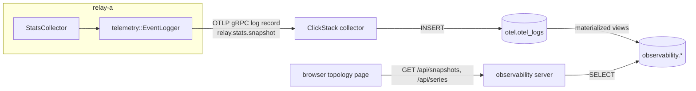

# `observability` Architecture

## Status
Living document (PoC). Update this file in the same change whenever the design
intent, module boundaries, runtime flow, or invariants described here change.

## Scope
A view of an app's traffic through the relay mesh: per-session network
statistics, per-track / per-subscription delivery counters, and the pub/sub
topology that links them, live and as history. A reader sees only the app its
token names (`anon` without one); operators read every app, and the relays'
own figures, in HyperDX.

- Every relay sends one snapshot per second as an OTLP log record, and the
  relay-wide values of it as OTLP gauges for HyperDX (see Relay gauges).
- The ClickStack collector stores it in the `otel` database of ClickHouse,
  and materialized views copy it into the `observability` database's tables.
- The `observability` server serves those tables to the browser over HTTP.
- The browser page renders the topology and plots history for a
  selected node.

Target scale: 3 relays, up to 100 clients.

## Data flow



## Snapshot record

| Field | Value |
| --- | --- |
| `ServiceName` | `relay` (resource `relay.id` = `RELAY_ID`) |
| `EventName` and body | `relay.stats.snapshot` |
| `LogAttributes['snapshot']` | the JSON snapshot below |
| `Timestamp` | the snapshot's `timestamp_ms` |

The snapshot is an attribute rather than the body because the ClickStack
collector parses a body containing a JSON object into one attribute per
field, which would store it twice (see `docs/architecture/telemetry/architecture.md`).

Topology is not a separate record: a snapshot already lists which session
publishes each track and which session subscribes to it, so the topology at
time *t* is the snapshot at *t*.

The relays reach the collector the way their traces and logs do, so the
server needs no list of relays: a relay appears once it logs a snapshot.
A relay whose runtime stops, or whose collector reads block on a stuck
directory lock, stops logging and leaves the live view after 10 s.

### Snapshot payload

The type is `telemetry::relay_stats::RelaySnapshot`. Counters are
cumulative since the session, track cache or subscription started; rates are
derived from consecutive snapshots, so a lost snapshot loses no traffic.
`…_since_last_snapshot_…` and `lag_…` fields are gauges.

All transport statistics are measured on the relay. A browser client could
not report them: the wasm transport's `stats()` returns
`TransportStats::default()`. What a browser does report is its player's
view, through `POST /api/client-telemetry` (see Client telemetry). A QUIC endpoint only knows the loss and
congestion window of what it sends, so the relay sees the two directions of a
client session differently:

| Direction | Observable on the relay | Not observable |
| --- | --- | --- |
| Downlink (relay → client, also relay → relay) | bitrate, loss, lost bytes, cwnd, congestion events, relay blocked by the client's flow-control window, STOP_SENDING from the client, streams the relay reset, delivery lag per subscription | — |
| Uplink (client → relay) | bitrate, client blocked by the relay's flow-control window, streams the client reset, aborted subgroups, maximum object arrival gap per track | packet loss, cwnd |
| Both | RTT, path MTU, remote address | — |

quinn 0.11.16 has no minimum RTT, and object id gaps prove nothing about
loss (draft-14 §11.3 Prior Object ID Gap lets a publisher skip ids), so
neither is reported.

```json
{
  "relay_id": "relay-a",
  "timestamp_ms": 1791262800000,
  "process": { "rss_bytes": 123456789, "cache_tracks": 12, "cache_objects": 3456, "cache_payload_bytes": 98765432, "disk_cache_bytes": 1234567890, "disk_cache_max_bytes": 5368709120, "client_sessions": 3, "draining_since_ms": null },
  "sessions": [
    {
      "session_id": 7, "peer": "client", "app_id": "ac8adbc8-a2ff-4c41-9f5e-fdaed5e1e65e",
      "remote_address": "203.0.113.5:50123", "local_ip": "10.0.0.2", "dialed_relay_id": null,
      "rtt_us": 12000, "current_mtu": 1452,
      "sent_bytes": 52428800, "sent_packets": 40000, "lost_packets": 120,
      "cwnd": 120000, "congestion_events": 3, "sent_stream_data_blocked": 0, "sent_data_blocked": 0,
      "received_stop_sending": 0, "received_bytes": 1048576, "received_stream_data_blocked": 0,
      "received_data_blocked": 0, "received_reset_stream": 0
    }
  ],
  "tracks": [
    {
      "namespace": "ac8adbc8-…/live/ch1", "name": "video", "publisher_session_id": 7,
      "bytes_received": 1234567,
      "max_arrival_gap_since_last_snapshot_us": 34000
    }
  ],
  "subscriptions": [
    {
      "namespace": "ac8adbc8-…/live/ch1", "name": "video", "publisher_session_id": 7,
      "subscriber_session_id": 9, "request_id": 2,
      "bytes_sent": 1200000, "streams_reset": 0, "datagrams_dropped": 0,
      "lag_behind_newest_received_us": 40000
    }
  ]
}
```

- `peer` is `client` or `relay` from the endpoint the session arrived on.
  Snapshots stored while relays published stats over MoQT (see Relay side)
  also carry `stats_publisher` and `stats_subscriber` sessions; until they
  expire, the page hides them and the relay totals in `/api/series` count
  only `client` and `relay` sessions, and `/api/namespaces` leaves out
  `observability/…`.
- `dialed_relay_id` is set on an inter-relay session this relay dialed. The
  accepting relay only sees a relay token, so consumers identify the far end
  of an accepted relay session by its remote IP: a relay's addresses are the
  non-loopback `local_ip` of the sessions it accepted and the address other
  relays dialed it at. (`local_ip` is empty on a dialed session: quinn does
  not report it for a client endpoint bound to `0.0.0.0`.) This needs every
  relay on its own IP and nothing else connecting from a relay's IP (true on
  GCP and in docker compose, not for several relays, or a relay and the
  observability server, on one host).
- `datagrams_dropped` counts the objects of the subscription dropped as
  datagrams larger than the subscriber's session allows (draft-14 §10.3,
  draft-18 §11.3); the subscriber is not told. A snapshot from a relay
  without the field reads as 0.
- `max_arrival_gap_since_last_snapshot_us` is the longest interval between two
  live objects of the track since the previous snapshot. Stream data is
  retransmitted, so uplink loss shows up as arrival gaps rather than as
  missing objects.
- `lag_behind_newest_received_us` is the newest object the track received
  minus the newest object the subscription sent, both by the relay's receive
  time. It is a time, not a group count, because group ids may be wall-clock
  values with gaps.
- `rss_bytes` is `VmRSS` from `/proc/self/status` on Linux and absent
  elsewhere. glibc keeps freed memory, so RSS alone overstates live memory;
  the cache figures tell whether growth is held by the cache.
- `disk_cache_bytes` is the payload held in the relay's disk cache segments
  (`RELAY_DISK_CACHE_DIR`), 0 when the relay has none. It is
  `#[serde(default)]` because stored `snapshots.payload` rows from before the
  field are decoded again for `?at=`. `disk_cache_max_bytes` is the cap it is
  held under (`RELAY_DISK_CACHE_BYTES`), 0 without a disk cache, and likewise
  defaulted. The relay and mesh views chart the two as `disk_cache_mb` and
  `disk_cache_max_mb` under Storage, the space the relay may use rather than
  the host's disk.
- `client_sessions` is the count a drain waits for: client sessions only, no
  relay peer. `draining_since_ms` is when the relay began
  draining (sent GOAWAY) and `null` while it serves; a relay older than these
  fields reads as 0 and `null`.

## Relay side (`services/relay`, `modules/observability/`)

`docs/architecture/relay/architecture.md` ("Observability") describes the
collector, `StatsExportTask` and where each counter lives.

Alternative considered: publishing the snapshot on a MoQT track
(`observability/<RELAY_ID>` / `network_stats`) through a loopback session, which
the server subscribed to on every relay. Delivery went through the relay's
own data plane, so a stalled data plane also stopped the stats, but the
server needed a fixed list of relays, the loopback and server sessions showed
up in the relay's statistics and traces, and the snapshots took a storage
path of their own beside the relays' logs.

Cascading is not used for observability: each relay sends its own snapshots
to the collector, so losing inter-relay routing does not hide the relays it
affects.

## Observability server (`services/observability`)

| Variable | Default | Meaning |
| --- | --- | --- |
| `CLICKHOUSE_URL` | `http://127.0.0.1:8123` | ClickHouse HTTP interface |
| `CLICKHOUSE_DATABASE` | `observability` | Created at startup with its tables and views |
| `CLICKHOUSE_USER` / `CLICKHOUSE_PASSWORD` | none | Basic auth |
| `OBSERVABILITY_HTTP_PORT` | `8095` | API port |
| `OTEL_EXPORTER_OTLP_METRICS_ENDPOINT` | none | OTLP/HTTP metrics URL (`…/v1/metrics`) for player stats |
| `OTEL_EXPORTER_OTLP_LOGS_ENDPOINT` | none | OTLP/HTTP logs URL (`…/v1/logs`) for browser logs |
| `OTEL_EXPORTER_OTLP_TRACES_ENDPOINT` | none | OTLP/HTTP traces URL (`…/v1/traces`) for client request spans |
| `AUTH_VTS_URL` | none | VTS `…/verify` URL that reads the app of a stats request's or a browser report's token; without it every report is `anon` and a stats request with a token answers 503 |

The server stores nothing of the relays itself; at startup `schema::apply`
creates the tables and the views that fill them (see Storage) and the API
starts.

- `ApiServer` (`http_server::HttpServer`, as in `vts`, with `Access-Control-Allow-Origin: *`;
  `OPTIONS` answers a preflight allowing the `Authorization` header). The
  three stats routes below answer only the reader's app (see Access):
  - `POST /api/client-telemetry` — a client's logs, player stats and spans (see
    Client telemetry); 404 unless an OTLP endpoint is set.
  - `GET /api/snapshots` — the newest snapshot of every relay that logged one
    in the last 10 s (`RELAY_SILENCE`, by the snapshot's time), so a stopped
    relay leaves the live view instead of freezing on its last state. The
    relay's batch exporter (1 s) and the collector's batch (5 s) make it
    trail the relay by up to about 6 s.
  - `GET /api/snapshots?at=<ms>&previous=<ms>` — `{ snapshots, previous }`:
    each relay's last snapshot at or before `at`, and at or before
    `previous`, if it published one in the 10 s before that time. The page
    sends `previous` 2 s before `at` to derive rates. One scan reads both, so
    `previous` must lie within 10 s before `at` (400 otherwise).
  - `GET /api/namespaces?from=…&to=…` — every namespace of the app with a
    track in the range (from `track_stats`, at most 1000), with its tracks, relays, first / last time seen and the
    number of distinct client subscriptions, plus the range's totals of
    client subscriptions and client sessions.
  - `GET /api/series?relay_id=…&target=relay|session|track|subscription&…&from=…&to=…&points=…`
    — the target's rows bucketed into `points` buckets (at least 1 s), with
    counters turned into per-second rates between the last samples of
    consecutive buckets (so a partly filled newest bucket is not
    underestimated) and a
    counter that went backwards (a restart) giving no value. `relay` sums
    every session of the relay; ratios such as loss are weighted by their
    denominators. `relay` sums only the app's client sessions on the relay, a
    `session` must be one of them and a `track` or `subscription` must lie
    under the app's namespace root, else the series is empty. Query values
    reach ClickHouse as typed query parameters.
    A range longer than the 7-day retention (series and namespaces) or more
    than 300 points is rejected with 400, so an anonymous caller cannot make ClickHouse scan
    more than one retention window per request.

### Access

A stats request names its reader's app (`viewer::viewer_app`):

- Without `Authorization` it reads `anon`, the app the relay gives an
  anonymous session, which is public as it is on the relay and the recorder.
- With `Authorization: Bearer <token>` the VTS verifies the token and
  `auth_token::SignedToken::check` judges its times as the relay does
  (`app_verifier::AppVerifier`). It reads the token's app only when its
  `subscribe` claim is `""`: a session belongs to an app, not to a namespace
  below it, so a token for one room would otherwise show the whole app.
  Another claim answers 403, a rejected or malformed token 401, and a VTS that
  is missing or fails 503.
- A verified token is answered from memory until it no longer passes
  `check`, at most 1024 of them, so a page polling every second asks the VTS
  once per token.

A snapshot then keeps the app's client sessions and the tracks and
subscriptions under its namespace root, element by element. A relay session
stays only while one of those names it, and only with its id, peer and
addresses, so the page can follow a track to the relay it came from: its
counters, like the relay's `process` figures, carry every app's traffic and
are left out. The relay's id stays. The PoC page on GitHub Pages reads the API from any
origin with the token of the app it shows. A client session's address is
masked before it leaves the server
(`203.0.113.x:50123`, IPv6 keeps its first three groups); the port stays so
cards remain distinguishable. Relay addresses stay unmasked because the page
needs them to identify inter-relay sessions. ClickHouse keeps the unmasked
addresses.

The browser polls the server instead of reading ClickHouse or subscribing
over MoQT itself: one data path for live and history, and no ClickHouse
credentials in the browser.

## Storage (ClickHouse, self-hosted)

The collector writes each snapshot record into `otel.otel_logs` with the
relays' other logs (7-day TTL, `HYPERDX_OTEL_EXPORTER_TABLES_TTL`), where
HyperDX finds it by `relay.id`. That table is ordered by time and service,
not by relay, and its granules hold 8192 rows, so the API does not query it.
Instead `schema.rs` creates five MergeTree tables in the `observability`
database, all keyed by `relay_id` and `timestamp_ms` with
`ts DateTime64(3, 'UTC')` derived from it:

| Table | Rows per snapshot | Extra key |
| --- | --- | --- |
| `snapshots` | 1 (the raw JSON, for `?at=`) | — |
| `process_stats` | 1 | — |
| `session_stats` | one per session | `session_id` |
| `track_stats` | one per track | `publisher_session_id, namespace, name` |
| `subscription_stats` | one per subscription | `subscriber_session_id, request_id` |

and, for each, a materialized view `<table>_from_otel` from `otel.otel_logs`
(`EventName = 'relay.stats.snapshot'`): ClickHouse runs it on every block the
collector inserts, extracting each column from the snapshot JSON (an array
element per row for sessions, tracks and subscriptions). The views are
generated from the same column list as the tables, so a column added to a
table is filled from the field of the same name. A field missing from an
older relay's snapshot reads as 0 or `NULL`; a field with no column is
ignored. The collector inserts at most once per 5 s (its batch timeout), so a
table gets a part per 5 s, within ClickHouse's advice of about one INSERT per
second per table.

`schema::apply` drops the views, creates the tables and adds missing
columns, rebuilds a table whose settings changed (below), then waits until
the collector has created `otel.otel_logs` and creates the views again. The
snapshots logged while the views are gone, a few seconds per server
restart, are not copied, but they stay in `otel.otel_logs`.

Every table is `PARTITION BY toYYYYMMDD(ts)` with
`TTL toDateTime(ts) + INTERVAL 7 DAY` and `ttl_only_drop_parts = 1`, so old
data leaves a whole day partition at a time; there is no capacity-based
deletion. `snapshots` also sets `index_granularity = 64`: its payloads of a
few KB make the default granule about 1500 rows, so a `?at=` lookup of one row
per relay decompressed thousands of payloads, and a seek bar drag sends one
lookup per step. ClickHouse cannot change `index_granularity` on an existing
table, so `schema::apply` rebuilds a table whose `engine_full` lacks its
settings, while no view inserts into it: it copies the rows into
`<table>_rebuild`, swaps the two with `EXCHANGE TABLES` and drops the old
data. The copy needs free disk for a second copy of the table.
Tables are created with `IF NOT EXISTS`, and every startup also runs
`ALTER TABLE … ADD COLUMN IF NOT EXISTS` for each column, so a database
created by an older build gains the columns added since. A removed or retyped
column still needs a hand-written `ALTER TABLE` (or a fresh database).

ClickHouse and the ClickStack services (collector, HyperDX on port 8080) run
as `docker-compose.yml` services next to the relays; the relays send
snapshots only with `OTEL_SDK_DISABLED=false`.

Alternatives considered: OTLP metrics from the relay, read from
`otel_metrics_*`, would chart in HyperDX but at the export interval
(10 s or more), one row per metric and entity, and without the relations
between sessions, tracks and subscriptions; querying the snapshot JSON in
`otel.otel_logs` directly would parse a week of payloads for a 7-day chart.

### Relay gauges

The page reads the tables above, but HyperDX dashboards and alerts read
`otel_metrics_*`. So the relay also records each snapshot's `process` values
as OTLP gauges (`telemetry::relay_stats::ProcessGauges`), exported every 10 s
with resource `service.name=relay` and `relay.id`:

| Metric | Unit | `process` field |
| --- | --- | --- |
| `relay.process.rss` | By | `rss_bytes` (no point when unknown) |
| `relay.cache.tracks` | {track} | `cache_tracks` |
| `relay.cache.objects` | {object} | `cache_objects` |
| `relay.cache.payload` | By | `cache_payload_bytes` |
| `relay.disk_cache.payload` | By | `disk_cache_bytes` |
| `relay.disk_cache.max` | By | `disk_cache_max_bytes` |
| `relay.client_sessions` | {session} | `client_sessions` |
| `relay.draining` | 1 | 1 while `draining_since_ms` is set, else 0 |

Per-session, per-track and per-subscription values are not gauges: each
session would add a series, and their relations exist only in the snapshot.

## Client telemetry

Clients (browser pages, `moq-cli`, the Python bots) cannot reach the
collector, which listens only inside the VPC, so they post to the
observability server behind its public load balancer, which converts the
report to OTLP/JSON and forwards it (`client_telemetry`).

- **Request.** `POST /api/client-telemetry` with a JSON body
  `{ token?, service?, clientId, page, logs: [{ timeMs, level, target, message, fields, traceId?, spanId? }], stats: [{ timeMs, trackNamespace?, mediaSource?, values }], spans: [{ traceId, spanId, parentSpanId?, name, startTimeMs, endTimeMs, fields }] }`.
  `service` is `browser` (the default), `moq-cli` or `python`; any other value
  answers 400, so a client cannot log as a relay. `page` names the page, the
  CLI subcommand or the bot. `clientId` is generated once per page load or
  process. The server does not read `Content-Type`: browsers send
  `text/plain`, a CORS simple request that `navigator.sendBeacon` can send
  and that needs no preflight.
- **Limits.** The body is at most 64 KiB (413), a report carries at most 100
  logs, 100 stats and 100 spans, the ids of spans and logs must be 32 (trace) or 16 (span)
  hex digits, `clientId`, `page`, `trackNamespace` and `mediaSource`
  at most 128 characters (400).
  Each client address has a token bucket of 10 reports refilled at 1 per
  second (429). The address is the second-to-last `X-Forwarded-For` entry,
  which the Google Cloud load balancer appends after the client's own value,
  or the TCP peer without the header.
- **App.** A report with a `token` takes the `appId` the VTS returns for it,
  after the server judges its times with `SignedToken::check` as for a stats
  request (the VTS checks only the signature); a
  rejected token answers 401 and forwards nothing. A report without one is
  `anon`, the app the relay gives an anonymous session. The server sets
  `app_id` and `client_id` on every record, so a client cannot claim another
  app's data. A browser page sends one report per token: the wasm module hands
  each record to the page with the token of its session (see
  `docs/architecture/wasm/browser-sdk.md`), and the records of no session or
  of a session without a token go in a report without one. A client whose
  token was answered 401 sends that token's later records without it, so they
  arrive as `anon` instead of being rejected again (`crates/wasm/js/src/core/telemetry.ts`,
  `moq-cli`).
- **Logs** become OTLP log records of resource `service.name` (the report's
  `service`) and `page`, with `app_id`, `client_id`, `target` and the
  client's fields as attributes, and are posted to
  `OTEL_EXPORTER_OTLP_LOGS_ENDPOINT`. A log's `traceId` and `spanId` go on
  its OTLP record.
- **Spans** are the closed INFO spans of `moqt` in the browser's wasm module
  (`init({ onSpan })`) and in `moq-cli`, chiefly the request spans
  (`moqt.subscriber.subscribe`, …) and `moqt.session.connect` (see "Request spans" in
  `docs/architecture/moqt/architecture.md`). Each becomes an OTLP span of the
  same resource as the logs, kind INTERNAL, with `app_id`, `client_id` and
  the span's fields as attributes. `outcome` sets the status: `ok` is OK,
  `rejected` and `failed` are ERROR with the outcome as message. They are
  posted to `OTEL_EXPORTER_OTLP_TRACES_ENDPOINT`, so they land in
  `otel_traces` with `ServiceName` `browser` or `moq-cli`. The Python bots
  send none yet. A request span's `traceparent` travels with the request
  (`TRACE_CONTEXT`), so the relay's span for it is its child in the same
  trace; `moqt.session.connect`'s travels in CLIENT_SETUP, so the relay's
  `relay.session.setup` is its child.
- **Stats** become metric points with `app_id` and `client_id`, posted to
  `OTEL_EXPORTER_OTLP_METRICS_ENDPOINT`. A page playing several tracks at
  once (meeting: each remote member's camera and screen share) sends one
  sample per track with `trackNamespace` (`/`-joined, as the relay logs it)
  and `mediaSource`, which become the `track_namespace` and `media_source`
  attributes. Keys other than these are dropped:

| Metric | Unit | Kind | `LiveStats` field |
| --- | --- | --- | --- |
| `client.player.viewer_delay` | ms | gauge | `viewerDelayMs` |
| `client.player.buffer` | ms | gauge | `bufferMs` |
| `client.player.received` | kbit/s | gauge | `receivedKbps` |
| `client.player.audio_breaks` | {break} | cumulative sum | `audioBreaks` |
| `client.player.audio_concealed` | ms | cumulative sum | `audioConcealedMs` |
| `client.player.shed` | ms | cumulative sum | `shedMs` |
| `client.player.arrival_spread` | ms | gauge | `arrivalSpreadMs` |
| `client.player.av_sync_offset` | ms | gauge, positive when the picture is ahead of the sound | `syncOffsetMs` |
| `client.player.video_dropped` | {frame} | cumulative sum | `videoDroppedFrames` |
| `client.player.video_late` | {frame} | cumulative sum | `videoLateFrames` |
| `client.player.max_arrival_gap` | ms | gauge, `media_kind` attribute | `maxArrivalGapMs` |
| `client.player.arrival_delay` | ms | gauge, `media_kind` attribute; includes the publisher-to-viewer clock offset, which the audio-video difference cancels | `arrivalDelayMs` |

A collector that does not accept the export answers 502.

## Browser page (`examples/browser/examples/observability`)

A dark, full-width topology view of one app's live connections and
subscriptions with a chart drawer for the selection. Served from `localhost`
it reads the local stack's API on port 8095; anywhere else, the deployed
`https://observability.moqt.research.skyway.io`.

The page reads the app the other examples use (`utils/access.ts`): it sends
`bearerToken()` in `Authorization`, so it shows the temporary app the examples
share in this browser, the app of a `?jwt=` token such as one the console
signed, or, as the public app, `anon` without a token. The header names that
app.

### Header
- The app shown and a Track Namespace prefix filter. The prefix covers the
  elements after `app_id` and matches element-wise, as SUBSCRIBE_NAMESPACE
  does: `room1` matches `room1/alice`, `room` does not. Subscriptions outside
  the filter, links carrying only them and clients left with none of them
  are hidden; relays stay. The page filters the snapshot it already holds;
  the API takes no filter parameter.
- Time controls: a range selector (15 min / 1 h / 6 h / 1 d / 7 d, 1 h by
  default) shared with the chart drawer, and a slider spanning that range
  up to now in 1 s steps — a 7-day slider would move about an hour per
  pixel. −10 s / +10 s buttons and ← / → (1 s, Shift for 10 s) step from
  the current position; stepping past now returns to live. The whole page
  (topology, colours, charts) then shows the snapshot at that time, and the
  time label returns to live when clicked.
- A Namespaces button opens a panel listing every Track Namespace published
  in the header's range (`GET /api/namespaces`), newest first, searchable,
  with its tracks, relays, first / last time seen (Live while still
  published) and client subscriptions; its heading counts namespaces,
  subscriptions and clients in the range. Clicking a row sets the namespace
  filter to it and moves the page to its last published moment (or stays
  live).

### Topology
- One circle for the hosting environment (e.g. GCP) holding the relays,
  drawn as server icons with the number of the app's clients on each. Every client — publisher or
  viewer — is a card outside the circle on a ring, at the angle of its relay,
  since clients reach the relays from the Internet. A card shows the client,
  the Track Namespace it publishes (or, for a pure subscriber, the one it
  subscribes to) without the `app_id` element, and its published track
  count.
- One directed, animated dashed link per hop a subscription takes:
  publisher → its relay, relay → relay, relay → subscriber. Subscriptions
  sharing a hop share one link; its bitrate is the sum over publishers. Dash
  speed follows the bitrate. Downlink links are coloured by that session's
  loss rate; uplink links are grey because uplink loss is not measured, and
  inter-relay links too because their session's counters, which every app's
  traffic adds to, are not served. An unframed legend sits in the bottom-left corner.
- Every selection animates the view so that all highlighted nodes fit in
  the part of the topology the chart drawer leaves visible (zooming in no
  further than about 1.7× the overview scale); clearing the selection fits
  everything again. The user can then pan by dragging (a drag never counts as
  a click) and zoom with the wheel or trackpad pinch around the cursor, or
  with the +, − and fit buttons in the top-right corner; double-clicking
  empty space re-fits.

### Selection
- Clicking the "Relays" label of the environment selects the whole mesh:
  nothing is dimmed, the environment circle and every relay are drawn in the
  selection blue, and the drawer shows the app's ingress, egress and client
  sessions on each relay with per-relay charts plus an all-relays total line
  where a sum means something.
- Clicking a client highlights the hops of its subscriptions; clicking a
  relay, those through the relay; clicking a link draws it thick and
  highlights the full route of every subscription it carries, from the
  original publisher to the subscriber (all seven `live/ch1` routes for the
  `ingest-01 → relay-a` uplink). Everything else is dimmed.
- The links whose statistics the charts show are drawn in the selection blue:
  a client's uplink and downlink, every link of a relay, or the clicked link.
- A click also sets the namespace filter to the longest common namespace
  prefix of the subscriptions it involves (`room1` for a meeting
  participant). Inside an active filter a click only narrows it.
- Clicking empty space clears the selection, closes the drawer and widens
  the filter by one tuple element: `room1/bob` → `room1` → no namespace
  filter.

### Chart drawer
Opening on every selection, it overlays the bottom of the topology (45% of
the viewport by default, resizable by dragging its top edge) and holds:
- a tab column, one tab per chart group, switching the charts shown:
  Network and Sessions for a relay or the mesh; Media (bitrate, arrival gap,
  delivery lag), Transport (RTT, loss, cwnd, congestion) and Streams (flow
  control, resets) for a client, an uplink or a downlink; Media and Streams of
  the app's tracks alone for an inter-relay link. The picked tab stays across selections that have it, and
  only its charts are fetched;
- one chart per metric in the style of the GCP monitoring charts, with
  axes, gridlines and one line per series (uplink and downlink bitrate in
  one card, delivery lag per subscription in another), fed by
  `GET /series`. Every metric of the direction table above appears in one of
  the tabs; a relay's charts are the ingress / egress totals of the app's
  client sessions on it (bitrate-weighted egress loss, summed counts). The charts cover the header's
  range up to now and mark the selected past time with a vertical line;
  hovering any card moves a shared crosshair that shows every card's value
  at that instant, and clicking a card moves the whole page to that time. The grid keeps its scrollbar gutter, so resizing the drawer never
  changes the column count.

With a Track Namespace filter, bitrates and track lists count only the
filtered subscriptions (from the per-subscription counters; an inter-relay
link shows only the filtered tracks it carries). Transport figures — RTT,
loss, cwnd, congestion, flow-control and reset counts — exist per QUIC
connection only, so they stay whole-session.

A route is built backwards from each subscription of a client: the track's
publisher session on that relay is either a client (the original publisher)
or an inter-relay session, served without its counters, whose far relay is
found as described under "Snapshot payload" and searched for the same track,
up to four relays deep.
Bitrates come from consecutive snapshots of the same relay, so the page keeps
the previous snapshot per relay and only advances it when the relay's
timestamp moved.

Rendered as SVG with React. Links are per hop, not per subscription, so
their number grows with the session count (about 100 client links at the
target scale) rather than with publisher × subscriber pairs.

## Dependencies

The crate's dependencies have ADRs in this directory (`reqwest.md`,
`hyper.md`). The browser page needs no new package.
