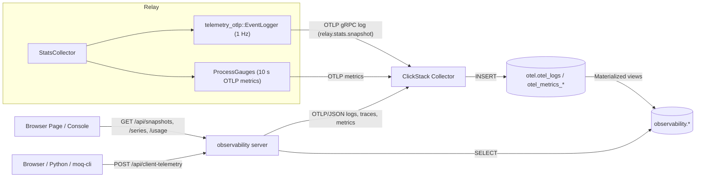

# `observability` Architecture

## Status
Living document (PoC). Update alongside any change to design intent, module boundaries, runtime flow, or invariants.

## Scope
Live and historical visibility into an app's relay-mesh traffic: per-session transport stats, per-track/per-subscription delivery counters, and pub/sub topology. Readers see only the app named by their token (`anon` without one); operators view all apps and relay-wide metrics in HyperDX.

Target scale: 3 relays, up to 100 clients.

## Data Flow



## Snapshot Record & Payload

Relays emit a `telemetry::relay_stats::RelaySnapshot` every second as an OTLP log record:
- `ServiceName`: `relay` (resource `relay.id` = `RELAY_ID`)
- `EventName` & body: `relay.stats.snapshot`
- `LogAttributes['snapshot']`: JSON payload (stored as attribute rather than body so ClickStack does not expand keys twice; see [`telemetry/architecture.md`](../telemetry/architecture.md))
- `Timestamp`: `timestamp_ms`

Topology is derived directly from snapshots (which link publisher and subscriber sessions per track). Relays appear automatically upon logging and drop from the live view after 10 s of silence (`RELAY_SILENCE`). See [`relay/architecture.md`](../relay/architecture.md) ("Observability") for collector internals.

*Why OTLP instead of MoQT loopback tracks or cascading*: avoids a static relay list, keeps observer sessions out of relay metrics/traces, shares the existing log pipeline, and stays visible even if inter-relay routing breaks.

### What the Relay Can Observe
Browser wasm `stats()` only counts bytes, and QUIC endpoints know loss/cwnd only for traffic they send (quinn 0.11 exposes no min-RTT, and draft-14 §11.3 Prior Object ID Gap makes object ID gaps ambiguous):

| Direction | Observable on relay | Not observable |
| --- | --- | --- |
| Downlink (relay → client / relay) | Bitrate, loss, lost bytes, cwnd, congestion events, client flow-control blocks, `STOP_SENDING`, relay stream resets, per-subscription delivery lag | — |
| Uplink (client → relay) | Bitrate, relay flow-control blocks, client stream resets, aborted subgroups, max object arrival gap per track | Packet loss, cwnd |
| Both | RTT, path MTU, remote address | — |

### Payload Schema & Field Semantics
Counters are cumulative since start (rates derive from deltas, so dropped snapshots lose no traffic). `…_since_last_snapshot_…`, `lag_…`, `client_sessions`, and `draining_since_ms` are gauges.

```json
{
  "relay_id": "relay-a",
  "timestamp_ms": 1791262800000,
  "process": { "rss_bytes": 123456789, "cache_tracks": 12, "cache_objects": 3456, "cache_payload_bytes": 98765432, "disk_cache_bytes": 1234567890, "disk_cache_max_bytes": 5368709120, "client_sessions": 3, "draining_since_ms": null },
  "sessions": [{ "session_id": 7, "peer": "client", "app_id": "ac8adbc8-...", "remote_address": "203.0.113.5:50123", "local_ip": "10.0.0.2", "dialed_relay_id": null, "rtt_us": 12000, "current_mtu": 1452, "sent_bytes": 52428800, "sent_packets": 40000, "lost_packets": 120, "cwnd": 120000, "congestion_events": 3, "sent_stream_data_blocked": 0, "sent_data_blocked": 0, "received_stop_sending": 0, "received_bytes": 1048576, "received_stream_data_blocked": 0, "received_data_blocked": 0, "received_reset_stream": 0 }],
  "tracks": [{ "namespace": "ac8adbc8-.../live/ch1", "name": "video", "publisher_session_id": 7, "bytes_received": 1234567, "max_arrival_gap_since_last_snapshot_us": 34000 }],
  "subscriptions": [{ "namespace": "ac8adbc8-.../live/ch1", "name": "video", "publisher_session_id": 7, "subscriber_session_id": 9, "request_id": 2, "bytes_sent": 1200000, "streams_reset": 0, "datagrams_dropped": 0, "lag_behind_newest_received_us": 40000 }]
}
```

- **`peer` & legacy stats sessions**: `client` or `relay` from the accepting endpoint. Legacy `stats_publisher`/`stats_subscriber` sessions and `observability/…` namespaces from older snapshots are hidden by the UI/API until they expire.
- **Identifying relay peers (`dialed_relay_id` / `local_ip`)**: Dialed inter-relay sessions set `dialed_relay_id` (`local_ip` is empty on `0.0.0.0`-bound quinn client sockets). Accepted relay sessions match remote IP against each relay's non-loopback `local_ip`s and dialed addresses (requires distinct relay IPs, true on GCP/Docker Compose).
- **Delivery metrics**: `datagrams_dropped` counts datagrams exceeding peer max size (draft-14 §10.3 / draft-18 §11.3, defaulted `0`); `max_arrival_gap_since_last_snapshot_us` surfaces uplink loss via stream retransmission gaps; `lag_behind_newest_received_us` uses relay receive times (group IDs can be wall-clock with gaps).
- **Process metrics**: `rss_bytes` (`VmRSS` on Linux; cache counters separate live cache growth from glibc retention); `disk_cache_bytes` / `disk_cache_max_bytes` (`#[serde(default)]`, charted as `disk_cache_mb` / `disk_cache_max_mb`); `client_sessions` and `draining_since_ms` (drain progress, defaulted `0` / `null`).

## Observability Server & Access Control

### Configuration
| Variable | Default | Meaning |
| --- | --- | --- |
| `CLICKHOUSE_URL` | `http://127.0.0.1:8123` | ClickHouse HTTP endpoint |
| `CLICKHOUSE_DATABASE` | `observability` | Auto-created at startup (`schema::apply`) |
| `CLICKHOUSE_USER` / `CLICKHOUSE_PASSWORD` | none | Basic auth |
| `OBSERVABILITY_HTTP_PORT` | `8095` | HTTP API port |
| `OTEL_EXPORTER_OTLP_{METRICS,LOGS,TRACES}_ENDPOINT` | none | OTLP/HTTP endpoints for client telemetry |
| `AUTH_VTS_URL` | none | VTS `/verify` URL; if unset, reports default to `anon` and tokenized stats queries return `503` |

### HTTP API (`ApiServer` on `http_server::HttpServer`, CORS `*` + `Authorization`)
| Route | Behavior |
| --- | --- |
| `POST /api/client-telemetry` | Accepts `ClientReport` (`404` if no OTLP endpoint configured) |
| `GET /api/snapshots` | Newest snapshot per relay logged within `RELAY_SILENCE` (10 s; trails live by ~6 s due to 1 s relay + 5 s collector batches) |
| `GET /api/snapshots?at=<ms>&previous=<ms>` | `{snapshots, previous}` within 10 s window before `at`/`previous` (`400` if `at - previous > 10 s`); used for rate calculation |
| `GET /api/namespaces?from=&to=` | Up to 1,000 namespaces in range (tracks, relays, first/last seen, distinct client subscriptions + range totals) |
| `GET /api/series?relay_id=&target=relay\|session\|track\|subscription&from=&to=&points=` | Bucketed (≥ 1 s) rates from consecutive bucket-end samples (restarts emit no point; ratios denominator-weighted). Scoped to caller's app; typed ClickHouse params. |
| `GET /api/usage?from=&to=[&points=]` | Console usage summary over client sessions only (excludes relay sessions to avoid double-counting): `traffic` (`SeriesTarget::App`), per-relay totals, top 20 `namespaces`, top 1,000 `sessions`. (New sessions miss ≤ 1 s before first snapshot.) |

Ranges exceeding 7 days or `points > 300` return `400`.

### Access & Privacy (`viewer::viewer_app`, `app_verifier::AppVerifier`)
- **Auth**: No `Authorization` → `anon`. With Bearer token → VTS verify + `SignedToken::check` + require `subscribe == ""` (prevents room-scoped tokens reading whole app; wrong claim `403`, invalid `401`, missing/down VTS `503`). Verified tokens cache in memory (LRU cap 1,024) until `check` fails.
- **Snapshot scoping**: Keeps only the app's client sessions, tracks, and subscriptions. Inter-relay sessions stay only when referenced, stripped of counters (leaving only ID, peer, addresses); relay `process` figures are omitted.
- **IP masking**: Client IPs are masked before leaving the server (`203.0.113.x:50123`, IPv6 keeps first 3 groups, port kept); relay IPs remain unmasked for link resolution; ClickHouse keeps raw IPs.

## Storage (ClickHouse) & Relay Gauges

### Tables & Materialized Views (`schema.rs`)
`otel.otel_logs` (7-day TTL) is ordered by time/service with 8,192-row granules, unsuitable for per-relay queries. `schema::apply` creates five MergeTree tables in `observability` (keyed by `relay_id, timestamp_ms` with `ts DateTime64(3, 'UTC')`, daily `PARTITION BY toYYYYMMDD(ts)`, 7-day `ttl_only_drop_parts = 1`) fed by materialized views `<table>_from_otel` (`EventName = 'relay.stats.snapshot'`):

| Table | Rows / snapshot | Extra key | Notes |
| --- | --- | --- | --- |
| `snapshots` | 1 (raw JSON) | — | `index_granularity = 64` (keeps `?at=` seek lookups fast) |
| `process_stats` | 1 | — | — |
| `session_stats` | 1 per session | `session_id` | — |
| `track_stats` | 1 per track | `publisher_session_id, namespace, name` | — |
| `subscription_stats` | 1 per subscription | `subscriber_session_id, request_id` | — |

- Views are generated from the table column list (missing fields default to `0`/`NULL`; unknown fields ignored). Collector inserts ≤ 1×/5 s.
- Startup drops views, runs `CREATE TABLE IF NOT EXISTS` + `ALTER TABLE ADD COLUMN IF NOT EXISTS`, rebuilds tables whose settings changed (via `<table>_rebuild` + `EXCHANGE TABLES`, requiring free space for a second copy), waits for `otel.otel_logs`, and recreates views (a few seconds of snapshots remain in `otel.otel_logs` only). Removed/retyped columns require manual `ALTER TABLE`.
- ClickStack + HyperDX (port 8080) run via `docker-compose.yml`; relays export only when `OTEL_SDK_DISABLED=false`.

### Relay Gauges (`relay::ProcessGauges`)
Exported as OTLP metrics every 10 s (`service.name=relay`, `relay.id`) for HyperDX dashboards/alerts (per-session/track stats are excluded to avoid high cardinality):

| Metric | Unit | Source field |
| --- | --- | --- |
| `relay.process.rss` | `By` | `rss_bytes` (omitted if unknown) |
| `relay.cache.tracks` / `.objects` / `.payload` | `{track}` / `{object}` / `By` | `cache_tracks` / `cache_objects` / `cache_payload_bytes` |
| `relay.disk_cache.payload` / `.max` | `By` | `disk_cache_bytes` / `disk_cache_max_bytes` |
| `relay.client_sessions` | `{session}` | `client_sessions` |
| `relay.draining` | `1` | `1` when `draining_since_ms` is set, else `0` |

## Client Telemetry

VPC-isolated collectors cannot be reached directly by browsers, Python bots, or `moq-cli`, so they `POST /api/client-telemetry` (`telemetry::client_report::ClientReport`) to `observability`, which forwards OTLP/JSON (`502` on collector or VTS error).

### Request, Limits & Rate Limiting
- **Body**: `{ token?, service?, clientId, page, logs, stats, publisherStats, spans }`. `service` must be `browser` (default), `moq-cli`, or `python` (`400` otherwise). Ignores `Content-Type` so browsers can use `text/plain` with `navigator.sendBeacon` (no CORS preflight).
- **Limits**: Max body **64 KiB** (`413`); max **100** items per array; trace IDs = 32 hex, span IDs = 16 hex; `clientId`/`page`/`trackNamespace`/`mediaSource` ≤ 128 chars (`400`).
- **Rate limit**: Per-IP token bucket of **10 reports, 1/s refill** (`429`), keyed on the second-to-last `X-Forwarded-For` entry (GCLB client IP) or TCP peer.
- **App attribution**: Tokenized reports verify via VTS + `SignedToken::check` (`401` on reject; clients retry future reports for a 401'd token without it so they land as `anon`); untokenized reports map to `anon`. Server stamps `app_id` and `client_id` on every record.

### Exported Signals
- **Logs** (`OTEL_EXPORTER_OTLP_LOGS_ENDPOINT`): Resource `service.name`, `page`; attributes `app_id`, `client_id`, `target`, fields; preserves `traceId`/`spanId`.
- **Spans** (`OTEL_EXPORTER_OTLP_TRACES_ENDPOINT`): Closed `INFO` spans from `moqt` (`moqt.session.connect`, `moqt.subscriber.subscribe`, …; see [`moqt/architecture.md`](../moqt/architecture.md) "Request spans"), kind `INTERNAL`; `outcome` maps `ok` → OK, `rejected`/`failed` → ERROR. Propagates `TRACE_CONTEXT` so relay spans attach as children.
- **Player stats** (`OTEL_EXPORTER_OTLP_METRICS_ENDPOINT`, one sample per `LivePlayer`, attributes `app_id`, `client_id`, `track_namespace`, `media_source`; unknown keys dropped):

| Metric | Unit | Kind | `LiveStats` field |
| --- | --- | --- | --- |
| `client.player.viewer_delay` / `.buffer` / `.arrival_spread` / `.av_sync_offset` | `ms` | gauge (`av_sync_offset` > 0 when video leads audio) | `viewerDelayMs`, `bufferMs`, `arrivalSpreadMs`, `syncOffsetMs` |
| `client.player.received` / `.max_arrival_gap` / `.arrival_delay` | `kbit/s` / `ms` / `ms` | gauge (`media_kind` attr) | `receivedKbps`, `maxArrivalGapMs`, `arrivalDelayMs` |
| `client.player.audio_breaks` / `.audio_concealed` / `.shed` | `{break}` / `ms` / `ms` | cumulative sum | `audioBreaks`, `audioConcealedMs`, `shedMs` |
| `client.player.video_dropped` / `.video_late` | `{frame}` | cumulative sum | `videoDroppedFrames`, `videoLateFrames` |

- **Publisher stats** (`publisherStats`, one sample per audio-publishing `LocalBroadcast` source, trailing 1 s window except latest format):

| Metric | Unit | Kind | `AudioPublishStats` field |
| --- | --- | --- | --- |
| `client.publisher.audio_input_frames` | `{frame}/s` | gauge | `input.framesPerSecond` |
| `client.publisher.audio_input_sample_rate` / `.channels` | `Hz` / `{channel}` | gauge | `input.sampleRate`, `input.numberOfChannels` |
| `client.publisher.audio_input_level_min` / `.mean` | `dBov` | gauge (`-127` = silence) | `input.minLevelDbov`, `input.meanLevelDbov` |
| `client.publisher.audio_encoded` | `kbit/s` | gauge | `encodedKbps` |

## Browser Topology Page (`examples/browser/examples/observability`)

React + SVG dark full-width topology view with a resizable bottom chart drawer (default 45% height). Uses `localhost:8095` on localhost, else `https://observability.moqt.research.skyway.io`, authenticated via `utils/access.ts` `bearerToken()`.

- **Header**: Shows app, element-wise Track Namespace prefix filter (client-side), shared time range (`1m`–`7d`, default `1h`) + 1 s scrubber (`±10 s`, `←`/`→`, `Shift` = 10 s; stepping past now returns to live), and searchable Namespaces panel (`GET /api/namespaces`).
- **Topology**: Relays sit inside the hosting circle; clients sit on an outer ring aligned to their relay. Per-hop animated dashed links (one per hop, scaling with sessions not pub×sub pairs): dash speed = bitrate; downlink colored by loss, uplink/inter-relay grey. Auto-fits selection (max ~1.7× overview zoom); pan/zoom/double-click reset supported. Routes trace backwards up to 4 relays deep.
- **Selection & Chart Drawer**:
  - Click "Relays" (whole mesh), a relay, a client, or a link (traces full pub→sub route); clicking narrows the namespace filter to the longest common prefix, clicking empty space clears selection and widens the filter by one element.
  - Drawer tabs persist across selections and fetch lazily (`GET /api/series`): `Network`/`Sessions` (relay/mesh), `Media`/`Transport`/`Streams` (client/uplink/downlink), `Media`/`Streams` (inter-relay). Shared crosshair across cards; clicking a chart scrubs the page to that instant. Namespace filters narrow media/track counters while QUIC transport metrics stay whole-session.

## Dependencies
See [reqwest.md](reqwest.md) and [hyper.md](hyper.md).
