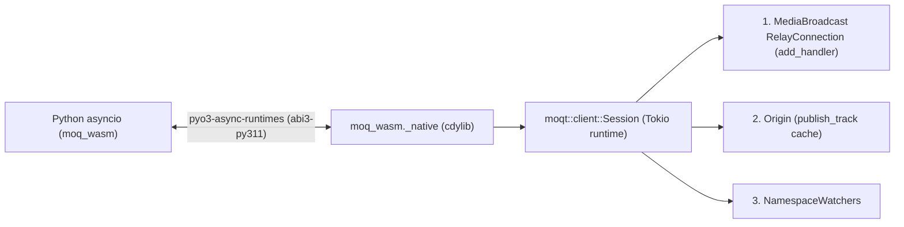

# Design: Python Bindings for `moqt`

Native extension module `moq_wasm._native` inside the Python SDK `moq-wasm`. For the Python SDK layers built on top, see [sdk.md](sdk.md).

## Status
Accepted (2026-10-20)

## Scope
- `sdk/python` (Cargo package `python`) builds the PyO3 `cdylib` `moq_wasm._native`.
- Reuses `moqt::client::Session` and `publish::Origin` so Python bots, the browser SDK, and Rust clients share one protocol implementation.
- Used by the Meeting transcriber and AI demo bots under `examples/python/`.

## Context
Previously, Python bots used `moq-rs` 0.4.7 (via pipecat), which broke against this repository's relay and browser pages:
- **No joining FETCH**: Late subscribers to an active catalog track received nothing until a new group arrived (`AbsoluteStart {0, 0}` in draft-14 only delivers objects published *after* `SUBSCRIBE`).
- **No mid-group joins**: Refused joining an event timeline mid-group.
- **No LOC extension headers**: Used its own payload layout instead of exposing draft-ietf-moq-loc-04 extension headers (Timestamp).
- **Breaking upstream drift**: `moq-rs` 0.5 replaced announcements with routes, leaving the pinned 0.4.7 behind.

`moqt` solves all four via `Subscriber::subscribe_current_group`, extension-header exposure, and `publish::Origin`.

## Decision

### The Crate & Runtime Bridge



- **Bindings**: Built with PyO3 + maturin targeting `abi3-py311`. Method names mirror JS `MoqSession`.
- **Tokio runtime**: Async methods return asyncio awaitables via `pyo3-async-runtimes`. The module enters that Tokio runtime before creating the `quinn` endpoint so sockets bind to the right runtime.
- **Excluded**: Server `listen`, raw request handlers, and peer-initiated `PUBLISH` (rejected as `Uninterested`). Full method list is in [sdk.md](sdk.md) ("Core: `moq_wasm`").

```python
import moq_wasm

session = await moq_wasm.connect("https://relay.example:4433", verify_certificate=True)

# Watch namespaces until session closes (run in its own task).
async for event in await session.watch_namespaces(["anon", "room"]):
    event.namespace  # ["anon", "room", "alice"]
    event.active     # False after PUBLISH_NAMESPACE_DONE

# Joining FETCH delivers cached current group before live objects.
track = await session.subscribe_current_group(["anon", "room", "alice"], "catalog")
async for obj in track:  # ends on PUBLISH_DONE or close()
    catalog = moq_wasm.parse_catalog(obj.payload)  # ValueError if invalid/delta/non-draft-02

# Register tracks before announce so immediate forwarded SUBSCRIBEs succeed.
transcript = await session.publish_track(
    ["anon", "room", "bots", "transcriber"], "transcript", retention_seconds=3600
)
await session.announce(["anon", "room", "bots", "transcriber"])
await transcript.write(payload, new_group=True)
await transcript.write(payload)

await session.close()
```

### Authorization Tokens
Bots serving temporary apps must outlive the initial token ([`on-demand-rooms.md`](../ai-bots/on-demand-rooms.md) "Temporary apps"):

```python
session = await moq_wasm._native.connect(url, token=jwt, refreshes_token=True)
await session.refresh_token(later_jwt, app_id="temp-3f9a…")
```

- **`refreshes_token=True`**: Passes an `AuthorizationTokenSource::provider` reading the session's latest token, so GOAWAY migrations and `EXPIRED_AUTH_TOKEN` reconnects present the refreshed token.
- **`refreshes_token=False`**: Passes a static token; GOAWAY reuses it, `EXPIRED_AUTH_TOKEN` closes the session, and `refresh_token()` raises.
- **`refresh_token()` behavior**: Sends the relay's in-session `TRACK_STATUS` refresh for `[app_id]` ([`relay/architecture.md`](../relay/architecture.md) "Token refresh") and updates the stored current token regardless of relay acceptance (if refused, the active connection keeps the old token until expiry and the next connection presents the new one). Fetching new tokens belongs to callers (`moq_wasm.connect` in [sdk.md](sdk.md) "Core").

### One Event Loop per Session
The native `Session` wraps `moqt::client::Session` ([`moqt/architecture.md`](../moqt/architecture.md) "`client` — the client session"), dispatching events in strict priority order:
1. Active `MediaBroadcast` `RelayConnection` handlers (registered via `add_handler`, removed on `MediaBroadcast.close`).
2. `Origin` — answers `SUBSCRIBE`, `FETCH`, and `TRACK_STATUS` for `publish_track` tracks.
3. `NamespaceWatchers` — forwards `PUBLISH_NAMESPACE` / `PUBLISH_NAMESPACE_DONE` to matching `watch_namespaces` iterators.
4. Fallback — unknown `SUBSCRIBE` gets `TRACK_DOES_NOT_EXIST`; `PUBLISH` gets `UNINTERESTED`.
5. Teardown — session close ends every iterator.

### Build, CI, and Bot Usage
- **Extension linking**: `[lib] test = false` (extension modules cannot link as Rust test binaries; tested via pytest). `.cargo/config.toml` sets `PYO3_NO_PYTHON` and `PYO3_BUILD_EXTENSION_MODULE` so workspace `cargo build`/`clippy` need no Python interpreter.
- **CI**: `python.yml` runs pytest against a workspace relay + VTS on ephemeral ports (`tests/conftest.py`). `closes_sessions` closes the sessions a test left open on a relay at its teardown, so a failed test does not hold the shared relay's drain past `stop()`.
- **Bot builds**: Bots depend on `sdk/python` by path (`[tool.uv.sources]`); `uv` builds via maturin (requires Rust toolchain; `examples/python/Dockerfile` uses a builder stage).
- **Bot API**: Bots use the SDK's media layer ([sdk.md](sdk.md) "Media"): `watch_broadcasts`, `RemoteBroadcast.catalogs`/`follow`, `create_broadcast`, and `moq_wasm.codecs` (mid-group video joins wait for the next keyframe group).

## Consequences
- **Positive**: Python shares the exact MoQT stack with the relay, recorder, and browser; transcriber reads active catalogs and serves transcripts to late joiners.
- **Negative**: Building bots requires Rust and takes minutes; adds a public API surface to maintain across protocol drafts (e.g., draft-18).

## Alternatives Considered
- **Periodic Meeting catalog re-sends**: Would let transcriber see catalogs after one period, but leaves `moq-rs` mid-group and extension-header gaps unfixed and delays startup.
- **Hardcode default audio track name**: Breaks whenever a room customizes its catalog.
- **Contribute joining FETCH to `moq-rs`**: Upstream schedule is external and does not address extension headers.
- **Thin 1:1 wrapper of `Session`/`Subscriber`/`Publisher`**: Forces every Python bot to reimplement event routing and joining FETCH already built in Rust.
