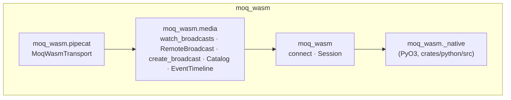

# Design: the Python SDK `moq-wasm`

## Status
Proposed

## Date
2026-11-13

## Scope
Turns the bindings of `crates/python` ([architecture.md](architecture.md))
into an SDK for bots, like the browser SDK in `crates/wasm/js`
([browser-sdk.md](../wasm/browser-sdk.md)): a core layer that keeps a relay
session up, a media layer that follows and publishes MSF broadcasts, and a
pipecat transport. This document fixes the API; its implementation, the
switch of the bots under `examples/python/`, and the release workflow follow
in later changes.

## Context
The bindings expose MoQT requests one to one (`connect`, `subscribe`,
`publish_track`, `watch_namespaces`, `parse_catalog`), named after the
browser SDK's `MoqSession`. Every bot under
`examples/python/` builds the same things on top of them:

| Pattern | Where |
| --- | --- |
| Reconnect two seconds after the session closes, and keep the token fresh meanwhile | `moq_system_one_bot/relay.py` `stay_connected`, and again in the transcriber's `Room.run` |
| Run a task while a namespace is published, and cancel it when it is withdrawn | `moq_system_one_bot/namespace.py`, the transcriber's participant map |
| Subscribe to the catalog with a joining FETCH and pick a track from `parse_catalog`'s dict | the transcriber's and camera detection's `catalog.py` |
| Subscribe again one second after a track ends, because the page that published it left | five places across chat moderation, camera detection, PTZ tracking and the transcriber |
| Write a draft-ietf-moq-msf-01 §8 event timeline | `EventTimeline` and `TranscriptTimeline` |
| Register tracks before `announce`, so a forwarded SUBSCRIBE is not refused | every bot, each with the same comment |
| Race the work against `session.closed()` | every bot |

pipecat ships `MOQTransport`, built on moq-rs. Its catalog and its JSON
streams are moq-rs's own formats, so it cannot talk to this repository's
relay or browser SDK. A pipecat pipeline that wants to use this relay has to
drop the transport and write the subscription code above by hand, as the
transcriber does.

## Decision

### Package
- The distribution is `moq-wasm`, imported as `moq_wasm`, the repository's
  name, like the browser SDK. It does not use WebAssembly; the name follows
  the repository, not the technology. `-python` is left out: a Python
  package is installed by pip or uv, so the suffix says nothing.
- `crates/python` becomes a mixed maturin project. The PyO3 module is
  `moq_wasm._native` and keeps the bindings of architecture.md. The SDK is
  Python under `crates/python/python/moq_wasm/`. asyncio's cancellation,
  `async with` and task groups are what the SDK is made of, and they are
  plain in Python and awkward through PyO3. The browser SDK splits its Rust
  and TypeScript the same way.
- The SDK depends on nothing beyond the native module. The pipecat transport
  is the `pipecat` extra (`moq-wasm[pipecat]`), which adds `pipecat-ai` and
  `av` (PyAV, for Opus and H.264).
- The package is released on GitHub only, as abi3 wheels for Linux x86_64,
  Linux aarch64 and macOS arm64 attached to a `python-sdk-v<version>` tag's
  Release. The workflow and the bots' switch to the wheels are designed with
  that change.

### Layers



The same split as the browser SDK's `moq-wasm` and `moq-wasm/media`. What
the demo apps need beyond MoQT stays in `examples/python/`: `BotRoom` and
`serve_rooms`, the token mint client, the System One clients, and the
pipelines.

### Core: `moq_wasm`

```python
import moq_wasm

async with moq_wasm.connect(url, token=jwt, refresh_token=mint.refresh) as session:
    ...
```

`connect` returns a `Session` that stays usable across connections:

- **Reconnection.** When the native session closes, other than by
  `close()`, the session dials again after 1 s, doubling the wait up to 30 s,
  and restores what the caller set up, in this order: it registers the tracks,
  publishes the namespaces, and sends the namespace subscriptions. The native
  session already follows GOAWAY and reopens after a token expiry by itself;
  this covers the rest (a relay restart, a network outage). The first
  connection's failure raises from `connect`, so a wrong URL does not retry
  forever.
- **What a lost connection takes.** A track subscription ends; the media
  layer's `follow` subscribes again. A namespace watch reports every
  namespace it had as withdrawn, and the next connection's
  SUBSCRIBE_NAMESPACE reports the published ones again. A `TrackWriter`
  drops what is written while the session reconnects, and the new
  connection's origin starts the track's groups afresh, numbered from the
  wall-clock time, so a subscriber never sees a group id go back. Its cache
  does not carry over.
- **Token refresh.** `refresh_token` is an async callable that takes the
  current token and returns a later one. The session reads `app_id` and
  `exp` from the token's claims, calls it five minutes before `exp`, retries
  every 30 s until the token expires, and hands each new token to the relay
  (`_native.Session.refresh_token`). Getting the token stays the caller's
  job, as in architecture.md "Authorization tokens".
- **Lifetime.** Leaving the `async with` block closes the session; awaiting
  `connect` instead leaves `close()` to the caller. The one failure the
  session cannot recover from is `TokenExpired`: the token expired while
  `refresh_token` kept failing. It raises from `async with`, after cancelling
  what runs inside it through `session.run`, which raises `SessionClosed`
  when `close()` ends the session instead:

```python
async with moq_wasm.connect(...) as session:
    await session.run(work())
```

The request methods keep the bindings' shape (`subscribe`,
`subscribe_current_group`, `watch_namespaces`, `publish_track`, `announce`),
with the reconnection above.

### Media: `moq_wasm.media`

```python
from moq_wasm.media import EventTimeline, create_broadcast, watch_broadcasts

async with create_broadcast(session, [root, room, "bots", "transcriber"]) as bot:
    transcript = bot.event_timeline("transcript", retention_seconds=3600)
    status = bot.publish_track("status", retention_seconds=3600)

    async def on_broadcast(remote: RemoteBroadcast) -> None:
        async for catalog in remote.catalogs():
            audio = catalog.select(role="audio", packaging="loc", codec="opus", prefer="lowest_bitrate")
            ...
        async for obj in remote.follow("chat"):
            ...

    await watch_broadcasts(session, [root, room], on_broadcast, empty_timeout=30)
```

- **`create_broadcast(session, namespace)`** publishes the namespace when its
  `async with` block is entered, after the tracks declared on it before the
  first `await`, and withdraws it on exit. Tracks added later are registered
  at once; the relay forwards their SUBSCRIBEs to the published namespace.
  This replaces the register-then-publish rule each bot comments.
- **`EventTimeline`** writes a draft-ietf-moq-msf-01 §8 event timeline: each
  connection's first group opens with the record list (every record so far
  with `replay=True`, empty otherwise), and each later record is one object.
  It replaces the two copies.
- **`watch_broadcasts(session, prefix, handler, *, empty_timeout=None)`** runs
  `handler` as a task for each broadcast published under `prefix`, cancels it
  when the broadcast is withdrawn, and runs it again when the broadcast is
  published anew, as `watchBroadcasts` does in the browser. With
  `empty_timeout`, it returns once no broadcast has been published for that
  long. Like `watchBroadcasts`, it skips the broadcasts this session created.
- **`RemoteBroadcast`** is one published namespace:
  - `catalogs()` yields a `Catalog` each time the publisher changes it,
    starting from the one the relay holds (a joining FETCH), and skips a
    catalog that does not parse, logging it.
  - `follow(name)` yields the track's objects, and subscribes again when the
    track ends while the broadcast is still published.
- **`Catalog`** is a typed draft-ietf-moq-msf-01 catalog (`tracks` of
  `CatalogTrack` with `name`, `role`, `packaging`, `codec`, `bitrate`,
  `width`, `height`, `samplerate`). `select` picks one track by its fields.
  `parse_catalog`'s dict stays in the bindings.

### pipecat: `moq_wasm.pipecat`

`MoqWasmTransport` takes the place of pipecat's `MOQTransport` in a
pipeline:

```python
from moq_wasm.pipecat import MoqWasmParams, MoqWasmTransport

transport = MoqWasmTransport(
    session,
    MoqWasmParams(
        room=[root, room],
        participant_id="bot",
        audio_in_enabled=True,
        audio_out_enabled=True,
        video_in_enabled=True,
        video_in_max_fps=10,
        video_out_enabled=True,
        video_out_codec="H264",
        video_out_width=1280,
        video_out_height=720,
    ),
)

@transport.event_handler("on_client_connected")
async def on_client_connected(transport, participant_id): ...

pipeline = Pipeline([transport.input(), stt, llm, tts, transport.output()])
```

- It is a pipecat `BaseTransport` with `input()` and `output()` and the
  events of `MOQTransport` (`on_connected`, `on_disconnected`,
  `on_client_connected`, `on_client_disconnected`, `on_track_subscribed`,
  `on_error`), so a pipeline changes its import and its params. The session
  comes from `moq_wasm.connect`, which owns reconnection and tokens, instead
  of the transport dialing the relay.
- **Peers.** Every broadcast under `room` is a participant, its last
  namespace element the participant id, followed with `watch_broadcasts`.
  `MOQTransport` follows one peer; a room is what the transcriber, chat
  moderation, camera detection and PTZ tracking serve. `on_client_connected`
  and `on_client_disconnected` take the participant id. The transport's own
  broadcast, `[*room, participant_id]`, is not a participant.
- **Audio in.** For each participant, the Opus LOC audio track of its catalog
  with the lowest bitrate, decoded and resampled to `audio_in_sample_rate`,
  is pushed as `UserAudioRawFrame` with the participant id as `user_id`. The
  lowest bitrate is the profile the room's viewers already take, so it starts
  no extra encoder in the participant's browser. The track is unsubscribed
  when its audio stops being in the catalog.
- **Video in.** For each participant, the H.264 LOC video track of its
  catalog with the lowest bitrate, decoded with a fresh decoder for each
  group (a group starts at a keyframe), is pushed as `UserImageRawFrame` at
  most `video_in_max_fps` times a second. `video_in_track` (a callable from
  `Catalog` to a track name) picks another track, as PTZ tracking picks the
  profile its viewer chose.
- **Audio and video out.** `OutputAudioRawFrame` is encoded to Opus and
  `OutputImageRawFrame` with PyAV to `video_out_codec` (`"H264"` by default,
  the codec the browser SDK publishes; `"VP8"` is royalty-free), at
  `video_out_width`, `video_out_height` and `video_out_framerate`, all
  fields of pipecat's `TransportParams`. Both are pushed into the transport's
  broadcast, so the browser plays it with `RemoteBroadcast`. A
  NEW_GROUP_REQUEST from a subscriber makes the encoder emit a keyframe.
- **Codecs are the transport's job.** pipecat's frames carry raw audio and
  pictures, and each transport encodes and decodes with its own stack (the
  Daily and LiveKit SDKs natively, `SmallWebRTCTransport` through aiortc and
  PyAV). `MoqWasmTransport` does it with PyAV.
- **Left out.** `MOQTransport`'s serve mode (the bot accepts sessions
  without a relay; the bindings have no server side) and its RTVI
  transcript stream.

### Publishing media: `_native.MediaBroadcast`
The browser SDK encodes with WebCodecs and hands the encoded samples to
`crates/wasm`'s `MediaBroadcast`, which wraps `broadcast::Broadcast`: the
MSF catalog, the LOC tracks with their Timestamp property
(draft-ietf-moq-loc-04), the media timeline, the cache for FETCH and the
NEW_GROUP_REQUEST callback. The bindings gain the same wrapper over the same
crate, so Python writes no catalog or LOC header of its own:

```python
media = await session.media_broadcast([*room, "bot"])
source = media.add_source("main", on_keyframe_request=encoder.request_keyframe)
source.configure_video("avc1.42e01f")
source.push_video(annexb, timestamp_micros)  # one access unit; a keyframe opens a group
source.configure_audio("opus", sample_rate=48000, channels=1)
source.push_audio(packet, timestamp_micros)
await media.announce()
```

`create_broadcast` in the media layer owns one, so the tracks a bot writes
itself (`publish_track`, `event_timeline`) and the media tracks share one namespace
and one catalog. Encoding stays in Python with PyAV, which the `pipecat`
extra already depends on for decoding.

### No codec in the wheel
The `moq-wasm` wheel holds this repository's code (MIT) and Rust crates
under permissive licenses, and no codec: it packs encoded H.264 and Opus
into LOC objects and never encodes or decodes them. Encoding and decoding go
through PyAV, which the user's pip or uv installs from PyPI for the
`pipecat` extra. PyAV's wheels are built with libx264 and libx265, so they
are under the GPL, and H.264 is covered by patents (the Via LA AVC pool) for
encoders and decoders alike. Keeping codecs out of the wheel keeps both out
of what this repository distributes. The SDK's documentation tells its
users to check them before they distribute PyAV with their app (an image,
an installer) or charge for the H.264 video they serve. Bundling FFmpeg
into the wheel to spare users the install would bring both into the
release, and is not done.

## Consequences

### Positive
- A bot is its pipeline and its app logic; the relay session, presence,
  catalogs and resubscription are written once.
- A pipecat pipeline reaches this relay and the browser SDK by swapping its
  transport.
- Python and the browser publish media through the same `broadcast` crate,
  so their catalogs and LOC tracks cannot drift apart.

### Negative
- The import changes from `moqt` to `moq_wasm` in every bot.
- The SDK's reconnection restores state the bots now rebuild themselves, so
  its tests need a relay that restarts in the middle of a session.
- The `pipecat` extra follows pipecat's transport API, which pipecat may
  change in a minor version.

## Alternatives Considered

### Write the SDK in Rust with PyO3
One language, but each task group, cancellation and `async with` would be
written against asyncio through PyO3, and the pipecat transport subclasses
pipecat's Python classes anyway.

### Name the distribution `moq-wasm-python`
Tells it apart from the browser SDK in the name, but a Python package
installed by pip says it is Python already, and the Release tag tells the two
apart.

### One peer per transport, as `MOQTransport`
Matches `MOQTransport`'s params exactly, but every bot here serves a room, so
each would run one pipeline per participant and merge their output itself.

### Keep the building blocks in `examples/python/moq-system-one-bot`
They work for the bots in this repository, but a bot outside it would copy
them, and the pipecat transport needs them too.
