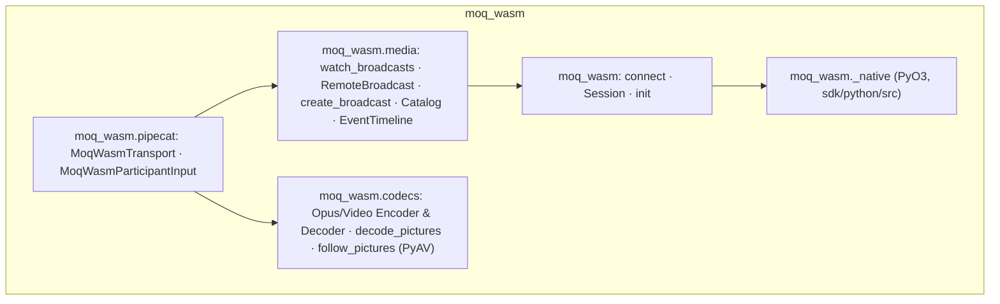

# Design: the Python SDK `moq-wasm`

## Status
Accepted (2026-11-13)

## Scope
Turns `sdk/python`'s native bindings ([`architecture.md`](architecture.md)) into a full bot SDK mirroring the browser SDK ([`wasm/browser-sdk.md`](../wasm/browser-sdk.md)):
- **Core** (`moq_wasm`): session lifecycle, token refresh, and typed request handles.
- **Media** (`moq_wasm.media`): MSF broadcast watching, catalog selection, publishing, and event timelines.
- **Codecs** (`moq_wasm.codecs`, `[codecs]` extra): PyAV Opus and video encoding/decoding.
- **Pipecat** (`moq_wasm.pipecat`, `[pipecat]` extra): `MoqWasmTransport` and `MoqWasmParticipantInput`.

## Context
Before the SDK, bots under `examples/python/` duplicated reconnection, token refresh, namespace watching, catalog joining FETCH, resubscription loops, event timelines, and pre-announce track registration. Pipecat's built-in `MOQTransport` uses `moq-rs`'s proprietary catalog and JSON formats, so it cannot interoperate with this relay or browser SDK.

**Jump to:** [Package](#package) · [Layers](#layers) · [Core](#core-moq_wasm) · [Logs & Spans](#logs-and-spans-moq_wasminit) · [Media](#media-moq_wasmmedia) · [Pipecat](#pipecat-moq_wasmpipecat) · [MediaBroadcast](#publishing-media-_nativemediabroadcast) · [No Codec](#no-codec-in-the-wheel) · [Alternatives](#consequences--alternatives)

## Decision

### Package
- **Distribution**: `moq-wasm` (imported as `moq_wasm`), matching the repository and browser/Rust SDKs (uses no WebAssembly; no `-python` suffix).
- **Layout**: Mixed maturin project—PyO3 module `moq_wasm._native` (`sdk/python/src`) plus pure Python (`sdk/python/python/moq_wasm/`) for asyncio cancellation, `async with`, and `TaskGroup`.
- **Extras**: Base package depends only on `_native`. `moq-wasm[codecs]` adds `av` (PyAV: Opus; H.264/VP8 encode; H.264/H.265/VP8/VP9/AV1 decode) + `numpy`. `moq-wasm[pipecat]` adds `pipecat-ai` + `[codecs]`.

**GitHub Release** (abi3 wheels for Python 3.11+ on Linux x86_64, Linux aarch64, macOS arm64; not marked Latest):
1. PRs add user-facing entries under `## リリースノート（Python）` (never editing `sdk/python/CHANGELOG.md` directly). The release PR collects them and bumps `[project] version` in `pyproject.toml` (`.agents/skills/release-python-sdk/SKILL.md`).
2. Push tag `python-sdk-v<version>` on the merge commit.
3. `.github/workflows/python-release.yml` validates tag vs. version/changelog and builds wheels natively per platform (`manylinux_2_28` image on Linux so GCC builds `aws-lc-sys` without zig; supports Debian 10 / Ubuntu 20.04+).
4. Runs binding tests against each wheel on Python 3.11 against a workspace relay + VTS.
5. Publishes the GitHub Release with the three wheels (usable as a flat index by pip/uv). Workspace bots build from source by path.

### Layers



Demo-specific helpers (`BotJob`, `BotDispatcher`, `serve_bot_job` in `moq-bot-job`, System One clients) stay in `examples/python/`.

### Core: `moq_wasm`

```python
async def work() -> None:
    async with asyncio.TaskGroup() as workers:
        workers.create_task(publish())
        workers.create_task(follow())

async with moq_wasm.connect(url, token=await dispatcher.token(), refresh_token=dispatcher.refresh) as session:
    await session.run(work())
```

#### Connection, Reconnection & Token Refresh
- **First connect**: Raises if transport or `CLIENT_SETUP` fails within `moqt`'s 30 s deadline (`SERVER_SETUP_TIMEOUT` / transport idle timeout).
- **Reconnection**: Owned by `moqt` ([`moqt/session-migration.md`](../moqt/session-migration.md)): follows GOAWAY and replaces unexpected drops (or `EXPIRED_AUTH_TOKEN` when `refresh_token` is supplied) with 0.5 s → 10 s backoff up to 60 s. Re-sends namespaces/subscriptions (resuming from next group start without gap fill) and preserves `Origin`. After 60 s (or at `exp` without `refresh_token`), ends with `ConnectionLost`.
- **Token refresh (`refresh_token(current) -> new_token`)**:
  - Reads `app_id` and `exp`, triggers 5 min before `exp` (or halfway for shorter tokens), retries every 30 s (or half remaining time) until `exp`, and hands off via `_native.Session.refresh_token`.
  - Enforces a 30 s (or `exp`) deadline per call + handover in isolated tasks (cancelling slow cleanups without delaying retries or `TokenExpired`). Rejects mismatched `app_id`, non-increasing `exp`, or relay refusals (retaining last accepted token for retry while native session presents the latest token on reconnect). External cancellations of a shared future count as failed attempts and retry.

#### Session Lifetime, `run()` & Exceptions
- **Context management**: `async with connect(...)` closes on exit (re-entering an active result raises `RuntimeError`; awaiting twice opens independent sessions seeded with the latest token). `close()` cancels internal tasks (including in-flight refresh cleanups) and awaits native close; `close()` called from a refresh cleanup returns immediately to avoid deadlock.
- **`session.run(coro)`**: Cancels work on session end and raises `ConnectionLost` (with `CloseInfo`), `TokenExpired`, or `SessionClosed` (all subclass `SessionEnded`, not `RuntimeError`). Always awaits full work cleanup (even if the caller of `run()` is cancelled). Combine multiple workers inside `asyncio.TaskGroup` rather than `asyncio.gather` so all teardowns finish before `run()` returns.
- **Outcome preservation (`moq_wasm._ended.Ended`)**: Each session/writer/source records its first terminal outcome and re-raises a fresh copy per failed call (preventing unbounded traceback growth). Reads on `Subscription`, `Group`, and `Fetch` cancel pending native reads on session end (held weakly so dropped iterators collect cleanly).
- **Request errors**: Protocol refusals raise `RequestError` (subclass of `RuntimeError`, with `message_type`, draft-14 `code` / `RequestErrorCode`, `reason`); `SUBSCRIBE_UPDATE`, `refresh_token`, and missing FETCH streams raise plain `RuntimeError`.
- **CPython 3.14 workaround (`moq_wasm._wait.wait`)**: Drops task references from pending futures on return/cancel (avoiding CPython 3.14.0–3.14.6 `asyncio.wait` leaks).

#### Requests, Ownership & Cancellation Safety
- **Request API** (snake_case mirror of `MoqSession`): `subscribe`, `subscribe_current_group`, `subscribe_group_start`, `fetch`, `track_status`, `watch_namespaces`, `publish_track` (`retention_seconds`, `publish`, `datagram`, `priority` default 128), `announce`, `transport_stats()`.
- **Track origin immutability**: Native `Origin` pins a track's initial `retention_seconds` (re-registering with another raises `ValueError` before native call) and locks `datagram` mode once any object is written. Media broadcasts verify compatible delivery/retention on `add_media_source`/`add_rendition` and enter.
- **Single owner per track & namespace**: `publish_track`, `announce`, and `LocalBroadcast` reject concurrent duplicate owners with `RuntimeError` until prior `close()`/withdrawal completes. Namespace lists are defensively copied (`name` is read-only).

**Cancellation-safe cleanup**
- Cancelled `subscribe*`, `watch_namespaces`, `publish_track`, or `announce` runs its native call to completion and immediately unsubscribes/ends/withdraws on accept (subsequent owners wait for cleanup).
- `TrackWriter`: serializes `write`/`write_group` (started sends finish even if caller is cancelled); `next_subscriber` accepts one waiter at a time (preserving arrivals on cancel); `registered()` surfaces registration failure; `close()` waits for pending send/registration and sends `PUBLISH_DONE`.
- `Subscription` / `Group` / `Fetch`: choose either object iteration or `groups()` (mixing or concurrent reads raise `RuntimeError`; `subscribe_current_group`/`subscribe_group_start` are object-only). Cancelled reads keep the native read pending so timeouts never drop objects. `close()` sends `UNSUBSCRIBE` in an independent future. `Object` exposes `group_id`, `subgroup_id`, `object_id`, `status`, `payload`, `extension_headers`, `timestamp_micros`.

### Logs and Spans: `moq_wasm.init`

```python
moq_wasm.init(
    log_level="info",
    on_log=on_log,
    on_span=on_span,
    telemetry=moq_wasm.TelemetryOptions(url="https://observability.example", page="my-bot"),
)
moq_wasm.report_log("warn", "my-bot", "room joined", room=room)
```

Process-wide (first `init` wins):
- **Python `logging`**: Native `tracing` events ≥ `log_level` emit under `moq_wasm.native.<module>` (with `TRACE = 5` and `record.moq_fields`).
- **GIL-free dispatch**: Tokio threads push to a 4,096-item ring queue (drops warn via `log records dropped`); a daemon thread drains to `logging`/`on_log`/`on_span` without holding the GIL while idle, stopping cleanly at interpreter exit.
- **Trace context & scopes**: `on_span` or `telemetry` enables `telemetry-report` spans and `TRACE_CONTEXT` propagation (`set_trace_context_provider`/`joiner`). Each session binds a `telemetry_report` scope (propagated across `executor::spawn`) mapping records to its latest token (records outside any session go untokenized).
- **`ClientTelemetry`**: Keeps newest 100 logs + 100 spans per token (max 64 tokens), flushes every 10 s via `urllib` on a background thread (`service: "python"`), drains ≤ 1.5 s + 2 s final POST at exit. Remembers up to 64 `401`-rejected tokens by SHA-256 digest (sending later records untokenized), deep-copies fields as JSON after `redact` (stringifying `NaN`/infinity/non-JSON keys). `report_log` bypasses `logging` and feeds `on_log`/`telemetry` only.

### Media: `moq_wasm.media`

| Primitive | Behavior |
| --- | --- |
| `create_broadcast(session, ns)` | `async with` registers synchronous pre-`await` `publish_track` / `event_timeline` declarations, then calls `announce()` (`PUBLISH_NAMESPACE`), withdrawing on exit. Refuses `publish=True`. If `announce()` fails, all tracks/sources raise that error on writes/waits and on normal block exit unless already raised. |
| `EventTimeline` | Single-group MSF §8 timeline: writes opening empty list on registration; `append` waits for registration + opening; failed/cancelled opening closes track cleanly. |
| `watch_broadcasts(session, prefix, handler, *, filter=, empty_timeout=)` | Spawns a task per accepted broadcast under `prefix`, cancels on withdraw, restarts after teardown finishes on re-announce, logs handler exceptions, awaits all handler teardowns on exit. Skips broadcasts published by the same session. |
| `RemoteBroadcast` | `catalogs()` (joining FETCH, skips unparseable and older groups persisted per instance); `follow(name)` (2 s default `delivery_timeout`, 1 s retry, `on_subscribed` errors abort and unsubscribe); `subscriptions(name)` (yields per-subscription owned iterators; `from_group_start=True` uses `subscribe_current_group`); `event_timeline(name)` (joining FETCH, no default timeout, deduplicates on retry). |
| `Following` (iterator type) | State-machine async iterator running in caller's task (no per-read task). Survives `asyncio.wait_for` timeouts without killing the iteration; rejects concurrent reads (`RuntimeError`); `aclose()` cancels active reader / waits for in-flight `SUBSCRIBE` + `UNSUBSCRIBE` (or schedules close if called from `on_subscribed`); GC finalizer unsubscribes unclosed iterators. |
| `Catalog` | Typed msf-02 catalog (`tracks: list[CatalogTrack]`, root `fields`, `select(...)` with codec prefix matching, `init_data(track)` resolving Base64 `inline` `initRef`). |

### Pipecat: `moq_wasm.pipecat`

`MoqWasmTransport(session, MoqWasmParams(...))` subclasses pipecat's `BaseTransport` (`input()`, `output()`, events `on_connected`, `on_disconnected`, `on_client_connected`, `on_client_disconnected`, `on_track_subscribed`, `on_error`, `on_room_empty`). Does not implement `MOQTransport`'s server mode or RTVI transcript stream. Params (and their dicts/lists) are defensively copied at init.

#### Lifecycle & Room Sharing
- Input and output share one room: first `StartFrame` opens broadcast + `watch_broadcasts`; last `EndFrame`/`CancelFrame`/`cleanup` tears down. Teardown waits for full namespace withdrawal before returning (and subsequent opens wait for prior teardown).
- **Single-run processors**: Each `input()`/`output()` serves one pipeline run (`cleanup` resets transport to allocate fresh processors; reusing a finished processor fails `setup` permanently). `StopFrame` pauses without cleanup (`StartFrame` resumes subscriptions and replaces media senders cleanly, restarting audio filters at the new sample rate).
- **Open failure**: Withdraws partial state, fires `on_error`, pushes permanent `ErrorFrame` (`force_treat_as_permanent`; build workers with `ProcessorUnusablePolicy.CANCEL` rather than pipecat's default `CONTINUE`). Failed tracks fire `on_error` and retry with 1 s → 30 s exponential backoff.
- **Peers**: Every broadcast 1 level under `room` is a participant (last element = `participant_id`). Transport's own broadcast (`[*room, participant_id]` or explicit `broadcast`, e.g., `[*room, "bots", "<type>"]`) is excluded. Room is watched even with no media inputs so presence and `empty_timeout` work.
- **Per-participant pipelines**: `MoqWasmParticipantInput(broadcast, MoqWasmInputParams(...))` runs an isolated input per speaker (required for single-speaker VAD and stateful `audio_in_filter`; `MoqWasmTransport` rejects `audio_in_filter` with `ValueError`). Reports failed tracks as non-fatal `ErrorFrame`s.

#### Audio & Video Input
- **Audio in**: Picks lowest-bitrate Opus LOC track per participant, decodes in order (dropping older out-of-order groups, resetting decoder on gaps/resubscribe/sample-rate change), resamples to pipeline rate and `audio_in_channels` (mono default—Silero/Smart Turn require mono at pipeline sample rate), emits `UserAudioRawFrame(user_id=participant_id)`. Honors `audio_in_stream_on_start=False` until `InputTransportStartAudioStreamingFrame`.
- **Video in**: `"camera"` picks lowest-bitrate PyAV-decodable LOC video (or `video_in_track` callback); other source names match track name directly. Uses `follow_pictures` (`decode_pictures` per subscription, `from_group_start=True`, catalog `init_data` as fallback Video Config) emitting RGB `UserImageRawFrame` with `transport_source` and `metadata["location"]`. Samples at configured `framerate` (50 ms jitter tolerance, matching pipecat's sampler) or `on_request_only`; supports `capture_participant_video` and `release_participant_video` (awaits `UNSUBSCRIBE` completion; used by PTZ tracking).
- **Image requests (`UserImageRequestFrame`)**: Activates source on demand if inactive; answered only by a picture strictly newer than `SUBSCRIBE_OK`'s `largest` and all prior seen locations of that subscription (filtering replayed/delayed/B-frame-older frames). Unanswerable or > 5 s timed-out requests invoke `result_callback({"error": ...})` (serialized safely against releases and teardowns).
- **Multi-transport pipelines**: Inputs without video forward `UserImageRequestFrame` upstream; outputs act only on default `transport_destination`, forwarding frames/controls for other destinations untouched.

#### Data Tracks & Audio/Video Output
- **Data tracks**: `data_in_tracks` emit `InputTransportMessageFrame(MoqWasmTrackMessage)` (dropped while paused by `StopFrame`). `OutputTransportMessageFrame` carrying `MoqWasmTrackObject` (`data_out_tracks`) or `MoqWasmEventRecord` (`event_timelines_out`) writes immediately in frame order (bypassing audio/PTS pacing so untimed/timed records never reorder); unknown message types pass through normally.
- **Audio out**: Copies and resamples `OutputAudioRawFrame` (16-bit mono/stereo PCM; rejects >2 ch, stereo + `SoundfileMixer`, non-positive `audio_out_10ms_chunks`, rate < 100 Hz) into a continuous stream, encodes Opus (pacing ≤ 100 ms ahead of wall clock so interruptions cut off unsent speech). Interruptions drop interruptible buffered/queued audio while preserving uninterruptible speech (flushed padded before subsequent interruptible speech). `TTSStoppedFrame`, `EndFrame`, `StopFrame`, and `PipelineFlushFrame` flush trailing samples padded with silence.

**Video out** (copies/validates `OutputImageRawFrame` and `SpriteFrame` before queueing; `H264` default or `VP8`, keyframe every 2 s + on `MediaSource.keyframe_request`):
- Live queue bounded at 2 s (drops oldest interruptible first on overflow, emitting non-fatal `ErrorFrame`).
- `sync_with_audio` pictures write off the audio task at the exact audio-clock end of preceding speech (bounded at 2 s; `EndFrame`/`StopFrame`/flush wait ≤ 3 s).
- `AssistantImageRawFrame` writes behind preceding audio and forwards to assistant context only once drawn (preserving still-frame ordering and interruption semantics).
- Non-fatal write errors emit `ErrorFrame` and continue; permanent media-source publish failure marks output unusable (unless data tracks remain active).

#### Codecs (`moq_wasm.codecs`)
- Software PyAV decoders (`dav1d` single-threaded for AV1 to avoid GIL deadlock on mid-group drop, falling back to `libaom`; FFmpeg HW-only AV1 excluded; other codecs keep multi-threading).
- `decode_pictures` / `follow_pictures`: Decodes in worker threads (surviving cancelled reads), tracks up to 4 concurrent interleaved groups (flushing B-frames on End of Group, eviction, or end), fails track after 3 consecutive refusals in a keyframe-joined group.
- **H.264/H.265 framing & LOC Video Config (§2.1.3–2.1.4, §2.3.2.1)**: Auto-detects Annex-B start codes vs. 4-byte length prefixes (rewriting in-band SPS `avc3`/`hev1` to start codes; skipping unreadable pre-config objects with warning). Inherits LOC Video Config across groups (holding out-of-order groups up to `MAX_HELD_OBJECTS`/`MAX_HELD_BYTES`, provisionally re-decoding if an open earlier group updates config, and carrying latest config across resubscriptions in `follow_pictures.config`).

#### Workspace Bots Built on `moq_wasm.pipecat`
- **Camera detection**: `MoqWasmTransport` reading `prompt` (`data_in_tracks`), issuing up to 8 concurrent `UserImageRequestFrame`s, writing verdicts to `event_timelines_out`.
- **Meeting transcriber**: Per-participant `MoqWasmParticipantInput` pipelines publishing `{root}/{room}/bots/transcriber`.
- **PTZ tracking**: Two transports in one pipeline (viewer room + `ingest-gateway pull` room), dynamically capturing/releasing profiles via `release_participant_video`.
- **Chat moderation**: Data-only `MoqWasmTransport` reading `chat` and appending verdicts to `event_timelines_out`.

### Publishing Media: `_native.MediaBroadcast`

```python
async with create_broadcast(session, [*room, "bot"]) as bot:
    status = bot.publish_track("status")
    media = bot.add_media_source(video="video", audio="audio", label="bot")
    media.configure_video("avc1.42e01f")
    media.configure_audio("opus", sample_rate=48000, channels=1)
    await bot.published()
    media.push_video(annexb, timestamp_micros)
    media.push_audio(packet, timestamp_micros)
    await media.keyframe_request()
```

- Shares `crates/broadcast` (`RelayConnection::with_client_session` + shared `Origin`, registered ahead of `Origin` in the event loop). Raw `publish_track`/`event_timeline` tracks remain unlisted in the catalog; all broadcast tracks (catalog, video, audio, `<video>_timeline`, renditions, `_cmaf` siblings, default `chat`/`audio` placeholder) participate in single-owner enforcement (read-only names).
- Uses `MediaBroadcast.announce` (single namespace announcement). Leaving removes tracks after queued media (`PUBLISH_DONE`), ends catalog, and drops `RelayConnection` so `CatalogRefreshTask` stops. Invalid options raise `ValueError`/`TypeError` upfront before native construction.
- `push_video` / `push_audio` return `bool` (`False` if dropped pre-publish, post-close, non-picture AU, or bounded-queue overflow; raises `RuntimeError` permanently on live native publish failure).
- `add_rendition(name, label, bitrate)` returns a `Rendition` object (supports multi-codec `altGroup` e.g. VP8 alongside H.264). `cmaf=True` enables `_cmaf` siblings; `on_demand=True` (default) exposes `await media.demand_change() -> Demand(track_name, wanted)` (coalesced to 1 unread per track); `await media.remove_track("video" | "audio")` runs to completion even if cancelled.

### No Codec in the Wheel
The `moq-wasm` wheel ships only MIT/permissive code with zero codecs (packing already-encoded frames into LOC). Codecs come from PyAV on PyPI via `[codecs]` / `[pipecat]`, keeping GPL (`libx264`/`libx265`) and H.264 patent obligations out of this repository's release artifacts.

## Consequences & Alternatives

### Consequences
- **Positive**: Bots focus on pipeline/app logic; pipecat pipelines interoperate with this relay/browser SDK by swapping one transport; Python and browser share `crates/broadcast`.
- **Negative**: Outages > 60 s end the session and room; `[pipecat]` tracks pipecat's minor-version transport API.

### Alternatives Considered
- **Write SDK in Rust/PyO3**: Awkward asyncio `TaskGroup`/cancellation across FFI; pipecat still requires Python subclasses.
- **Name package `moq-wasm-python`**: Redundant for pip/uv; GitHub Release tags distinguish languages.
- **Single-peer transport like `MOQTransport`**: Every workspace bot serves multi-participant rooms.
- **Infinite SDK-level reconnect after native 60 s**: Retries forever when no page waits, duplicates native carryover, and diverges from browser SDK.
- **Keep helpers in `examples/python/moq-system-one-bot`**: Unusable by external bots and `moq_wasm.pipecat`.
