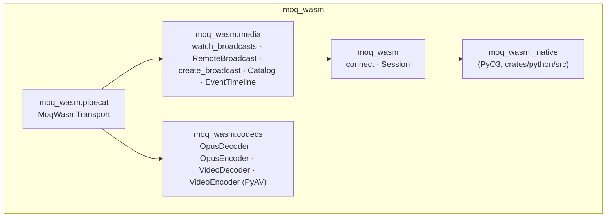

# Design: the Python SDK `moq-wasm`

## Status
Proposed

## Date
2026-11-13

## Scope
Turns the bindings of `crates/python` ([architecture.md](architecture.md))
into an SDK for bots, like the browser SDK in `crates/wasm/js`
([browser-sdk.md](../wasm/browser-sdk.md)): a core layer that keeps a relay
session up, a media layer that follows and publishes MSF broadcasts, and a
pipecat transport. This document fixes the API; its implementation, the
switch of the bots under `examples/python/`, and the release workflow follow
in later changes.

## Context
The bindings expose MoQT requests one to one (`connect`, `subscribe`,
`publish_track`, `watch_namespaces`, `parse_catalog`), named after the
browser SDK's `MoqSession`. Every bot under
`examples/python/` builds the same things on top of them:

| Pattern | Where |
| --- | --- |
| Reconnect two seconds after the session closes, and keep the token fresh meanwhile | `moq_system_one_bot/relay.py` `stay_connected`, and again in the transcriber's `Room.run` |
| Run a task while a namespace is published, and cancel it when it is withdrawn | `moq_system_one_bot/namespace.py`, the transcriber's participant map |
| Subscribe to the catalog with a joining FETCH and pick a track from `parse_catalog`'s dict | the transcriber's and camera detection's `catalog.py` |
| Subscribe again one second after a track ends, because the page that published it left | five places across chat moderation, camera detection, PTZ tracking and the transcriber |
| Write a draft-ietf-moq-msf-01 §8 event timeline | `EventTimeline` and `TranscriptTimeline` |
| Register tracks before `announce`, so a forwarded SUBSCRIBE is not refused | every bot, each with the same comment |
| Race the work against `session.closed()` | every bot |

pipecat ships `MOQTransport`, built on moq-rs. Its catalog and its JSON
streams are moq-rs's own formats, so it cannot talk to this repository's
relay or browser SDK. A pipecat pipeline that wants to use this relay has to
drop the transport and write the subscription code above by hand, as the
transcriber does.

## Decision

### Package
- The distribution is `moq-wasm`, imported as `moq_wasm`, the repository's
  name, like the browser SDK. It does not use WebAssembly; the name follows
  the repository, not the technology. `-python` is left out: a Python
  package is installed by pip or uv, so the suffix says nothing.
- `crates/python` becomes a mixed maturin project. The PyO3 module is
  `moq_wasm._native` and keeps the bindings of architecture.md. The SDK is
  Python under `crates/python/python/moq_wasm/`. asyncio's cancellation,
  `async with` and task groups are what the SDK is made of, and they are
  plain in Python and awkward through PyO3. The browser SDK splits its Rust
  and TypeScript the same way.
- The SDK depends on nothing beyond the native module. `moq_wasm.codecs` is
  the `codecs` extra (`moq-wasm[codecs]`), which adds `av` (PyAV, for Opus,
  H.264 and VP8) and `numpy`. The pipecat transport is the `pipecat` extra
  (`moq-wasm[pipecat]`), which adds `pipecat-ai` and the `codecs` extra.
- The package is released on GitHub only, as abi3 wheels for Linux x86_64,
  Linux aarch64 and macOS arm64 attached to a `python-sdk-v<version>` tag's
  Release. The workflow and the bots' switch to the wheels are designed with
  that change.

### Layers



The same split as the browser SDK's `moq-wasm` and `moq-wasm/media`. What
the demo apps need beyond MoQT stays in `examples/python/`: `BotRoom` and
`serve_rooms`, the token mint client, the System One clients, and the
pipelines.

### Core: `moq_wasm`

```python
import moq_wasm

async with moq_wasm.connect(url, token=jwt, refresh_token=mint.refresh) as session:
    ...
```

`connect` returns a `Session`:

- **Reconnection is the native session's.** The native session (the `moqt`
  crate, shared with the browser SDK) follows GOAWAY, and replaces a
  connection that ended without a termination code (a network outage, a
  relay killed and restarted) or with EXPIRED_AUTH_TOKEN, retrying from
  0.5 s, doubling up to 10 s, for at most 60 s
  ([moqt/session-migration.md](../moqt/session-migration.md) "Reconnecting
  after a lost connection"). It sends the namespace subscriptions,
  namespaces and subscriptions again on the new connection; each
  subscription continues from the next group start, and the objects
  published in between are not filled in. The origin, and so the tracks the
  session publishes and their cache, stay. When the native session cannot
  replace its connection, the session ends with `ConnectionLost`, as the
  browser SDK's `MoqSession.closed` resolves. It does not dial again: a bot
  whose session ended ends its room, and the page that asked for the room
  asks again. A failure to connect raises from `connect`.
- **Token refresh.** `refresh_token` is an async callable that takes the
  current token and returns a later one. The session reads `app_id` and
  `exp` from the token's claims, calls it five minutes before `exp`, retries
  every 30 s until the token expires, and hands each new token to the relay
  (`_native.Session.refresh_token`). Getting the token stays the caller's
  job, as in architecture.md "Authorization tokens". The native session
  also presents the latest token when it reconnects.
- **Lifetime.** Leaving the `async with` block closes the session; awaiting
  `connect` instead leaves `close()` to the caller. A session ends with
  `ConnectionLost`, or with `TokenExpired` when the token expired while
  `refresh_token` kept failing. The failure raises from `async with`, after
  cancelling what runs inside it through `session.run`, which raises
  `SessionClosed` when `close()` ends the session instead. `run` raises the
  failure even when the work returned because of it, as a watch does when
  the session ends:

```python
async with moq_wasm.connect(...) as session:
    await session.run(work())
```

The request methods keep the bindings' shape, which follows the browser
SDK's `MoqSession` in snake_case: `subscribe` (with `filter`, `forward`,
`priority`, `delivery_timeout` in seconds and `group_order`),
`subscribe_current_group`, `subscribe_group_start`, `fetch` (between two
`Location`s), `track_status`, `watch_namespaces`, `publish_track` (with
`retention_seconds`, `publish` and `datagram`) and `announce`. A
`TrackWriter` has `write` and `write_group`, which return the group id an
object went into when a subscriber took it, and `next_subscriber`; its
objects carry no extension headers. A `Subscription` iterates its objects, or its subgroup streams
through `groups()`, and has `largest`, `done()`, `set_forward`,
`set_priority`, `request_new_group`, `end_before_group` and `close`. An
`Object` carries `group_id`, `subgroup_id`, `object_id`, `status` and
`payload`; its extension headers are left out until a bot reads one.

A request that fails raises `RequestError`, as the browser SDK does, with
`message_type` (`"SUBSCRIBE"`, ...), `code`, the draft-14 number of its
error code (`RequestErrorCode` names those of SUBSCRIBE, FETCH and
TRACK_STATUS), and `reason`. It subclasses `RuntimeError`, which the bots
and the media layer catch around their requests. The requests the
browser SDK wraps raise it; a refused PUBLISH or SUBSCRIBE_UPDATE,
`MediaBroadcast.announce`, `refresh_token` and a FETCH stream that never
arrives raise a plain `RuntimeError`. A
`ConnectionLost` carries the `CloseInfo` (termination `code` and `reason`)
of the last connection, and `transport_stats()` the bytes the session sent
and received.

### Media: `moq_wasm.media`

```python
from moq_wasm.media import RemoteBroadcast, create_broadcast, watch_broadcasts

async with create_broadcast(session, [root, room, "bots", "transcriber"]) as bot:
    transcript = bot.event_timeline("transcript", retention_seconds=3600)
    status = bot.publish_track("status", retention_seconds=3600)

    async def on_broadcast(remote: RemoteBroadcast) -> None:
        async for catalog in remote.catalogs():
            audio = catalog.select(role="audio", packaging="loc", codec="opus", prefer="lowest_bitrate")
            ...
        async for obj in remote.follow("chat"):
            ...

    await watch_broadcasts(session, [root, room], on_broadcast, empty_timeout=30)
```

- **`create_broadcast(session, namespace)`** publishes the namespace when its
  `async with` block is entered, after the tracks declared on it before the
  first `await`, and withdraws it on exit (PUBLISH_NAMESPACE_DONE, through
  the `Announcement` that `Session.announce` returns). `publish_track`
  and `event_timeline` are synchronous so that a block can declare its
  tracks before anything yields; `published()` waits for the
  PUBLISH_NAMESPACE. A track added later is registered on its own, and
  what is written to it before that is dropped. `LocalBroadcast.publish_track` takes
  `datagram` but not `publish`: the batch is registered before the
  namespace is published, and a PUBLISH must follow the namespace. This
  replaces the register-then-publish rule each bot comments.
- **`EventTimeline`** writes a draft-ietf-moq-msf-01 §8 event timeline as
  one group: it opens with an empty record list once the track is
  registered, and each record is one more object, so a late joiner's joining
  FETCH brings those the track still keeps. It replaces the two copies.
- **`watch_broadcasts(session, prefix, handler, *, filter=None,
  empty_timeout=None)`** runs `handler` as a task for each broadcast
  published under `prefix` that `filter` accepts, cancels it when the
  broadcast is withdrawn, and runs it again when the broadcast is published
  anew, as `watchBroadcasts` does in the browser. A handler's exception is
  logged. With `empty_timeout`, it returns once no broadcast has been
  published for that long. Like `watchBroadcasts`, it skips the broadcasts
  this session publishes.
- **`RemoteBroadcast`** is one published namespace:
  - `catalogs()` yields a `Catalog` each time the publisher changes it,
    starting from the one the relay holds (a joining FETCH), and skips a
    catalog that does not parse, logging it.
  - `follow(name)` yields the track's objects, and subscribes again a second
    after the track ends or its SUBSCRIBE fails; the handler's cancellation
    ends it.
- **`Catalog`** is a typed draft-ietf-moq-msf-01 catalog (`tracks` of
  `CatalogTrack` with `name`, `namespace`, `role`, `packaging`, `codec`,
  `bitrate`, `width`, `height`, `framerate`, `samplerate`, and every field in
  `fields`). `select` picks one track by its fields; `codec="avc1"` matches
  `avc1.42e01f`.
  `parse_catalog`'s dict stays in the bindings.

### pipecat: `moq_wasm.pipecat`

`MoqWasmTransport` takes the place of pipecat's `MOQTransport` in a
pipeline:

```python
from moq_wasm.pipecat import MoqWasmParams, MoqWasmTransport

transport = MoqWasmTransport(
    session,
    MoqWasmParams(
        room=[root, room],
        participant_id="bot",
        audio_in_enabled=True,
        audio_out_enabled=True,
        video_in_enabled=True,
        video_in_max_fps=10,
        video_out_enabled=True,
        video_out_codec="H264",
        video_out_width=1280,
        video_out_height=720,
    ),
)

@transport.event_handler("on_client_connected")
async def on_client_connected(transport, participant_id): ...

pipeline = Pipeline([transport.input(), stt, llm, tts, transport.output()])
```

- It is a pipecat `BaseTransport` with `input()` and `output()` and the
  events of `MOQTransport` (`on_connected`, `on_disconnected`,
  `on_client_connected`, `on_client_disconnected`, `on_track_subscribed`,
  `on_error`), so a pipeline changes its import and its params. The session
  comes from `moq_wasm.connect`, which owns the connection and tokens, instead
  of the transport dialing the relay. The input and the output processors
  share one room: the first `StartFrame` publishes the transport's broadcast
  and starts following the participants, and the last `EndFrame` or
  `CancelFrame` withdraws it. `on_connected` and `on_disconnected` mark those
  two moments; `on_track_subscribed` takes a `MoqWasmTrack` (participant id,
  track name, `audio` or `video`).
- **Peers.** Every broadcast one level under `room` is a participant, its last
  namespace element the participant id, followed with `watch_broadcasts`.
  `MOQTransport` follows one peer; a room is what the transcriber, chat
  moderation, camera detection and PTZ tracking serve. `on_client_connected`
  and `on_client_disconnected` take the participant id. The transport's own
  broadcast, `[*room, participant_id]`, is not a participant.
- **Audio in.** For each participant, the Opus LOC audio track of its catalog
  with the lowest bitrate, decoded and resampled to `audio_in_sample_rate`,
  is pushed as `UserAudioRawFrame` with the participant id as `user_id`. The
  lowest bitrate is the profile the room's viewers already take, so it starts
  no extra encoder in the participant's browser. The track is unsubscribed
  when its audio stops being in the catalog.
- **Video in.** For each participant, the LOC video track of its catalog
  with the lowest bitrate that PyAV decodes, decoded with a fresh decoder for
  each group (a group starts at a keyframe), is pushed as an RGB
  `UserImageRawFrame` at most `video_in_max_fps` times a second.
  `video_in_track` (a callable from `Catalog` to a `CatalogTrack`) picks
  another track, as PTZ tracking picks the profile its viewer chose.
- **Audio and video out.** `OutputAudioRawFrame` is encoded to Opus and
  `OutputImageRawFrame` with PyAV to `video_out_codec` (`"H264"` by default,
  the codec the browser SDK publishes; `"VP8"` is royalty-free), at
  `video_out_width`, `video_out_height` and `video_out_framerate`, all
  fields of pipecat's `TransportParams`. Both are pushed into the transport's
  broadcast, so the browser plays it with `RemoteBroadcast`. The encoder
  makes a keyframe every two seconds, and on `MediaSource.keyframe_request`
  (a NEW_GROUP_REQUEST). Timestamps
  are wall-clock microseconds that follow the previous frame by its
  duration. `write_audio_frame` waits while the speech written so far runs
  more than 100 ms ahead of the clock, as `MOQTransport` paces its own, so
  an interruption stops speech the browser has not yet received.
- **Codecs are the transport's job.** pipecat's frames carry raw audio and
  pictures, and each transport encodes and decodes with its own stack (the
  Daily and LiveKit SDKs natively, `SmallWebRTCTransport` through aiortc and
  PyAV). `MoqWasmTransport` does it with PyAV through `moq_wasm.codecs`,
  which a bot running its own pipeline (one per participant, or with the
  location of each picture) uses too.
- **Left out.** `MOQTransport`'s serve mode (the bot accepts sessions
  without a relay; the bindings have no server side) and its RTVI
  transcript stream.

### The bots in this repository
The bots under `examples/python/` run on the media layer and
`moq_wasm.codecs`, not on `MoqWasmTransport`, because each needs what the
transport's frames do not carry:
- The Meeting transcriber runs a pipeline per participant, so that its voice
  activity detector hears one speaker, and publishes under
  `{root}/{room}/bots/transcriber`, two levels down, so the Meeting lists no
  participant for it.
- Chat moderation, camera detection and PTZ tracking record each verdict at
  the Location of the chat message or picture it judged, and follow tracks of
  their own (`prompt`, `chat`) next to the media.

### Publishing media: `_native.MediaBroadcast`
The browser SDK encodes with WebCodecs and hands the encoded samples to
`crates/wasm`'s `MediaBroadcast`, which wraps `broadcast::Broadcast`: the
MSF catalog, the LOC tracks with their Timestamp property
(draft-ietf-moq-loc-04), the media timeline, the cache for FETCH and the
NEW_GROUP_REQUEST callback. The bindings gain the same wrapper over the same
crate, so Python writes no catalog or LOC header of its own. The media layer
uses it through `LocalBroadcast.add_media_source`:

```python
async with create_broadcast(session, [*room, "bot"]) as bot:
    status = bot.publish_track("status")
    media = bot.add_media_source(video="video", audio="audio", label="bot")
    media.configure_video("avc1.42e01f")
    media.configure_audio("opus", sample_rate=48000, channels=1)
    media.push_video(annexb, timestamp_micros)  # one access unit; a keyframe opens a group
    media.push_audio(packet, timestamp_micros)
    await media.keyframe_request()  # a subscriber asked for a new group
```

- `_native.Session.media_broadcast(namespace)` builds a `broadcast::Broadcast`
  on a `RelayConnection::with_session` that shares the session's origin, and
  the session's event loop passes each event to these connections before the
  origin (architecture.md "One event loop per session"). The tracks a bot
  writes itself (`publish_track`, `event_timeline`) stay in that origin and
  are answered as before; they are not listed in the catalog.
- A broadcast with a media source is published by the media broadcast's
  `announce` instead of `Session.announce`, so the namespace is published
  once. Leaving the block withdraws the namespace and closes the media
  broadcast, so its tracks are no longer answered and later frames are
  dropped.
- `keyframe_request()` is awaited rather than registered as a callback, the
  asyncio form of the browser SDK's `on_keyframe_request`. On demand
  publishing (the browser's `on_demand_change`) is left out until a bot
  needs it.
- The source's methods are the browser SDK's `MediaSource` in snake_case,
  minus what WebCodecs does there:

  ```python
  media.configure_audio("mp4a.40.2", 48000, 1, description=audio_specific_config)
  media.push_audio(frame, timestamp_micros, level=30, voice_activity=True)
  low = media.add_rendition("low", label="180p", bitrate=200_000)
  low.configure_video("vp8")
  low.push_video(packet, timestamp_micros)  # the same picture as a video frame
  ```

  A rendition is a `Rendition` object rather than the browser's index
  (`addRendition` returns one, `configureRendition(index, ...)` and
  `pushRenditionVideo(index, ...)` take it): the caller encodes each
  rendition itself and pushes its frames, with keyframes on the same
  pictures as the video's; `keyframe_request()` asks for them too. A
  rendition joins the video's switching set, so one in another codec (VP8
  beside H.264) is an alternative in the same catalog `altGroup`, as the
  browser's multi-codec renditions are. AAC needs its AudioSpecificConfig,
  as WebCodecs' `description`; `level` is the LOC Audio Level property.

Encoding stays in Python with PyAV, through `moq_wasm.codecs`.

### No codec in the wheel
The `moq-wasm` wheel holds this repository's code (MIT) and Rust crates
under permissive licenses, and no codec: it packs encoded H.264 and Opus
into LOC objects and never encodes or decodes them. Encoding and decoding go
through PyAV, which the user's pip or uv installs from PyPI for the
`codecs` extra, and so for the `pipecat` extra. PyAV's wheels are built with libx264 and libx265, so they
are under the GPL, and H.264 is covered by patents (the Via LA AVC pool) for
encoders and decoders alike. Keeping codecs out of the wheel keeps both out
of what this repository distributes. The SDK's documentation tells its
users to check them before they distribute PyAV with their app (an image,
an installer) or charge for the H.264 video they serve. Bundling FFmpeg
into the wheel to spare users the install would bring both into the
release, and is not done.

## Consequences

### Positive
- A bot is its pipeline and its app logic; the relay session, presence,
  catalogs and resubscription are written once.
- A pipecat pipeline reaches this relay and the browser SDK by swapping its
  transport.
- Python and the browser publish media through the same `broadcast` crate,
  so their catalogs and LOC tracks cannot drift apart.

### Negative
- The import changes from `moqt` to `moq_wasm` in every bot.
- An outage longer than the native session's 60 s ends the session, and the
  bot's room with it.
- The `pipecat` extra follows pipecat's transport API, which pipecat may
  change in a minor version.

## Alternatives Considered

### Write the SDK in Rust with PyO3
One language, but each task group, cancellation and `async with` would be
written against asyncio through PyO3, and the pipecat transport subclasses
pipecat's Python classes anyway.

### Name the distribution `moq-wasm-python`
Tells it apart from the browser SDK in the name, but a Python package
installed by pip says it is Python already, and the Release tag tells the two
apart.

### One peer per transport, as `MOQTransport`
Matches `MOQTransport`'s params exactly, but every bot here serves a room, so
each would run one pipeline per participant and merge their output itself.

### Dial again after the native session ends
The SDK dialed again from 1 s, doubling up to 30 s, without a limit, and
registered the tracks, published the namespaces and watched the prefixes
again on the new session. It kept a bot through an outage longer than 60 s,
but retried forever, while no page waits that long for a bot; it rebuilt
what the native session already carries over, and it differed from the
browser SDK, whose session ends there.

### Keep the building blocks in `examples/python/moq-system-one-bot`
They work for the bots in this repository, but a bot outside it would copy
them, and the pipecat transport needs them too.
