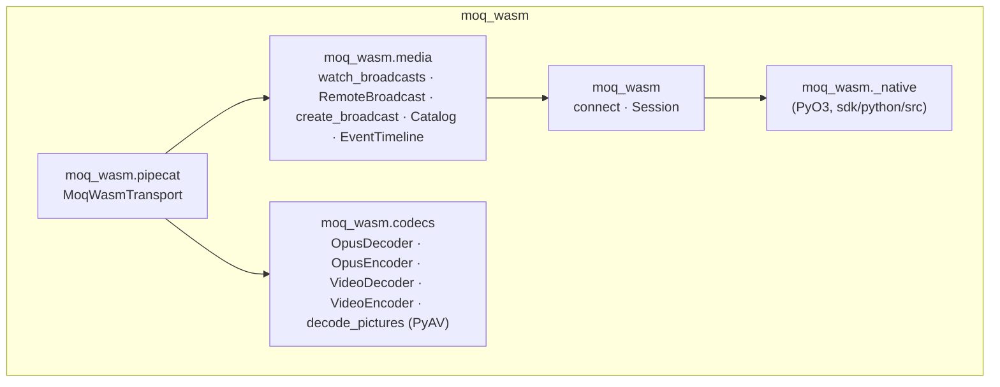

# Design: the Python SDK `moq-wasm`

## Status
Proposed

## Date
2026-11-13

## Scope
Turns the bindings of `sdk/python` ([architecture.md](architecture.md))
into an SDK for bots, like the browser SDK in `sdk/js/js`
([browser-sdk.md](../wasm/browser-sdk.md)): a core layer that keeps a relay
session up, a media layer that follows and publishes MSF broadcasts, and a
pipecat transport. This document fixes the API; its implementation, the
switch of the bots under `examples/python/`, and the release workflow follow
in later changes.

## Context
The bindings expose MoQT requests one to one (`connect`, `subscribe`,
`publish_track`, `watch_namespaces`, `parse_catalog`), named after the
browser SDK's `MoqSession`. Every bot under
`examples/python/` builds the same things on top of them:

| Pattern | Where |
| --- | --- |
| Reconnect two seconds after the session closes, and keep the token fresh meanwhile | `moq_system_one_bot/relay.py` `stay_connected`, and again in the transcriber's `Room.run` |
| Run a task while a namespace is published, and cancel it when it is withdrawn | `moq_system_one_bot/namespace.py`, the transcriber's participant map |
| Subscribe to the catalog with a joining FETCH and pick a track from `parse_catalog`'s dict | the transcriber's and camera detection's `catalog.py` |
| Subscribe again one second after a track ends, because the page that published it left | five places across chat moderation, camera detection, PTZ tracking and the transcriber |
| Write a draft-ietf-moq-msf-02 §8 event timeline | `EventTimeline` and `TranscriptTimeline` |
| Register tracks before `announce`, so a forwarded SUBSCRIBE is not refused | every bot, each with the same comment |
| Race the work against `session.closed()` | every bot |

pipecat ships `MOQTransport`, built on moq-rs. Its catalog and its JSON
streams are moq-rs's own formats, so it cannot talk to this repository's
relay or browser SDK. A pipecat pipeline that wants to use this relay has to
drop the transport and write the subscription code above by hand, as the
transcriber does.

## Decision

### Package
- The distribution is `moq-wasm`, imported as `moq_wasm`, the repository's
  name, like the browser SDK. It does not use WebAssembly; the name follows
  the repository, not the technology. `-python` is left out: a Python
  package is installed by pip or uv, so the suffix says nothing.
- `sdk/python` becomes a mixed maturin project. The PyO3 module is
  `moq_wasm._native` and keeps the bindings of architecture.md. The SDK is
  Python under `sdk/python/python/moq_wasm/`. asyncio's cancellation,
  `async with` and task groups are what the SDK is made of, and they are
  plain in Python and awkward through PyO3. The browser SDK splits its Rust
  and TypeScript the same way.
- The SDK depends on nothing beyond the native module. `moq_wasm.codecs` is
  the `codecs` extra (`moq-wasm[codecs]`), which adds `av` (PyAV, for Opus,
  H.264 and VP8) and `numpy`. The pipecat transport is the `pipecat` extra
  (`moq-wasm[pipecat]`), which adds `pipecat-ai` and the `codecs` extra.
- The package is released on GitHub only, as abi3 wheels for Python 3.11+
  on Linux x86_64, Linux aarch64 and macOS arm64 attached to a
  `python-sdk-v<version>` tag's Release, not marked Latest, which stays on
  the browser SDK's. The version is `[project] version` in `pyproject.toml`,
  which maturin writes into the wheel; the crate's Cargo version is not read.
  A release goes:
  1. PRs do not edit `sdk/python/CHANGELOG.md`; a change a user of the
     package would notice carries its entry in the PR body's
     `## リリースノート（Python）` section. The release PR collects them into
     the version's section and sets the version
     (`.agents/skills/release-python-sdk/SKILL.md`).
  2. `python-sdk-v<version>` is pushed on its merge commit.
  3. `.github/workflows/python-release.yml` stops unless the tag names the
     version and the changelog has its section. It builds each wheel with
     maturin-action on a runner of its platform, the Linux ones in the PyPA
     `manylinux_2_28` image of the runner's architecture rather than through
     maturin's zig cross-compilation: the image's GCC builds the C and
     assembly of `aws-lc-sys` with no other tool, and maturin checks the
     wheel against the manylinux policy. glibc 2.28 is Debian 10 and Ubuntu
     20.04 or later.
  4. The binding tests run against each wheel on Python 3.11, the oldest the
     abi3 wheel takes: the locked test dependencies are installed without
     the project, then the wheel, with a relay and a VTS built from the tag.
  5. The GitHub Release is created with the three wheels and the changelog
     section as its body.

  The release page's asset list is a flat index pip and uv read (README,
  "Install"). The bots in `examples/python` keep building the package from
  the sources at the same commit, so a change to the SDK and the bots that
  use it land together without a release.

### Layers



The same split as the browser SDK's `moq-wasm` and `moq-wasm/media`. What
the demo apps need beyond MoQT stays in `examples/python/`: `BotRoom` and
`serve_rooms`, the temporary-apps service client, the System One clients, and the
pipelines.

### Core: `moq_wasm`

```python
import moq_wasm

async with moq_wasm.connect(url, token=jwt, refresh_token=temporary_apps.refresh) as session:
    ...
```

`connect` returns a `Session`:

- **Reconnection is the native session's.** The native session (the `moqt`
  crate, shared with the browser SDK) follows GOAWAY, and replaces a
  connection that ended without a termination code (a network outage, a
  relay killed and restarted) or, for a session given `refresh_token`, with
  EXPIRED_AUTH_TOKEN, retrying from 0.5 s, doubling up to 10 s, for at most
  60 s
  ([moqt/session-migration.md](../moqt/session-migration.md) "Reconnecting
  after a lost connection"). It sends the namespace subscriptions,
  namespaces and subscriptions again on the new connection; each
  subscription continues from the next group start, and the objects
  published in between are not filled in. The origin, and so the tracks the
  session publishes and their cache, stay. When the native session cannot
  replace its connection, the session ends with `ConnectionLost`, as the
  browser SDK's `MoqSession.closed` resolves; without `refresh_token`, that
  is when the relay closes it at the token's `exp`, since no later token can
  come. It does not dial again: a bot
  whose session ended ends its room, and the page that asked for the room
  asks again. A failure to connect raises from `connect`, as does a relay
  that does not open the transport, or answer CLIENT_SETUP once it is open,
  within 30 s: moqt's deadlines for a first connection (quinn's idle timeout
  or the `wss://` dial's, then `SERVER_SETUP_TIMEOUT`), long enough for a
  relay starting from zero behind a link with a round trip of over half a
  second. The SDK adds no deadline of its own.
- **Token refresh.** `refresh_token` is an async callable that takes the
  current token and returns a later one. The session reads `app_id` and
  `exp` from the token's claims, calls it five minutes before `exp` (halfway
  through a shorter lifetime, so a short-lived token is not refreshed in a
  loop), retries every 30 s, or after half the time left, until the token
  expires, and hands each new token to the relay
  (`_native.Session.refresh_token`). A call that takes over 30 s, or past
  the token's expiry, together with handing its token to the relay fails,
  even when the call caught its timeout and returned a token, and
  a token of another app or one that does not expire later is refused: the
  native session presents the token it is handed on its next connection.
  A token the relay refuses counts as a failed call too: the session keeps
  the token the relay accepted and asks `refresh_token` again with it on
  the same schedule, until that token's `exp`, while the native session
  presents the refused token on its next connection until a
  later one the relay accepts replaces it. Each call of `refresh_token`, and
  each handover, runs in a task of its own: at the deadline the session
  stops waiting for it and cancels it, so a call whose cleanup takes long
  delays neither the retry nor `TokenExpired`, and what it returns later is
  discarded. The task checks the deadline just before it starts the call,
  and the session once the call returned, so a call the event loop stalled
  past its deadline, before it started or while it ran, hands nothing
  over. A call that ends cancelled while the session is not, as one
  awaiting a shared future another task cancelled, counts as a failed call
  and is retried, instead of stopping the refresh. Getting the token stays
  the caller's job, as in architecture.md "Authorization tokens". The
  native session also presents the latest token when it reconnects.
- **Lifetime.** Leaving the `async with` block closes the session; awaiting
  `connect` instead leaves `close()` to the caller. Entering one `connect()`
  result again while it is entered raises RuntimeError before dialing, since
  one exit closes one session. Awaiting one result more than once opens a
  session each time; each refreshes its own token, starting from the
  newest one the session opened before it holds, so neither takes the
  token the other refreshed as not later than its own. Closing cancels the
  session's own tasks, the token refresh among them, and returns once they
  finished, a `refresh_token` call's cleanup included, even one given up
  at its deadline (which is not cancelled again), and the native
  session closed. The refresh ends with the cancellation even when the
  call raises another error from its cleanup, or catches the cancellation
  and returns a token, which is not handed over, and a `close()` the call
  makes from its cleanup returns at once instead of waiting for the
  shutdown that waits for it. A session ends with
  `ConnectionLost`, or with `TokenExpired` when the token expired while
  `refresh_token` kept failing. The failure raises from `async with`, after
  cancelling what runs inside it through `session.run`, which raises
  `SessionClosed` when `close()` ends the session instead. `run` raises the
  failure even when the work returned because of it, as a watch does when
  the session ends, and, called once the session ended, raises what ended
  it without starting the work, after cancelling a task or future already
  scheduled and waiting for its cleanup. `run` returns only once the work finished,
  even when its own caller is cancelled while the work cleans up, so
  nothing the work owns outlives it. The wait covers the work itself, not
  what it started: `asyncio.gather`'s future finishes as soon as one child
  ended cancelled, while the others still clean up, as a broadcast that is
  still withdrawing its namespace, which a reopen right after `run`
  returned would find owned. Several workers therefore run in one
  coroutine that starts them in an `asyncio.TaskGroup`, which waits for
  every child's cleanup and raises a child's failure, as a refused
  request, inside an `ExceptionGroup`: a loop that connects again
  catches every `Exception` with `except*`.
  The three subclass `SessionEnded`, which is no
  `RuntimeError`: a request made after the session ended raises what ended
  it, so the loops that retry a refused request (`RemoteBroadcast.follow`)
  end with it. A read of a `Subscription`, of its groups or of a `Fetch`
  raises it too, a read already waiting included,
  whose native read it cancels: the native iterator would wait until the
  native session gave its connection up, so a reader outside `run`, such
  as `follow()` or `catalogs()`, would outlive
  `close()`. The session's end also cancels the native read a timed-out
  read left for the next one, and drops the item it took as it ends, also
  when no read follows, so no read returns an object once the session
  ended and none is kept. The session holds such an iterator only weakly:
  one dropped while the session goes on is
  collected, and the native read it left is cancelled with it:

```python
async def work() -> None:
    async with asyncio.TaskGroup() as workers:
        workers.create_task(publish())
        workers.create_task(follow())


async with moq_wasm.connect(...) as session:
    await session.run(work())
```

The request methods keep the bindings' shape, which follows the browser
SDK's `MoqSession` in snake_case: `subscribe` (with `filter`, `forward`,
`priority`, `delivery_timeout` in seconds and `group_order`),
`subscribe_current_group` and `subscribe_group_start` (with the same
`priority`, `delivery_timeout` and `group_order`), `fetch` (between two
`Location`s), `track_status`, `watch_namespaces`, `publish_track` (with
`retention_seconds`, `publish`, `datagram` and `priority`, the Publisher
Priority, 128 by default: among the session's tracks, a lower value is sent
first) and `announce`. The native origin keeps a track, with the retention
of its first registration in the session, for the session's life:
`publish_track` of a closed track with that `retention_seconds` continues
it, and one with another raises ValueError before any native call, since
the native origin could not apply it. The native origin also keeps the
delivery a track sent its objects with: registering it again with the other
`datagram` switches a track that has no object yet and raises ValueError,
from the native call, for one that has. The session records the registration
once the native origin registered the track: when it succeeded, when only
its PUBLISH was refused, and, on subgroup streams with the retention the
media broadcast gives it (the newest object for the catalog, 60 s for the
others), for each track a media broadcast registered, or may have, as a
subscriber may take any track its catalog lists: the catalog and the tracks
its sources' configurations listed, those a later configuration replaced
included, as the CMAF sibling of an AAC audio reconfigured as Opus,
recorded as the broadcast is left, before it releases them. A track a
source names but never configures, as the video of an audio-only source,
is not registered, so a later writer
of that name chooses its delivery and retention; a registration the native
call refuses for its arguments, as an invalid `retention_seconds` or the
other delivery, records nothing. A media broadcast refuses, with
ValueError, a track the session last registered in datagrams or first with
another retention than it gives the track: the native broadcast takes the
track as the origin keeps it, without asking for a delivery, so it would
send it in datagrams too, which its subscribers cannot read by group, or
keep another span of its objects for late subscribers. It checks as it
claims the track, in `add_media_source` or `add_rendition`, and again as
it is entered, since a writer may register the track in between. A
`subscribe*`, `watch_namespaces`, `publish_track` or `announce` cancelled
before it returns, as by a timeout, keeps its native request running: once
the relay accepts it, the session unsubscribes, ends the track (PUBLISH_DONE)
or withdraws it, so nothing stays active without an owner, and a later
watch of the prefix, writer of the track or announcement of the namespace
waits for that; leaving a `LocalBroadcast` whose
PUBLISH_NAMESPACE is unanswered waits for it the same way. A
`TrackWriter` has `write` and `write_group`, which return the group id an
object went into when a subscriber took it and are sent one at a time, in
the order they were made; a send that started runs to its end even when
its caller is cancelled, as by a timeout, and the next write waits for it.
A write after the session ended raises what ended it, also
when the session ends while the write waits for the one before, and passes
nothing to the native origin, which would cache it. A writer ends for good
at the first of its `close()`, the session ending, the failure of its
registration and the refusal of its broadcast's namespace, and a media
source at the first of leaving its broadcast, the session ending, that
refusal and a failure of its native publishing: each keeps that one
outcome (`moq_wasm._ended.Ended`), which every method of the handle
consults, so its writes raise what came first and its waits wake on it.
Each raise is a copy of that outcome of the same type, message and
attributes (a `RequestError`'s `code`, a `ConnectionLost`'s `close_info`),
caused by it, as is what a request made
after the session ended raises: raising the one object again would grow
its traceback with every failed write. It has `next_subscriber`, which
takes one caller at a time and keeps a subscriber that came as its caller
was cancelled for the next call,
`registered`, which raises what failed the track's registration (a
registration cancelled, as by leaving its broadcast, raises RuntimeError
there and from the writes: the cancellation is the cancelled task's own,
and no handle ends with one), and
`close`, which ends its subscriptions with PUBLISH_DONE and makes later
writes raise RuntimeError at once, a write waiting behind a stalled send
included; every call returns once the PUBLISH_DONE was sent,
even after one was cancelled. It is final: a registration and a send under
way are waited for and its track ended, `registered()` raises and
`next_subscriber()` returns False, a waiting one included. A track has one
writer in a session: `publish_track`, the broadcast's included, raises
RuntimeError while another writer of the session publishes the track,
until that one's `close()` finished or its registration failed, so
closing an old writer cannot end its replacement's subscriptions. A
writer whose `publish_track` was cancelled keeps the track until the end
of what the relay registered was sent: a later `publish_track` of the
track waits for it, and a broadcast or media source that would publish the
track is refused meanwhile, so that PUBLISH_DONE cannot end their
subscriptions. A track
declared on a `LocalBroadcast` before it is entered stays the broadcast's
own until entering it succeeds, which raises RuntimeError, and publishes
nothing, while another writer of the session publishes one of them, so a
broadcast that could not be entered leaves its tracks free. Until then
the session holds the broadcast's tracks and media sources only weakly,
ending those the app still holds when the session ends, so a broadcast
that could not be entered is not kept alive by the session either. Its
objects carry no extension headers. Leaving a
`LocalBroadcast` closes its writers, each even when withdrawing the
namespace fails, so a handle kept past the broadcast cannot write into a
later broadcast of the same namespace; adding a track or a media source
to a broadcast being left raises RuntimeError. A namespace has one owner
in a session: `announce` or entering a `LocalBroadcast` raises
RuntimeError while another announcement or broadcast of the session
publishes it, until that one finished withdrawing it (its `close()` or
leaving the broadcast finished), so leaving one broadcast cannot end the
next one's subscriptions with PUBLISH_DONE. Leaving runs to its end even
when the caller leaving is cancelled, and leaving again waits for it; a
`LocalBroadcast` is entered once, and entering it again raises
RuntimeError. An
`Announcement` withdraws only the publication it made, and its `close()`
sends the PUBLISH_NAMESPACE_DONE even when cancelled. The session, its
announcements, writers, watches and broadcasts copy the namespace lists
they are given, and the `namespace` of an announcement, a writer or a
broadcast returns a new list each time, and a writer's `name` is
read-only, so a caller changing a list or a name cannot make them withdraw
or end another namespace or track. A `Subscription` iterates its objects,
or its subgroup streams
through `groups()`, whose every call returns the same iterator, whichever
is read first: reading the other raises RuntimeError at once, even while
the first read still waits, as one a timeout cancelled does. One from
`subscribe_current_group` or `subscribe_group_start`, whose native reader
merges the joining FETCH into its objects, is read by object from the
start, so reading its groups raises at once and leaves its objects
readable. It has `largest`, `done()`, `set_forward`,
`set_priority`, `request_new_group`, `end_before_group` and `close`, which
sends the UNSUBSCRIBE at once, as the native `close` does, and returns an
`asyncio.Future` of the caller's own: it resolves once the UNSUBSCRIBE was
sent and raises what failed it, and cancelling it, or awaiting it in a
task that is cancelled, leaves the UNSUBSCRIBE going for the other calls.
`Subscription`, its `Group`s and `Fetch` wrap the native iterators so that
a timeout loses no object: the native read stays with the iterator until a
caller takes its result, so a read cancelled after the object arrived
leaves it to the next read, and a read while another waits raises
RuntimeError, as a `NamespaceWatch` does. An
`Object` carries `group_id`, `subgroup_id`, `object_id`, `status`,
`payload`, its `extension_headers` as `(id, value)` pairs and
`timestamp_micros`, the LOC Timestamp a recorder aligns audio and video
by.

A request that fails raises `RequestError`, as the browser SDK does, with
`message_type` (`"SUBSCRIBE"`, ...), `code`, the draft-14 number of its
error code (`RequestErrorCode` names those of SUBSCRIBE, FETCH and
TRACK_STATUS), and `reason`. It subclasses `RuntimeError`, which the bots
and the media layer catch around their requests. The requests the
browser SDK wraps raise it, as do a refused PUBLISH (`publish_track` with
`publish`) and a media broadcast's refused PUBLISH_NAMESPACE; a refused
SUBSCRIBE_UPDATE, `refresh_token` and a FETCH stream that never arrives
raise a plain `RuntimeError`. A
`ConnectionLost` carries the `CloseInfo` (termination `code` and `reason`)
of the last connection, and `transport_stats()` the bytes the session sent
and received.

### Logs and spans: `moq_wasm.init`

```python
moq_wasm.init(
    log_level="info",
    on_log=on_log,
    on_span=on_span,
    telemetry=moq_wasm.TelemetryOptions(url="https://observability.example", page="my-bot"),
)
moq_wasm.report_log("warn", "my-bot", "room joined", room=room)
```

The native module writes its logs and spans with `tracing`, as the browser
SDK's wasm module does, and installs no subscriber until `init`, the browser
SDK's `init({ logLevel, onLog, onSpan })`:
- **Logs go to `logging`.** Each event at `log_level` or above becomes a
  `logging` record under `moq_wasm.native` and its target with `.` for `::`
  (`moq_wasm.native.moqt.modules.client.routes`), so
  `logging.getLogger("moq_wasm")` configures them with the SDK's own logs,
  at the matching level (`trace` is 5, named `TRACE`), its fields appended
  to the message and kept in `record.moq_fields`. Without `init` no
  subscriber is installed.
- **`on_log` and `on_span`** receive the records in the shape the browser
  SDK's callbacks and the observability server's `/api/client-telemetry`
  take (`crates/telemetry-report`). With `on_span`, the requests a session
  sends carry the span's TRACE_CONTEXT and the answers to the relay's
  requests join its trace (`moqt::set_trace_context_provider` and
  `set_trace_context_joiner` with `telemetry-report`'s functions, as the
  wasm module registers them).
- **No GIL in `tracing`.** The subscriber only queues records, from
  whichever tokio thread logs, in a queue of 4096 that drops and counts
  what overflows (reported as a `log records dropped` warning). A daemon
  thread takes them with the GIL released while it waits, and hands them to
  `logging` and the callbacks, which therefore run on that thread. At exit
  it is stopped before the interpreter finalizes.
- **Tokens.** Each native `Session` and every object it returns (a
  subscription, a fetch, a track writer, a media broadcast with its
  sources and renditions) runs its calls in a `telemetry_report` scope that
  the log sink maps to the session's token, its newest after
  `refresh_token`, as the browser SDK's `SessionScope` does. The tasks
  `moqt::executor::spawn` starts keep the scope they are spawned in
  (`set_spawn_wrapper`), and a span keeps the scope it is opened in, so the
  session's own tasks, its writers' publish tasks and its renditions carry
  it too. What runs outside them (quinn's own tasks, a record of no
  session) goes without a token.
- **`telemetry`** is the browser's `TelemetryOptions` minus the player
  stats, and turns span recording on as `on_span` does: `ClientTelemetry`
  keeps the newest 100 logs and 100 spans per token, for 64 tokens at most
  (a record of another token drops the records of the token queued first,
  and the next flush logs how many it dropped), and posts them every
  10 s to the observability server's `/api/client-telemetry` with
  `service: "python"`, a `clientId` per process and the `page`. At exit
  the sink thread drains the queue (at most 1.5 s), then one last report
  goes out with a 2 s request timeout (at most 3 s). A token the server
  answered 401 to is left out of later reports; the newest 64 such tokens
  are remembered, each by its SHA-256 digest, so the process keeps no
  credential of a session that ended. Each field, after `redact`, is
  queued as a JSON round trip, so a list changed later does not change
  what is sent. A field JSON cannot hold (a NaN or an infinity anywhere, a
  key such as a tuple) is sent as its `str`, since Python's `json` writes
  a bare `NaN` and the server rejects the whole report. It posts with
  `urllib` on a thread of its own, so the module gains no HTTP client.
- **`report_log`** hands the app's own log to `on_log` and `telemetry`, not
  to `logging`, as the browser's `reportLog` keeps it off the console.
- The subscriber is process-wide, so only the first `init` takes effect, as
  in the browser.

### Media: `moq_wasm.media`

```python
from moq_wasm.media import RemoteBroadcast, create_broadcast, watch_broadcasts

async with create_broadcast(session, [root, room, "bots", "transcriber"]) as bot:
    transcript = bot.event_timeline("transcript", retention_seconds=3600)
    status = bot.publish_track("status", retention_seconds=3600)

    async def on_broadcast(remote: RemoteBroadcast) -> None:
        async for catalog in remote.catalogs():
            audio = catalog.select(role="audio", packaging="loc", codec="opus", prefer="lowest_bitrate")
            ...
        async for obj in remote.follow("chat"):
            ...

    await watch_broadcasts(session, [root, room], on_broadcast, empty_timeout=30)
```

- **`create_broadcast(session, namespace)`** publishes the namespace when its
  `async with` block is entered, after the tracks declared on it before the
  first `await`, and withdraws it on exit (PUBLISH_NAMESPACE_DONE, through
  the `Announcement` that `Session.announce` returns). `publish_track`
  and `event_timeline` are synchronous so that a block can declare its
  tracks before anything yields; `published()` waits for the
  PUBLISH_NAMESPACE. When it or the batch's registration fails, the
  tracks still waiting for their registration, those added later and the
  media sources' `keyframe_request()` and `demand_change()` raise the
  failure at once, and every track of the broadcast, one registered before
  the refusal included, raises it from its writes, as the relay takes
  nothing of a namespace it refused; their `next_subscriber()` returns
  False, and the media sources' and renditions' pushes and configurations
  and `remove_track` raise RuntimeError from it. Leaving a block that
  exited normally raises the failure unless one of those, or `published()`, raised it to
  the caller before, so a refused broadcast does not look as if it ran. A
  track added later is registered on its own, and
  what is written to it before that is dropped; once its registration
  failed, its writes raise the failure. `LocalBroadcast.publish_track`
  takes `datagram` and `priority` but not `publish`: the batch is
  registered before the namespace is published, and a PUBLISH must follow
  the namespace. This replaces the register-then-publish rule each bot
  comments.
- **`EventTimeline`** writes a draft-ietf-moq-msf-02 §8 event timeline as
  one group: it opens with an empty record list once the track is
  registered, at once on the writer `Session.publish_track` returned
  registered already, so a joiner finds the opening before the first
  record, and each record is one more object, so a late joiner's joining
  FETCH brings those the track still keeps. `append` waits until the track
  is registered and the opening empty list was written, so a record appended
  as the timeline is added to a published broadcast is not dropped, and
  raises what failed either. An opening that fails, or is cancelled by
  leaving the broadcast while it is sent, closes the track, so nothing is
  appended without it; the broadcast keeps the track until that close
  finished, so leaving it waits for the close and the session may publish
  the track again once it was left. It replaces the two copies.
- **`watch_broadcasts(session, prefix, handler, *, filter=None,
  empty_timeout=None)`** runs `handler` as a task for each broadcast
  published under `prefix` that `filter` accepts, cancels it when the
  broadcast is withdrawn, and runs it again when the broadcast is published
  anew, as `watchBroadcasts` does in the browser. A handler's exception is
  logged. With `empty_timeout`, it returns once no broadcast has been
  published for that long. Like `watchBroadcasts`, it skips the broadcasts
  this session publishes.
- **`RemoteBroadcast`** is one published namespace:
  - `catalogs()` yields a `Catalog` each time the publisher changes it,
    starting from the one the relay holds (a joining FETCH), and skips a
    catalog that does not parse, logging it.
  - `follow(name)` yields the track's objects, and subscribes again a second
    after the track ends or its SUBSCRIBE fails; the handler's cancellation
    ends it.
  - `event_timeline(name)` yields the records of a draft-ietf-moq-msf-02 §8
    event timeline track, starting with those of the group the relay holds
    (a joining FETCH), and subscribes again as `follow` does without
    yielding a record twice. It takes the SUBSCRIBE's `priority` and
    `delivery_timeout`; unlike `follow`, which drops what would arrive more
    than 2 s late as a player does, it has no timeout by default, since a
    chat or an episode track needs every record.
- **`Catalog`** is a typed draft-ietf-moq-msf-02 catalog (`tracks` of
  `CatalogTrack` with `name`, `namespace`, `role`, `packaging`, `codec`,
  `bitrate`, `width`, `height`, `framerate`, `samplerate`, and every field in
  `fields`). `select` picks one track by its fields; `codec="avc1"` matches
  `avc1.42e01f`.
  `parse_catalog`'s dict stays in the bindings.

### pipecat: `moq_wasm.pipecat`

`MoqWasmTransport` takes the place of pipecat's `MOQTransport` in a
pipeline:

```python
from moq_wasm.pipecat import MoqWasmParams, MoqWasmTransport

transport = MoqWasmTransport(
    session,
    MoqWasmParams(
        room=[root, room],
        participant_id="bot",
        audio_in_enabled=True,
        audio_out_enabled=True,
        video_in_enabled=True,
        video_in_sources={"camera": VideoInSourceParams(framerate=10)},
        video_out_enabled=True,
        video_out_codec="H264",
        video_out_width=1280,
        video_out_height=720,
    ),
)

@transport.event_handler("on_client_connected")
async def on_client_connected(transport, participant_id): ...

pipeline = Pipeline([transport.input(), stt, llm, tts, transport.output()])
```

- It is a pipecat `BaseTransport` with `input()` and `output()` and the
  events of `MOQTransport` (`on_connected`, `on_disconnected`,
  `on_client_connected`, `on_client_disconnected`, `on_track_subscribed`,
  `on_error`), so a pipeline changes its import and its params. The session
  comes from `moq_wasm.connect`, which owns the connection and tokens, instead
  of the transport dialing the relay. The input and the output processors
  share one room: the first `StartFrame` publishes the transport's broadcast
  and starts following the participants, and the last `EndFrame` or
  `CancelFrame` withdraws it. `on_connected` and `on_disconnected` mark those
  two moments; `on_track_subscribed` takes a `MoqWasmTrack` (participant id,
  track name, `audio` or `video`).
- **Peers.** Every broadcast one level under `room` is a participant, its last
  namespace element the participant id, followed with `watch_broadcasts`.
  `MOQTransport` follows one peer; a room is what the transcriber, chat
  moderation, camera detection and PTZ tracking serve. `on_client_connected`
  and `on_client_disconnected` take the participant id. The transport's own
  broadcast, `[*room, participant_id]` or the namespace `broadcast` names, is
  not a participant. A `broadcast` such as `[*room, "bots", "chat-moderation"]`
  puts it where the bot service lets its bots publish
  (docs/architecture/bot-dispatcher/architecture.md "Bots in the room").
- **Audio in.** For each participant, the Opus LOC audio track of its catalog
  with the lowest bitrate, decoded and resampled to `audio_in_sample_rate`,
  is pushed as `UserAudioRawFrame` with the participant id as `user_id`. The
  lowest bitrate is the profile the room's viewers already take, so it starts
  no extra encoder in the participant's browser. The track is unsubscribed
  when its audio stops being in the catalog.
- **Video in.** pipecat's video sources name tracks of a participant's
  catalog. `"camera"` is the LOC video track with the lowest bitrate that
  PyAV decodes, or the one `video_in_track` picks; any other source is the
  video track of that name, as an ONVIF camera names its profiles. Each
  group is decoded with a fresh decoder (a group starts at a keyframe), and
  each picture is pushed as an RGB `UserImageRawFrame` with the source in
  `transport_source` and the `Location` of its object in
  `metadata["location"]`, so a bot records a verdict at the picture it
  judged. As in pipecat, `video_in_enabled` receives the sources
  `video_in_sources` lists, each at its framerate or `on_request_only`, as
  each participant joins, and others only when asked for.
  `capture_participant_video` starts one. `release_participant_video`,
  which pipecat's API does not have, stops one: PTZ tracking releases its
  profile when the viewer clears the target, because onvif-ingest serves only
  the profile its first subscriber picks.
- **Image requests.** A `UserImageRequestFrame` pushed upstream is answered
  by the next picture of its `user_id` and `video_source` (`"camera"` when
  unset), with the request in `request`, as pipecat's Daily and SmallWebRTC
  transports answer it; a source not yet received starts being received for
  requests only. A request no picture will answer, for a participant not in
  the room, one who left or a track that failed, gets `{"error": ...}`
  through its `result_callback`. A bot that judges pictures slower than
  they arrive asks for one when it is ready instead of thinning a stream.
- **Two transports.** A bot in two rooms runs a transport for each in one
  pipeline. The input that receives video answers image requests and keeps
  them, and an input without video passes them upstream. pipecat's output
  passes every transport message on, so the other output writes the ones for
  its tracks; an urgent one it does not write is passed on as well.
- **Data tracks.** The objects of `data_in_tracks` (a camera page's
  `prompt`, a chat) are pushed as `InputTransportMessageFrame`s carrying a
  `MoqWasmTrackMessage` (participant id, track, payload, `Location`), as
  pipecat transports push a client's app messages. An
  `OutputTransportMessageFrame` carrying a `MoqWasmTrackObject` writes an
  object on one of `data_out_tracks`, and one carrying a
  `MoqWasmEventRecord` appends a record to one of `event_timelines_out`;
  both are tracks of the transport's broadcast, each with the seconds it
  keeps for FETCH. Other messages, such as RTVI's, are logged and dropped.
- **Room lifetime.** With `empty_timeout`, `on_room_empty` fires once no
  participant has been in the room for that many seconds, and the transport
  stops following it. A participant's catalog is read again a second after it
  ends or its SUBSCRIBE fails, as when the publisher has not written it yet,
  until the participant leaves.
- **Audio and video out.** `OutputAudioRawFrame` is encoded to Opus and
  `OutputImageRawFrame` (`RGB`, `RGBA`, `BGR` or `BGRA`) with PyAV to
  `video_out_codec` (`"H264"` by default,
  the codec the browser SDK publishes; `"VP8"` is royalty-free), at
  `video_out_width`, `video_out_height` and `video_out_framerate`, all
  fields of pipecat's `TransportParams`. Both are pushed into the transport's
  broadcast, so the browser plays it with `RemoteBroadcast`. The encoder
  makes a keyframe every two seconds, and on `MediaSource.keyframe_request`
  (a NEW_GROUP_REQUEST). Timestamps
  are wall-clock microseconds that follow the previous frame by its
  duration. `write_audio_frame` waits while the speech written so far runs
  more than 100 ms ahead of the clock, as `MOQTransport` paces its own, so
  an interruption stops speech the browser has not yet received.
- **A pipeline per participant.** A voice activity detector must hear one
  speaker, so a bot may run a pipeline per participant.
  `MoqWasmParticipantInput(broadcast, MoqWasmInputParams(...))` is the input
  of one `RemoteBroadcast`: it picks, decodes and pushes the tracks as the
  transport's input does, with the same `on_track_subscribed`, and publishes
  nothing. A failed track is pushed upstream as a non-fatal `ErrorFrame`, the
  way pipecat processors report errors: `on_error` belongs to pipecat's
  `FrameProcessor`. The bot follows the room with
  `watch_broadcasts`, starts a pipeline in each handler task (cancelled when
  the participant leaves), and publishes with `create_broadcast`.
  `MoqWasmParams` extends `MoqWasmInputParams` with the room.
- **Codecs are the transport's job.** pipecat's frames carry raw audio and
  pictures, and each transport encodes and decodes with its own stack (the
  Daily and LiveKit SDKs natively, `SmallWebRTCTransport` through aiortc and
  PyAV). `MoqWasmTransport` does it with PyAV through `moq_wasm.codecs`,
  which a bot running its own pipeline (one per participant, or with the
  location of each picture) uses too. `decode_pictures` turns a video
  track's objects into pictures with the `Location` of each, a decoder for
  each group and at most one every `interval` seconds.
- **Left out.** `MOQTransport`'s serve mode (the bot accepts sessions
  without a relay; the bindings have no server side) and its RTVI
  transcript stream.

### The bots in this repository
- Camera detection runs on `MoqWasmTransport`: it reads the camera page's
  `prompt` from `data_in_tracks`, asks for the camera's picture with
  `UserImageRequestFrame` while fewer than eight are being judged, and
  appends each verdict, at the picture's Location, to `event_timelines_out`.
- The Meeting transcriber runs a pipeline per participant on
  `MoqWasmParticipantInput`, so that its voice activity detector hears one
  speaker, and publishes under `{root}/{room}/bots/transcriber`, two levels
  down, so the Meeting lists no participant for it.
- PTZ tracking runs a transport for the page's room and one for
  onvif-ingest's in one pipeline. It reads the viewer's prompt from the
  first, asks the second for pictures of the profile the prompt names, and
  releases the profile with `release_participant_video` when the target
  leaves it; it writes its event timeline and status on the first and the
  camera's commands on the second.
- Chat moderation runs on `MoqWasmTransport` without media: it reads the
  chat page's `chat` from `data_in_tracks` and appends each verdict, at the
  message's Location, to `event_timelines_out`.

### Publishing media: `_native.MediaBroadcast`
The browser SDK encodes with WebCodecs and hands the encoded samples to
`sdk/js`'s `MediaBroadcast`, which wraps `broadcast::Broadcast`: the
MSF catalog, the LOC tracks with their Timestamp property
(draft-ietf-moq-loc-04), the media timeline, the cache for FETCH and the
NEW_GROUP_REQUEST callback. The bindings gain the same wrapper over the same
crate, so Python writes no catalog or LOC header of its own. The media layer
uses it through `LocalBroadcast.add_media_source`:

```python
async with create_broadcast(session, [*room, "bot"]) as bot:
    status = bot.publish_track("status")
    media = bot.add_media_source(video="video", audio="audio", label="bot")
    media.configure_video("avc1.42e01f")
    media.configure_audio("opus", sample_rate=48000, channels=1)
    await bot.published()  # frames pushed before the namespace is published are dropped
    media.push_video(annexb, timestamp_micros)  # one access unit; a keyframe opens a group
    media.push_audio(packet, timestamp_micros)
    await media.keyframe_request()  # a subscriber asked for a new group
```

- `_native.Session.media_broadcast(namespace)` builds a `broadcast::Broadcast`
  on a `RelayConnection::with_session` that shares the session's origin, and
  the session's event loop passes each event to these connections before the
  origin (architecture.md "One event loop per session"). The tracks a bot
  writes itself (`publish_track`, `event_timeline`) stay in that origin and
  are answered as before; they are not listed in the catalog. The tracks
  the media broadcast publishes (the catalog, each source's video, audio
  and `<video>_timeline`, each rendition's `<video>_<name>`, with `cmaf`
  their `_cmaf` siblings, and the tracks `broadcast::build_catalog` lists
  next to them on its own: the `chat` while a source has the default
  `video` or `audio`, and an `audio` placeholder while one has the default
  `video`, both ended with PUBLISH_DONE once the catalog no longer lists
  them, as when the default audio is removed) share the session's
  one-owner-per-track rule with the writers; the sources share those two,
  and a source's own `audio` takes the place of the placeholder, which
  another source's track named `audio`, as its video, does not, in either
  order: a writer, source or rendition named as one of
  them raises RuntimeError, before anything is published, until the
  broadcast was left, so a raw writer cannot reach the catalog's
  subscribers or end their subscription. A source's `video` and `audio`
  and a rendition's `name` are read-only, as a writer's `name` is, so
  renaming one after its tracks were claimed cannot move it onto a track
  another owner publishes.
- A broadcast with a media source is published by the media broadcast's
  `announce` instead of `Session.announce`, so the namespace is published
  once. Leaving the block withdraws the namespace and closes the media
  broadcast: its tracks are no longer answered, each is removed from the
  catalog after the media pushed before, which ends it with PUBLISH_DONE,
  the catalog track ends too, and later frames are dropped. The binding
  then drops every writer of the broadcast, the last holders of its
  `RelayConnection`, whose catalog refresh would otherwise keep resending
  the old catalog into a later broadcast of the same namespace.
- A source's options are checked as they are given: a bitrate, framerate,
  sample rate or channel count the native broadcast would refuse, such as
  a negative one, raises ValueError from `add_media_source`,
  `add_rendition` or `configure_audio`, and an option of a type it would
  refuse, such as a float framerate, a name that is no string or a `cmaf`
  that is no bool, raises TypeError, before anything native is built.
  A media broadcast that fails while it is being built, after a source
  built before may have published the namespace with its catalog, is
  closed, then withdrawn (PUBLISH_NAMESPACE_DONE), and a later publication
  of the namespace waits for that. A built source publishes on its own,
  from its media configuration, and closing waits for that publication and
  ends it: a withdrawal sent while it is under way would leave the
  namespace published, or leave the source's PUBLISH unanswered by the
  relay and the close waiting for it until the session ended.
- `keyframe_request()` is awaited rather than registered as a callback, the
  asyncio form of the browser SDK's `on_keyframe_request`. It and
  `demand_change()` raise RuntimeError once the broadcast was left or the
  session ended, so a loop awaiting them ends. Each takes one caller at a
  time, so no two callers take the same answer: a call while another
  waits raises RuntimeError, and an answer that came as its caller was
  cancelled goes to the next caller.
- A push returns whether the native source took the frame: False for one
  dropped, before the broadcast was published, after it was left or once
  the session ended, so a caller such as the pipecat transport does not
  take it as sent. Published means the relay accepted the namespace: the
  native source is built, and takes the configurations its catalog lists,
  as the namespace is requested, but a push reaches it only once the
  relay answered, since the media of a namespace the relay refuses would
  be lost; once the session ended, a push is dropped before it reaches
  the native source, which may still queue it with nothing left to send
  it. A video push, the source's or a rendition's, is False for a frame
  without a picture, as an H.264 access unit without NAL units, which the
  demuxer reads into no sample and nothing publishes, or an H.264 or H.265
  access unit without a slice (an access unit delimiter or parameter sets
  alone), whose sample the bindings drop after the demuxer kept its
  parameter sets for the keyframes after it. A push is also False for a
  frame the queue drops while the relay does not keep up: the source's
  publish queue and a rendition's queue are bounded, and drop video up to
  the next keyframe that fits, which `keyframe_request()` asks for. A
  frame or configuration the native source refuses as the session ends is
  dropped with a warning. One it refuses while the session is live
  means its publishing failed for good: the push or configuration raises
  that RuntimeError, and so do later pushes and configurations,
  `add_rendition`, the source's renditions' configurations and pushes,
  `remove_track()`, `keyframe_request()` and `demand_change()`, so the
  application, and the pipecat transport's writes, see it instead of a
  source that looks healthy.
- `configure_video` takes the codec of a codec string, its first element;
  the catalog lists the codec string of the configuration the keyframes
  carry, such as an H.264 SPS. `VideoEncoder.codec_string` names the same
  profile and level, which the encoder picks as x264 does (the lowest that
  takes its size and framerate) and writes into its SPS.
- The source's methods are the browser SDK's `MediaSource` in snake_case,
  minus what WebCodecs does there:

  ```python
  media.configure_audio("mp4a.40.2", 48000, 1, description=audio_specific_config)
  media.push_audio(frame, timestamp_micros, level=30, voice_activity=True)
  low = media.add_rendition("low", label="180p", bitrate=200_000)
  low.configure_video("vp8")
  low.push_video(packet, timestamp_micros)  # the same picture as a video frame
  ```

  A rendition is a `Rendition` object rather than the browser's index
  (`addRendition` returns one, `configureRendition(index, ...)` and
  `pushRenditionVideo(index, ...)` take it): the caller encodes each
  rendition itself and pushes its frames, with keyframes on the same
  pictures as the video's; `keyframe_request()` asks for them too. A
  rendition joins the video's switching set, so one in another codec (VP8
  beside H.264) is an alternative in the same catalog `altGroup`, as the
  browser's multi-codec renditions are. AAC needs its AudioSpecificConfig,
  as WebCodecs' `description`; `level` is the LOC Audio Level property.
- `add_media_source(..., cmaf=True)` also sends the video, its renditions
  and AAC audio as CMAF in `<track>_cmaf`, as the browser's
  `addSource({ cmaf })` does. The video, its renditions, their CMAF
  siblings and the audio are published on demand, as every browser source
  is, and `await media.demand_change()` returns each change as a
  `Demand(track_name, wanted)` (the browser's `on_demand_change`); the
  caller can stop encoding a track nobody takes. A change replaces the
  unread one of its track, so a caller that reads late holds one change per
  track rather than every transition. `on_demand=False` keeps a
  source's tracks sent with no subscriber, for a track that should stay in
  the relay's cache, FETCHable, while nobody takes it.
- `await media.remove_track("video" | "audio")` is the browser's
  `removeTrack`: it ends the track with PUBLISH_DONE, the video's renditions
  with it, and sends the catalog without them. The caller stops pushing that
  kind first; configuring it again and pushing republishes it. The
  native removal, which removes the renditions after the video, runs to
  its end even when its caller is cancelled, as by a timeout, and a call
  while it runs awaits it, so no rendition stays in the catalog.

Encoding stays in Python with PyAV, through `moq_wasm.codecs`.

### No codec in the wheel
The `moq-wasm` wheel holds this repository's code (MIT) and Rust crates
under permissive licenses, and no codec: it packs encoded H.264 and Opus
into LOC objects and never encodes or decodes them. Encoding and decoding go
through PyAV, which the user's pip or uv installs from PyPI for the
`codecs` extra, and so for the `pipecat` extra. PyAV's wheels are built with libx264 and libx265, so they
are under the GPL, and H.264 is covered by patents (the Via LA AVC pool) for
encoders and decoders alike. Keeping codecs out of the wheel keeps both out
of what this repository distributes. The SDK's documentation tells its
users to check them before they distribute PyAV with their app (an image,
an installer) or charge for the H.264 video they serve. Bundling FFmpeg
into the wheel to spare users the install would bring both into the
release, and is not done.

## Consequences

### Positive
- A bot is its pipeline and its app logic; the relay session, presence,
  catalogs and resubscription are written once.
- A pipecat pipeline reaches this relay and the browser SDK by swapping its
  transport.
- Python and the browser publish media through the same `broadcast` crate,
  so their catalogs and LOC tracks cannot drift apart.

### Negative
- The import changes from `moqt` to `moq_wasm` in every bot.
- An outage longer than the native session's 60 s ends the session, and the
  bot's room with it.
- The `pipecat` extra follows pipecat's transport API, which pipecat may
  change in a minor version.

## Alternatives Considered

### Write the SDK in Rust with PyO3
One language, but each task group, cancellation and `async with` would be
written against asyncio through PyO3, and the pipecat transport subclasses
pipecat's Python classes anyway.

### Name the distribution `moq-wasm-python`
Tells it apart from the browser SDK in the name, but a Python package
installed by pip says it is Python already, and the Release tag tells the two
apart.

### One peer per transport, as `MOQTransport`
Matches `MOQTransport`'s params exactly, but every bot here serves a room, so
each would run one pipeline per participant and merge their output itself.

### Dial again after the native session ends
The SDK dialed again from 1 s, doubling up to 30 s, without a limit, and
registered the tracks, published the namespaces and watched the prefixes
again on the new session. It kept a bot through an outage longer than 60 s,
but retried forever, while no page waits that long for a bot; it rebuilt
what the native session already carries over, and it differed from the
browser SDK, whose session ends there.

### Keep the building blocks in `examples/python/moq-system-one-bot`
They work for the bots in this repository, but a bot outside it would copy
them, and the pipecat transport needs them too.
