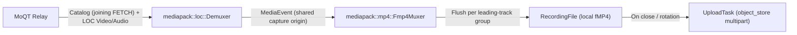
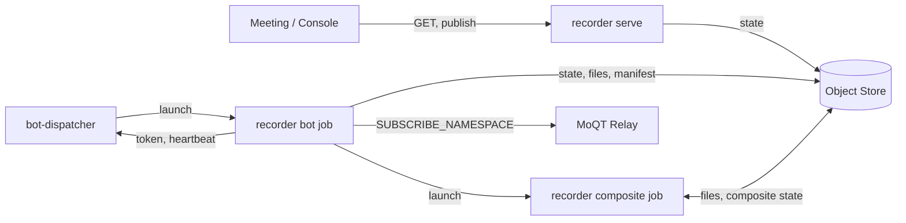

# `recorder` Architecture

## Status
Living document. Update alongside any change to track selection, muxing flow, archive format, or invariants.

## Scope
`services/recorder` subscribes to MSF broadcasts through a MoQT relay (following `crates/broadcast`'s layout; see [`crates/broadcast/README.md`](../../../crates/broadcast/README.md)) and persists them as:
- **Fragmented MP4** (default): combined audio+video file, or `--layout per-track` (one file per track); `--upload` uploads closed files to an object store.
- **Experimental MoQ archive** (`--archive` or room API `format: "moq"`): stores raw catalogs, selected LOC media, and meeting/robot event timelines without muxing, and replays finished archives as MSF VOD via `POST /recordings/{id}/publish`.

This crate is independent of the relay's disk cache (`RELAY_DISK_CACHE_DIR`); when disk cache is enabled, `--from-cache` reaches back as far as the relay retains.

## Why LOC Tracks (Not CMAF)
CMAF siblings only exist for AAC audio, split audio/video into separate single-track files, and run on demand (cold path). LOC tracks are always published and carry all codecs: `mediapack::loc::Demuxer` → `mediapack::mp4::Fmp4Muxer` writes both tracks into one init segment and fragment stream.

## Live Recording Flow

1. **Connect (`relay::RelayConnection`)**: Opens one `Endpoint<NATIVE>` session (QUIC/WebTransport) with `follow_go_away`, preserving IDs across relay drains ([`moqt/session-migration.md`](../moqt/session-migration.md)).
2. **Catalog & selection (`broadcast::CatalogReader`, `broadcast::selection::select_tracks`)**: Subscribes to `catalog` via `subscribe_current_group` (joining FETCH offset 0, MSF §5) and parses with `msf::Catalog::parse` (rejecting unsupported versions, delta updates, invalid catalogs per §5.1.1, §5.1.6, §5.2). Uses `--video-track`/`--audio-track` if given; otherwise picks tallest recordable video ≤ `--max-video-height` (default 720; shortest if all taller; tie-break lowest bitrate, then first listed) and highest-bitrate decodable audio (H.264/H.265/VP8/VP9/AV1; AAC with `initDataList`/`initRef`, Opus, G.711 A-law, MP3). `--list-tracks` prints `track_list::track_table` and exits.
3. **Subscribe**: Video uses `relay::subscribe_group_start` (fetches current group or requests new group if ≥ 60 objects in) so recording starts on a keyframe; audio uses `LargestObject` (`relay::subscribe_audio`). With `--from-cache`, video also uses `LargestObject` after a standalone FETCH `{0, 0}` through `SUBSCRIBE_OK`'s Largest Location per track (live objects buffer via QUIC flow control, joining seamlessly).
4. **Mux (`recording::Recording`, `pipeline::Pipeline`, `file_writer::RecordingFile`)**: Converts `TrackObject` → `LocObject` → `loc::Demuxer` → `Fmp4Muxer`, emitting one combined `Streams { has_video, has_audio }` so the init segment waits for all file tracks.
5. **Flush & end**: Flushes whenever the leading track (video if active, else audio) advances to a new group (each video group is a complete GoP on disk). Ends when catalog and all media tracks finish (`PUBLISH_DONE` ends tracks 10 s later in `moqt` after late streams).

## Sources & Dynamic Tracks

### Sources
Broadcasts can hold multiple sources (e.g., camera + screen share), grouped by `renderGroup` (msf-02 §5.2.12; ungrouped tracks form one source; renditions share `altGroup` §5.2.13). Because `broadcast` renumbers `renderGroup` per catalog, `broadcast::selection::SourceChoice` re-identifies sources on every catalog:
- **Camera (`Content::Camera`)**: Source listing a track named `video`, `audio`, `video_<rendition>`, `camera`, or `camera_<suffix>` (for non-meeting broadcasts without an event timeline, such as `ingest-gateway pull`, takes the first source).
- **Screen share (`Content::ScreenShare`)**: First source listed besides the main one.
- **Retention**: A recorded track stays only while still listed under its kind (`broadcast::selection::keeps`).

### Tracks that come and go
`record_live` polls catalog updates ahead of media so initial catalogs take effect before the first object:
- **Late audio / mute & unmute**: Recording starts with video alone if audio is absent or lacks AAC `initRef`. When audio disappears from the catalog (mute) or ends, `record_live` drops the subscription immediately (without waiting 10 s for `moqt`'s `PUBLISH_DONE` grace, so quick unmutes resubscribe cleanly). When audio returns, `Recording::add_audio` appends to the same file if config matches (decode times from capture timestamps preserve sync across silence), or rotates at the next keyframe (combined) / immediately (per-track).
- **Camera off / on**: Dropping video from the catalog stops only the video subscription while audio leads the file (flushing per audio group and rotating segments on audio frames). Participants joining camera-off start from audio (setting capture origin). When video returns, same config continues in-file (last pre-gap frame holds across the gap); new config—or first video in an audio-only combined file—starts a new numbered file at that keyframe. Per-track files keep the first track's filename.

## Key Invariants & Upload

### Key Invariants
- **Single capture timeline**: `Recording` anchors `with_capture_origin` on the first video object's capture timestamp (or first audio object if video-free). Audio arriving early waits up to `MAX_PENDING_AUDIO` (~10 s; oldest dropped); audio captured before origin is dropped so it never clamps to PTS 0.
- **Immutable init segments**: Any `VideoConfig` or `AudioConfig` change finishes the current `Fmp4Muxer` and rotates to a new numbered file.
- **Keyframe-aligned segments**: `--segment-seconds` rotates on the first keyframe (or audio frame if audio-only) past the duration. PTS is never rebased so segments stay concatenatable.
- **Crash-safe & non-destructive**: fMP4 is valid at every flush (at most the last video sample is lost on kill). Files open with `create_new` (never overwrite). `RelayConnection::close` awaits `Session::close` so `CONNECTION_CLOSE` reaches the relay.

### Upload (`--upload <URL>`)
Builds an `ObjectStore` via `object_store::parse_url_opts` + env credentials ([object_store.md](object_store.md)). Writes locally first and only uploads closed files (avoiding unreadable partial multiparts and network backpressure on recording):
- `UploadTask` streams closed files sequentially via `object_store::buffered::BufWriter`, deletes local copies on success, keeps failed files on disk with an `ERROR` log, and drains on exit.
- Key format: `<url path>/<namespace>[/screenshare]/[<track>/]<start_unix_ms>-<segment_index>.mp4` (`<track>` omitted for combined).
- No object attributes (keeps `file://` and `gs://` identical); `capture_origin_us` goes into room `manifest.json` (logged for single recordings).

## Recording API

`bot-dispatcher` starts/stops room recordings (`recorder bot`), which in turn launch composites (`recorder composite`); `recorder serve` (`api_server::ApiServer` on `http_server::HttpServer`; [hyper.md](hyper.md)) is a stateless HTTP read/replay API sharing state through `--store` (`gs://` or `file://`).

### Single-Writer Store Layout (`store::RecordingStore`)
Each object has one writer, requiring no database or CAS (identical on `file://` and `gs://`; `bot-dispatcher` enforces 1 recording per room). Namespace prefixes are percent-encoded into one path segment so `anon/a` and `anon/a/b` never nest:

| Object | Writer | Holds |
| --- | --- | --- |
| `state/<id>.json` | Recording job | `RoomRecord` (id, prefix, layout, format `mp4`/`moq`, composite flag, state, members, `updated_at_ms`) |
| `state/<id>.composite.json` | Composite job (or recording job on launch failure) | Composite status |
| `rooms/<prefix>/<id>` | Recording job | Empty marker for per-room listing |
| `<app>/<id>/<namespace>/...`, `<app>/<id>/manifest.json` | Recording job | Uploaded files and manifest (`files`, `screen_share_files`, `capture_origin_us`) |

### Room Recording Behavior (`room_recording::record`)
- Ignores `<room>/recordings/<id>/` (replays) and `<room>/bots/` (except MoQ archives also record `<room>/bots/transcriber` and `<room>/bots/policy` without counting them as room-keepers).
- Runs two `record_broadcast` tasks per participant (camera + optional screen share), rejects forwarded `PUBLISH` with `UNINTERESTED`, handles GOAWAY re-announcements idempotently, and syncs state at least every 30 s (`StateSyncTask`; API marks jobs silent > 90 s as `failed`).
- Stops on `bot-dispatcher` stop, `SIGTERM`/`SIGINT`, `--max-seconds`, or `--grace-seconds` with no active participant (participants count up to 10 s past `PUBLISH_DONE`).
- Stays `starting` until the relay accepts its `SUBSCRIBE_NAMESPACE` for the room and `PUBLISH_NAMESPACE` for its presence; a stop before then moves it to `stopping`. The heartbeat reports `running` while `starting`.

### Auth, Listing & Signed URLs
- Every request verifies its Bearer token via `AUTH_VTS_URL` (`subscribe` claim must cover room element-wise; `--insecure-skip-auth` bypasses for local dev). Replays forward the caller's token (`relay::ServiceToken`, renewed via `--temporary-apps-url` for temp apps). Tokens are never persisted.
- `GET /apps/{app}/recordings` lists MP4 recordings with uploaded files under `<app>/`. `GET /recordings/{id}/file?name=` returns a 15-minute GCS V4 signed URL (signed lazily via IAM `signBlob`, requiring `iam.serviceAccounts.signBlob` on self).
- `POST` checks `Origin` against `--allowed-origin` (blocks preflight-free `text/plain` CSRF). Relay URL and store are server-pinned.

## MoQ Archives & Replay

### Archiving (`format: "moq"`)
- Records camera (including cataloged event timelines like `chat`), screen-share, transcriber, and robot `policy` archives as immutable payload chunks + JSON indexes straight to the object store (no local copy). Archive manifests index chunk object/Timestamp ranges and group starts.
- **Single recording clock (`RecordingClock`)**: Rewrites wall-clock LOC Timestamps into media time since `started_at_ms` (`Timescale = 1_000_000`, loc-04 §2.3.1.2) and event timeline `T` → `M` (msf-02 §8.2), dropping pre-start groups/events. Draft-14 extension encoding drops objects with draft-18 extension values ≥ 2^62 (`WARN`).
- **Config/track switches**: Swapping a track or changing codec/config after media was stored closes the archive and starts `camera-<n>` / `screenshare-<n>` so each archive holds one track per kind (preserving `altGroup` time alignment §5.2.13).
- **Integrity**: Identical duplicate objects keep the first payload; conflicting duplicates or any subscription/task/upload error fails the entire MoQ recording (unlike MP4, which skips failed participants). Room manifest is written last.

### VOD Replay (`POST /recordings/{id}/publish`, `replay::ReplayTask`)
- **HTTP stream & namespaces**: Accepts finished MoQ archives (`409` on MP4), returns a long-lived NDJSON stream (`{namespace_prefix, renew_after_seconds, started_at_ms}` + 15 s empty keepalive lines), and announces `<room>/recordings/<id>/<member>/<content>/<session-index>` (`camera` / `screen_share`, skipping empty archives and transcriber namespace).
- **Serving FETCH & SUBSCRIBE**: `StoredRecording` validates chunk checksums before `FETCH_OK` (reads selected chunks twice; max 4 concurrent FETCHes per replay, queueing extras). Accepts `LargestObject` `SUBSCRIBE` (answers last location, delivers nothing; Joining FETCH resolves against it).
- **Cloud Run leases (`ReplayLease`)**: Replay stays live while at least one `publish` HTTP stream is open (keeping CPU allocated on Cloud Run; `--max-replays` caps per instance). `renew_after_seconds` (45 min for 60 min Cloud Run timeout) tells `moq-wasm/recording`'s `openRecording` when to open a replacement stream (overlapping 60 s so the relay shifts FETCHes to the newest publisher).
- **Player**: `examples/browser/examples/recording-player` uses `openRecording` + `SUBSCRIBE_NAMESPACE` + `LivePlayer` inside one `PlaybackGroup` ([`wasm/browser-sdk.md`](../wasm/browser-sdk.md), 「録画を `LivePlayer` で再生する」).

**Deterministic VOD synthesis (`vod::build_tracks`)** — rebuilt strictly from stored objects so concurrent replay instances are byte-identical (draft-14 §2.1 / §8.2):
- **Catalog** (`{0, 0}`): `isLive: false` (§5.2.8), `trackDuration` (§5.2.36), `isComplete: true` (§5.1.3), single unified `renderGroup`, no `namespace`/`targetLatency`/`generatedAt`.
- **Media timelines** (`{0, 0}`): One entry per stored group (floored ms, wallclock `0` §7.1.1).
- **Transcripts** (`{0, 0}`): Split from `<room>/bots/transcriber` by speaker and served as each speaker's camera `transcript` track (`packaging: eventtimeline`, `role: subtitle`, `eventType: io.skyway.research.moqt.transcript.v1`, `depends`: namespace media timelines), deduplicated and sorted by `M`.

*Open questions for MoQ archives*: common-clock error bounds, retention, partial viewing, chat/transcript edit/delete, MP4 export from archives, and cost vs. per-participant MP4.

## Composite, `bot-dispatcher` & Token Refresh

- **Composite (`"composite": true`)**: After recording ends, launches `recorder composite --id <id>` via `--launcher`. Downloads manifest files into `--work-dir/<id>/`, computes speaker loudness (`transcode::Loudness`), shifts samples to the room's earliest `capture_origin_us`, composites active speaker / screen share + strip + mixed audio (`transcode::Compositor`), uploads `<app>/<id>/composite.mp4`, and cleans up. States: `waiting` → `composing` → `done` | `skipped` | `failed`.
- **`recorder bot` (`bot-dispatcher` integration)**: Runs via `bot_job::run`, authenticates to `bot-dispatcher` with `BOT_DISPATCHER_BOT_KEY` (local) or Google ID token (`google_cloud::identity_token`), fetches/renews bot tokens (`POST /bots/{type}/{id}/token`), announces `<room>/bots/<type>`, and heartbeats every 5 s (`StateSyncTask`, attaching `output: {"recording_id": "<id>"}` once initial recording state is written; omitted on pre-recording failure).
- **Token refresh (`TokenRefreshTask`)**: Polls `TokenRenewal` (`File`, `Issuer`, `BotDispatcher`) every 10 s (renewing 5 min before expiry), updates the shared `AuthorizationTokenSource` cell, and sends relay in-session refresh (`TRACK_STATUS` `[app_id]` / `update_auth_token`; [`relay/architecture.md`](../relay/architecture.md) "Token refresh").

## Limits

**Media & codecs**
- `--from-cache` spans at most relay + publisher cache (60 s for `broadcast`); mid-group cache starts drop video until the next keyframe.
- Unsupported audio codecs (outside AAC/Opus/A-law/MP3) are ignored; unsupported initial video codecs abort recording (if added later, logged and skipped).
- Late-added audio starts at the next keyframe in a new file (prior audio lost); audio-first combined recordings start with a short audio-only file until the first video keyframe.

**Recording & composite**
- Screen-share detection relies on default camera track names (`video*`/`camera*`/`audio`); at most one non-main source is recorded as screen share.
- Failed room recordings skip compositing (`skipped`); crashed composite jobs stay `composing` (no heartbeat).
- Single `--upload` recordings write no manifest; participant device clock skew shifts composite alignment.
