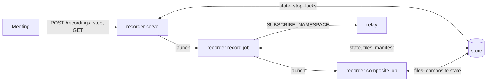

# `recorder` Architecture

An experimental archive is available with `--archive` and with the room API's
`format: "moq"`. It stores catalogs, selected LOC media and available meeting
event tracks without muxing. Closed data and index chunks are uploaded before
their manifest. `POST /recordings/{id}/publish` replays a finished archive
through the relay as MSF VOD broadcasts. The separate experimental archive
player handles a local single-broadcast JSON Lines file.

## Status
Living document. Update this file in the same change whenever the track
choice, the muxing flow or the file rules described here change.

## Scope
`services/recorder` is a subscriber: it joins an MSF broadcast through a relay
and writes what it receives to local disk as fragmented MP4: one file holding
the video and the audio track, or with `--layout per-track` one file per
track. With `--upload` it moves every closed file to an object store. It knows the catalog (`msf`), LOC objects and
the fMP4 muxer (`mediapack`) and the client side of `moqt`; it owns no track
layout of its own and follows the one `crates/broadcast` publishes (see
[its README](../../../crates/broadcast/README.md)).

It is the first half of persisting what flows through a relay. The second
half, the relay spilling its object cache to disk and answering FETCH from
there, is a relay change and does not depend on this crate; once it exists,
`--from-cache` reaches back as far as the relay keeps.

## Why the LOC tracks and not the CMAF siblings
The CMAF siblings are already fMP4, and copying their fragments into a file
would need no media code. They were not chosen because they exist for AAC
audio only, each sibling is a single-track file so audio and video would end
up in two files, and a `broadcast` publisher sends them only while someone
subscribes, which is the cold path. The LOC tracks are always published and
carry every codec; `mediapack::loc::Demuxer` turns them into the same media
events the publishers started from, and `mediapack::mp4::Fmp4Muxer` writes
both tracks into one init segment and one fragment stream.

## Flow
1. `relay::RelayConnection` opens one session; the URL scheme selects QUIC
   or WebTransport (`Endpoint<NATIVE>`), as `broadcast` does on the publishing
   side. The session follows the relay's GOAWAY (`follow_go_away`): when the
   relay drains, every subscription moves to the relay it names, keeping its
   ids, and the files continue without a gap (see the `moqt` architecture,
   session-migration.md).
2. `catalog_reader::CatalogReader` subscribes to the catalog first with
   `Subscriber::subscribe_current_group`: the SUBSCRIBE and joining FETCH
   (offset 0) draft-ietf-moq-msf-01 §5 asks for, read through one
   `TrackReader` that yields the current group before the live objects, or
   only the live objects when the publisher has sent none yet.
   `track_selection::select_tracks` picks the LOC track named by
   `--video-track` and `--audio-track`. Without a name it takes the tracks
   of one source (see "Sources") by their catalog role and quality fields
   instead of guessing names the publisher chose: among the source's video
   tracks whose codec can be recorded, the tallest at or below
   `--max-video-height` (720 by default; the shortest when all are taller),
   then the lowest `bitrate`, and the source's audio track with the highest
   `bitrate` among those that can be decoded; remaining ties go to the track
   listed first. A meeting participant encodes a rendition only while it has
   a subscriber, and the recorder's SUBSCRIBE counts, so a 720p rendition no
   viewer watches is encoded for the recording alone. The limit is the same
   for every source, and 720 keeps a shared screen's text legible. Audio
   takes the highest bitrate, which viewers start on as well, and Opus is
   cheap to encode. The video codec
   comes from the catalog's `codec`, a WebCodecs codec string naming H.264, H.265, VP8, VP9 or AV1,
   the audio codec from its `codec`, `sampleRate` and `channelConfig`, and an AAC track's
   AudioSpecificConfig from the `initDataList` entry its `initRef` names, the
   way `broadcast::build_catalog` writes it. While the catalog lists neither
   a video track nor an audio track that can be decoded, the recorder waits
   for the next catalog object. While it lists only one of them, the
   recording starts with that track alone and keeps reading the catalog (see
   "Tracks that come and go"). With
   `--list-tracks` it prints the first catalog object's LOC tracks
   (`track_list::track_table`) to stdout and exits instead.
3. The video track is subscribed with `NextGroupStart`, so the recording
   begins on a keyframe, and the audio track with `LargestObject`
   (`relay::subscribe_audio`): an audio object decodes alone, and a meeting
   participant who sends the audio as a single stream never starts a new
   group, so `NextGroupStart` would deliver none of it. Each is read with
   one `relay::Track`, a subscription and the `TrackReader`
   `Subscriber::track_reader` makes for it. With
   `--from-cache` the video is subscribed with `LargestObject` too, and a
   standalone FETCH per track from `{0, 0}` through the Largest Location in
   SUBSCRIBE_OK is written first, in arrival order across the two tracks. The
   FETCH ends at that object and the subscription starts after it, so the
   two parts join without a gap or an overlap; the relay serves the range
   from its cache and FETCHes what it lacks from the publisher. The live
   objects wait in the readers' bounded channels, so QUIC flow control holds
   them back meanwhile.
4. `recording::Recording` holds one `pipeline::Pipeline` and one
   `file_writer::RecordingFile` per output file and routes each track's
   objects to the file that holds it. A pipeline converts each `TrackObject`
   to a `LocObject`, runs the track's `loc::Demuxer` and feeds the events to
   the `Fmp4Muxer`. It pushes one `Streams { has_video, has_audio }` for the
   tracks of its file and drops the single-track `Streams` events the
   demuxers announce, so the muxer waits for every configuration of the file
   before writing the init segment.
5. The `RecordingFile` appends the bytes and flushes whenever the file's
   leading track moved to a new group: the video while a video track is
   read, the audio otherwise. A video group is a complete GoP on disk.
6. The recording ends once the catalog track and every media track it reads
   have ended. When the publisher leaves, the relay sends PUBLISH_DONE on
   every subscription and `moqt` ends them 10 s later, after any late
   streams, so the recorder needs no session-event handling of its own. A
   media track that ends alone only stops that track (see "Tracks that come
   and go").

## Sources
A broadcast can carry several sources: a meeting participant publishes the
camera with its renditions and the microphone, and the screen share with
its renditions. The recorder groups the tracks into sources by the catalog's
`renderGroup` (draft-ietf-moq-msf-01 §5.2.11): a source
is the LOC video and audio tracks of one `renderGroup`, and the tracks
without one form one source. `broadcast` gives a source's renditions one
`altGroup` (§5.2.12), so the video tracks of a source are the renditions
the recorder chooses from. A `renderGroup` number means nothing beyond its
catalog: `broadcast` numbers the sources anew in each catalog, and the
camera's number changes when a screen share starts. So the source is found
again in every catalog (`track_selection::SourceChoice`):

- The main source (`Content::Camera`) is the one `broadcast` and the browser
  SDK publish by default: the source listing a media track named `video`,
  `audio` or `video_<rendition>`, or `camera` or `camera_<suffix>`, the
  tracks of the source the browser SDK names `camera`. While none is listed, as for a participant
  with the camera and the microphone off, there is no main source; a catalog
  without an event timeline, a broadcast outside a meeting such as
  `onvif-ingest`'s, takes its first source.
- Another source (`Content::ScreenShare`) is the first one listed besides
  the main one: a meeting participant's screen share.
- A recorded track stays while the catalog lists it in a source of its
  recording's kind (`track_selection::keeps`), so a track whose source turns
  into the main one leaves the screen share recording.

Neither MSF nor the catalog says which source is a camera and which a
screen share, and no field of our own was added for it (see 「録画を
`LivePlayer` で再生する」 in the browser SDK's architecture). The room
recording still keeps the two apart, for the composite's focus and the
archive layout, and the default source's track names stand in for it, as
draft-ietf-moq-msf-02 is to drop the chat's `depends` that did before.

## Tracks that come and go
A publisher's first catalog often lacks the audio a later one lists:
`broadcast` sends a catalog at the first video and the first audio
configuration, and until the second it lists the AAC `audio` track without
its `initRef`; a meeting participant lists its audio tracks only while the
microphone is on. A room recording subscribes the moment the namespace is
published, so it reads exactly that first catalog. Waiting for the audio
before recording was not chosen, because a video-only `broadcast` lists the
`audio` placeholder for good and a muted participant may never unmute.

So the video starts alone, and while the recording has no audio,
`record_live` runs every catalog object through `track_selection::select_audio`.
The first track it returns is subscribed with `LargestObject` and added
with `Recording::add_audio`. In the combined layout the pipeline adds the
track to the muxer at once when nothing has been written yet; otherwise the
file goes on with video only, the audio meanwhile is dropped, and the next
keyframe starts the next numbered file with both tracks (the init segment
cannot change). The per-track layout opens the track's file. The catalog
branch is polled before the media branches, so a catalog that arrives
together with the first video object is applied before that object.

A meeting participant who mutes publishes a catalog without its audio
tracks and then ends them with PUBLISH_DONE; one who unmutes publishes a
catalog that lists them again and serves new SUBSCRIBEs. Ending the
recording with the audio was not kept: the video after a mute would be
lost. So `record_live` drops the audio subscription once a catalog no
longer lists its track, or once the track ends, and the video goes on. The
recording then reads no audio, and the next catalog that lists an audio
track adds it the same way. Dropping on the catalog matters because `moqt`
reports the end of a track 10 s after its PUBLISH_DONE: an unmute within
those 10 s would list the audio while the ended subscription is still
held, and no later catalog would follow.

An audio track added after an ended one goes to the file the ended one
went to. A file keeps its init segment, so audio with the configuration it
holds continues in it after a gap: every audio sample is its own fragment
whose decode time comes from its capture timestamp, so the gap needs
nothing written and the audio stays in sync. Audio with another
configuration starts the next file, at the next keyframe in a file with
video, at once in the per-track audio file. The per-track audio file keeps
the name of the first audio track.

A participant who turns the camera off publishes a catalog without its
camera tracks and ends them with PUBLISH_DONE; turning it on lists them
again, and the namespace is not published again. Ending the recording with
the video was not kept: a room recording starts a participant only on
PUBLISH_NAMESPACE, so the participant would never be recorded again. The
video therefore follows the catalog like the audio: `record_live` drops the
subscription once a catalog no longer lists the track, or once it ends, and
while the recording reads no video, each catalog object goes through
`track_selection::select_video`, the same choice as at start. The track it
returns is subscribed with `NextGroupStart` and added with
`Recording::add_video`.

While no video is read, the audio is recorded alone and leads the file: it
flushes at each audio group and ends a segment at the first frame past its
length. Holding the audio back until the video returns was not chosen, since
what a participant says with the camera off would be lost. For the same
reason a participant who joins with the camera off is recorded from the
audio: `select_tracks` returns a selection while the catalog lists either
track, and the capture origin is then the first audio object's capture
timestamp.

A video track added after an ended one goes to the file the ended one went
to, through a new demuxer. Its first keyframe continues the file when the
init segment holds the same configuration; the muxer gives the last sample
before the gap the gap's duration, so a player shows that frame until the
camera is back. Another configuration starts the next file at that
keyframe, and so does the first keyframe in a combined file that holds no
video because the recording started with the audio; the audio until then
stays in the audio-only file. The per-track video file keeps the name of
the first video track.

## Key invariants
- **One timeline for both tracks.** Each `loc::Demuxer` would otherwise count
  presentation time from its own first capture timestamp, and the two
  subscriptions start at different objects. The `Recording` keeps the
  capture timestamp of the first video object, and each pipeline creates its
  track's demuxer at its first object with `with_capture_origin` set to it.
  The files therefore keep the publisher's audio/video offset, whether the
  tracks share a file or not. The video subscription starts at its next
  group and the audio one at its next object, so the audio can start before
  the video. Audio captured before the origin is dropped, since the demuxer
  would clamp it to presentation time 0.
  Audio that overtakes the first video object waits for it, up to
  `MAX_PENDING_AUDIO` objects (about 10 s); beyond that the oldest is dropped.
  While no video track is read, the first audio object sets the origin,
  including one held for a video track that ended before its first object.
- **An init segment never changes.** `Fmp4Muxer` rejects a configuration
  change after the init segment is out. The pipeline compares each
  `VideoConfig` / `AudioConfig` event with the one the current muxer was built
  from; a different one ends the file (the pending video sample is flushed
  with `finish`) and starts a fresh muxer, and the writer continues in the
  next numbered file.
- **Segments start on a keyframe.** With `--segment-seconds` the same rotation
  runs at the first keyframe whose presentation time is at least the segment
  length past the file's first video sample, so every file decodes on its
  own. While no video track is read, a file rotates at the first audio frame
  past that length, since every audio frame is a sync sample. Presentation times are
  not rebased per file: the files keep one timeline and can be concatenated.
- **The file is valid at every flush.** Fragmented MP4 needs no trailing
  index, so a recorder killed mid-way leaves a playable file; only the last
  video sample, whose duration is unknown until the next one, is lost.
- **Never overwrite.** The output file is created with `create_new`; a name
  clash is an error, not a truncated recording.
- **Shutdown reaches the relay.** `RelayConnection::close` awaits
  `Session::close` before exit, so the CONNECTION_CLOSE is sent instead of the
  relay waiting for the idle timeout.

## Upload
With `--upload <URL>` the recorder builds an `ObjectStore` from the URL with
`object_store::parse_url_opts` and the process environment, so the credentials
never pass through flags (see [object_store.md](object_store.md)). Local disk
stays the write path, and the store only ever sees closed files:

- Each file is uploaded the moment it closes: at the end, or when a new
  configuration or `--segment-seconds` rotates it. Without
  `--segment-seconds` a recording is therefore one object per init segment,
  uploaded when it ends, rather than one object per minute that would have
  to be joined before viewing. The cost is that nothing reaches the store
  while the recording runs, and a VM lost with its disk loses the whole
  recording; a recorder process that dies leaves a playable file on disk.
- `upload_task::UploadTask` uploads the closed files one at a time in closing
  order with `object_store::buffered::BufWriter`, which streams a large file
  as a multipart upload. It deletes the local file once the object is
  complete. A file whose upload still fails after the store's retries stays
  on disk with an error log, and the recording goes on.
- An object is named `<url path>/<namespace>/<track>/<recording start Unix
  ms>-<segment index>.mp4`, without `<track>` for the combined file, with
  `screenshare/` after the namespace for a screen share recording. A `/` in
  the namespace or the track name nests the key.
- Objects carry no attributes: a `file://` store (`LocalFileSystem`) refuses
  a put with any, so a store in a local directory and GCS behave the same.
  The capture origin of a file, the Unix time in microseconds that
  presentation time 0 stands for, goes into a room recording's
  `manifest.json` instead (see "Recording API"); a single recording only
  logs it.
- At the end the recorder waits for the queued uploads before it exits.

Writing straight into an in-progress multipart upload was not chosen: the
object is not readable until the upload completes, a crash loses the whole
segment, and a network stall would hold up the recording.

## Recording API

The room watcher ignores namespaces under `<room>/recordings/<id>/` so that
replayed recordings do not become participants of a new recording.
`recorder serve` is an HTTP API (`api_server::ApiServer` on
`http_server::HttpServer`, see [hyper.md](hyper.md)) that keeps no recording in its own memory or process.
Every room recording runs as a `recorder record` job and every composite as a
`recorder composite` job; the API and the jobs share the recordings' state
through small JSON objects in the store (`--store`, `gs://` or `file://`), so
any number of API instances answer alike, none has to outlive a recording,
and on Cloud Run the API scales to zero while the jobs get the CPU they need.

`store::RecordingStore` lays the objects out so that each has one writer, and
so needs neither compare-and-swap nor a database: a `file://` directory and
GCS behave the same. The exception is a room's lock, which concurrent API
requests may each find left by an ended recording and release. A release reads
the lock and deletes it only if it names the recording; in GCS the delete goes
through the JSON API with `ifGenerationMatch` (`cloud_storage::CloudStorageBucket`,
since `object_store` 0.14 has no conditional delete), so a lock another request
took after the read stays.

| Object | Writer | Holds |
| --- | --- | --- |
| `state/<id>.json` | the API once (`starting`), then the recording job | `room_state::RoomRecord`: prefix, layout, whether to composite, state, members, `updated_at_ms` |
| `state/<id>.stop` | the API | a stop request |
| `state/<id>.composite.json` | the composite job, or the recording job when it cannot start one | the composite's state |
| `locks/<prefix>` | the API, only if absent (`PutMode::Create`); deleted by the recording job, or by the API once that recording is no longer active | the id recording the room |
| `rooms/<prefix>/<id>` | the API | an empty marker, so a room's recordings are listed without reading the others |
| `<app>/<id>/<namespace>/...`, `<app>/<id>/manifest.json` | the recording job | the files and the manifest, under the app, the first element of the room's prefix, so that an app's recordings are listed without reading the others |

A namespace prefix is one path element (its `/` percent-encoded), so the rooms
`anon/a` and `anon/a/b` do not nest in a directory store.

`POST /recordings` with `{"namespace_prefix", "layout", "composite"}`:
1. Takes the room's lock. A lock whose recording is no longer active (see
   below) is released first; a held one answers `409`.
2. Counts the other active recordings against `--max-recordings`; at the
   limit it releases its lock and answers `503`. A lock with no state whose
   id was made less than 90 s ago counts as active: it belongs to a request
   between steps 1 and 3. Of concurrent requests, the one that locks last
   counts all the others, so they cannot all pass; requests that count each
   other can all be refused even when one would fit.
3. Writes the recording as `starting` (id `<Unix ms>-<6 hex digits>`, which
   does not collide between instances), adds it to the room and launches
   `recorder record --id <id>` with every flag the job needs: the store, the
   relay, the limits and the launcher (`launcher::Launcher`). `--launcher
   local` starts the same binary as a child process; `--launcher cloud-run`
   starts an execution of `--record-job` through the Cloud Run Admin API with
   the arguments overridden (see [reqwest.md](reqwest.md)).

The recording job (`record_job::run`) exits at once unless the recording is
still `starting`, so a job that starts after the API gave it up records
nothing. Otherwise it records the room as `room_recording::record`:

- It opens its own relay session and sends SUBSCRIBE_NAMESPACE for the
  prefix. Each PUBLISH_NAMESPACE under it, the participants already there and
  those who join later, starts `record_broadcast` for that namespace with the
  requested layout. The tracks of the main source are picked from the
  catalog as without `--video-track` (`--max-video-height`, 720 by default),
  so a participant's browser encodes at most one extra rendition per source
  for the recorder.
- A second `record_broadcast` for the same namespace, with its own catalog
  subscription, records another source (`Content::ScreenShare`, see
  "Sources"), the screen share, for the composite, with its audio when it
  has one. It waits for a share the way the camera recording waits for its
  tracks, follows a share that stops and starts again into the same file,
  and records nothing for a participant who never shares.
- A forwarded PUBLISH is refused with PUBLISH_ERROR UNINTERESTED. Accepting
  it would deliver every track of the namespace, every rendition included.
- A participant who leaves ends their tracks with PUBLISH_DONE, which ends
  their recording. One who joins again is recorded into new files. Muting
  and turning the camera off and on keep the recording going (see "Tracks
  that come and go").
- When the relay drains, the session sends SUBSCRIBE_NAMESPACE again on the
  relay its GOAWAY names; the PUBLISH_NAMESPACE that relay answers with for a
  participant already recorded is acknowledged and changes nothing.
- `state_sync_task::StateSyncTask` writes the state whenever it changes and
  at least every 30 s, and checks `state/<id>.stop` every 5 s. A stop
  request, SIGTERM (Cloud Run stopping the job) or SIGINT sends the stop
  signal every `record_broadcast` watches; the state goes from `stopping` to
  `finished` once each file is closed and uploaded.
- A recording also stops by itself, the same way, `--max-recording-seconds`
  (2 h) after it started, or once no participant has been recorded for
  `--empty-room-seconds` (5 min), counted from the start too. A participant
  counts until their recording ends, which is up to 10 s after the
  PUBLISH_DONE that follows their leaving.
- At the end it writes `<app>/<id>/manifest.json`, which lists the uploaded files
  by participant, the camera and audio in `files` and the screen share in
  `screen_share_files`, with each file's capture origin (`capture_origin_us`),
  leaving out a file whose upload failed; then the final state, and it
  deletes the room's lock.

The API reports a recording that is `starting`, `recording` or `stopping` but
has not written its state for 90 s (three heartbeats) as `failed` ("the
recording job stopped"), and releases its room when it next needs the lock or
counts the active recordings. The `starting` state lasts as long as the job
takes to start, about 12 s on Cloud Run; the Meeting shows `Starting` instead
of `REC` meanwhile, and nothing from before the job joined is recorded.
A lock with no state whose id was made 90 s ago or more belongs to a request
that ended between steps 1 and 3 (it failed or its instance died); the API
releases it when it next needs the room's lock.

The API accepts a prefix of at least two elements, `<app>/<room>`, and one
recording per prefix. Every request carries a bearer token verified by
`--auth-vts-url` (`AUTH_VTS_URL`): reads and replay require the `subscribe`
claim to cover the room, while start and stop require `publish`. Namespace
claims use component boundaries, not a string-prefix match. VTS failures deny
access. The anonymous app, whose rooms carry no token, is not recorded:
recording is a feature of an app that authenticates its users. Tokens are never
stored in the recording.

A recording and a replay present the caller's bearer token to the relay
(`relay::ServiceToken`), so the recorder holds no identity of its own that
could read every app: the API hands the token to the recording job as
`--token`. The relay ends the session when the token expires, which finishes
an MP4 recording with the files it has and fails a MoQ one (a closed session
fails an archive). With `--token-mint-url`, a temporary app's token
(`auth_token::TEMPORARY_APP_ID_PREFIX`) is renewed instead: the job gets the
issuer URL too, and its `TokenRefreshTask` renews the token there
(`TokenRenewal::Issuer`). A registered app's token comes from that app's own
backend, which the recorder cannot ask, so its recording lasts at most until the
token's `exp`. `--insecure-skip-auth` accepts every request and records with
whatever token it carries, for a local relay without authorization.

A POST whose `Origin` is not an `--allowed-origin` is refused, since
CORS alone only hides the answer from that page and a `text/plain` POST needs
no preflight. The relay URL, the store and the track choice are server
settings, so a request cannot point the recorder at another relay or bucket.

## MoQ archives and replay

`format: "moq"` writes a room manifest that refers to participant camera,
screen-share and event archives. Camera archives also receive the event
timeline tracks the catalog lists, a meeting's `chat`; the
`<room>/bots/transcriber` namespace has a transcript archive and does not keep
an otherwise empty room alive. The publishers' media timelines are not
recorded: the replay builds each from the stored media (see below). Each
track has immutable payload chunks and JSON indexes, including canonical
object fields, subgroup headers, FIN events and LOC Timestamps. The archive
manifest lists each chunk with its object range, its Timestamp range and the
first object of each group it holds media of with its Timestamp, so the
replay finds a track's recorded groups without reading the indexes.
Duplicate object identities retain the first payload; conflicting duplicates
fail the recording.

A room recording stores its archives on one clock, time since the recording
started (`recording_clock::RecordingClock`), whose start the room manifest
keeps as `started_at_ms`. Each media object's wall-clock LOC Timestamp becomes media time
with a Timescale property of 1,000,000 (draft-ietf-moq-loc-04 §2.3.1.2), and a
group whose objects begin before the start is not stored, so a publisher
whose clock runs behind the recorder's loses its first group. Each event timeline record
indexed by wallclock (`t`) becomes a media time record (`m`,
draft-ietf-moq-msf-01 §8.1), and one from before the start is left out. So
every participant shares one time axis, and a replay's media timeline names
each group at the presentation time its first object carries, with wallclock
0, as §7.1.1 asks of VOD. The replay serves the stored objects unchanged. The
meeting's time of day is
`started_at_ms` plus the media time; the publish answer gives it to the
player (below).
A catalog that swaps a video or audio track the archive holds media of for
another, such as a taller rendition, or changes its video codec or audio
configuration, ends the archive before that catalog is stored, and the next
archive starts from it: `camera-<n>` and `screenshare-<n>` follow `camera`
and `screenshare` (`archive::record_broadcast`). A track swapped before any
of its media was stored, added or dropped keeps the archive going. Each
archive then holds one track per kind: the tracks of a switch listed side by
side would share an `altGroup` without the matching media time sequences
draft-ietf-moq-msf-01 §5.2.12 requires.
The chunks go straight to the object store; no local copy is written. A reset
subgroup stream ends only that stream, as in `moqt`'s `TrackReader`. The
recording fails if a subscription, task or upload fails, and its final room
manifest is written only after its broadcast manifests are committed. An MP4
room recording instead leaves out a participant whose task failed.

`POST /recordings/{id}/publish` accepts a finished MoQ recording, verifies
access to its source room and starts `replay::ReplayTask`; an MP4 recording is
answered `409`. The replay announces namespaces under
`<room>/recordings/<id>/<member>/<content>/<session-index>`: `<member>` is the
member's namespace elements after the room, a meeting participant's name,
`<content>` is `camera` or `screen_share`, and `<session-index>` counts the
member's archives of that content, one per time they joined and one more
each time a catalog replaced a recorded track. With every
element rather than the last, and the last two always content and index, two
members never share one. The transcriber's namespace is not announced (see
below), nor one that recorded no media its catalog lists, such as the screen
share of a participant who never shared their screen: it has nothing to play.
The answer is an NDJSON stream (`replay_stream::ReplayStream`) that stays open: one
line with `namespace_prefix` (`<room>/recordings/<id>`),
`renew_after_seconds` and `started_at_ms`, the start of the media time the
replay's objects carry, then an empty line every 15 s. A player finds the
namespaces with SUBSCRIBE_NAMESPACE and reads each as it reads a live
broadcast, from its catalog; media objects keep their recorded identities. The
relay URL and the track list are not in the answer: the player reaches the
relay it already uses, and the catalog lists the tracks.

Each replay namespace is an MSF VOD broadcast (see 「録画を `LivePlayer` で
再生する」 in the browser SDK's architecture). When the replay starts,
`vod::build_tracks` replaces the namespace's stored `catalog` and builds its
media timeline tracks, one object each, at group 0, object 0:

- The catalog lists every stored track a stored catalog object describes, in
  the archive's order, with the fields of the last object that describes it.
  Each track is `isLive: false` (draft-ietf-moq-msf-01 §5.2.7) and has the
  namespace's one `trackDuration` (§5.2.35): from the earliest to the latest
  LOC Timestamp of its media. `namespace` is left out, so every track inherits the replay
  namespace (§5.2.2) rather than naming the original publisher's;
  `targetLatency` is dropped (§5.2.8). `depends` names only listed tracks, and
  `initDataList` holds the entries the listed `initRef`s name. The LOC tracks
  take one `renderGroup`, the first one's: a replay namespace holds one source,
  but `broadcast` numbers the sources anew in each catalog, so tracks described
  by different objects may disagree. The root is `isComplete: true` (§5.1.3)
  without `generatedAt` (§5.1.2).
- The catalog also lists each media timeline a stored catalog object lists
  whose `depends` names a stored track. Its object has one record per group a
  track it depends on holds media of, at the group's earliest first object
  with a Timestamp among those tracks (the chunks' `groups`): presentation
  time that Timestamp floored to milliseconds, wallclock 0 (§7.1.1), in
  presentation order.
- A participant's transcript is an event timeline of its own, built from the
  transcriber's recording (see below).
- All of them come from the stored objects alone. draft-ietf-moq-transport-14 §2.1
  requires an object to be the same bytes wherever it is read, and several
  instances may replay one recording under the same namespaces, which the
  relay merges (§8.2); a creation time or an instance's value would put two
  contents at one location.

The transcriber publishes one `transcript` for the whole room under
`<room>/bots/transcriber`, without a catalog: its catalog entry would have to
name the audio it transcribes in `depends` (draft-ietf-moq-msf-01 §8.2), whose
names MSF resolves in the timeline's own namespace (§5.2.14), and that audio is
in the participants' (see [its design](../ai-bots/meeting-transcriber.md)). The
replay therefore splits the transcript by speaker and serves each part in the
speaker's camera namespace, where it can name the audio, and does not announce
the transcriber's namespace:

- The transcriber names a speaker after the element below the room of the
  namespace it transcribed, so a record goes to the member `<room>/<speaker>`,
  in the camera session whose media spans its `m`, the first one when several
  do. A record of another speaker, at an `m` outside all their sessions or
  for a session without an audio track is left out. `m` comes from the
  transcriber's clock and the Timestamps from the participant's, so a skew
  between them moves the boundaries by as much.
- The session's catalog lists `transcript` after its other tracks:
  `packaging` `eventtimeline`, role `subtitle` ("a transcription of the spoken
  dialogue", §5.2.6), `eventType` `com.skyway.transcript.v1`, label
  `Transcript`, `mimeType` `application/json`, `depends` the session's audio
  tracks, and the namespace's `trackDuration` like the others.
- The track is one object at group 0, object 0: the session's records as one
  §8.1 array sorted by `m`, a record stored twice listed once.

`archive_reader::StoredRecording` rejects cross-recording keys, invalid ranges,
oversized metadata and corrupt chunks. FETCH sorts object locations across chunk
boundaries, supports ascending and descending group order and handles
cancellation; the writer already rejected conflicting duplicates. Data and
index checksums are verified before FETCH_OK so damaged data is rejected with a
control response rather than an unreadable stream reset. This reads selected
payload chunks twice, once for validation and once for sending. Four FETCH
requests run at once per replay, which bounds the chunks held in memory; a
later one waits for a slot before its FETCH_OK instead of failing, since a
player of a meeting fetches every participant's video and audio, and the next
window of each while the current one plays.

A SUBSCRIBE with the Largest Object filter is answered with the track's last
object and delivers nothing; other filters are refused. A Joining Fetch of such
a subscription resolves against that object as a live publisher's would
(draft-14 §9.16.2), so the relative one with offset 0 returns the track's last
group. The relay itself turns a subscriber's Joining Fetch into a Standalone
Fetch of the same range, so both reach the replay alike.

A replay runs while an answer to `publish` is open: each open answer holds a
`ReplayLease`, and the replay closes its relay session as soon as the last one
is dropped, or at once on server shutdown. Hyper drops an answer when its
connection closes; a keepalive write fails once the client has gone away.
Repeated HTTP requests on that API instance share its publication. A request
reserves its recording's slot under a lock and opens the recording outside it,
so opening one recording delays only the requests for that recording.

The lease exists for Cloud Run with CPU allocated only during requests: an open
answer keeps CPU on the instance that serves the replay, and a replay whose last
answer closed ends instead of keeping its namespaces announced on an instance
whose CPU is throttled. Cloud Run ends a request at its timeout (at most 60
minutes; the deployment must set 60), so the answer's `renew_after_seconds` (45
minutes) tells the player when to open the next one. The player
(`openRecording` in `moq-wasm/recording`) keeps the previous answer for 60 s:
the relay sends a FETCH to the newest publisher of a namespace first, so the new
replay takes the later ones even when it runs on another instance, and gives up
on a FETCH to the old one within 30 s (10 s for its FETCH_OK, 20 s to fill it).
Several instances may each run a replay of the same recording; they serve the
same objects. The player also opens a new answer when the current one ends
without the player closing it. The number of active publications per instance
is capped by `--max-recordings`; recording jobs remain independent and their
stored state stays shared.

`examples/recording-player` plays a replay with the SDK alone: `openRecording`
holds the answer and gives the prefix, SUBSCRIBE_NAMESPACE on the prefix finds
each participant's camera and screen share namespaces, and each plays in a
`LivePlayer`, all in one `PlaybackGroup` on one position. The page puts a
participant's sessions in one tile, showing the one whose range covers the
position, and reads the chat and transcript event timelines each catalog lists
with FETCH (docs/architecture/wasm/browser-sdk.md, 「録画を `LivePlayer` で再生する」).

The recorder subscribes through the relay rather than reading the relay's disk
cache, which is optional, drops data under pressure and loses its index on
restart. The archive is application-specific, not a standard MoQ file format.
Still open: the common-clock mechanism and its error bound, archive retention,
whether partial recordings may be viewed, edit and delete semantics for chat
and transcript events, MP4 export from an archive, and the recording and
playback cost compared with per-participant MP4.

## Composite
On a recorder started with `--composite`, a `POST /recordings` with
`"composite": true` also makes one MP4 of the whole room once the recording
has ended; without the flag the request is refused with `400`. The MP4 holds
a screen share or else the active speaker's video in focus, every other
participant's video in a strip beside it with the speaker on top, and their
audio mixed (`transcode::Compositor`, see the transcode README). Compositing live was not
chosen: offline the compositor waits for every participant's data instead of
dropping late frames.

- When the recording ends, the recording job launches `recorder composite
  --id <id>` through the same launcher; the compositor's CPU belongs to that
  job alone, not to the API or to other recordings.
- The composite job (`composite_job::run`) reads the manifest, downloads the
  listed files into `--work-dir/<id>/`, leaving out one it cannot read, and
  composites them with `composite::composite_room`.
- `composite::FileEvents` reads a participant's files in order with
  `mediapack::mp4::Demuxer`, once each for the camera, the screen share and
  the audio, on the compositor's feeder threads. Before that the audio is
  read once more, every participant on its own blocking thread, for
  `transcode::Loudness`, which picks the active speaker over the whole
  recording. Each sample is moved by the file's
  capture origin minus the room's earliest, so the participants share one
  timeline; presentation time 0 of `composite.mp4` is that earliest origin.
- `composite.mp4` is uploaded to `<app>/<id>/composite.mp4` and the work directory
  removed.

The recording's JSON carries `composite` (`null` when not requested) with
`state` `waiting` (until the composite job reports), `composing`, `done`,
`skipped` (the recording failed) or `failed`, and `error`.

## Token refresh
A `TokenRefreshTask` polls a `TokenRenewal` every 10 s: `File` re-reads a token
file (`--auth-token-file`), and `Issuer` asks the token mint's
`POST /tokens/refresh` for a new token once the current one expires within
five minutes, keeping the current one when the mint refuses or is unreachable.
It sends a changed token with the relay's in-session refresh convention: a
TRACK_STATUS for namespace `[app id]` and track `update_auth_token` carrying
the token as its AUTHORIZATION TOKEN (see the relay architecture document,
"Token refresh"). The app id is the namespace's first element. moq-cli does
the same; neither shares the code because draft-14 has no refresh message and
the convention is the relay's. The TRACK_STATUS goes to the current connection, so it
follows a migration; the session to the new relay is opened with the token
the recorder started with.

## Limits
- `--from-cache` reaches only as far back as the relay's and the
  publisher's caches, 60 s for a `broadcast` publisher. A relay that started
  caching mid-group returns that group without its keyframe, and the pipeline
  drops video until the first keyframe.
- Audio outside AAC, Opus, G.711 A-law and MP3 is never recorded.
- An audio track listed after the first video was written starts at the
  next keyframe in the next file; the audio before it is lost. Only a missing
  track is added later: a track once picked stays while the catalog lists it.
- A recording that starts with the audio alone writes it to a file of its
  own in the combined layout; the first keyframe starts the next. A
  `broadcast` publisher whose first audio configuration comes before its
  first keyframe lists the audio first, so a recording that starts with that
  publisher can begin with a short audio-only file.
- Video outside H.264, H.265, VP8, VP9 and AV1 in the catalog a recording starts
  from ends the recorder with an error before anything is recorded. Listed
  later, it is logged and the recording goes on without it.
- A screen share is told from the camera only by the default source's track
  names (see "Sources"). A meeting participant whose camera is named
  otherwise has no main source, and the room recording takes its first
  source as the screen share; a source the SDK adds under a name starting
  with `video_` counts as the camera.
- Of more than two sources, the screen share recording takes only the first
  listed besides the main one.
- A room recording that fails while `composite` was requested is not
  composited (`skipped`).
- A composite job that dies stays `composing`: unlike the recording job it
  writes no heartbeat.
- A lock left by a request that ended between taking it and writing the
  state counts toward `--max-recordings`, and its room answers `409`, for
  90 s after its id was made.
- A `file://` store releases a lock by reading it and then deleting it, so
  two API processes sharing one directory may delete a lock taken in
  between and record a room twice.
- With a `gs://` store outside Google Cloud, a lock cannot be released: the
  conditional delete needs the metadata server even when `object_store`
  reads credentials from a key file.
- A single recording (`recorder --upload`) writes no manifest; the capture
  origin of its files is only logged.
- Clocks of the participants' devices are trusted as they are; a skewed
  clock shifts that participant in the composite.
