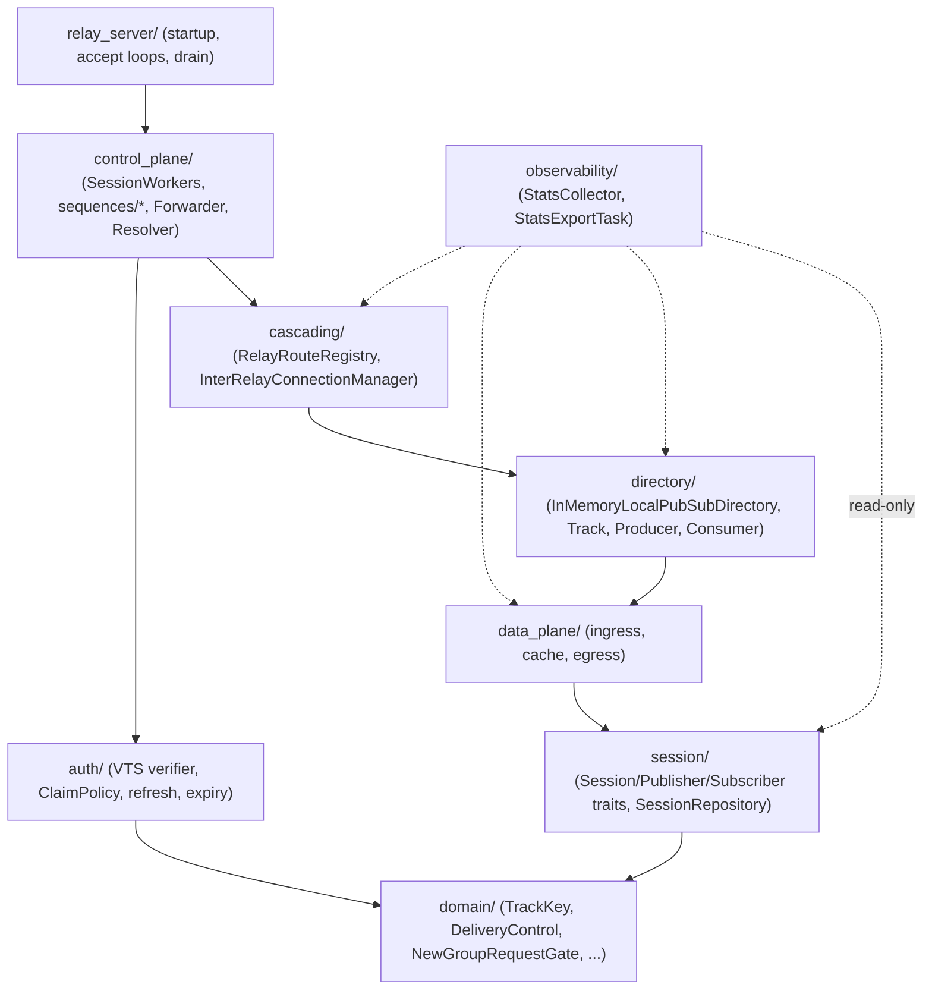
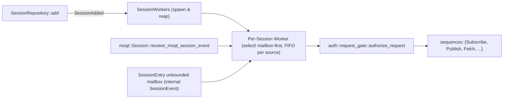

# `relay` Architecture

## Status
Living document. Update alongside any change to design intent, module boundaries, runtime flow, or invariants.

## Scope
MoQT relay server (`draft-ietf-moq-transport-14` relay sections, plus `draft-18` interoperability via `moqt`). Fans publisher tracks out to subscribers, caches objects in memory (and optionally on disk), serves `FETCH` from cache or upstream, and cascades across relays via a Redis route registry.

**Jump to:** [Layout & Startup](#module-layout--startup) · [Shutdown](#shutdown-drain--goaway) · [Control Plane](#control-plane--event-pipeline) · [Message Sequences](#message-sequences) · [Auth](#authentication--authorization-modulesauth) · [Data Plane](#data-plane-ingress-cache-egress) · [Cross-Version](#relaying-across-versions) · [Cascading](#cascading-relays-modulescascading) · [Observability](#observability-modulesobservability) · [Invariants](#key-invariants-design-direction--testing)

## Module Layout & Startup

| Directory | Holds |
| --- | --- |
| `relay_server/` | Startup, transport accept loops (`SessionHandler`), `SessionIntake`, graceful drain |
| `modules/session/` | Relay-side `Session`/`Publisher`/`Subscriber`/handler traits (implemented by `moqt` and test mocks), `SessionRepository`, `SessionEvent` |
| `modules/domain/` | Shared vocabulary: `TrackKey`, `SessionId`, `SessionPeer`, `DeliveryControl`, `DeliveryStats`, `NewGroupRequestGate`, `PublishDoneReason`, `DownstreamRunnerSignals` |
| `modules/directory/` | `InMemoryLocalPubSubDirectory` (namespace tables, tracks, consumer index) and `Track` (`Producer`s + `Consumer`s) |
| `modules/auth/` | Token verification, claim checks, request gate, in-session refresh, expiry task |
| `modules/control_plane/` | `SessionWorkers`, per-session `SessionWorker`, `sequences/*`, `ControlMessageForwarder`, `UpstreamPublisherResolver`, `PendingProducerTask` |
| `modules/data_plane/` | `ingress/` (`IngestTask`), `cache/` (`TrackCacheStore`, `TrackCache`, disk cache), `egress/` (`EgressTask`, `FetchDeliveryTask`) |
| `modules/cascading/` | `RelayRouteRegistry` (Redis / no-op), `NamespaceRoutes`, `WatchedNamespaceRoutes`, `InterRelayConnectionManager` |
| `modules/observability/` | `StatsCollector`, `StatsExportTask` (1 Hz OTLP snapshot + process gauges) |
| `modules/test_support/` | `cfg(test)` mocks, `RelayHarness`, scripted peer harness |

### Startup Path (`main.rs` & `RelayServer`)
1. `init_logging` (`crates/telemetry-otlp`).
2. Generate self-signed certs under `RELAY_CERT_DIR` (default `services/relay/keys/`) if missing.
3. Parse `RelayConfig::from_env()` (data plane reads no env vars directly—everything flows via `DataPlaneConfig`):

| Env var | Default / Required | Purpose |
| --- | --- | --- |
| `RELAY_ID`, `RELAY_ADVERTISE_HOST`, `RELAY_PUBLIC_HOST` | `public_host`: `localhost:RELAY_PORT` | Identity, inter-relay address, client-facing address |
| `RELAY_PORT` / `RELAY_INNER_PORT` | `4433` / `port + 1` | Client (`moqt::NATIVE`: QUIC + WebTransport + WSS) and inner (`moqt::QUIC`) ports |
| `RELAY_INNER_CA_FILE`, `REDIS_URL` | optional | Trusted CA for dialing relays; Redis route registry |
| `AUTH_VTS_URL`, `AUTH_RELAY_TOKEN` | **required** | VTS endpoint and relay JWT (no unauthenticated mode; anonymous clients still need VTS to reject bad tokens) |
| `AUTH_MAX_TOKEN_TTL_SECONDS`, `AUTH_CLOCK_LEEWAY_SECONDS` | `86400` / `60` | `ClaimPolicy` applied to client tokens |
| `RELAY_MOQT_VERSIONS` | `draft-18,draft-14` | Draft preference order on both transports |
| `RELAY_CACHE_TTL_SECS`, `RELAY_CACHE_EVICT_INTERVAL_SECS`, `RELAY_DISK_CACHE_DIR`, `RELAY_DISK_CACHE_BYTES`, `MOQT_FETCH_FILL_TIMEOUT_SECS` | `60` / `5` / off / — / `20` | Cache retention, eviction cadence, disk spill, FETCH fill cap |

4. `RelayServer::new_with_config` starts `SessionRepository` (shared `Arc<Mutex<_>>` emitting `SessionAdded` per session), `RelayRuntime` (`TrackCacheStore`, directory, `InterRelayConnectionManager`, `UpstreamPublisherResolver`, `SessionWorkers`, cache eviction job), both transports, and `StatsExportTask` (when OTLP is on).

## Shutdown (Drain & GOAWAY)
Implements draft-14 §3.5 (`relay_server/drain.rs`). On first `SIGINT`/`SIGTERM` (second signal exits immediately):
1. Stop the client accept loop (`SessionHandler::stop_accepting`, keeping inner transport open) and mark the relay `draining` in Redis so peers stop routing new subscriptions or migrations here.
2. Pick migration target: `public_host` of the `active` peer relay with fewest `client_sessions` (lowest ID tie-break), or empty URI if none.
3. Send `GOAWAY` to all `SessionPeer::Client` sessions with target URI in the client's `Session::url_scheme` (`moqt://`, `https://`, `wss://`), and empty-URI `GOAWAY` to relay-peer sessions (not waited on; peers switch to alternate publishers).
4. Release `PUBLISH`-initiated upstream subscriptions like `SUBSCRIBE`-initiated ones (draft-22 §6.6.1): unwatched publishes unsubscribe immediately (`ReleaseUnwatchedPublishes`), rest unsubscribe as the last downstream subscriber leaves.
5. Wait on `SessionRepository::client_session_count == 0` up to `RELAY_DRAIN_TIMEOUT_SECS`, then close remaining clients with `GOAWAY_TIMEOUT` (§3.5) and wait ≤ 3 s (`wait_idle`) to flush `CONNECTION_CLOSE`.

## Control Plane & Event Pipeline

### Session Intake (`relay_server/session_handler.rs`)
Each accepted connection runs in a per-connection `SessionIntake` task:
1. Await `Accepting` → `Handshake` (`CLIENT_SETUP` received).
2. `SessionAuthenticator::authenticate` extracts the JWT, calls `TokenVerifier`, and enforces `is_relay` matches the port (`false` on client, `true` on inner). Tokenless client connections become `VerifiedToken::anonymous()` (`anon/**`); tokenless inner connections are rejected. Rejects call `Handshake::reject` with `UNAUTHORIZED` or `INTERNAL_ERROR` (VTS down).
3. `Handshake::accept(&session_span)` sends `SERVER_SETUP` under `relay.session.setup` (continuing client's `moqt.session.connect` trace if present; `relay.vts.verify` is its child; links to root `relay.session` span so setup closes immediately).
4. Adds `SessionEntry` to `SessionRepository` (recording `peer_relay_id` on relay spans; upstream forwarded requests record `upstream_relay_id`/`upstream_request_id`).
5. For client tokens with `exp`, starts `SessionExpiryTask` closing with `EXPIRED_AUTH_TOKEN (0x18)` at expiry. Outbound inter-relay sessions use `VerifiedToken::full_access()` and never expire.

### Token refresh
Draft-14 has no token-renewal message, so the relay repurposes `TRACK_STATUS` carrying an `AUTHORIZATION TOKEN` parameter (convention: namespace `[app_id]`, track `update_auth_token`; relay reads neither). `auth::token_refresh::refresh_token`:
- Verifies token via `TokenVerifier`; requires a client session, non-relay token, and matching `app_id`.
- On success: `SessionRepository::replace_verified_token` swaps the token and restarts `SessionExpiryTask`, replying `TRACK_STATUS_OK` (Track Alias `0`, `content_exists: false`). Applies to future requests only (existing subscriptions stay up).
- On failure (keeps current token): `NOT_SUPPORTED (0x3)` (inter-relay), `MALFORMED_AUTH_TOKEN (0x10)` (bad alias/type/UTF-8), `UNAUTHORIZED (0x1)` (rejected/relay/app mismatch), `INTERNAL_ERROR (0x0)` (VTS down). `AUTHORIZATION TOKEN` on other messages is ignored.

### Event pipeline

- **Isolation & ordering**: Each worker reads only its own session (no cross-session head-of-line blocking) and awaits each sequence serially—except upstream `FETCH` (`UpstreamFetchTask`), forwarded `PUBLISH_NAMESPACE` replies (`PublishNamespaceResponseTask`), and forwarded `PUBLISH` (`DownstreamPublishTask`), which run asynchronously so slow peers cannot stall the session.
- **Authorization gate (`authorize_request`)**: Reads current `VerifiedToken` per event. `PUBLISH`/`PUBLISH_NAMESPACE`/`PUBLISH_NAMESPACE_DONE` require `publish`; `SUBSCRIBE`/`SUBSCRIBE_NAMESPACE`/standalone `FETCH`/status-query `TRACK_STATUS` require `subscribe`; token-refresh `TRACK_STATUS`, joining `FETCH`, and follow-ups pass through. Denied requests get `*_ERROR(UNAUTHORIZED)` (or logged+dropped for `PUBLISH_NAMESPACE_DONE`).
- **Span topology**: Per-request spans (`relay.subscribe`, `relay.publish`, …) continue incoming `TRACE_CONTEXT` (propagated upstream so browser → relay-2 → relay-1 is one trace) and link to `relay.session`. Long-lived spans (`relay.dataplane.egress.track`, `relay.upstream.ingress`, `relay.inter_relay.session`) root their own trace and link back without retaining the request `Span` handle.
- **Internal mailbox events**: `UpstreamForwardChanged`, `MalformedTrackDetected` (`MalformedTrackCleanup` removes all `Producer`s and sends `UNSUBSCRIBE` per §2.5), `ProtocolViolationDetected` (closes session with `PROTOCOL_VIOLATION`), `GoAwaySent`, `DownstreamSubscriptionEnded`. Dropping a departed session's mailbox drops late internal events safely.
- **Terminal cleanup (`cleanup_session`)**: Removes session from `SessionRepository` *first* (closing the race with concurrent `PendingProducerTask` via `end_if_publisher_gone`), removes directory entries (stopping egress runners and sending `PUBLISH_DONE(TRACK_ENDED)` on orphaned tracks), stops ingress, sends released upstream `UNSUBSCRIBE`s, and reconciles client namespace routes / notifies local namespace subscribers if a relay was last publisher.

### Directory & `Track` Model (`modules/directory`)
- **`InMemoryLocalPubSubDirectory`**: Tracks `/`-joined namespaces (field-wise `namespace_has_prefix`, safe because `authorize` rejects `/` inside elements), per-(session, request_id) namespace publications (client vs. relay for split horizon), `NamespaceSubscription`s keyed by `(session, NamespaceInterest)`, and `Track`s.
- **`Track` & `TrackEntry`**: Holds `Producer`s (each owning `moqt::Subscription` + `IngestTask`), `Consumer`s (each owning stop `oneshot<PublishDoneReason>`, `DeliveryControl` watch, `DeliveryStats`), `CreationState` (`Creating` / `Created` / `Failed`), subscriber `TrackReservation`s, and pending forwarded `PUBLISH`es. Dropping a `Producer`/`Consumer` stops its task. Every `Track` instance carries a generation (`TrackEntry`) so late callbacks from a removed track never attach to a recreated one.

## Message Sequences

### `SUBSCRIBE` Sequence
1. **Find or create (`track_or_begin_creation`)**: Returns `Ready`, `Creating` (await watch), or `Started`. On `Started`, resolves publishers via `UpstreamPublisherResolver` (local clients newest-first; for client `SUBSCRIBE`s, also remote `active` relays from Redis) and spawns one `PendingProducerTask` per publisher (3 s inter-relay dial timeout; skips already-feeding/subscribing publishers). First `SUBSCRIBE_OK` starts ingest and completes creation; fails only if every publisher fails.
2. **Largest Object**: `max(upstream SUBSCRIBE_OK largest, TrackCache largest)` so rejoined publishers never advertise `contentExists=false` over cached data.
3. **Register & start egress**: Atomically registers consumer against active track, starts `EgressTask`, awaits runner readiness, then replies `SUBSCRIBE_OK` (retrying from step 1 up to 3× if concurrent cleanup removed the track before readiness).

*Late-joining publishers (§8.4)*: After answering `PUBLISH_NAMESPACE` (from client, or from relay for client-watched tracks), the relay spawns `PendingProducerTask`s to subscribe that publisher for all active watched tracks under the namespace.

### `PUBLISH` Sequence
1. Register Redis track-publisher route (client-origin only).
2. Start ingest and add `Producer` of origin `Publish` (survives with 0 consumers; replaces any `Subscribe` producer of the same publisher).
3. Fan out `DownstreamPublishTask` to local `SUBSCRIBE_TRACKS` subscribers (respecting draft-18 self-echo exclusion §6.1 and `PublishBlocked` refusal) and remote subscriber relays (preserving on-demand Forward State). Each accepted `PUBLISH_OK` registers a normal downstream `Consumer` starting at `PUBLISH_OK`'s Forward State.
4. Reply `PUBLISH_OK` with desired upstream Forward State.

### SUBSCRIBE_NAMESPACE sequence
Handles both draft-14 `SUBSCRIBE_NAMESPACE` and draft-18 `SUBSCRIBE_NAMESPACE` / `SUBSCRIBE_TRACKS`:
- Rejects overlapping prefixes within the same interest (`PREFIX_OVERLAP`, §9.28 / §10.18–10.19).
- Registers prefix (reconciling the prefix's Redis route for client subscribers; a failed registration rolls back the subscription and replies `SUBSCRIBE_NAMESPACE_ERROR`), replies `SUBSCRIBE_NAMESPACE_OK` *first* (§9.28), then forwards existing matching namespaces (`PUBLISH_NAMESPACE`, deduplicated via `SessionRepository` per-session announcement set) or tracks (`DownstreamPublish`).
- **Remote relay namespaces**: For client namespace subscriptions, dials publishing relays and sends per-namespace `SUBSCRIBE_NAMESPACE` (`InterRelayConnectionManager::namespace_subscriptions`) so withdrawals travel on the request stream (required by draft-18 §10.17); cleaned up when the last client leaves.
- **Split horizon**: Relay `SUBSCRIBE_NAMESPACE` sees local clients only; relay-announced namespaces reach clients only.
- **Draft-18 prefix update (`SubscribeNamespaceUpdate`, §10.9.2)**: Authorizes new prefix, checks overlap (excluding self), registers new prefix, replies `REQUEST_OK`, releases old prefix, and announces only newly matched entries (existing subscriptions untouched). Refused/timed-out updates end the subscription.

### `SUBSCRIBE_UPDATE`, `NEW_GROUP_REQUEST` & Upstream Forward State
- **`SUBSCRIBE_UPDATE` / `REQUEST_UPDATE`**: Updates `DeliveryControl` watch (Subscriber Priority, Forward State, Start Location, End Group stored as exclusive `end + 1`). Widening Start/End closes draft-14 sessions with `PROTOCOL_VIOLATION` (§9.10) and is allowed on draft-18 (§10.9.1, restarting schedule past Largest Object). Draft-18 replies `REQUEST_OK(Largest Object)` (updating joining location on Forward 0→1 per §5.1); `UpdateAnswer::Failed` ends the subscription with `PUBLISH_DONE(UPDATE_FAILED)`.
- **`NEW_GROUP_REQUEST` (§10.2.13)**: `NewGroupRequestGate` on `Track` forwards to all `DYNAMIC_GROUPS` publishers unless (1) none support it, (2) requested group ≤ Largest Group, or (3) an equal/larger request is already outstanding for the current Largest Group.
- **Upstream Forward State**: Non-on-demand tracks stay Forward `1`. On-demand `PUBLISH`es (`Forward = 0`, §10.10) stay `1` iff at least one served downstream subscriber is in Forward `1` (split horizon applies); transitions dispatch via `SessionEvent::UpstreamForwardChanged` and `send_forward_update` (non-blocking).

### `FETCH` Sequence & TRACK_STATUS sequence
- **`FETCH`**:
  - Joining FETCH validates in order: known request ID (`INVALID_JOINING_REQUEST_ID`) → draft rule (`FetchHandler::check_joining`: draft-14 LargestObject-only session close vs. draft-18 Forward=0 `INVALID_RANGE`) → non-empty track → valid range.
  - `start > Largest Object` returns `INVALID_RANGE` while live ingest runs.
  - If `resolve_fetch_range` covers the range in cache, replies `FETCH_OK` and spawns `FetchDeliveryTask`. Otherwise spawns `UpstreamFetchTask` (trying live producers newest-first, then resolved publishers), store-and-forwarding through `FetchIngest` bounded by `FillBudget` (`min(FILL_TIMEOUT, MOQT_FETCH_FILL_TIMEOUT_SECS)`). `FILL_TIMEOUT = 0` serves immediately from cache with unknown ranges marked (draft-18) or reset `INTERNAL_ERROR` (draft-14).
- **TRACK_STATUS sequence**: Answered solely from local `Track` state (newest producer's Expires + resolved Largest Location; `MALFORMED_TRACK` if latched; `NOT_SUPPORTED (0x3)` if unknown—never forwards upstream).

### GOAWAY sequence
Client `GOAWAY` is logged only. Relay-peer `GOAWAY` re-runs `UpstreamPublisherResolver` for every track that relay feeds (the draining relay is no longer `active` in Redis) and subscribes alternate publishers via `PendingProducerTask` so downstream subscribers survive the close.

## Authentication & Authorization (`modules/auth`)
- `VerifiedToken` (`app_id`, split `publish`/`subscribe` paths, `is_relay`, `expires_at`, `relay_id`).
- `authorize`: Rejects `/` inside tuple elements; checks `tuple[0] == app_id` (unless `is_relay`) and element-wise prefix match.
- `VtsTokenVerifier`: Calls `auth_token::VtsClient` (`POST {AUTH_VTS_URL}`, 3 s timeout, W3C trace context) under `relay.vts.verify`, then enforces `ClaimPolicy` via `SignedToken::check` (`401` → `Unauthorized`, other/transport → `Unavailable`).
- `anonymous_root`: Maps anonymous root `SUBSCRIBE_NAMESPACE` to `anon`.

## Data Plane (Ingress, Cache, Egress)

### Ingress (`modules/data_plane/ingress`)
- `IngestTask` (`read_track`, `stream_reader`, `datagram_reader`) ingests **every publisher** of a track into one `TrackCache` (draft-14 §8.2), deduplicating via §8.1.
- Each live subgroup holds an `OpenSubgroupGuard` (only FIN or EndOfGroup/EndOfTrack `finish`es it; drop marks it aborted so egress resets downstream). Among multiple publishers, a FIN covering from the earliest started object completes the subgroup for all. Reopening an aborted subgroup starts a new `SubgroupRun` past all cached objects. `SubgroupStart::ends_group` + clean FIN synthesizes an `EndOfGroup` object at `last_id + 1`.
- **Malformed latch (§2.5)**: Set in `TrackCache` on conflicting insert, `moqt` `MalformedTrackError`, or upstream `MALFORMED_TRACK` refusal (`refused_as_malformed`). Triggers `MalformedTrackCleanup` upstream, `PUBLISH_DONE(MALFORMED_TRACK)` downstream, and immediate `MALFORMED_TRACK` (`INTERNAL_ERROR` on draft-14 `SUBSCRIBE`/`TRACK_STATUS`) for new requests for the full cache TTL even if empty.

### Cache (`modules/data_plane/cache`)
- **`TrackCache`**: `RwLock` (never held across `.await`) over `objects: BTreeMap<Location, Arc<CachedObject>>`, `open_subgroups` (epoch-guarded), `KnownRanges` (`LocationCursor`, supporting `u64::MAX`), `partial_objects` (cut-through arriving objects; 10 s `STALLED_PAYLOAD_TIMEOUT` while mid-payload), a `Notify`, and a 256-slot `SubgroupRun` broadcast channel.
- **Knowledge & `resolve_fetch_range`**: Live inserts mark only received locations; closing the last open subgroup marks its tail past `LiveGroup` max; fetch fills mark received range minus `UnknownRange`. `resolve_fetch_range` returns `NotCovered` (sending FETCH upstream before `FETCH_OK`) unless live ingest is active, object 0 of every group is known, and every partial group still has an open subgroup (and no object in range is expired).
- **Eviction (`eviction_job.rs`, `EvictionQueues`)**: Runs every 5 s (`RELAY_CACHE_EVICT_INTERVAL_SECS`), visiting only indexed candidates (memory TTL 60 s, `MAX_CACHE_DURATION` capped at `RETENTION_LIMIT` 1 h, deleted disk segments—never full-track scan except end-of-broadcast purge). Keeps live track's newest object past TTL for `Content Exists` (unless `MAX_CACHE_DURATION` expired). Caps tracked subgroups per group at `MAX_SUBGROUPS_PER_GROUP` (1,024).
- **Track properties**: Forwarded whole and unchanged from the newest live publisher (or last cached set after publishers leave, draft-18 §2.5).
- **Disk cache (`RELAY_DISK_CACHE_DIR`)**: Client-origin tracks spill payloads asynchronously via `DiskCacheTask` into 60 s `<n>.seg` files (up to `RETENTION_LIMIT` / `RELAY_DISK_CACHE_BYTES`). Memory TTL drops in-memory payload bytes while retaining the index; `publisher_left` purges track objects and segments 10 s after the last publisher departs. Ephemeral across restarts (deletes `*.seg` on startup).

### Egress (`modules/data_plane/egress`)
- **`EgressRunner`**: Lives strictly as long as its `Consumer` (dropping stop `oneshot` stops cleanly; sending `PublishDoneReason` sends `PUBLISH_DONE` after all streams finish and after `SUBSCRIBE_OK`).
- **`EgressScheduler`**: Subscribes to `SubgroupRun` channel, scans cached groups ≥ Start Location (clamped past Largest, respecting `GroupOrder` and `EndGroup`), skips Forward `0` (restarting schedule past Largest on Forward `0→1` or draft-18 Start widen), and exits on `EndGroupReached` (sending `PUBLISH_DONE(SUBSCRIPTION_ENDED)` + `DownstreamSubscriptionEnded`).
- **`GroupSender`**: Max `MAX_CONCURRENT_SEND_TASKS` (256) per subscription. Opens stream lazily on first object, forwards partial arriving objects cut-through, sets `StreamPriority` before header and updates it while open/unacknowledged (`GroupPositions` ensures fair round-robin across equal-priority subscriptions). Enforces `STREAM_CREDIT_TIMEOUT` (10 s) and per-object `DELIVERY TIMEOUT` (resetting with `DELIVERY_TIMEOUT` before open, during write, or before FIN ACK).
- **`FetchDeliveryTask`**: Streams `FetchCursor` objects immediately as groups become known; respects `FillBudget` (`FetchWait::{Never, Until, Unlimited}`), marking unknown gaps with draft-18 `End of Unknown Range` or resetting with `UNKNOWN_OBJECT_STATUS` / `INTERNAL_ERROR`.

## Relaying across versions
With `RELAY_MOQT_VERSIONS=draft-14,draft-18`, peers of both drafts share tracks transparently:
- **Mandatory Track Properties**: Refused at receipt by `moqt` (`UNSUPPORTED_EXTENSION`, mapped to `NOT_SUPPORTED` for draft-14); cached checks use `SubscribeHandler::understands` / `FetchHandler::understands`.
- **Single-preference conversion for draft-14**: `TrackCache::fix_single_preference` locks a draft-14 session's first scheduled preference for the track (consistent across live + FETCH to avoid `ObjectLedger` conflicts). Stream-locked sessions wrap datagrams as single-object streams on reserved Subgroup ID `2^61 + object_id` (`≥ 2^61` dropped); datagram-locked sessions send stream objects as datagrams (oversized dropped & counted in `datagrams_dropped`).
- **Draft-18 values ≥ 2^62 (`UnencodableObject`)**: Extension header → reset subgroup stream and resume on new stream (or drop datagram); Group/Object ID → reset + end subscription with `PUBLISH_DONE(INTERNAL_ERROR)`; Subgroup ID → reset subgroup; FETCH → reset `INTERNAL_ERROR`.
- **Cascading**: Inner endpoints negotiate `RELAY_MOQT_VERSIONS`, preserving draft-18 properties/mixed preferences across draft-18 relays.

## Cascading relays (`modules/cascading`)
- **`RelayRouteRegistry`**: `NoopRelayRouteRegistry` (standalone) or `RedisRelayRouteRegistry` (15 s TTL, 5 s heartbeat re-registering local routes, `relay:<RELAY_ID>` hash with `host:port`, `public_host`, `status: active|draining`, `client_sessions`).
- **Client-origin routes & reconciliation (`NamespaceRoutes`)**: `cascading/namespace_routes.rs` holds one lock per namespace and per prefix across registry calls (`reconcile_publisher` / `reconcile_subscriber`), deriving Redis state from the directory so crossing withdrawals and new requests converge (checked by `docs/architecture/relay/models/namespace.qnt`). `PUBLISH_NAMESPACE`/`SUBSCRIBE_NAMESPACE` enters the directory first and answers OK only once reconcile succeeds (idempotent `upsert_route.lua`); failure rolls back, reconciles, and sends `PUBLISH_NAMESPACE_DONE` / `SUBSCRIBE_NAMESPACE_ERROR`. Remote subscriber relays receive `PUBLISH_NAMESPACE_DONE` only when reconcile withdraws the publisher route. Also maintains track-publisher routes (`route:publisher:track:<ns>:<name>`) for `PUBLISH`-only tracks and `WatchedNamespaceRoutes` (reconciled every 5 s by `WatchedNamespaceJob`; dropped after 2 empty passes).
- **Split horizon**: Relay `SUBSCRIBE`/`FETCH` resolves to local clients only; inter-relay subscriptions release when the last client leaves; never loops between two relays.
- **`InterRelayConnectionManager`**: Lazily dials remote `inner_port` over `moqt::QUIC` (single-flight per relay, verified against `RELAY_INNER_CA_FILE` or OS roots matching `RELAY_ADVERTISE_HOST`), authenticates with `AUTH_RELAY_TOKEN`, and reuses the session for both `SUBSCRIBE`s and cascaded `DownstreamPublish`es.

## Observability (`modules/observability`)
- **`StatsExportTask`** (OTLP on): Emits 1 Hz `RelaySnapshot` (`relay.stats.snapshot` via `EventLogger`) + `ProcessGauges` ([`observability/architecture.md`](../observability/architecture.md)). Reads control-plane locks so a deadlock drops the relay from live view.
- **`StatsCollector`**: Lock-free-across-await reads of `SessionRepository`, `InterRelayConnectionManager::dialed_relay_ids`, directory tracks/subscriptions, `IngressStats`, `DeliveryStats`, `TrackCacheStore::occupancy`, `client_session_count`, `draining_since_ms`, and Linux `/proc/self/status` `VmRSS`.
- **`RemoteAddressWatchTask`**: Runs on every session (1 Hz poll of `Session::transport_addresses`), logging `connection migrated` at `INFO` on NAT rebinding / QUIC migration (RFC 9000 §9).

## Key Invariants, Design Direction & Testing

### Key Invariants
- **No cross-session deadlocks**: Each worker reads only its own session; departed mailboxes drop late events; ledger `RwLock` is never held across `.await`.
- **Track & subscription consistency**: One `Producer` per `(track, publisher)`; `SUBSCRIBE_OK` Largest Location equals egress start; Start Location is a lower bound; every `Consumer` stops immediately on removal; ended upstreams always emit `PUBLISH_DONE` after `SUBSCRIBE_OK`.
- **Self-contained cache**: Identity is the `Location` key; `open_subgroups` RAII guards keep all waits bounded; eviction releases knowledge at exact evicted locations; `TrackCache` drops only when empty with `strong_count == 1` (and unlatched).
- **Client-scoped cascading & clean drain**: Redis routes and inter-relay subscriptions exist only for client demand (publisher/subscriber namespace routes match directory state whenever no reconcile is in flight; no 3-hop relay forwarding); draining relays wait for clients to migrate before closing at timeout with `GOAWAY_TIMEOUT`.

### Design Direction
Three aggregates (`Track`, `SessionEntry`, `TrackCache`) + two registries (`SessionRepository`, `InMemoryLocalPubSubDirectory`). Sequences are thin choreography; state transitions return effects performed outside locks (never sending control messages under a `Track` lock or inside `Drop`).

### Testing Conventions
Colocated unit tests (`#[cfg(test)]`), shared mocks/`RelayHarness` in `test_support/`, randomized property tests in `control_plane/tests/message_sequences.rs` (`scripted_session.rs`), and multi-process E2E suites in `tests/*-e2e/run.sh`.
