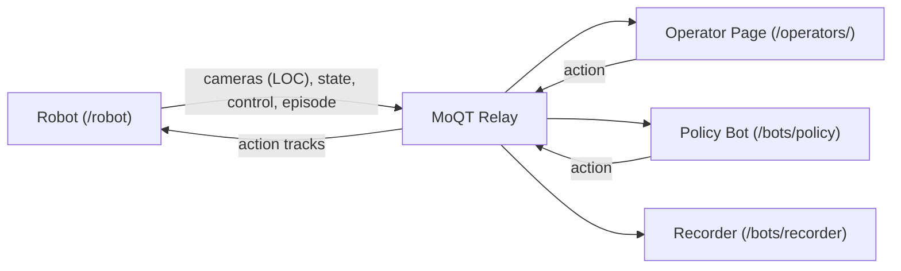
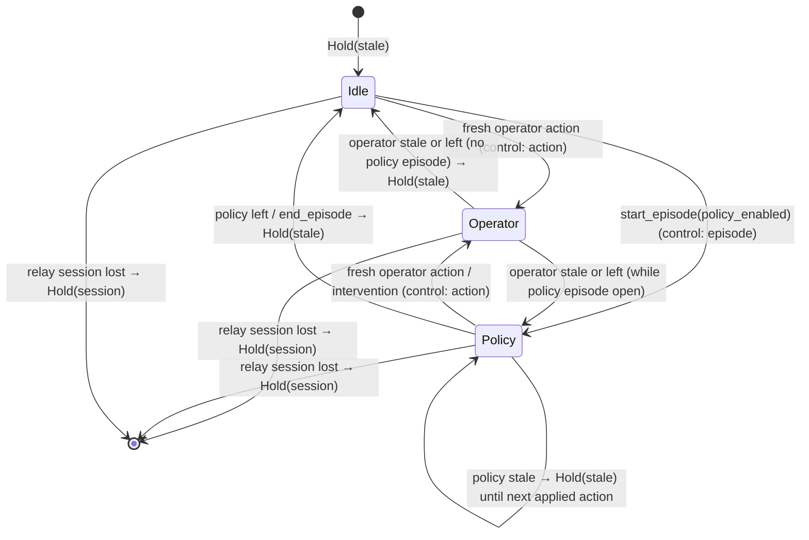

# Design: Robot Teleoperation, Cloud Policies, and Data Collection over MoQT

## Status
Accepted (2026-11-20). See [Not Implemented Yet](#not-implemented-yet) for remaining work.

## Scope
`crates/robotics` defines the MoQT contract between a robot, human operators, and cloud policies.

Touches:
- `crates/moqt`: per-track Publisher Priority on `TrackWriter`.
- SDKs: Rust (`moq_wasm::robotics`, [`moq-wasm/sdk.md`](../moq-wasm/sdk.md)), Python (robot/policy), Browser (operator).
- `services/recorder`: archives robot room event timelines.
- `services/bot-dispatcher`: upcoming `policy` bot type.
- Exporters (upcoming): LeRobot datasets, then MCAP.

Teleoperation (demonstration), policy execution (rollout), and human takeover (intervention) all use the **same tracks**, differing only in the active driver. Out of scope: policy model internals, low-level motion control, physical safety beyond hold-on-stop, multi-robot rooms, point clouds, and ROS 2 bridge.

## Context
The repo already provides MSF catalogs, wall-clock LOC video, MSF event timelines, per-subscription priority/`DELIVERY TIMEOUT`, joining FETCH, per-room bots (`bot-dispatcher`), and `format: "moq"` archive/VOD replay (`recorder`). `crates/robotics` adds the shared Rust contract (wrapped by SDKs) for tracks, action freshness, arbitration, dead-man safety, and dataset export.

## Decision

### Topology & Auth



- One robot per room (`<room>/robot`). Operators publish `<room>/operators/<operator_id>`; policy publishes `<room>/bots/policy` ([`bot-dispatcher/architecture.md`](../bot-dispatcher/architecture.md)).
- The relay enforces token `publish` prefixes, so the robot trusts the **namespace** of an action track (never a field inside the payload). Tokens: robot gets `publish: <room>/robot`, `subscribe: <room>`; each operator gets `publish: <room>/operators/<operator_id>`.

### Tracks & Record Schemas
Non-media tracks are MSF event timelines (draft-ietf-moq-msf-02 §8) indexed by wallclock `T` (ms on robot clock unless noted), with `eventType` `io.skyway.research.moqt.robotics.<track>.v1` (§5.2.6). Cameras use standard media sources (`add_media_source` / `addSource`) so `LivePlayer` and `recorder` handle them unchanged.

| Broadcast | Track | Packaging | Groups | Content |
| --- | --- | --- | --- | --- |
| robot | `camera_<name>` | `loc` | 1 per keyframe | Video with robot wall-clock LOC Timestamp |
| robot | `state` | `eventtimeline` | 1 per record | Joint positions, velocities, gripper, … per tick |
| robot | `control` | `eventtimeline` | 1 per record | Active driver and transition reason |
| robot | `episode` | `eventtimeline` | 1 per episode | Start/task instruction → end/success (incremental §8.4) |
| operator / policy | `action` | `eventtimeline` | 1 per record | Action chunk + observation `basis` |

`state`, `control`, and `action` use 1-object groups (§8.4): late subscribers read the latest value via joining FETCH without periodic repeats, and readers drop groups with smaller Group IDs than already seen.

#### Record Shapes

| Track | Shape & rules |
| --- | --- |
| `state` | `{"T": 1763600000123, "data": {"seq": 4512, "joints": [...], "gripper": 0.8}}` (fields beyond `seq` are robot-defined and mapped by exporter config) |
| `action` | `{"T": 1763600000180, "data": {"seq": 77, "basis": 1763600000123, "dt_ms": 20, "actions": [[...]]}}` (`T` = sender clock, informational only; `basis` = max of newest `state.T` and displayed camera LOC Timestamp in ms; entry `i` targets `basis + (i + 1) × dt_ms`, stale entries skipped, chunk spans ≥ `max_action_age_ms`) |
| `control` | `{"T": …, "data": {"driver": "operators/alice" \| null, "reason": "action" \| "left" \| "stale" \| "episode"}}` |
| `episode` | First: `{"T": …, "data": {"event": "start", "id": 12, "task": "..."}}`; last: `{"T": …, "data": {"event": "end", "id": 12, "success": true}}` |

#### Clock-Sync-Free Freshness
Only the robot's clock judges freshness: `age = now - basis` measures full observation-to-arrival loop latency on the robot's own clock. Camera LOC Timestamps and `state` share the robot's clock, so subscribers align them without NTP/PTP.

### Arbitration & Dead-Man Safety
`robotics::Arbiter` is a pure, synchronous, I/O-free state machine driven by `robotics::Robot`. Defaults (starting points): `max_action_age = 300 ms`, `hold_timeout = 500 ms`.



- **Driver precedence**: Operators (`operators/<id>`) preempt policy (`bots/policy`); all other namespaces are ignored. An active operator blocks other operators until stale or `PUBLISH_NAMESPACE_DONE`. Policy drives when no operator is active and an episode is open with `policy_enabled`; `PUBLISH_NAMESPACE_DONE` disables policy until the next episode.
- **Freshness**: Accepted only when sender is eligible, `seq > last_seq` for that namespace, and `0 <= now - basis <= max_action_age`. Entries whose target time already passed are skipped; an empty remaining chunk is ignored (neither advances `seq` nor resets dead-man nor takes control). `PUBLISH_NAMESPACE_DONE` resets that namespace's `last_seq`.
- **Dead man**: No applied action for `hold_timeout` emits one `Hold(Stale)` (not repeated before an action applies) and publishes `control` (`stale`). Leaving with no fallback driver emits `Hold` immediately.
- **Session loss**: Immediately emits `Hold(Session)` (even if already holding for `stale`), clears drivers/episode/`seq`, and publishes no `control`.

#### Robot Runtime (`robotics::Robot`)
```rust
let robot = Robot::run(session, &broadcast, room, ArbiterConfig::default()).await?;
robot.publish_state(fields).await?;
let id = robot.start_episode(task, policy_enabled).await?;
robot.end_episode(success).await?;
while let Some(cmd) = robot.next_command().await { /* Apply { at_ms, values, driver } | Hold(reason) */ }
```

- Uses `broadcast` (`<room>/robot` on `RelayConnection::with_client_session`) to offer `state`, `control`, and `episode`, and watches `<room>` with one `SUBSCRIBE_NAMESPACE` (`Session::watch_tracks`, avoiding `NAMESPACE_PREFIX_OVERLAP` draft-14 §9.28).
- One task owns `Arbiter` and serializes namespace events, candidate records, episode calls, a periodic tick (`max(hold_timeout / 10, 50 ms)`), and session end. `publish_state` writes directly.
- Accepts candidate `action` `PUBLISH`es (with priority + `DELIVERY TIMEOUT = max_action_age`, starting from Largest Location via Standalone FETCH) and rejects other tracks; re-`PUBLISH` replaces the reader task; `PUBLISH_NAMESPACE_DONE` drops it (`Arbiter::left`).
- Episode IDs start at 1 per `Robot`; `start_episode` fails while open, `end_episode` fails while closed. Session end yields `Hold(Session)` then `None` (non-reusable).

### Priority, Delivery & Recording
Lower numeric priority goes first (draft-14 §7) so control never queues behind video:

| Track | Publisher Priority | Subscriber Priority (driver) | `DELIVERY TIMEOUT` |
| --- | --- | --- | --- |
| `action`, `control` | `0` | `0` | `max_action_age` |
| `state` | `32` | `32` | `max_action_age` (drivers); none (recorder) |
| `episode` | `64` | `64` | none |
| cameras | `128` | `128` | player default |

- **Streams over datagrams**: Streams prevent unrecovered uplink loss for the recorder while letting each subscriber pick its own `DELIVERY TIMEOUT`. Publisher Priority is set via `PublishTrackOptions.priority` (default `128`).
- **Recording & export**: Every broadcast lists its event timelines in its catalog so `recorder` (`format: "moq"`) archives cameras + timelines on one clock (`<room>/bots/policy` is recorded without counting as a human room-keeper). Start recording before opening episodes: `Robot` writes `control` at each episode start even if the driver is unchanged; incomplete episodes opened prior to recording are skipped by the exporter. The Python LeRobot exporter reads via `POST /recordings/{id}/publish` (FETCH), aligning frames by timestamp; MCAP follows later.

### Policy Bot, SDKs & Telemetry
- **Policy bot**: Uses `robotics::Driver` on `<room>/bots/policy`, subscribing to `state` (and cameras) and publishing `action` chunks with observation `basis`. `examples/rust/moq-robot-policy` runs standalone; `bot-dispatcher` integration needs a Rust bot-protocol client (like Python's `moq-bot-job`).
- **SDK wrappers**: Rust robot (`moq_wasm::robotics::run_robot`), Rust policy (`moq_wasm::robotics::offer_actions`), browser operator (`createBroadcast` + `eventTimelines` + `subscribeCurrentGroup`). Rust/Python read timelines via `RemoteBroadcast.event_timeline(name)` (joining FETCH + auto-resubscribe + priority/`DELIVERY TIMEOUT`).
- **Telemetry**: `INFO` on driver change (`control_reason`), holds (`hold_reason`: `stale`/`session`), and episode start/end (`episode_id`); `DEBUG` on applied-action `loop_latency_ms` (`now - basis`).

## Alternatives & Remaining Work

### Alternatives

| Alternative | Why rejected |
| --- | --- |
| Custom binary packaging | Violates MSF §5.2.4 packaging values and needs custom parsers everywhere; JSON handles hundreds of Hz today |
| Datagrams for `action`/`state` | Breaks per-subscriber reliability needed by `recorder` |
| Relay/service-side arbitration | Only the robot must safely stop when cut off, so arbitration lives on the robot |
| NTP/PTP clock sync | Unnecessary because `basis` keeps freshness on the robot's clock |
| Python-only crate | Robot code is often Rust; one Rust crate guarantees shared rules |
| Direct Rust archive reader for exporter | Duplicates archive parsing already served by recorder VOD replay |

### Not Implemented Yet
- `relay`: open higher-priority streams ahead of lower-priority ones waiting for credit (`docs/todos/high/relay-lower-priority-streams-block-higher-priority.md`).
- `bot-dispatcher` `policy` type + Rust bot-protocol client.
- Python SDK robotics wrapper.
- LeRobot exporter, MCAP export, and ROS 2 bridge.

### Open Questions
- VOD FETCH throughput for long recordings (governs dataset export speed).
