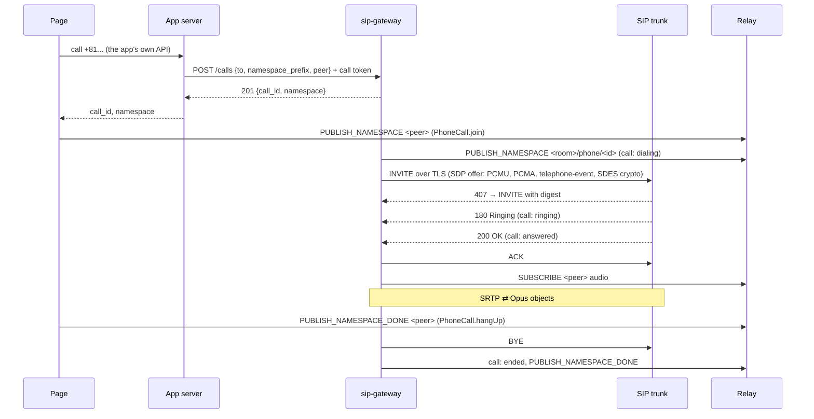

# Design: a SIP gateway that bridges phone calls into MoQT rooms

## Status
Proposed

## Date
2026-11-20

## Scope
A new service `services/sip-gateway` that places and answers telephone calls
through a SIP trunk and bridges each call's audio to a MoQT broadcast, and the
changes it brings to:

- `crates/broadcast`, which gains the reading side that `services/live-egress`
  keeps privately today (`BroadcastReader`).
- `crates/auth-token`, which gains the claim a call request carries.
- `crates/app-registry`, which gains the phone numbers of an app.
- The browser SDK (`crates/wasm/js`), which gains a call API.

A call connects one phone to one MoQT peer. Out of scope: video, more than one
peer per call (mixing a room's members into one phone leg), call transfer,
fax, emergency calling, and number provisioning.

## Context
A browser on the SDK can publish and play Opus audio through a relay, and the
services around it (`recorder`, the AI bots, `live-translate`) subscribe to a
room's broadcasts. A telephone cannot join: it speaks SIP and RTP with G.711.
Bridging one into a room makes a call recordable, translatable and answerable
by a bot with no change to those services, because the call is one more
broadcast in the room.

`rsipstack` provides the SIP side (RFC 3261 transactions and dialogs over
TLS, digest authentication for 401/407, re-INVITE). It does not carry media
and does not run session timers (RFC 4028): `Session-Expires` is only a
header to it.

## Decision

### Topology
```
Browser ──MoQT (Opus)──► Relay ◄──MoQT (Opus)── sip-gateway ──SIP/TLS + SRTP (G.711)──► SIP trunk ──► phone
                                                 ├ sip    : rsipstack (INVITE, BYE, CANCEL, digest auth)
                                                 ├ srtp   : rustrtc, one SDES-SRTP session per call
                                                 ├ codec  : Opus 48 kHz ⇄ G.711 8 kHz (GStreamer)
                                                 └ moqt   : one broadcast published, one subscribed, per call
```

A call is a room member. The gateway publishes the phone leg as the broadcast
`<room>/phone/<call_id>` with an MSF catalog, one Opus audio track and one
`call` track (below), and subscribes to the one broadcast the call is bridged
to (the *peer*): a broadcast the page publishes for this call alone, with its
microphone audio and a `dtmf` track. A page sees the phone appear and
leave with PUBLISH_NAMESPACE and PUBLISH_NAMESPACE_DONE, as it sees any
member.

### Who may call
A call costs money and an outbound call can be abused for toll fraud, so a
page never starts one. As with bots (docs/architecture/bot-dispatcher/architecture.md),
the app's server decides and calls the gateway with a short-lived token signed
with the app's secret, carrying one new claim:

| Claim | Meaning |
| --- | --- |
| `calls` | Relative namespace path under which the token may place, answer and end calls; absent means not allowed |

The gateway verifies the token through the VTS. The destination must match the
app's allowed number patterns in the registry; the gateway enforces a
per-app concurrent-call limit and a maximum call duration. The gateway joins
the relay with a client token it signs for the app (`Claims::issued`), scoped
to `publish: <room>/phone/<call_id>` and `subscribe: <peer>`.

### Outbound call


### Inbound call
An app registers its numbers (DIDs) in the registry with the URL of its call
webhook. On an INVITE to one of them the gateway answers `180 Ringing` and
calls the webhook with `{call_id, from, to}` signed with the app's secret. The
app server answers with the room and the peer to bridge to, or refuses. The
gateway then sends `200 OK`, or `486`/`603` on refusal and `480` when the
webhook does not answer within the ringing timeout. The app server hands
`call_id` and the namespace to the page through its own channel, and the page
joins with `PhoneCall.join`, as for an outbound call.

### Trunk
The target trunk is Twilio Elastic SIP Trunking with Secure Trunking on.
Until there is a Twilio account, a local Asterisk configured as Twilio
behaves stands in for it (below). What the gateway does follows from Twilio:

| Concern | Twilio | Gateway |
| --- | --- | --- |
| Authentication | no REGISTER; termination (our outbound calls) by IP ACL, credential list (digest on INVITE), or both | sends no REGISTER; answers a 401/407 on INVITE with the configured credentials |
| Inbound calls | Twilio sends the INVITE to the trunk's origination URI (`sips:<host>:5061;transport=tls`) | listens on a fixed public address; accepts INVITEs only from the configured signalling addresses |
| Codecs | PCMU, PCMA | offers both, PCMU first; the answer picks one |
| Security | Secure Trunking: SIP over TLS, SRTP keyed with SDES; unencrypted calls are refused | TLS (5061) only, SDES-SRTP only |
| DTMF | RFC 2833 / 4733 | `telephone-event` |

SRTP keys travel in the SDP (`a=crypto`, RFC 4568), so signalling is TLS
only: over UDP or TCP the keys would be readable on the wire. A peer that
answers without `a=crypto` is refused with `488`. The trunk's host, its
credentials and its signalling addresses are settings, so another trunk with
the same shape needs no code; REGISTER waits for a trunk that needs it.

### Local trunk
`tests/sip-gateway/` runs Asterisk (PJSIP) in a container as the trunk:

- a TLS transport on 5061 with a self-signed certificate the gateway trusts
  through a setting, and `media_encryption=sdes`;
- an endpoint for the gateway identified by its address and challenging its
  INVITEs with digest (Twilio's IP ACL plus credential list), with
  `allow=ulaw,alaw` and `dtmf_mode=rfc4733`;
- a dialplan that stands in for the phone network: one extension answers
  with `Echo()`, one plays a file and reads DTMF, one calls the gateway back
  (an inbound call).

The E2E test drives a page through `PhoneCall` against these extensions.

### The `call` track
A JSON object per state change, so a page shows the call's progress and a
late subscriber reads the current state from the latest object:

| Field | Meaning |
| --- | --- |
| `state` | `dialing`, `ringing`, `answered`, `ended` |
| `reason` | when `ended`: the SIP status or `hangup`, `timeout`, `limit` |

Call control stays an application protocol on ordinary MOQT objects; no call
semantics are added to MOQT, and the presence of a namespace never means
"ringing" by itself.

The page's `dtmf` track carries one object per digit, which the gateway sends
to the phone as RFC 4733 events. The page hangs up by ending its broadcast.

### Browser SDK
`moq-wasm/media` gains `PhoneCall`, which publishes the peer broadcast, plays
the phone's audio and reads the `call` track. A page never dials: it joins a
call its app server placed or accepted.

```ts
const call = await PhoneCall.join(session, {
  call: ['app', 'room', 'phone', callId], // the gateway's broadcast
  local: ['app', 'room', 'alice', 'call', callId], // the peer broadcast
  audio: microphoneTrack,
})
call.listen((state, reason) => {}) // dialing | ringing | answered | ended
call.sendDtmf('1')
await call.hangUp() // closes the peer broadcast
```

`PhoneCall` is built from `createBroadcast` and `RemoteBroadcast`; the
`dtmf` and `call` tracks need a JSON object track on both, which the chat
track (`offerChat`) is the precedent for.

### Media
- **Phone to MoQT.** Each RTP packet (20 ms) is decoded from G.711, resampled
  to 48 kHz and encoded to one Opus frame, published as one LOC object.
  `broadcast` builds the catalog and the track, as for `live-ingest`. The
  capture timestamp is the RTP time mapped to wall clock through RTCP sender
  reports when the trunk sends them, else arrival time.
- **MoQT to phone.** The peer's audio is read through the `BroadcastReader`
  moved into `broadcast`, decoded, resampled to 8 kHz, encoded to the codec
  the SDP answer chose, and sent every 20 ms from a playout buffer. While the
  buffer is empty the gateway sends comfort silence, so the trunk never sees a
  gap in RTP (some trunks hang up on RTP inactivity).
- **Transcoding** uses GStreamer (`opusdec`/`opusenc`, `audioresample`,
  `mulawenc`/`alawenc`), already in the workspace through `transcode` and
  `live-translate`.
- **Latency.** The audio is subscribed from the largest object with a short
  DELIVERY TIMEOUT, as `live-egress` does, and the playout buffer targets
  40-60 ms.

### Session timers and teardown
The gateway implements session timers (RFC 4028), which `rsipstack` leaves to
the application: it offers `Supported: timer`, accepts the interval the trunk
asks for (answering `422` with its minimum when the offer is shorter), and,
when it is the refresher, sends re-INVITE (or UPDATE) at half the interval. A
call whose refresh is not answered ends with BYE. A call ends on BYE from either
side, on the peer's PUBLISH_NAMESPACE_DONE, on RTP silence from the trunk for
30 s, at the maximum duration, and on SIGTERM (every call gets BYE first).

### Deployment
SIP and SRTP need inbound traffic on a stable public address that the trunk
allow-lists: a VM or GKE node with a static IP, signalling on 5061 (TLS) and
a UDP port range for SRTP. Cloud Run cannot receive them. The gateway should run in
the region of the relay it joins.

### Telemetry
New log fields, added to the vocabulary in `AGENTS.md` before use: `call_id`
(the gateway's id, also the namespace element), `sip_call_id` (the SIP
Call-ID, to join with the trunk's logs), `sip_status`, `direction`
(`inbound` / `outbound`). Each SIP request and final response the gateway
sends or receives is one INFO event.

## Alternatives
- **`mediapack::rtp` instead of `rustrtc`** (by the author of `rsipstack`):
  already in the workspace, but has no SRTP, jitter buffer or RFC 4733, which
  `rustrtc` brings with SDES keying.
- **DTLS-SRTP instead of SDES**: keys never appear in signalling, but SIP
  trunks rarely offer it.
- **Publishing G.711 into MoQT unchanged** (`mediapack` and `broadcast`
  already know `audio/pcma`): saves one transcode on the phone-to-MoQT side,
  but leaves PCMU unsupported and every subscriber (players, recorder,
  translation) to handle a second audio codec.
- **Ringing through MoQT** instead of the webhook: the gateway publishes the
  ringing call and a page answers in its own broadcast. Needs no app server
  for inbound calls, but leaves who may answer to whoever holds a room token.
- **pipecat's `SIPTransport` (baresip)**: unreleased, Python, and one call per
  transport; it suits a bot, not a gateway.

## Plan
Each step is its own pull request, stacked:

1. `broadcast`: move `BroadcastReader` from `live-egress` into the crate (lower
   layer, refactor only).
2. `auth-token` / `app-registry`: the `calls` claim, the app's numbers, number
   patterns and webhook URL.
3. `sip-gateway`: outbound calls against the local Asterisk over TLS and
   SDES-SRTP, with the ADRs for `rsipstack` and `rustrtc`.
4. `sip-gateway`: inbound calls and the webhook.
5. Browser SDK: the JSON object track, then `PhoneCall`.
6. An example page and an E2E test against a local PBX.

## Open questions
- Against Twilio once there is an account: the SRTP crypto suites it accepts,
  whether it asks for session timers, and its signalling and media address
  ranges for the allow-list.
