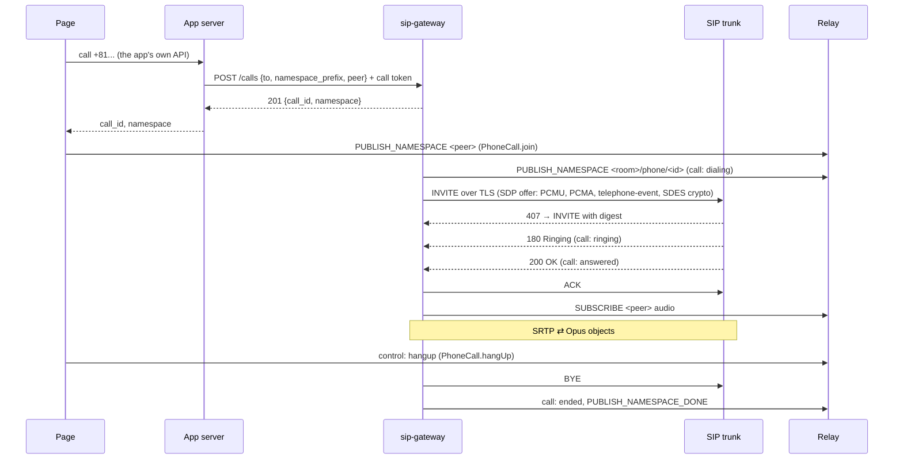

# Design: a SIP gateway that bridges phone calls into MoQT rooms

## Status
Proposed

## Date
2026-11-20

## Scope
A new service `services/sip-gateway` that places and answers telephone calls
through a SIP trunk and bridges each call's audio to a MoQT broadcast, and the
changes it brings to:

- `crates/broadcast`, which gains the reading side that `services/live-egress`
  keeps privately today (`BroadcastReader`).
- `crates/auth-token`, which gains the claim a call request carries.
- `crates/app-registry`, which gains the phone numbers of an app.
- The browser SDK (`sdk/js/js`), which gains a call API.

A call connects one phone to one MoQT peer. Out of scope: video, more than one
peer per call (mixing a room's members into one phone leg), call transfer,
fax, emergency calling, and number provisioning.

## Context
A browser on the SDK can publish and play Opus audio through a relay, and the
services around it (`recorder`, the AI bots, `live-translate`) subscribe to a
room's broadcasts. A telephone cannot join: it speaks SIP and RTP with G.711.
Bridging one into a room makes a call recordable, translatable and answerable
by a bot with no change to those services, because the call is one more
broadcast in the room.

`rsipstack` provides the SIP side (RFC 3261 transactions and dialogs over
TLS, digest authentication for 401/407, re-INVITE). It does not carry media
and does not run session timers (RFC 4028): `Session-Expires` is only a
header to it.

## Decision

### Topology
```
Browser ──MoQT (Opus)──► Relay ◄──MoQT (Opus)── sip-gateway ──SIP/TLS + SRTP (G.711)──► SIP trunk ──► phone
                                                 ├ sip    : rsipstack (INVITE, BYE, CANCEL, digest auth)
                                                 ├ srtp   : rustrtc, one SDES-SRTP session per call
                                                 ├ codec  : Opus 48 kHz ⇄ G.711 8 kHz (GStreamer)
                                                 └ moqt   : one broadcast published, one subscribed, per call
```

A call is a room member. The gateway publishes the phone leg as the broadcast
`<room>/phone/<call_id>` with an MSF catalog, one Opus audio track and one
`call` track (below), and subscribes to the one broadcast the call is bridged
to (the *peer*): a broadcast the page publishes for this call alone, with its
microphone audio and a `control` track. A page sees the phone appear and
leave with PUBLISH_NAMESPACE and PUBLISH_NAMESPACE_DONE, as it sees any
member.

### Who may call
A call costs money and an outbound call can be abused for toll fraud, so a
page never starts one. As with bots (docs/architecture/bot-dispatcher/architecture.md),
the app's server decides and calls the gateway with a short-lived token signed
with the app's secret, carrying one new claim:

| Claim | Meaning |
| --- | --- |
| `calls` | Relative namespace path under which the token may place, answer and end calls; absent means not allowed |

The gateway verifies the token through the VTS. The destination must be
E.164 and start with one of the app's `allowedDestinations` in the registry;
the gateway enforces a per-app concurrent-call limit and a maximum call
duration. The gateway joins the relay with a client token it signs for the
app (`Claims::issued`), scoped to `publish: <room>/phone/<call_id>` and
`subscribe: <peer>`, which outlives the maximum duration by five minutes. An
INVITE shows the app's first number as its caller, or `anonymous`.

`POST /calls` takes `{to, namespace_prefix, peer}`: `namespace_prefix` is the
room the `calls` claim must cover, and `peer` a broadcast in it (not under
`<room>/phone`). It answers `201 {call_id, namespace}` as soon as the call is
started, and refuses with:

| Status | `error` | When |
| --- | --- | --- |
| 400 | `invalid_request`, `invalid_destination`, `invalid_peer` | malformed body, `to` not E.164, `peer` outside the room |
| 401 | `invalid_token`, `invalid_token_lifetime` | the VTS refuses the token, or it lives longer than 5 minutes |
| 403 | `forbidden`, `destination_not_allowed` | no `calls` claim for the room or a relay's token; the app's phone settings do not allow `to` |
| 429 | `too_many_calls` | the app has its maximum of calls in progress |
| 503 | `vts_unavailable`, `registry_unavailable` | |

### Outbound call


### Inbound call
An app registers its numbers (DIDs) in the registry with the URL of its call
webhook. An INVITE from outside the trunk's signalling addresses gets `403`,
one to a number no app has `404`, and one for an app with its maximum of
calls in progress `486`. The gateway answers the offer first (`488` when it
is not SDES-SRTP with a G.711 codec), sends `180 Ringing`, and calls the
webhook:

```
POST <callWebhook>
Authorization: Bearer <JWT, HS256 with the app's secret:
                       {appId, callId, from, to, iat, exp = iat + 5 min}>
{"call_id": "...", "from": "+8190...", "to": "+8150..."}
```

`from` is the caller as the trunk shows it, or `anonymous`. The claims repeat
the body, so an app server that checks the token can trust them. The app
server answers within the ringing timeout (60 s), and may hold the request
while it rings its users:

| Answer | The gateway |
| --- | --- |
| `200 {"namespace_prefix": "<app>/<room>", "peer": "<a broadcast of the room>"}` | publishes `<room>/phone/<call_id>` with the state `ringing`, sends `200 OK` with its SDP answer, and `answered` on the ACK |
| `200 {"reject": "busy"}` / `200 {"reject": "decline"}` | `486` / `603` |
| no answer in time, another status, or another body | `480` |
| a room outside the app, or a peer outside the room | `500` |

A CANCEL from the trunk while the webhook is asked ends the call without a
broadcast. The app server hands `call_id` and the namespace to the page
through its own channel, and the page joins with `PhoneCall.join`, as for an
outbound call. From the `200 OK` on, an inbound call runs as an outbound one.

### Trunk
The target trunk is Twilio Elastic SIP Trunking with Secure Trunking on.
Until there is a Twilio account, a local Asterisk configured as Twilio
behaves stands in for it (below). What the gateway does follows from Twilio:

| Concern | Twilio | Gateway |
| --- | --- | --- |
| Authentication | no REGISTER; termination (our outbound calls) by IP ACL, credential list (digest on INVITE), or both | sends no REGISTER; answers a 401/407 on INVITE with the configured credentials |
| Inbound calls | Twilio sends the INVITE to the trunk's origination URI (`sips:<host>:5061;transport=tls`) | listens on a fixed public address; accepts INVITEs only from the configured signalling addresses |
| Codecs | PCMU, PCMA | offers both, PCMU first; the answer picks one |
| Security | Secure Trunking: SIP over TLS, SRTP keyed with SDES; unencrypted calls are refused | TLS (5061) only, SDES-SRTP only |
| DTMF | RFC 2833 / 4733 | `telephone-event` |

SRTP keys travel in the SDP (`a=crypto`, RFC 4568), so signalling is TLS
only: over UDP or TCP the keys would be readable on the wire. A peer that
answers without `a=crypto` is refused with `488`. The trunk's host, its
credentials and its signalling addresses are settings, so another trunk with
the same shape needs no code; REGISTER waits for a trunk that needs it.

### Local trunk
`tests/sip-gateway-e2e/` runs Asterisk (PJSIP, `andrius/asterisk:22-cert`)
in a container as the trunk:

- a TLS transport on 5061 with a certificate from a CA the run creates
  (rustls refuses a self-signed certificate as its own trust anchor), and
  `media_encryption=sdes`;
- an endpoint for the gateway identified by its address and challenging its
  INVITEs with digest (Twilio's IP ACL plus credential list), with
  `allow=ulaw,alaw` and `dtmf_mode=rfc4733`;
- a dialplan that stands in for the phone network: one number answers with
  `Echo()`, one plays a 1 kHz tone, one is busy, one hangs up two seconds
  after answering;
- an AOR for the gateway's listener on the host, so `channel originate`
  calls the app's number as a phone that echoes what it hears.

`run.sh` starts it with a VTS, a relay and the gateway, and a Rust client
acts as the page: it publishes a 700 Hz tone as the peer, checks the call's
states, hears the tone back from the echo, hangs up by closing its session,
and checks `486` and a hangup from the phone. It also serves the app's call
webhook: it has the trunk call the app's number, answers with the room,
hears its tone back, and declines a second call. Until `PhoneCall` exists the
client stands in for it; the browser E2E test replaces it in step 6.

### The `call` track
A JSON object per state change, each a group of its own whose stream ends at
once (`Broadcast::send_group`), so a page shows the call's progress, a late
subscriber reads the current state by joining the current group (a Joining
FETCH, `subscribe_current_group`), and `ended` reaches the relay although the
gateway closes its session right after: `moqt::Session::close` waits for the
peer to acknowledge the streams that ended:

| Field | Meaning |
| --- | --- |
| `state` | `dialing`, `ringing`, `answered`, `ended` |
| `reason` | when `ended`: the trunk's final status (`486`, …, or `488` for an answer without SDES-SRTP or G.711); `hangup` (BYE from the trunk, or the peer ended its broadcast); `timeout` (no answer within 60 s, or no audio from the trunk for 30 s); `limit` (the maximum duration); `gateway` (SIGTERM, or a failure of the gateway's own) |

Call control stays an application protocol on ordinary MOQT objects; no call
semantics are added to MOQT, and the presence of a namespace never means
"ringing" by itself.

The page's `control` track carries one JSON object per command, each a group
of its own: `{"event":"hangup"}`, and `{"event":"dtmf","digit":"1"}`, which
the gateway sends to the phone as an RFC 4733 event. The gateway reads it from
its current group on, so a `hangup` written before the gateway subscribed
still ends the call. The page hangs up with `hangup` rather than by ending
its broadcast: `LocalBroadcast` keeps its namespace announced until the
session closes, and a page's session carries its other broadcasts too. A
page whose session closes (the tab closed, or lost) ends its broadcast, and
the gateway hangs up on the PUBLISH_NAMESPACE_DONE.

### Browser SDK
`moq-wasm/media` gains `PhoneCall`, which publishes the peer broadcast, plays
the phone's audio and reads the `call` track. A page never dials: it joins a
call its app server placed or accepted.

```ts
const call = await PhoneCall.join(session, {
  call: ['app', 'room', 'phone', callId], // the gateway's broadcast
  local: ['app', 'room', 'alice', 'call', callId], // the peer broadcast
  audio: microphoneTrack,
})
call.listen((state, reason) => {}) // dialing | ringing | answered | ended
await call.sendDtmf('1')
await call.hangUp() // writes hangup on the control track
```

`PhoneCall` is built from `createBroadcast` (the microphone), `RemoteBroadcast`
(the phone's audio) and the core API: `publishTrack` and `writeGroup` for the
`control` track, `subscribeCurrentGroup` for the `call` track
(docs/architecture/wasm/browser-sdk.md).

### Media
- **Phone to MoQT.** Each RTP packet (20 ms) is decoded from G.711, resampled
  to 48 kHz and encoded to one Opus frame, published as one LOC object.
  `broadcast` builds the catalog and the track, as for `live-ingest`. The
  capture timestamp is the RTP time mapped to wall clock through RTCP sender
  reports when the trunk sends them, else arrival time.
- **MoQT to phone.** The peer's audio is read through the `BroadcastReader`
  moved into `broadcast`, decoded, resampled to 8 kHz, encoded to the codec
  the SDP answer chose, and sent every 20 ms from a playout buffer. While the
  buffer is empty the gateway sends comfort silence, so the trunk never sees a
  gap in RTP (some trunks hang up on RTP inactivity).
- **Transcoding** uses GStreamer (`opusdec`/`opusenc`, `audioresample`,
  `mulawenc`/`alawenc`), already in the workspace through `transcode` and
  `live-translate`.
- **Latency.** The audio is subscribed from the largest object with a short
  DELIVERY TIMEOUT, as `live-egress` does, and the playout buffer targets
  40-60 ms.

### Session timers and teardown
A call ends on BYE from either side, on the peer's `hangup` or
PUBLISH_NAMESPACE_DONE (also while it rings: the gateway sends CANCEL),
without an answer within 60 s, on RTP silence from the trunk for 30 s, at the
maximum duration, and on SIGTERM (every call gets BYE or CANCEL first, and the process waits for them).

Session timers (RFC 4028), which `rsipstack` leaves to the application, are
not implemented yet: a trunk that asks for them gets no refresh. When added,
the gateway offers `Supported: timer`, accepts the interval the trunk asks for
(answering `422` with its minimum when the offer is shorter), and, when it is
the refresher, sends re-INVITE (or UPDATE) at half the interval; a call whose
refresh is not answered ends with BYE.

### Modules
```
main.rs          settings from the environment, SIGTERM
server.rs        POST /calls, GET /healthz
call_auth.rs     the call token through the VTS, the app's phone settings
calls.rs         calls in progress, the per-app limit, the relay token,
                 answering the trunk's INVITEs
webhook.rs       the app's call webhook: its token, its decision
call.rs          one call: INVITE, answer, bridge, teardown
  state_track    the `call` track
  phone_audio    trunk audio → Opus → the broadcast's `audio` track
  peer_audio     the peer's broadcast → G.711 → one RTP packet per 20 ms
  peer_control   the peer's `control` track
sip_trunk.rs     rsipstack endpoint, TLS listener, INVITE, in-dialog requests,
                 INVITEs from the trunk's signalling addresses
  address_range  IP addresses and CIDR blocks
media/
  rtp_leg        rustrtc PeerConnection: SDP offer/answer, SRTP, RTP
  transcoder     GStreamer G.711 ⇄ Opus
  playout        the 40–120 ms buffer in front of the 20 ms RTP clock
  g711           PCMU/PCMA payload types, caps, silence
```

### Settings
| Variable | Meaning |
| --- | --- |
| `PORT` | HTTP port, 8099 by default |
| `SIP_GATEWAY_SIP_ADDRESS` / `SIP_GATEWAY_SIP_PUBLIC_ADDRESS` | the TLS listener (`0.0.0.0:5061` by default), and the address the trunk reaches it at, which is the Via and Contact of every request |
| `SIP_GATEWAY_TLS_CERT_FILE` / `SIP_GATEWAY_TLS_KEY_FILE` | the listener's PEM certificate chain and key |
| `SIP_GATEWAY_TRUNK_HOST` | `host[:port]` of the trunk's TLS signalling, also the host of every Request-URI |
| `SIP_GATEWAY_TRUNK_CA_FILE` | PEM roots the trunk's certificate is verified against |
| `SIP_GATEWAY_TRUNK_USERNAME` / `SIP_GATEWAY_TRUNK_PASSWORD` | digest credentials for 401/407 |
| `SIP_GATEWAY_TRUNK_SIGNALLING_ADDRESSES` | comma-separated IP addresses and CIDR blocks the trunk's INVITEs may come from; empty refuses every inbound call |
| `SIP_GATEWAY_MEDIA_ADDRESS` | the address the SDP offers for media, when it is not the bound one |
| `SIP_GATEWAY_RELAY_URL` / `SIP_GATEWAY_RELAY_INSECURE_SKIP_TLS_VERIFY` | the relay calls join |
| `SIP_GATEWAY_VTS_URL`, `SIP_GATEWAY_REGISTRY_FILE` or `SIP_GATEWAY_REGISTRY_BUCKET`/`_OBJECT` | call token verification and the apps' phone settings |
| `SIP_GATEWAY_INSECURE_SKIP_AUTH` | `true` accepts every request and destination and joins with no token (a relay without authorization only); with no registry, every inbound call gets `404` |
| `SIP_GATEWAY_MAX_CALLS_PER_APP` / `SIP_GATEWAY_MAX_CALL_SECONDS` | 2 and 3600 by default |

### Deployment
SIP and SRTP need inbound traffic on a stable public address that the trunk
allow-lists: a VM or GKE node with a static IP, signalling on 5061 (TLS) and
a UDP port range for SRTP. Cloud Run cannot receive them. The gateway should run in
the region of the relay it joins.

### Telemetry
New log fields, added to the vocabulary in `AGENTS.md`: `call_id` (the
gateway's id, also the namespace element and, for an outbound call, the SIP
Call-ID), `sip_call_id` (the SIP Call-ID, to join with the trunk's logs),
`sip_status`, `direction` (`inbound` / `outbound`), `call_end_reason` (the
`reason` of the `ended` state). Each SIP request and final response the
gateway sends or receives is one INFO event; `rsipstack`'s own logs stay at
WARN, since at INFO they carry every message whole, SRTP keys included.

## Alternatives
- **`mediapack::rtp` instead of `rustrtc`** (by the author of `rsipstack`):
  already in the workspace, but has no SRTP, jitter buffer or RFC 4733, which
  `rustrtc` brings with SDES keying.
- **DTLS-SRTP instead of SDES**: keys never appear in signalling, but SIP
  trunks rarely offer it.
- **Publishing G.711 into MoQT unchanged** (`mediapack` and `broadcast`
  already know `audio/pcma`): saves one transcode on the phone-to-MoQT side,
  but leaves PCMU unsupported and every subscriber (players, recorder,
  translation) to handle a second audio codec.
- **Ringing through MoQT** instead of the webhook: the gateway publishes the
  ringing call and a page answers in its own broadcast. Needs no app server
  for inbound calls, but leaves who may answer to whoever holds a room token.
- **pipecat's `SIPTransport` (baresip)**: unreleased, Python, and one call per
  transport; it suits a bot, not a gateway.

## Plan
Each step is its own pull request, stacked:

1. `broadcast`: move `BroadcastReader` from `live-egress` into the crate (lower
   layer, refactor only).
2. `auth-token` / `app-registry`: the `calls` claim, the app's numbers, number
   patterns and webhook URL.
3. `sip-gateway`: outbound calls against the local Asterisk over TLS and
   SDES-SRTP, with the ADRs for `rsipstack`, `rustrtc` and GStreamer.
4. `sip-gateway`: inbound calls and the webhook.
5. Browser SDK: `PhoneCall`, on the core API's track writer and joining
   SUBSCRIBE (no new track type).
6. `sip-gateway`: the page's `control` track and its `hangup`; then an example
   page and an E2E test against a local PBX.
7. `sip-gateway`: `dtmf` on the `control` track as RFC 4733 events, and
   session timers.

## Open questions
- Against Twilio once there is an account: the SRTP crypto suites it accepts,
  whether it asks for session timers, and its signalling and media address
  ranges for the allow-list.
